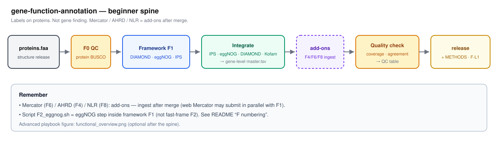
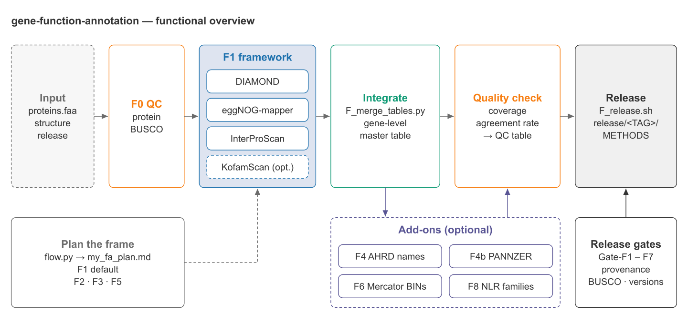

# gene-function-annotation
[中文](README.zh.md)

## Overview

This repository assigns functional labels such as names, GO/KEGG pathways, and domains to protein sequences after a structure release is available. It begins processing only after the structure pipeline outputs `proteins.faa`. It does not perform BRAKER, soft-masking, GFF editing, or gene finding. The upstream gene models are handled by [`gene-structure-annotation`](https://github.com/Xuzhen-Li/gene-structure-annotation). The boundary between structure and function is defined in [structure `docs/BOUNDARY.md`](https://github.com/Xuzhen-Li/gene-structure-annotation/blob/main/docs/BOUNDARY.md). TE soft-masking and TE library building are excluded from this functional pipeline.

Chinese teaching: [`docs/zh/`](docs/zh/) (what it is, relationship with structure, how to run, F pipelines)
English ops: [`docs/BILINGUAL.md`](docs/BILINGUAL.md)
Plant sims (3): [`examples/plant_sim/`](examples/plant_sim/) (paired with structure Vitis+NLR, Oryza plain F1, Solanum+Mercator)



The file `pipeline/F2_eggnog.sh` is the eggNOG step inside the default F1 framework, not the fast-frame branch F2.
Wiki Start-tonight: [Wiki Start-tonight](https://github.com/Xuzhen-Li/gene-function-annotation/wiki/Start-tonight) (GitHub Wiki, not in the clone).
Offline classroom: [`docs/CLASSROOM_TONIGHT.md`](docs/CLASSROOM_TONIGHT.md).
Track work: [Annotation board (Project #2)](https://github.com/users/Xuzhen-Li/projects/2).

## Concepts

1. Framework F1 / F2 / F3 / F5 denotes the whole annotation frame you claim. The default is F1, which includes DIAMOND, eggNOG, and IPS.
2. Script `F2_eggnog.sh` is the eggNOG step inside framework F1, not frame F2.
3. TOOLS F1a / F1b / F1c are literacy cards for the three F1 steps.
4. Gates such as `Gate-F1` are release hard checks, not a frame choice. Deep dive is at [`docs/zh/FAQ_入门.md`](docs/zh/FAQ_入门.md).

## Usage

You must already have proteins. If not, run the structure pipeline's `flow_tool` first to get the GFF and `proteins.faa`. Refer to [`docs/HANDOFF_STRUCTURE_TO_FUNCTION.md`](docs/HANDOFF_STRUCTURE_TO_FUNCTION.md).

Auto-plan the FA frame:

```bash
git clone https://github.com/Xuzhen-Li/gene-function-annotation.git
cd gene-function-annotation
cp pipeline/flow_tool/answers.example.yaml my_answers.yaml
# edit: prefer_fast? plant add-ons?
python3 pipeline/flow_tool/flow.py --answers my_answers.yaml -o my_fa_plan.md
```

For the initial setup, finish `my_fa_plan.md` and list DB disk paths. InterProScan is not required at this stage. Check concepts at [Wiki Concepts](https://github.com/Xuzhen-Li/gene-function-annotation/wiki/Concepts) or offline at [`docs/zh/02_和结构注释的关系.md`](docs/zh/02_和结构注释的关系.md). Write `grade=` and `status=` separately. Do not write `status=F-L1`.

For cluster execution, proceed only after the [Done when](https://github.com/Xuzhen-Li/gene-function-annotation/wiki/Start-tonight#done-when) checklist is completed and `python3 pipeline/print_qc_commands.py` exits 0 with no `[STOP]`. Otherwise do not set `RUN=1`. Browsing with `--env config/example.env` will show `[STOP]` as expected. Required fields in METHODS must be draftable per [Wiki Evaluate-release](https://github.com/Xuzhen-Li/gene-function-annotation/wiki/Evaluate-release).

Follow [`docs/INSTALL_FUNCTIONAL.md`](docs/INSTALL_FUNCTIONAL.md) and [`docs/DB_INSTALL_CHECKLIST.md`](docs/DB_INSTALL_CHECKLIST.md). Then set `RUN=1` for framework F1 and complete [`docs/EVALUATION_CHECKLIST.md`](docs/EVALUATION_CHECKLIST.md). F-L1 is the acceptance bar, not a requirement to finish IPS immediately.

```bash
cp config/example.env config/local.env
# set PROTEINS_FA to your structure release proteins (one representative per gene)
# set DIAMOND_DB, EGGNOG_*, INTERPROSCAN_HOME, BUSCO_LINEAGE_PROTEIN, …
```

<details>
<summary>Namespace details</summary>

Four namespaces exist and should remain distinct in METHODS.
Framework: F1 / F2 / F3 / F5 indicates the whole annotation frame. Default F1 is DIAMOND+eggNOG+IPS.
Script filenames: `F1_diamond.sh`, `F2_eggnog.sh`, `F3_interproscan.sh` are steps inside framework F1.
TOOLS cards: F1a / F1b / F1c map to the three literacy pages.
Gates: Gate-F1 to Gate-F7 are release hard checks covering provenance, BUSCO, versions, and row counts.

The Chinese reference is [`docs/zh/FAQ_入门.md`](docs/zh/FAQ_入门.md).
</details>

## Documentation

Chinese teaching and start guide: [`docs/zh/`](docs/zh/)
Start here: [`docs/START_HERE.md`](docs/START_HERE.md)

<details>
<summary>Additional documentation</summary>

Flow tool: [`pipeline/flow_tool/`](pipeline/flow_tool/)
Install: [`docs/INSTALL_FUNCTIONAL.md`](docs/INSTALL_FUNCTIONAL.md)
Install checklist: [`docs/DB_INSTALL_CHECKLIST.md`](docs/DB_INSTALL_CHECKLIST.md)
Evaluation checklist: [`docs/EVALUATION_CHECKLIST.md`](docs/EVALUATION_CHECKLIST.md)
After structure: [`docs/POST_STRUCTURE.md`](docs/POST_STRUCTURE.md)
Stage IO: [`docs/STAGE_IO.md`](docs/STAGE_IO.md)
Roadmap: [`docs/ROADMAP.md`](docs/ROADMAP.md)
Tool how-tos: [`docs/TOOLS.md`](docs/TOOLS.md)
Tool docs: [`docs/tools/`](docs/tools/)
Evaluation rules: [`docs/EVALUATION.md`](docs/EVALUATION.md)
QC methods and papers: [`docs/QUALITY_SOURCES.md`](docs/QUALITY_SOURCES.md)
Walkthrough: [`docs/QUICKSTART.md`](docs/QUICKSTART.md)
Mercator4 web: [`docs/MERCATOR_WHEN.md`](docs/MERCATOR_WHEN.md)
Tutorials: [`docs/TUTORIALS_AND_MEETINGS.md`](docs/TUTORIALS_AND_MEETINGS.md)
Recent high quality: [`docs/RECENT_HIGH_QUALITY.md`](docs/RECENT_HIGH_QUALITY.md)

</details>

<details>
<summary>Overview figure</summary>



</details>

Author: Xuzhen Li, [ORCID](https://orcid.org/0000-0003-3670-6657)