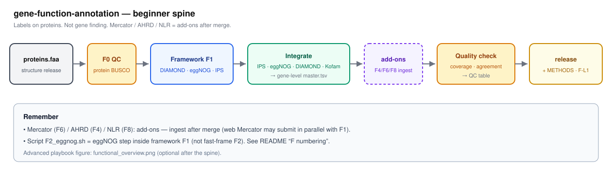
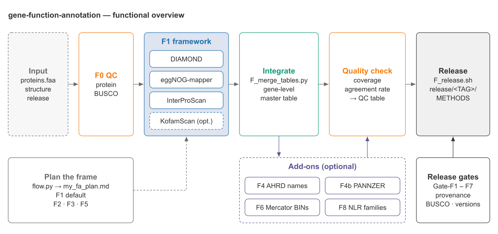
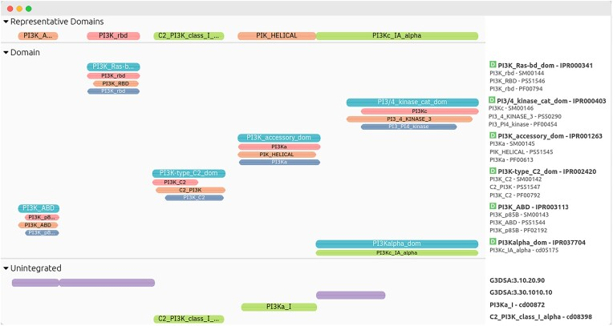
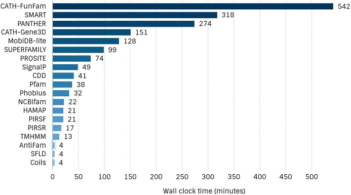
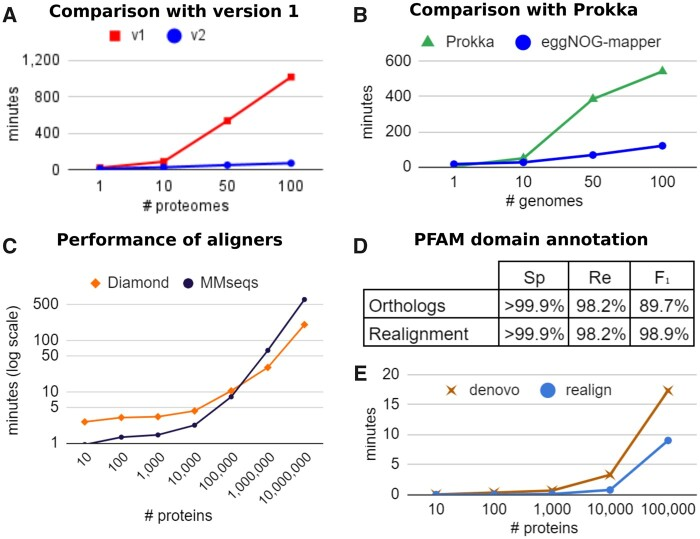
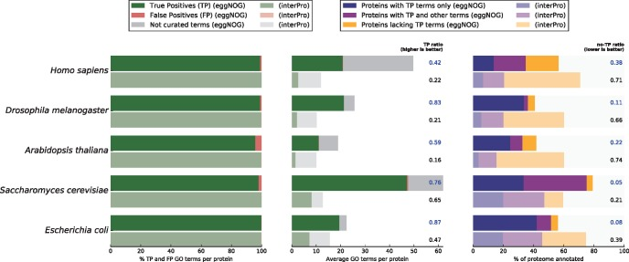
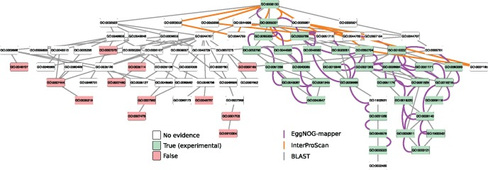
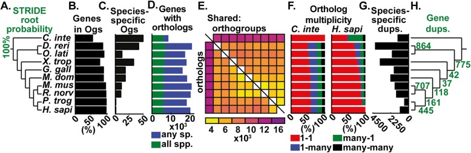
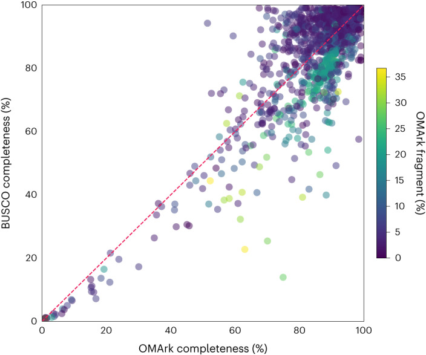

# gene-function-annotation
[中文](README.zh.md)

## Overview

This repository assigns functional labels such as names, GO/KEGG pathways, and domains to protein sequences after a structure release is available. It begins processing only after the structure pipeline outputs `proteins.faa`. It does not perform BRAKER, soft-masking, GFF editing, or gene finding. The upstream gene models are handled by [`gene-structure-annotation`](https://github.com/Xuzhen-Li/gene-structure-annotation). The boundary between structure and function is defined in [structure `docs/BOUNDARY.md`](https://github.com/Xuzhen-Li/gene-structure-annotation/blob/main/docs/BOUNDARY.md). TE soft-masking and TE library building are excluded from this functional pipeline.

Chinese teaching: [`docs/zh/`](docs/zh/) (what it is, relationship with structure, how to run, F pipelines)
English ops: [`docs/BILINGUAL.md`](docs/BILINGUAL.md)
Plant sims (3): [`examples/plant_sim/`](examples/plant_sim/) (paired with structure Vitis+NLR, Oryza plain F1, Solanum+Mercator)



The file `pipeline/F2_eggnog.sh` is the eggNOG step inside the default F1 framework, not the fast-frame branch F2.
Wiki Start-tonight: [Wiki Start-tonight](https://github.com/Xuzhen-Li/gene-function-annotation/wiki/Start-tonight) (GitHub Wiki, not in the clone).
Offline classroom: [`docs/CLASSROOM_TONIGHT.md`](docs/CLASSROOM_TONIGHT.md).
Track work: [Annotation board (Project #2)](https://github.com/users/Xuzhen-Li/projects/2).

## Concepts

1. Framework F1 / F2 / F3 / F5 denotes the whole annotation frame you claim. The default is F1, which includes DIAMOND, eggNOG, and IPS.
2. Script `F2_eggnog.sh` is the eggNOG step inside framework F1, not frame F2.
3. TOOLS F1a / F1b / F1c are literacy cards for the three F1 steps.
4. Gates such as `Gate-F1` are release hard checks, not a frame choice. Deep dive is at [`docs/zh/FAQ_入门.md`](docs/zh/FAQ_入门.md).


This page is also the 2026-11 methods catalog: 129 tools, databases and ideas in 15 type sections. Default frame F1 is unchanged (see Usage and `docs/ROADMAP.md`). Framework / step order stays in the roadmap and in `catalog/`.

## Usage

You must already have proteins. If not, run the structure pipeline's `flow_tool` first to get the GFF and `proteins.faa`. Refer to [`docs/HANDOFF_STRUCTURE_TO_FUNCTION.md`](docs/HANDOFF_STRUCTURE_TO_FUNCTION.md).

Auto-plan the FA frame:

```bash
git clone https://github.com/Xuzhen-Li/gene-function-annotation.git
cd gene-function-annotation
cp pipeline/flow_tool/answers.example.yaml my_answers.yaml
# edit: prefer_fast? plant add-ons?
python3 pipeline/flow_tool/flow.py --answers my_answers.yaml -o my_fa_plan.md
```

For the initial setup, finish `my_fa_plan.md` and list DB disk paths. InterProScan is not required at this stage. Check concepts at [Wiki Concepts](https://github.com/Xuzhen-Li/gene-function-annotation/wiki/Concepts) or offline at [`docs/zh/02_和结构注释的关系.md`](docs/zh/02_和结构注释的关系.md). Write `grade=` and `status=` separately. Do not write `status=F-L1`.

For cluster execution, proceed only after the [Done when](https://github.com/Xuzhen-Li/gene-function-annotation/wiki/Start-tonight#done-when) checklist is completed and `python3 pipeline/print_qc_commands.py` exits 0 with no `[STOP]`. Otherwise do not set `RUN=1`. Browsing with `--env config/example.env` will show `[STOP]` as expected. Required fields in METHODS must be draftable per [Wiki Evaluate-release](https://github.com/Xuzhen-Li/gene-function-annotation/wiki/Evaluate-release).

Follow [`docs/INSTALL_FUNCTIONAL.md`](docs/INSTALL_FUNCTIONAL.md) and [`docs/DB_INSTALL_CHECKLIST.md`](docs/DB_INSTALL_CHECKLIST.md). Then set `RUN=1` for framework F1 and complete [`docs/EVALUATION_CHECKLIST.md`](docs/EVALUATION_CHECKLIST.md). F-L1 is the acceptance bar, not a requirement to finish IPS immediately.

```bash
cp config/example.env config/local.env
# set PROTEINS_FA to your structure release proteins (one representative per gene)
# set DIAMOND_DB, EGGNOG_*, INTERPROSCAN_HOME, BUSCO_LINEAGE_PROTEIN, …
```

<details>
<summary>Namespace details</summary>

Four namespaces exist and should remain distinct in METHODS.
Framework: F1 / F2 / F3 / F5 indicates the whole annotation frame. Default F1 is DIAMOND+eggNOG+IPS.
Script filenames: `F1_diamond.sh`, `F2_eggnog.sh`, `F3_interproscan.sh` are steps inside framework F1.
TOOLS cards: F1a / F1b / F1c map to the three literacy pages.
Gates: Gate-F1 to Gate-F7 are release hard checks covering provenance, BUSCO, versions, and row counts.

The Chinese reference is [`docs/zh/FAQ_入门.md`](docs/zh/FAQ_入门.md).
</details>

## Documentation

Chinese teaching and start guide: [`docs/zh/`](docs/zh/)
Start here: [`docs/START_HERE.md`](docs/START_HERE.md)

<details>
<summary>Additional documentation</summary>

Flow tool: [`pipeline/flow_tool/`](pipeline/flow_tool/)
Install: [`docs/INSTALL_FUNCTIONAL.md`](docs/INSTALL_FUNCTIONAL.md)
Install checklist: [`docs/DB_INSTALL_CHECKLIST.md`](docs/DB_INSTALL_CHECKLIST.md)
Evaluation checklist: [`docs/EVALUATION_CHECKLIST.md`](docs/EVALUATION_CHECKLIST.md)
After structure: [`docs/POST_STRUCTURE.md`](docs/POST_STRUCTURE.md)
Stage IO: [`docs/STAGE_IO.md`](docs/STAGE_IO.md)
Roadmap: [`docs/ROADMAP.md`](docs/ROADMAP.md)
Tool how-tos: [`docs/TOOLS.md`](docs/TOOLS.md)
Tool docs: [`docs/tools/`](docs/tools/)
Evaluation rules: [`docs/EVALUATION.md`](docs/EVALUATION.md)
QC methods and papers: [`docs/QUALITY_SOURCES.md`](docs/QUALITY_SOURCES.md)
Walkthrough: [`docs/QUICKSTART.md`](docs/QUICKSTART.md)
Mercator4 web: [`docs/MERCATOR_WHEN.md`](docs/MERCATOR_WHEN.md)
Tutorials: [`docs/TUTORIALS_AND_MEETINGS.md`](docs/TUTORIALS_AND_MEETINGS.md)
Recent high quality: [`docs/RECENT_HIGH_QUALITY.md`](docs/RECENT_HIGH_QUALITY.md)

</details>

<details>
<summary>Overview figure</summary>



</details>

Author: Xuzhen Li, [ORCID](https://orcid.org/0000-0003-3670-6657)

## Methods catalog

This page lists, by type, the 129 methods, tools, databases and ideas from the 2026-11 survey (61 in the type catalog, 68 first-pass cards in `catalog/`). The default frame is still F1 (DIAMOND + eggNOG + InterProScan); the catalog does not change it. Framework / step order stays in `docs/ROADMAP.md` and in `catalog/`. Full tables and errata are in `docs/CATALOG_BY_TYPE_2026-11.md` and `docs/CATALOG_NEW_TOOLS_2026-11.md`.

## Contents

1. [Homology search](#section-1) (6)
2. [Reference sequence and ontology databases](#section-2) (8)
3. [Domain and family annotation](#section-3) (5)
4. [Orthology-based names, GO and KEGG](#section-4) (9)
5. [Machine-learning GO prediction](#section-5) (7)
6. [Pathways, KO and EC](#section-6) (16)
7. [Multi-genome orthology](#section-7) (9)
8. [Localization and topology](#section-8) (8)
9. [Plant gene families](#section-9) (11)
10. [Non-coding RNA function resources](#section-10) (9)
11. [Expression-supported function](#section-11) (5)
12. [Community catalogues and naming](#section-12) (3)
13. [Protein 3D structure](#section-13) (17)
14. [Downstream enrichment](#section-14) (8)
15. [Ideas, formats and merge rules](#section-15) (8)

- [Data needed alongside the proteins](#data-needs)
- [Figure credits](#figure-credits)

How the sections line up with this repo: input QC (F0) is under data needs, not a type section → default frame F1 (homology, domains, orthology/GO) → optional add-ons (pathways, multi-genome, localization, plant families) → merge `merged_function_table.tsv` → release. Frame IDs stay in `docs/ROADMAP.md` and `catalog/`.

<a id="section-1"></a>
## 1. Homology search

Sequence similarity engines used in the frame F1 homology-search step.

**Needs:** a local DIAMOND (or BLAST) database, typically Swiss-Prot or a documented equivalent, with the version recorded in METHODS. [Data needs by scenario](#data-needs)


- **BLAST+** (tool) — NCBI BLAST command-line suite (blastp, makeblastdb). [doi:10.1186/1471-2105-10-421](https://doi.org/10.1186/1471-2105-10-421) · [link](https://blast.ncbi.nlm.nih.gov/)
- **DIAMOND (v2)** (tool) — Fast protein aligner with BLAST-like sensitivity modes (--ultra-sensitive). [doi:10.1038/s41592-021-01101-x](https://doi.org/10.1038/s41592-021-01101-x) · [link](https://github.com/bbuchfink/diamond)
- **MMseqs2** (tool) — Sensitive fast protein search and clustering. [doi:10.1038/nbt.3988](https://doi.org/10.1038/nbt.3988) · [link](https://github.com/soedinglab/MMseqs2)
- **HMMER 3** (tool) — Profile HMM search (hmmscan, hmmsearch, jackhmmer). [doi:10.1371/journal.pcbi.1002195](https://doi.org/10.1371/journal.pcbi.1002195) · [link](https://github.com/EddyRivasLab/hmmer) [待确认]
- **HH-suite3** (tool) — HMM-HMM comparison for remote homology (HHblits, HHsearch). [doi:10.1186/s12859-019-3019-7](https://doi.org/10.1186/s12859-019-3019-7) · [link](https://github.com/soedinglab/hh-suite)
- **MMseqs2-GPU** (tool) — GPU-accelerated MMseqs2 sequence search (also speeds ColabFold MSAs). [doi:10.1038/s41592-025-02819-8](https://doi.org/10.1038/s41592-025-02819-8) · [link](https://github.com/soedinglab/MMseqs2)

<a id="section-2"></a>
## 2. Reference sequence and ontology databases

Reference sequence and ontology databases that the search and naming steps need.

**Needs:** the database files themselves (UniProt, GO, eggNOG, InterPro member data, and so on), with versions. These are not computed from the proteins alone. [Data needs by scenario](#data-needs)


- **UniRef** (resource) — Clustered UniProt sets (UniRef100/90/50). [doi:10.1093/bioinformatics/btu739](https://doi.org/10.1093/bioinformatics/btu739) · [link](https://www.uniprot.org/help/uniref)
- **Pfam (2021)** (resource) — Protein family HMM library (now hosted in InterPro). [doi:10.1093/nar/gkaa913](https://doi.org/10.1093/nar/gkaa913) · [link](https://www.ebi.ac.uk/interpro/entry/pfam/)
- **TAIR** (resource) — The Arabidopsis Information Resource: curated Arabidopsis gene function and nomenclature. [doi:10.1002/dvg.22877](https://doi.org/10.1002/dvg.22877) · [link](https://www.arabidopsis.org/)
- **eggNOG 6** (resource) — Hierarchical orthology database behind eggNOG-mapper. [doi:10.1093/nar/gkac1022](https://doi.org/10.1093/nar/gkac1022) · [link](http://eggnog6.embl.de/) [待确认]
- **UniProt 2025** (resource) — Swiss-Prot/TrEMBL reference; cite the current NAR update for METHODS. [doi:10.1093/nar/gkae1010](https://doi.org/10.1093/nar/gkae1010) · [link](https://www.uniprot.org)
- **Carbon Annotation Database (CADB)** (resource) — Predicted protein-coding loci and proteins for ~48k GenBank eukaryote assemblies (Carbon-A). [doi:10.64898/2026.10.20.760448](https://doi.org/10.64898/2026.10.20.760448) · [link](https://huggingface.co/blog/HuggingFaceBio/carbon-annotator-genbank-genome-annotation)
- **Gene Ontology knowledgebase (2026)** (resource) — Current GO release paper (NAR, issue 2026; a correction notice exists, doi 10.1093/nar/gkag678). [doi:10.1093/nar/gkaf1292](https://doi.org/10.1093/nar/gkaf1292) · [link](https://geneontology.org)
- **Ensembl Plants** (resource) — Plant genomes with gene trees and projected annotation. [link](https://plants.ensembl.org)

<a id="section-3"></a>
## 3. Domain and family annotation

Domain and family annotation in the frame F1 domain step (InterProScan and related data).

**Needs:** a working InterProScan install and its data; this step is slow and is part of default frame F1, but F-L1 does not require finishing IPS the same day. [Data needs by scenario](#data-needs)



*InterPro domain annotation of PIK3CA (Fig. 4). Blum, Andreeva, Florentino et al. 2025, Nucleic Acids Res., Fig. 4, doi:10.1093/nar/gkae1082, PMC11701551, CC BY.*



*InterProScan runtime on a human proteome (Fig. 6). Blum, Andreeva, Florentino et al. 2025, Nucleic Acids Res., Fig. 6, doi:10.1093/nar/gkae1082, PMC11701551, CC BY.*

- **InterProScan 5** (tool) — Runs member databases (Pfam, PANTHER, SMART, CDD, Gene3D…) and maps InterPro2GO. [doi:10.1093/bioinformatics/btu031](https://doi.org/10.1093/bioinformatics/btu031) · [link](https://github.com/ebi-pf-team/interproscan)
- **SMART (2021 update)** (resource) — Signalling/extracellular domain resource (member DB of InterPro). [doi:10.1093/nar/gkaa937](https://doi.org/10.1093/nar/gkaa937) · [link](https://smart.embl.de)
- **CDD / CD-Search (2023)** (resource) — NCBI conserved-domain models and SPARCLE architectures. [doi:10.1093/nar/gkac1096](https://doi.org/10.1093/nar/gkac1096) · [link](https://www.ncbi.nlm.nih.gov/Structure/cdd/cdd.shtml)
- **Merizo** (tool) — Domain segmentation of predicted 3D structures. [doi:10.1038/s41467-023-43934-4](https://doi.org/10.1038/s41467-023-43934-4) · [link](https://github.com/psipred/Merizo)
- **DPFunc** (tool) — Deep learning GO prediction guided by domain + 3D-structure information. [doi:10.1038/s41467-024-54816-8](https://doi.org/10.1038/s41467-024-54816-8) · [link](https://github.com/CSUBioGroup/DPFunc)

<a id="section-4"></a>
## 4. Orthology-based names, GO and KEGG

Orthology or similarity-based names, GO and KEGG, including whole frames (F1 orthology step, fast frame F2, EnTAP frame F3, F4 readable names).

**Needs:** the eggNOG-mapper database (and, for names, optional AHRD / PANNZER inputs). Machine-assigned GO remains electronic evidence (IEA). [Data needs by scenario](#data-needs)



*eggNOG-mapper v2 runtime compared with other annotators (Fig. 2). Cantalapiedra et al. 2021, Mol. Biol. Evol., Fig. 2, doi:10.1093/molbev/msab293, PMC8662613, CC BY.*



*eggNOG-mapper compared with InterProScan (Fig. 3). Huerta-Cepas et al. 2017, Mol. Biol. Evol., Fig. 3, doi:10.1093/molbev/msx148, PMC5850834, CC BY.*



*eggNOG-mapper GO assignment on a worked example (Fig. 4). Huerta-Cepas et al. 2017, Mol. Biol. Evol., Fig. 4, doi:10.1093/molbev/msx148, PMC5850834, CC BY.*

- **eggNOG-mapper v2** (tool) — Orthology-based functional annotation: names, GO, KEGG, EC, COG. [doi:10.1093/molbev/msab293](https://doi.org/10.1093/molbev/msab293) · [link](https://github.com/eggnogdb/eggnog-mapper)
- **PANNZER2** (tool) — Fast web/standalone GO and free-text description prediction. [doi:10.1093/nar/gky350](https://doi.org/10.1093/nar/gky350) · [link](http://ekhidna2.biocenter.helsinki.fi/sanspanz/) [待确认]
- **Blast2GO** (tool) — BLAST-based GO annotation and visualisation (now in commercial OmicsBox). [doi:10.1093/bioinformatics/bti610](https://doi.org/10.1093/bioinformatics/bti610) · [link](https://www.biobam.com/omicsbox/)
- **EnTAP** (tool) — Eukaryotic non-model annotation pipeline: filtering, similarity search, contaminant flags, eggNOG and InterPro. [doi:10.1111/1755-0998.13106](https://doi.org/10.1111/1755-0998.13106) · [link](https://github.com/harta55/EnTAP)
- **FA-nf** (tool) — Nextflow functional annotation pipeline for non-model proteins (BLAST, InterProScan, KEGG, signal peptides). [doi:10.3390/genes12101645](https://doi.org/10.3390/genes12101645) · [link](https://github.com/guigolab/FA-nf)
- **Sma3s v2** (tool) — Functional annotation of proteomes/transcriptomes against UniProt (GO, keywords, pathways). [doi:10.1002/pmic.201700071](https://doi.org/10.1002/pmic.201700071) · [link](https://github.com/UPOBioinfo/sma3s)
- **AHRD** (tool) — Automated assignment of Human Readable Descriptions from BLAST results. [link](https://github.com/groupschoof/AHRD)
- **GOMAP** (tool) — Gene Ontology Meta Annotator for Plants: combines sequence similarity, domains and mixed-method predictors into plant GO sets. [doi:10.1186/s13007-021-00754-1](https://doi.org/10.1186/s13007-021-00754-1) · [link](https://github.com/Dill-PICL/GOMAP)
- **TRAPID 2.0** (tool) — Web app for taxonomic and functional analysis of de novo plant transcriptomes using PLAZA references. [doi:10.1093/nar/gkab565](https://doi.org/10.1093/nar/gkab565) · [link](https://bioinformatics.psb.ugent.be/trapid_02/) [待确认]

<a id="section-5"></a>
## 5. Machine-learning GO prediction

Machine-learning GO prediction. Optional add-ons after frame F1, not a replacement for F1.

**Needs:** usually only the proteins, plus the tool’s own models. These are optional add-ons after frame F1, not a replacement for F1. [Data needs by scenario](#data-needs)


- **DeepGOPlus** (tool) — CNN + DIAMOND GO prediction from sequence. [doi:10.1093/bioinformatics/btz595](https://doi.org/10.1093/bioinformatics/btz595) · [link](https://github.com/bio-ontology-research-group/deepgoplus)
- **NetGO 3.0** (tool) — Protein-language-model GO prediction server (CAFA top performer). [doi:10.1016/j.gpb.2023.04.001](https://doi.org/10.1016/j.gpb.2023.04.001)
- **DeepFRI** (tool) — Graph-convolution function prediction from 3D structure and sequence. [doi:10.1038/s41467-021-23303-9](https://doi.org/10.1038/s41467-021-23303-9) · [link](https://github.com/flatironinstitute/DeepFRI)
- **GoPredSim** (tool) — GO transfer by embedding similarity (SeqVec/ProtT5). [doi:10.1038/s41598-020-80786-0](https://doi.org/10.1038/s41598-020-80786-0) · [link](https://github.com/Rostlab/goPredSim)
- **DeepGO-SE** (tool) — GO prediction as approximate semantic entailment over ESM2 embeddings and GO axioms. [doi:10.1038/s42256-024-00795-w](https://doi.org/10.1038/s42256-024-00795-w) · [link](https://github.com/bio-ontology-research-group/deepgo2)
- **ProtGO** (tool) — Multi-modal GO prediction (PLM + text + taxonomy + GO graph). [doi:10.1093/bioinformatics/btaf390](https://doi.org/10.1093/bioinformatics/btaf390) · [link](https://github.com/sunyatawang/ProtGO)
- **AltereGO** (tool) — Score-level fusion of ESM2, ProtT5, Ankh and ProstT5-3Di predictors for GO molecular function (preprint 2026). [doi:10.64898/2026.10.23.761425](https://doi.org/10.64898/2026.10.23.761425)

<a id="section-6"></a>
## 6. Pathways, KO and EC

Pathways, KO and EC (F1+ Kofam, frame F6 MapMan, and related add-ons).

**Needs:** for Kofam / KO, a hidden-Markov model set and its score thresholds; for MapMan (F6), a Mercator4 result (web or local — see `docs/MERCATOR_WHEN.md`). KEGG redistribution rules are `[待确认]` and are not assumed here. [Data needs by scenario](#data-needs)


- **MapMan4 / Mercator4** (tool / resource) — Plant-specific functional bins (MapMan4) assigned by Mercator4. [doi:10.1016/j.molp.2019.01.003](https://doi.org/10.1016/j.molp.2019.01.003) · [link](https://www.plabipd.de/mercator_main.html)
- **KofamKOALA / KofamScan** (tool) — KEGG Orthology assignment with adaptive-threshold profile HMMs. [doi:10.1093/bioinformatics/btz859](https://doi.org/10.1093/bioinformatics/btz859) · [link](https://www.genome.jp/tools/kofamkoala/)
- **BlastKOALA / GhostKOALA** (tool) — KEGG web servers assigning KO numbers by sequence similarity. [doi:10.1016/j.jmb.2015.11.006](https://doi.org/10.1016/j.jmb.2015.11.006) · [link](https://www.kegg.jp/blastkoala/)
- **KEGG Mapper** (tool) — Maps KO lists onto KEGG pathways, BRITE and modules. [doi:10.1002/pro.3711](https://doi.org/10.1002/pro.3711) · [link](https://www.kegg.jp/kegg/mapper/)
- **kegg-pathways-completeness** (tool) — Computes KEGG module completeness from a KO list. [link](https://github.com/EBI-Metagenomics/kegg-pathways-completeness-tool)
- **MetaCyc** (resource) — Curated metabolic pathways and enzymes across life. [doi:10.1093/nar/gkz862](https://doi.org/10.1093/nar/gkz862) · [link](https://metacyc.org/) [待确认]
- **BRENDA** (resource) — Comprehensive enzyme function database (EC). [doi:10.1093/nar/gkaa1025](https://doi.org/10.1093/nar/gkaa1025) · [link](https://www.brenda-enzymes.org/)
- **DeepEC** (tool) — Deep-learning EC number prediction. [doi:10.1073/pnas.1821905116](https://doi.org/10.1073/pnas.1821905116)
- **KEGG (2025 NAR)** (resource) — Current KEGG citation for KO/pathway mapping. [doi:10.1093/nar/gkae909](https://doi.org/10.1093/nar/gkae909) · [link](https://www.kegg.jp)
- **Plant Reactome (2024)** (resource) — Curated plant pathways (rice reference, projected to other plants). [doi:10.1093/nar/gkad1052](https://doi.org/10.1093/nar/gkad1052) · [link](https://plantreactome.gramene.org) [待确认]
- **Plant Metabolic Network / E2P2** (tool / resource) — PlantCyc and species pathway DBs built with the E2P2 enzyme predictor. [link](https://plantcyc.org) [待确认]
- **CLEAN** (tool) — Contrastive-learning EC number prediction. [doi:10.1126/science.adf2465](https://doi.org/10.1126/science.adf2465) · [link](https://github.com/tttianhao/CLEAN)
- **EZpred** (tool) — EC prediction using unlabeled sequence homologs (Advanced Science 2026). [doi:10.1002/advs.78703](https://doi.org/10.1002/advs.78703) [待确认]
- **ProteEC-CLA** (tool) — EC prediction with contrastive learning + agent attention on ESM2. [doi:10.1002/prot.26822](https://doi.org/10.1002/prot.26822)
- **plantiSMASH 2.0** (tool) — Plant biosynthetic gene cluster detection, substrate prediction for some enzyme families, promoter TF sites; DB of ~30k BGCs over 430 genomes. [doi:10.1016/j.jmb.2026.169798](https://doi.org/10.1016/j.jmb.2026.169798) · [link](https://github.com/plantismash/plantismash)
- **dbCAN3** (tool) — CAZyme and substrate annotation. [doi:10.1093/nar/gkad328](https://doi.org/10.1093/nar/gkad328) · [link](https://github.com/linnabrown/run_dbcan)

<a id="section-7"></a>
## 7. Multi-genome orthology

Orthogroups across genomes. Frame F7 annotates orthogroup representatives, not every gene.

**Needs:** protein FASTA from each genome in the panel. Frame F7 annotates orthogroup representatives, not every gene. [Data needs by scenario](#data-needs)



*OrthoFinder summary for a Chordata example (Fig. 3). Emms and Kelly 2019, Genome Biol., Fig. 3, doi:10.1186/s13059-019-1832-y, PMC6857279, CC BY.*

- **Broccoli** (tool) — Orthology via phylogeny and network label propagation. [doi:10.1093/molbev/msaa159](https://doi.org/10.1093/molbev/msaa159) · [link](https://github.com/rderelle/Broccoli)
- **Proteinortho6** (tool) — Graph-based (co-)orthology detection at scale. [doi:10.3389/fbinf.2023.1322477](https://doi.org/10.3389/fbinf.2023.1322477) · [link](https://gitlab.com/paulklemm_PHD/proteinortho)
- **CAFE 5** (tool) — Gene family expansion/contraction under rate variation. [doi:10.1093/bioinformatics/btaa1022](https://doi.org/10.1093/bioinformatics/btaa1022) · [link](https://github.com/hahnlab/CAFE5)
- **PLAZA 5.0** (resource) — Plant comparative genomics: gene families, orthologs, GO/InterPro projections. [doi:10.1093/nar/gkab1024](https://doi.org/10.1093/nar/gkab1024) · [link](https://bioinformatics.psb.ugent.be/plaza/) [待确认]
- **OrthoFinder 3** (tool) — Scalable phylogenetic orthology (v3.x, FAMSA alignment). [doi:10.1101/2025.07.15.664860](https://doi.org/10.1101/2025.07.15.664860) · [link](https://github.com/OrthoFinder/OrthoFinder)
- **FastOMA** (tool) — Linear-scaling orthology inference (OMAmer placement). [doi:10.1038/s41592-024-02552-8](https://doi.org/10.1038/s41592-024-02552-8) · [link](https://github.com/DessimozLab/FastOMA)
- **SonicParanoid2** (tool) — Fast orthology with ML and language models. [doi:10.1186/s13059-024-03298-4](https://doi.org/10.1186/s13059-024-03298-4) · [link](https://gitlab.com/salvo981/sonicparanoid2)
- **OrthoDB v12** (resource) — Hierarchical orthologs with functional descriptors (OrthoDB + BUSCO update paper). [doi:10.1093/nar/gkae987](https://doi.org/10.1093/nar/gkae987) · [link](https://www.orthodb.org)
- **OMA browser 2024** (resource) — OMA orthology resource update. [doi:10.1093/nar/gkad1020](https://doi.org/10.1093/nar/gkad1020) · [link](https://omabrowser.org)

<a id="section-8"></a>
## 8. Localization and topology

Signal peptides, topology and subcellular localization (F1+ add-ons).

**Needs:** usually only the proteins (SignalP, TargetP and similar). Keep these as F1+ add-on columns, not as a second master table. [Data needs by scenario](#data-needs)


- **SignalP 6.0** (tool) — Signal peptide prediction (all five types) with protein language model. [doi:10.1038/s41587-021-01156-3](https://doi.org/10.1038/s41587-021-01156-3) · [link](https://services.healthtech.dtu.dk/services/SignalP-6.0/)
- **TMHMM 2.0** (tool) — Transmembrane helix prediction (HMM). [doi:10.1006/jmbi.2000.4315](https://doi.org/10.1006/jmbi.2000.4315) · [link](https://services.healthtech.dtu.dk/services/TMHMM-2.0/)
- **Phobius** (tool) — Combined transmembrane topology and signal peptide predictor. [doi:10.1016/j.jmb.2004.03.016](https://doi.org/10.1016/j.jmb.2004.03.016) · [link](https://phobius.sbc.su.se/)
- **WoLF PSORT** (tool) — Subcellular localization prediction with a plant model. [doi:10.1093/nar/gkm259](https://doi.org/10.1093/nar/gkm259) · [link](https://wolfpsort.hgc.jp/)
- **LOCALIZER** (tool) — Predicts chloroplast, mitochondrial and nuclear localization of plant and effector proteins. [doi:10.1038/srep44598](https://doi.org/10.1038/srep44598) · [link](https://localizer.csiro.au/)
- **DeepLoc 2.1** (tool) — Subcellular localization + membrane protein type from PLMs. [doi:10.1093/nar/gkae237](https://doi.org/10.1093/nar/gkae237) · [link](https://services.healthtech.dtu.dk/services/DeepLoc-2.1/)
- **TargetP 2.0** (tool) — N-terminal targeting peptides (signal, mitochondrial, chloroplast, thylakoid). [doi:10.26508/lsa.201900429](https://doi.org/10.26508/lsa.201900429) · [link](https://services.healthtech.dtu.dk/services/TargetP-2.0/)
- **DeepTMHMM** (tool) — Transmembrane topology prediction (preprint). [doi:10.1101/2022.04.08.487609](https://doi.org/10.1101/2022.04.08.487609) · [link](https://dtu.biolib.com/DeepTMHMM)

<a id="section-9"></a>
## 9. Plant gene families

Plant gene-family classifiers (frame F8 NLR, frame F9 TF/kinase).

**Needs:** for NLR (F8), InterProScan output and optional HRP window lists; for TF / kinase (F9), iTAK (or a documented equivalent). Skip F8 if there is no disease / NLR story. [Data needs by scenario](#data-needs)


- **iTAK** (tool) — Plant transcription factor and protein kinase identification and classification. [doi:10.1016/j.molp.2016.09.014](https://doi.org/10.1016/j.molp.2016.09.014) · [link](https://github.com/kentnf/iTAK)
- **TAPscan v4** (tool / resource) — Detects transcription-associated proteins with family rules; streptophyte-wide database. [doi:10.1111/tpj.17184](https://doi.org/10.1111/tpj.17184) · [link](https://tapscan.plantcode.cup.uni-freiburg.de/)
- **PRGdb 4.0** (tool / resource) — Plant resistance gene database with DRAGO annotation pipeline. [doi:10.1093/nar/gkab1087](https://doi.org/10.1093/nar/gkab1087) · [link](http://prgdb.org/) [待确认]
- **RGAugury** (tool) — Pipeline identifying resistance gene analogs (NBS, RLK, RLP). [doi:10.1186/s12864-016-3197-x](https://doi.org/10.1186/s12864-016-3197-x) · [link](https://bitbucket.org/yaanlpc/rgaugury)
- **Resistify** (tool) — Fast NLR identification/classification from proteins using NLRexpress motifs. [doi:10.1177/11779322241308944](https://doi.org/10.1177/11779322241308944) · [link](https://github.com/SwiftSeal/resistify)
- **NLRtracker + RefPlantNLR** (tool / resource) — Extracts and classifies NLRs from proteomes/transcripts using features of RefPlantNLR. [doi:10.1371/journal.pbio.3001124](https://doi.org/10.1371/journal.pbio.3001124) · [link](https://github.com/slt666666/NLRtracker)
- **NLR-Annotator** (tool) — Annotation-independent NLR locus finder on genomic sequence. [doi:10.1104/pp.19.01273](https://doi.org/10.1104/pp.19.01273) · [link](https://github.com/steuernb/NLR-Annotator)
- **NLRexpress** (tool) — ML motif predictors for CC/TIR/NB-ARC/LRR motifs. [doi:10.3389/fpls.2022.975888](https://doi.org/10.3389/fpls.2022.975888) · [link](https://github.com/eliza-m/NLRexpress)
- **NLRSeek** (tool) — Combines NLR-Annotator loci, targeted re-annotation and NLRtracker to recover NLRs missing from proteomes. [doi:10.1016/j.abiote.2025.100001](https://doi.org/10.1016/j.abiote.2025.100001) · [link](https://github.com/Wang-Mengda/NLRSeek)
- **PlantTFDB / PlantRegMap** (resource) — Plant TF families, binding motifs and regulatory map. [doi:10.1093/nar/gkz1020](https://doi.org/10.1093/nar/gkz1020) · [link](http://planttfdb.gao-lab.org) [待确认]
- **PlantPAN (latest)** (resource) — Plant promoter / TF-binding analysis navigator. [doi:10.1093/nar/gkad945](https://doi.org/10.1093/nar/gkad945) · [link](https://plantpan.itps.ncku.edu.tw)

<a id="section-10"></a>
## 10. Non-coding RNA function resources

Resources for non-coding RNA function. These usually need transcriptome or known ncRNA loci, not the protein table alone.

**Needs:** transcriptome or known ncRNA loci — not the protein table alone. Gene finders and TE libraries stay in the structure / vitis-te repos. [Data needs by scenario](#data-needs)


- **miRBase** (resource) — Reference microRNA sequence and nomenclature database. [doi:10.1093/nar/gky1141](https://doi.org/10.1093/nar/gky1141) · [link](https://www.mirbase.org/)
- **psRobot** (tool) — Plant small-RNA meta-analysis and target prediction. [doi:10.1093/nar/gks554](https://doi.org/10.1093/nar/gks554) · [link](http://omicslab.genetics.ac.cn/psRobot/) [待确认]
- **ncPlantDB** (resource) — Plant ncRNAs with potential ncRNA-encoded peptides and cell-type interactions (43 species). [doi:10.1093/nar/gkae1017](https://doi.org/10.1093/nar/gkae1017) · [link](https://bis.zju.edu.cn/ncPlantDB)
- **PLncDB V2.0** (resource) — Plant lncRNA encyclopedia. [doi:10.1093/nar/gkaa910](https://doi.org/10.1093/nar/gkaa910) · [link](https://www.tobaccodb.org/plncdb/) [待确认]
- **GreeNC 2.0** (resource) — Plant lncRNA catalog. [doi:10.1093/nar/gkab1014](https://doi.org/10.1093/nar/gkab1014) · [link](http://greenc.sequentiabiotech.com) [待确认]
- **CANTATAdb 3.0** (resource) — Updated plant lncRNA repository. [doi:10.1093/pcp/pcae081](https://doi.org/10.1093/pcp/pcae081) · [link](http://cantata.amu.edu.pl) [待确认]
- **PlantCircRNA** (resource) — Plant circular RNA database. [doi:10.1093/nar/gkae709](https://doi.org/10.1093/nar/gkae709) · [link](https://plant.deepbiology.cn/PlantCircRNA/)
- **psRNATarget (2017 release)** (tool) — Plant small-RNA target prediction server. [doi:10.1093/nar/gky316](https://doi.org/10.1093/nar/gky316) · [link](https://www.zhaolab.org/psRNATarget/) [待确认]
- **PmiREN 2.0** (resource) — Plant miRNA encyclopedia. [doi:10.1093/nar/gkab811](https://doi.org/10.1093/nar/gkab811) · [link](https://pmiren.com)

<a id="section-11"></a>
## 11. Expression-supported function

Expression or co-expression used to support a function hypothesis, not as experimental GO.

**Needs:** RNA-seq (preferably from the same genotype) if using expression to support a function claim. [Data needs by scenario](#data-needs)


- **Grapevine Expression Atlas** (resource) — Organ/stage expression atlas of V. vinifera Corvina. [doi:10.1105/tpc.112.100230](https://doi.org/10.1105/tpc.112.100230)
- **ATTED-II v11** (resource) — Plant gene coexpression database. [doi:10.1093/pcp/pcac041](https://doi.org/10.1093/pcp/pcac041) · [link](https://atted.jp/)
- **scPlantDB** (resource) — Plant single-cell atlas: cell types and markers. [doi:10.1093/nar/gkad706](https://doi.org/10.1093/nar/gkad706) · [link](https://biobigdata.nju.edu.cn/scplantdb/) [待确认]
- **hdWGCNA** (tool) — Co-expression networks in single-cell/spatial data. [doi:10.1016/j.crmeth.2023.100498](https://doi.org/10.1016/j.crmeth.2023.100498) · [link](https://github.com/smorabit/hdWGCNA)
- **CoNekT** (tool / resource) — Co-expression network toolkit/framework for plants. [doi:10.1101/255075](https://doi.org/10.1101/255075) · [link](https://conekt.sbs.ntu.edu.sg) [待确认]

<a id="section-12"></a>
## 12. Community catalogues and naming

Curated community catalogues and naming sources.

**Needs:** access to the named community catalogue (and its version or date). [Data needs by scenario](#data-needs)


- **The grapevine gene nomenclature system** (idea) — Proposed rules for naming grapevine genes. [doi:10.1186/1471-2164-15-1077](https://doi.org/10.1186/1471-2164-15-1077)
- **Grapedia Grapevine Reference Gene Catalogue** (resource) — Curated V. vinifera gene ID/symbol pairs with function, literature and confidence; v3.1 (Nov 2025) aligned to T2T v5.1 annotation. [link](https://grapedia.org/genes/)
- **Grape Gene Reference Catalogue (paper)** (resource) — Describes the catalogue as a standard for gene selection. [doi:10.3389/fpls.2021.803977](https://doi.org/10.3389/fpls.2021.803977)

<a id="section-13"></a>
## 13. Protein 3D structure

Protein 3D structure prediction, search and domains. “Structure” here means 3D structure, not gene models.

**Needs:** the proteins; some tools also need AlphaFold / PDB style libraries. “Structure” here means protein 3D structure, not gene models. [Data needs by scenario](#data-needs)


- **AlphaFold2** (tool) — Protein 3D structure prediction. [doi:10.1038/s41586-021-03819-2](https://doi.org/10.1038/s41586-021-03819-2) · [link](https://github.com/google-deepmind/alphafold)
- **ColabFold** (tool) — Fast AlphaFold2 with MMseqs2 MSAs. [doi:10.1038/s41592-022-01488-1](https://doi.org/10.1038/s41592-022-01488-1) · [link](https://github.com/sokrypton/ColabFold)
- **ESMFold / ESM-2** (tool) — Single-sequence 3D structure prediction from a protein language model. [doi:10.1126/science.ade2574](https://doi.org/10.1126/science.ade2574) · [link](https://github.com/facebookresearch/esm)
- **AlphaFold 3** (tool) — Joint structure prediction of complexes with nucleic acids, ligands and ions. [doi:10.1038/s41586-024-07487-w](https://doi.org/10.1038/s41586-024-07487-w) · [link](https://github.com/google-deepmind/alphafold3)
- **TED (The Encyclopedia of Domains)** (resource) — Structure-based domain segmentation of AlphaFold DB. [doi:10.1126/science.adq4946](https://doi.org/10.1126/science.adq4946) · [link](https://ted.cathdb.info/)
- **CATH (2021)** (resource) — Hierarchical classification of protein 3D domains. [doi:10.1093/nar/gkaa1079](https://doi.org/10.1093/nar/gkaa1079) · [link](https://www.cathdb.info/)
- **TM-align** (tool) — Structure alignment with TM-score. [doi:10.1093/nar/gki524](https://doi.org/10.1093/nar/gki524) · [link](https://zhanggroup.org/TM-align/)
- **US-align** (tool) — Universal structure alignment for proteins and nucleic acids. [doi:10.1038/s41592-022-01585-1](https://doi.org/10.1038/s41592-022-01585-1) · [link](https://github.com/pylelab/USalign)
- **DALI** (tool) — Structure comparison server against PDB/AlphaFold DB. [doi:10.1002/pro.3749](https://doi.org/10.1002/pro.3749) · [link](http://ekhidna2.biocenter.helsinki.fi/dali/) [待确认]
- **Foldseek** (tool) — Protein 3D-structure search via 3Di alphabet; finds remote homologs missed by sequence search. [doi:10.1038/s41587-023-01773-0](https://doi.org/10.1038/s41587-023-01773-0) · [link](https://github.com/steineggerlab/foldseek)
- **ProstT5** (tool) — Protein language model translating sequence to 3Di tokens so Foldseek can run without predicted structures. [doi:10.1093/nargab/lqae150](https://doi.org/10.1093/nargab/lqae150) · [link](https://github.com/mheinzinger/ProstT5)
- **TM-Vec 2s** (tool) — Embedding-based remote homology / TM-score prediction (preprint 2026). [doi:10.64898/2026.02.05.704073](https://doi.org/10.64898/2026.02.05.704073)
- **AlphaFold Protein Structure Database (2024)** (resource) — Predicted protein 3D structures for UniProt; target for Foldseek searches. [doi:10.1093/nar/gkad1011](https://doi.org/10.1093/nar/gkad1011) · [link](https://alphafold.ebi.ac.uk)
- **AlphaFind v2** (tool) — Similarity search over AlphaFold DB and TED domains. [doi:10.1093/nar/gkag372](https://doi.org/10.1093/nar/gkag372) · [link](https://alphafind.fi.muni.cz)
- **WASP** (tool) — Whole-proteome annotation via Foldseek against AlphaFold DB (GO, Pfam, PANTHER, CATH, Rhea, EC). [link](https://github.com/gioodm/wasp-proteins-annotation)
- **PARSE** (tool) — Functional site annotation from local 3D-structure embeddings. [doi:10.1073/pnas.2513219122](https://doi.org/10.1073/pnas.2513219122)
- **metagenomic-DeepFRI** (tool) — Scaled DeepFRI (GO from protein 3D-structure graphs) (preprint 2026). [doi:10.64898/2026.04.27.720983](https://doi.org/10.64898/2026.04.27.720983)

<a id="section-14"></a>
## 14. Downstream enrichment

Downstream GO/KEGG enrichment. This uses the finished function table; it is not a source of labels.

**Needs:** a finished function table plus a clearly defined gene-set background (usually all genes in the release). This is downstream of merge, not a source of labels. [Data needs by scenario](#data-needs)


- **topGO** (tool) — GO enrichment accounting for GO graph topology. [doi:10.18129/B9.bioc.topGO](https://doi.org/10.18129/B9.bioc.topGO) · [link](https://bioconductor.org/packages/topGO/)
- **GOATOOLS** (tool) — Python GO library: DAG propagation, slims, enrichment. [doi:10.1038/s41598-018-28948-z](https://doi.org/10.1038/s41598-018-28948-z) · [link](https://github.com/tanghaibao/goatools)
- **GOseq** (tool) — GO enrichment correcting for length bias in RNA-seq. [doi:10.1186/gb-2010-11-2-r14](https://doi.org/10.1186/gb-2010-11-2-r14) · [link](https://bioconductor.org/packages/goseq/)
- **ShinyGO** (tool) — Web enrichment with plant species from Ensembl/STRING. [doi:10.1093/bioinformatics/btz931](https://doi.org/10.1093/bioinformatics/btz931) · [link](http://bioinformatics.sdstate.edu/go/) [待确认]
- **DAVID (2025 update)** (tool) — Enrichment server; adds DAVID Ortholog for cross-species analysis. [doi:10.1093/nar/gkag470](https://doi.org/10.1093/nar/gkag470) · [link](https://davidbioinformatics.nih.gov)
- **g:Profiler (2023)** (tool) — Enrichment and ID conversion. [doi:10.1093/nar/gkad347](https://doi.org/10.1093/nar/gkad347) · [link](https://biit.cs.ut.ee/gprofiler)
- **agriGO v2.0** (tool) — GO enrichment for agricultural species. [doi:10.1093/nar/gkx382](https://doi.org/10.1093/nar/gkx382) · [link](http://systemsbiology.cau.edu.cn/agriGOv2/) [待确认]
- **clusterProfiler 4.0** (tool) — R enrichment with custom TERM2GENE from merged_function_table.tsv. [doi:10.1016/j.xinn.2021.100141](https://doi.org/10.1016/j.xinn.2021.100141) · [link](https://github.com/YuLab-SMU/clusterProfiler)

<a id="section-15"></a>
## 15. Ideas, formats and merge rules

Ideas, formats and merge rules. The merge product remains `merged_function_table.tsv`. Nothing here changes frame F1 until tested.

**Needs:** depends on the idea; the merge product remains `merged_function_table.tsv`. Nothing here changes frame F1 until tested. [Data needs by scenario](#data-needs)


- **Evidence & Conclusion Ontology (ECO, 2022)** (idea) — Ontology of evidence types behind annotations (maps to GO evidence codes). [doi:10.1093/nar/gkab1025](https://doi.org/10.1093/nar/gkab1025) · [link](https://evidenceontology.org/)
- **GO Annotation File (GAF 2.2) format** (idea) — Standard tab format for gene–GO associations with evidence codes. [link](https://geneontology.org/docs/go-annotation-file-gaf-format-2.2/)
- **GO specificity balance (Genome Res 2026)** (idea) — Balancing GO term specificity in sequence-language-model predictions. [doi:10.1101/gr.280816.125](https://doi.org/10.1101/gr.280816.125) [待确认]
- **CAFA lessons (idea)** (idea) — Community assessments keep showing GO prediction is hard for proteins with partial knowledge; publish ML GO as electronic evidence (IEA) only. [link](https://biofunctionprediction.org/cafa/) [待确认]
- **GeneAgent** (idea) — Self-verifying LLM agent for gene-set analysis using domain databases. [doi:10.1038/s41592-025-02748-6](https://doi.org/10.1038/s41592-025-02748-6)
- **LLM-assisted Reactome annotation** (idea) — LLM/RAG proposals of pathway annotations for curator review (preprint). [doi:10.64898/2025.12.20.695723](https://doi.org/10.64898/2025.12.20.695723)
- **Agentic AI for gene function across genomes** (idea) — GO curators' agent workflow with constrained schemas and validators (Zenodo record). [doi:10.5281/zenodo.18904049](https://doi.org/10.5281/zenodo.18904049)
- **ProtNLM (UniProt names)** (idea) — UniProt uses a Google protein-naming model to propose names for unreviewed entries; names carry an automatic evidence tag. [link](https://www.uniprot.org/help/ProtNLM)

<a id="data-needs"></a>
## Data needed alongside the proteins

The main input is `proteins.faa` from a structure release (one representative sequence per gene). The notes below say what else each step usually needs. They do not change default frame F1 until a change is tested.

| Situation | Minimum | Recommended | Typical tools in this repo | Common pitfall |
|---|---|---|---|---|
| Input QC (F0) | `PROTEINS_FA` + protein-mode BUSCO lineage | OMArk as an extra consistency check | BUSCO protein, OMArk (optional) | Treating F0 as a source of functional labels; trying to "fix" a bad proteome here instead of going back to structure |
| Default frame F1 | Local DIAMOND DB, eggNOG-mapper data, InterProScan data (versions in METHODS) | Swiss-Prot (or documented equivalent) for DIAMOND | `F1_diamond.sh`, `F2_eggnog.sh`, `F3_interproscan.sh` | Confusing script `F2_eggnog.sh` with alternate frame F2 |
| Fast frame F2 | eggNOG-mapper data only | Add Kofam later into merge | eggNOG-mapper ± Kofam | Shipping F2 as if IPS had been run |
| Names (F4, optional) | Blast/DIAMOND-style outputs that AHRD expects | A documented name source | AHRD, optional PANNZER (`[待确认]` site check in the 2026-11 catalog) | Treating names as a higher F-L grade by themselves |
| MapMan (F6, optional) | Mercator4 result (web or local) | Follow `docs/MERCATOR_WHEN.md` | `F6_ingest_mercator.py` | Running Mercator "because it is a plant" with no MapMan figure planned |
| Multi-genome (F7) | Proteins from every genome in the panel | Annotate orthogroup representatives, then merge | OrthoFinder, then F1 on representatives | Writing labels as if every gene had been through F1 |
| NLR (F8, optional) | InterProScan output; optional HRP windows from the structure overlay | Only if there is a disease / NLR story | `F8_run.sh` | Calling an IPS+HRP screen a curated NLR set |
| TF / kinase (F9, optional) | iTAK (or a documented equivalent) | Only if that family is needed | `F9_itak.sh` | Adding F9 as a plant-genome checklist item |
| Enrichment (downstream) | `merged_function_table.tsv` + a defined background | The full release gene set as background | clusterProfiler and similar are catalogued; some licenses are NC/ND and are not used for figures | Using a convenience subset as the background without saying so |
| Pathways / KO | Kofam HMM set and thresholds, or eggNOG KO fields | Record the library version | KofamScan, eggNOG | Assuming KEGG data can be redistributed (`[待确认]`) |

### Cross-cutting pitfalls

- No gene finding, soft-mask, TE library, or GFF editing happens here. Those belong to gene-structure-annotation or vitis-te.
- Four ID sets must stay distinct in METHODS: frame (F1/F2/F3/F5), script file (`F2_eggnog.sh` is a step inside frame F1), tool card (F1a/F1b/F1c), and gate (Gate-F1…F7).
- The merge product is `merged_function_table.tsv`. Machine-predicted GO/EC stays IEA.
- Frame F7 annotates orthogroup representatives, not each gene.
- "Structure" in Foldseek, DeepFRI or AlphaFold DB means protein 3D structure.
- InterProScan is part of default F1 but is slow; F-L1 is an acceptance bar, not a requirement to finish IPS tonight.
- Optional plant add-ons (F4/F6/F8/F9) are not a higher grade by themselves.

Catalog rows still marked `[待确认]` (HMMER 3, eggNOG 6, PANNZER2, MetaCyc, PRGdb 4.0, psRobot, DALI, ShinyGO — site checks on 2026-11-13) stay marked until a person opens the page. This text does not re-check those sites.

Longer notes, including the Chinese table, are in [`docs/SCENARIOS_FUNCTIONAL.md#data-needs-details`](docs/SCENARIOS_FUNCTIONAL.md#data-needs-details).



*OMArk compared with BUSCO completeness on 1,805 eukaryotic UniProt reference proteomes (Fig. 5). Shown here because F0 input QC is not a type section. Nevers et al. 2025, Nat. Biotechnol. 43(1):124-133, Fig. 5, doi:10.1038/s41587-024-02147-w (online 2024-02-21), PMC11738984, CC BY.*

<a id="figure-credits"></a>
## Figure credits

Self-drawn overview figures in `docs/figures/` belong to this repository. Catalog figures below are unaltered JPEGs from CC BY papers (Europe PMC license field `cc by`, checked 2026-11-13). No NC/ND material is used.

| File | Credit |
|---|---|
| [`docs/figures/catalog/01_eggnogmapper_v2_runtime.jpg`](docs/figures/catalog/01_eggnogmapper_v2_runtime.jpg) | eggNOG-mapper v2 runtime compared with other annotators (Fig. 2). Cantalapiedra et al. 2021, Mol. Biol. Evol., Fig. 2, doi:10.1093/molbev/msab293, PMC8662613, CC BY. |
| [`docs/figures/catalog/02_eggnogmapper_vs_interproscan.jpg`](docs/figures/catalog/02_eggnogmapper_vs_interproscan.jpg) | eggNOG-mapper compared with InterProScan (Fig. 3). Huerta-Cepas et al. 2017, Mol. Biol. Evol., Fig. 3, doi:10.1093/molbev/msx148, PMC5850834, CC BY. |
| [`docs/figures/catalog/03_eggnogmapper_rhogap1_go.jpg`](docs/figures/catalog/03_eggnogmapper_rhogap1_go.jpg) | eggNOG-mapper GO assignment on a worked example (Fig. 4). Huerta-Cepas et al. 2017, Mol. Biol. Evol., Fig. 4, doi:10.1093/molbev/msx148, PMC5850834, CC BY. |
| [`docs/figures/catalog/04_interpro_pik3ca_domains.jpg`](docs/figures/catalog/04_interpro_pik3ca_domains.jpg) | InterPro domain annotation of PIK3CA (Fig. 4). Blum, Andreeva, Florentino et al. 2025, Nucleic Acids Res., Fig. 4, doi:10.1093/nar/gkae1082, PMC11701551, CC BY. |
| [`docs/figures/catalog/05_interproscan_human_runtime.jpg`](docs/figures/catalog/05_interproscan_human_runtime.jpg) | InterProScan runtime on a human proteome (Fig. 6). Blum, Andreeva, Florentino et al. 2025, Nucleic Acids Res., Fig. 6, doi:10.1093/nar/gkae1082, PMC11701551, CC BY. |
| [`docs/figures/catalog/06_orthofinder_chordata_summary.jpg`](docs/figures/catalog/06_orthofinder_chordata_summary.jpg) | OrthoFinder summary for a Chordata example (Fig. 3). Emms and Kelly 2019, Genome Biol., Fig. 3, doi:10.1186/s13059-019-1832-y, PMC6857279, CC BY. |
| [`docs/figures/catalog/07_omark_vs_busco_proteomes.jpg`](docs/figures/catalog/07_omark_vs_busco_proteomes.jpg) | OMArk compared with BUSCO completeness on 1,805 eukaryotic UniProt reference proteomes (Fig. 5). Shown here because F0 input QC is not a type section. Nevers et al. 2025, Nat. Biotechnol. 43(1):124-133, Fig. 5, doi:10.1038/s41587-024-02147-w (online 2024-02-21), PMC11738984, CC BY. |

