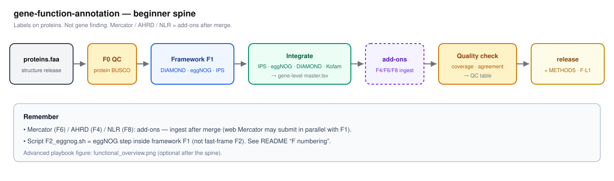
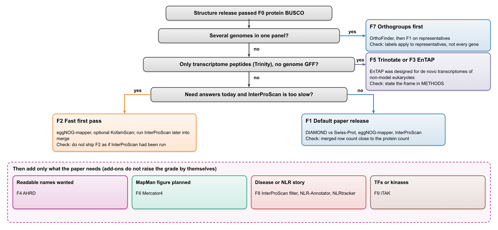
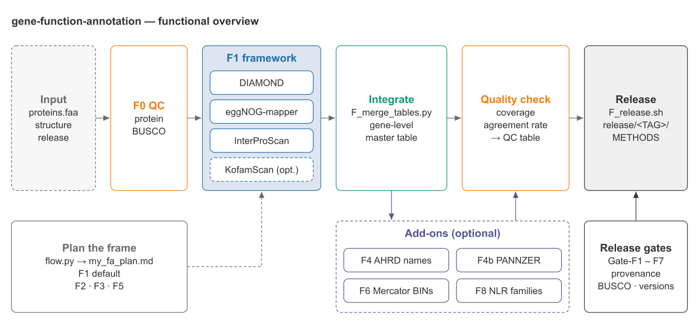

# gene-function-annotation
[中文](README.zh.md)

A knowledge base on functional annotation of plant proteins: what names, GO terms, pathways and domains mean, which software and databases exist for each step, how to check a function table, and one reference route with small example scripts. Grapevine (*Vitis*) is the running example; the material applies to other plant proteomes.

## How this repository is organised

The layout follows [TE-Lib](https://github.com/Xuzhen-Li/TE-Lib): knowledge first, then software, then workflow. Every page is indexed by topic in [`docs/KNOWLEDGE_MAP.md`](docs/KNOWLEDGE_MAP.md).

| Part | Use it to | Where |
|---|---|---|
| Knowledge units | read one concept or one set of criteria, with a claim and source for each statement | [`docs/kb/`](docs/kb/README.md) |
| Book | learn the concepts and the choices at each step | [`book/`](book/README.md); contents below |
| Topics | find everything on one step in one place | [`docs/KNOWLEDGE_MAP.md`](docs/KNOWLEDGE_MAP.md#topics) |
| Software and databases | compare 194 tools, databases and ideas by step, with paper, lab and citation tier | [`catalog/METHODS_CATALOG.md`](catalog/METHODS_CATALOG.md); [`catalog/README.by-type.md`](catalog/README.by-type.md); [`catalog/SOFTWARE_AUTHORITY.tsv`](catalog/SOFTWARE_AUTHORITY.tsv) |
| Reference workflow | follow one route and choose a frame | [`docs/workflow/README.md`](docs/workflow/README.md); [Usage](#usage) |
| Checks | judge whether a function table is good enough | [`docs/EVALUATION.md`](docs/EVALUATION.md); [`docs/EVALUATION_CHECKLIST.md`](docs/EVALUATION_CHECKLIST.md) |
| Example code and test data | read or run small scripts that show each step | [`pipeline/`](pipeline/00_overview.md); [`examples/`](examples/plant_sim/README.md); [`tests/`](tests/) |
| Figures | see the schematics and charts used on these pages | [`docs/figures/guide/`](docs/figures/guide/README.md) |
| Chinese pages | read the same structure in Chinese | [`README.zh.md`](README.zh.md); [`docs/kb/README.zh.md`](docs/kb/README.zh.md); [`docs/zh/`](docs/zh/README.md) |
| Older pages | find earlier lists, checks and corrections that are kept for reference | [`docs/KNOWLEDGE_MAP.md`](docs/KNOWLEDGE_MAP.md#older-pages) |

The code in `pipeline/` is reference code for the steps described here. It is small and tested on toy data; it is not a maintained software package.

## Knowledge map

Start with the knowledge units, then the book chapter for the step you need:

- [Functional gene annotation: an overview](docs/kb/field-overview.md)
- [Functional labels and the four numbering schemes](docs/kb/function-concepts.md)
- [Transferring function by homology and orthology](docs/kb/homology-transfer.md)
- [How far to trust a function table (criteria)](docs/kb/credibility-criteria.md)
- Labels used in these pages (sections, chapters, frameworks, scripts, grades) and how earlier labels map to the current ones: [`docs/kb/NUMBERING.md`](docs/kb/NUMBERING.md)
- All topics, tools, step cards and example code: [`docs/KNOWLEDGE_MAP.md`](docs/KNOWLEDGE_MAP.md)

## Book contents

The book, *Plant gene function annotation: a study guide with grapevine as the example*, is in English and Chinese. Start from [`book/README.md`](book/README.md); the whole text is in [`book/BOOK_full.md`](book/BOOK_full.md).

- [Preface](book/chapters/00-preface.md)
- [Chapter 1. Concepts and principles](book/chapters/01-concepts.md)
- [Chapter 2. Homology search](book/chapters/02-homology-search.md)
- [Chapter 3. Reference sequence and ontology databases](book/chapters/03-reference-sequence-and-ontology-databases.md)
- [Chapter 4. Domain and family annotation](book/chapters/04-domain-and-family-annotation.md)
- [Chapter 5. Orthology-based names, GO and KEGG](book/chapters/05-orthology-based-names-go-and-kegg.md)
- [Chapter 6. Machine-learning GO prediction](book/chapters/06-machine-learning-go-prediction.md)
- [Chapter 7. Pathways, KO and EC](book/chapters/07-pathways-ko-and-ec.md)
- [Chapter 8. Multi-genome orthology](book/chapters/08-multi-genome-orthology.md)
- [Chapter 9. Localization and topology](book/chapters/09-localization-and-topology.md)
- [Chapter 10. Plant gene families](book/chapters/10-plant-gene-families.md)
- [Chapter 11. Non-coding RNA function resources](book/chapters/11-non-coding-rna-function-resources.md)
- [Chapter 12. Expression-supported function](book/chapters/12-expression-supported-function.md)
- [Chapter 13. Community catalogues and naming](book/chapters/13-community-catalogues-and-naming.md)
- [Chapter 14. Protein 3D structure](book/chapters/14-protein-3d-structure.md)
- [Chapter 15. Downstream enrichment](book/chapters/15-downstream-enrichment.md)
- [Chapter 16. Ideas, formats and merge rules](book/chapters/16-ideas-formats-and-merge-rules.md)
- [Chapter 17. Visualization tools](book/chapters/17-visualization-tools.md)
- [Chapter 18. Choosing a frame and add-ons](book/chapters/18-choosing-tools.md)
- [Chapter 19. Pitfalls and quality control](book/chapters/19-pitfalls-and-qc.md)
- [Chapter 20. Worked example: grapevine proteins through frame F1 and add-on F8](book/chapters/20-worked-example.md)
- [Appendix A. Glossary](book/chapters/appendix-a-glossary.md)

## Overview

This repository assigns functional labels such as names, GO/KEGG pathways, and domains to protein sequences after a structure release is available. It begins processing only after the structure pipeline outputs `proteins.faa`. It does not perform BRAKER, soft-masking, GFF editing, or gene finding. The upstream gene models are handled by [`gene-structure-annotation`](https://github.com/Xuzhen-Li/gene-structure-annotation). The boundary between structure and function is defined in [structure `docs/BOUNDARY.md`](https://github.com/Xuzhen-Li/gene-structure-annotation/blob/main/docs/BOUNDARY.md). TE soft-masking and TE library building are excluded from this functional pipeline.

Chinese teaching: [`docs/zh/`](docs/zh/) (what it is, relationship with structure, how to run, F pipelines)
English ops: [`docs/BILINGUAL.md`](docs/BILINGUAL.md)
Plant sims (3): [`examples/plant_sim/`](examples/plant_sim/) (paired with structure Vitis+NLR, Oryza plain F1, Solanum+Mercator)




*Figure. The functional annotation route of this repository: F0 protein QC, frame F1 (DIAMOND against Swiss-Prot, eggNOG-mapper, InterProScan), merge into `merged_function_table.tsv`, function QC and release. Optional add-ons (F4, F6, F8, F9) join at merge; the other frames (F2, F3, F5) and the F7 panel entry also rejoin at merge. Schematic drawn for this repository from `docs/ROADMAP.md` and README; editable SVG: [`function_route_map_v2.svg`](docs/figures/guide/function_route_map_v2.svg).*

The file `pipeline/F2_eggnog.sh` is the eggNOG step inside the default F1 framework, not the fast-frame branch F2.
Start: [`docs/START_HERE.md`](docs/START_HERE.md) in English, or [`docs/zh/README.md`](docs/zh/README.md) in Chinese. Older quick-start pages, the classroom page and the project board are listed under [older pages](docs/KNOWLEDGE_MAP.md#older-pages).

## Concepts

1. Framework F1 / F2 / F3 / F5 denotes the whole annotation frame you claim. The default is F1, which includes DIAMOND, eggNOG, and IPS.
2. Script `F2_eggnog.sh` is the eggNOG step inside framework F1, not frame F2.
3. TOOLS F1a / F1b / F1c are literacy cards for the three F1 steps.
4. Gates such as `Gate-F1` are release hard checks, not a frame choice. Deep dive is at [`docs/zh/FAQ_入门.md`](docs/zh/FAQ_入门.md).



*Figure. Choosing a frame from the data and the deadline, then adding only the add-ons the paper needs (the same choice as the table in book chapter 18 and `docs/ROADMAP.md`). Schematic drawn for this repository; editable SVG: [`function_frame_decision_v2.svg`](docs/figures/guide/function_frame_decision_v2.svg).*


The full methods catalogue is in [`catalog/METHODS_CATALOG.md`](catalog/METHODS_CATALOG.md); a summary is under [Methods catalog](#methods-catalog) below.

## Usage

The commands below are reference code for the steps explained in the book. They are tested on toy data and are not a maintained software package. Which page is authoritative for the step order is stated in [`docs/workflow/README.md`](docs/workflow/README.md).

You must already have proteins. If not, run the structure pipeline's `flow_tool` first to get the GFF and `proteins.faa`. Refer to [`docs/HANDOFF_STRUCTURE_TO_FUNCTION.md`](docs/HANDOFF_STRUCTURE_TO_FUNCTION.md).

Auto-plan the FA frame:

```bash
git clone https://github.com/Xuzhen-Li/gene-function-annotation.git
cd gene-function-annotation
cp pipeline/flow_tool/answers.example.yaml my_answers.yaml
# edit: prefer_fast? plant add-ons?
python3 pipeline/flow_tool/flow.py --answers my_answers.yaml -o my_fa_plan.md
```

For the initial setup, finish `my_fa_plan.md` and list DB disk paths. InterProScan is not required at this stage. Check concepts at [Wiki Concepts](https://github.com/Xuzhen-Li/gene-function-annotation/wiki/Concepts) or offline at [`docs/zh/02_和结构注释的关系.md`](docs/zh/02_和结构注释的关系.md). Write `grade=` and `status=` as separate fields: `grade` is F-L0 or F-L1, and `status` is provisional or qualified (see [`docs/EVALUATION.md`](docs/EVALUATION.md)). Do not write `status=F-L1`.

For cluster execution, proceed only after the [Done when](https://github.com/Xuzhen-Li/gene-function-annotation/wiki/Start-tonight#done-when) checklist is completed and `python3 pipeline/print_qc_commands.py` exits 0 with no `[STOP]`. Otherwise do not set `RUN=1`. Browsing with `--env config/example.env` will show `[STOP]` as expected. Required fields in METHODS must be draftable per [Wiki Evaluate-release](https://github.com/Xuzhen-Li/gene-function-annotation/wiki/Evaluate-release).

Follow [`docs/INSTALL_FUNCTIONAL.md`](docs/INSTALL_FUNCTIONAL.md) and [`docs/DB_INSTALL_CHECKLIST.md`](docs/DB_INSTALL_CHECKLIST.md). Then set `RUN=1` for framework F1 and complete [`docs/EVALUATION_CHECKLIST.md`](docs/EVALUATION_CHECKLIST.md). F-L1 is the acceptance bar, not a requirement to finish IPS immediately.

```bash
cp config/example.env config/local.env
# set PROTEINS_FA to your structure release proteins (one representative per gene)
# set DIAMOND_DB, EGGNOG_*, INTERPROSCAN_HOME, BUSCO_LINEAGE_PROTEIN, …
```

<details>
<summary>Namespace details</summary>

Four namespaces exist and should remain distinct in METHODS.
Framework: F1 / F2 / F3 / F5 indicates the whole annotation frame. Default F1 is DIAMOND+eggNOG+IPS.
Script filenames: `F1_diamond.sh`, `F2_eggnog.sh`, `F3_interproscan.sh` are steps inside framework F1.
TOOLS cards: F1a / F1b / F1c map to the three literacy pages.
Gates: Gate-F1 to Gate-F7 are release hard checks covering provenance, BUSCO, versions, and row counts.

The Chinese reference is [`docs/zh/FAQ_入门.md`](docs/zh/FAQ_入门.md).
</details>

## Documentation

Knowledge map: [`docs/KNOWLEDGE_MAP.md`](docs/KNOWLEDGE_MAP.md). Knowledge units: [`docs/kb/`](docs/kb/README.md). Workflow index: [`docs/workflow/README.md`](docs/workflow/README.md). Changes by date: [`CHANGELOG.md`](CHANGELOG.md).

Chinese teaching and start guide: [`docs/zh/`](docs/zh/)
Start here: [`docs/START_HERE.md`](docs/START_HERE.md)

<details>
<summary>Additional documentation</summary>

Flow tool: [`pipeline/flow_tool/`](pipeline/flow_tool/)
Install: [`docs/INSTALL_FUNCTIONAL.md`](docs/INSTALL_FUNCTIONAL.md)
Install checklist: [`docs/DB_INSTALL_CHECKLIST.md`](docs/DB_INSTALL_CHECKLIST.md)
Evaluation checklist: [`docs/EVALUATION_CHECKLIST.md`](docs/EVALUATION_CHECKLIST.md)
After structure: [`docs/POST_STRUCTURE.md`](docs/POST_STRUCTURE.md)
Stage IO: [`docs/STAGE_IO.md`](docs/STAGE_IO.md)
Roadmap: [`docs/ROADMAP.md`](docs/ROADMAP.md)
Workflow chart with frame choices and decision points: [`docs/ROADMAP.md`, workflow chart](docs/ROADMAP.md#workflow-2026-11-14)
Tool how-tos: [`docs/TOOLS.md`](docs/TOOLS.md)
Tool docs: [`docs/tools/`](docs/tools/)
Evaluation rules: [`docs/EVALUATION.md`](docs/EVALUATION.md)
QC methods and papers: [`docs/QUALITY_SOURCES.md`](docs/QUALITY_SOURCES.md)
Walkthrough: [`docs/QUICKSTART.md`](docs/QUICKSTART.md)
Mercator4 web: [`docs/MERCATOR_WHEN.md`](docs/MERCATOR_WHEN.md)
Tutorials: [`docs/TUTORIALS_AND_MEETINGS.md`](docs/TUTORIALS_AND_MEETINGS.md)
Recent high quality: [`docs/RECENT_HIGH_QUALITY.md`](docs/RECENT_HIGH_QUALITY.md)

</details>

<details>
<summary>Overview figure</summary>



</details>

Author: Xuzhen Li, [ORCID](https://orcid.org/0000-0003-3670-6657)

## Methods catalog

The full catalogue, with the section notes, tool tables, tier rule, pipeline coverage, data needs and figure credits, is in [`catalog/METHODS_CATALOG.md`](catalog/METHODS_CATALOG.md). The same tables without the section notes are in [`docs/software/README.md`](docs/software/README.md); an index by type is in [`catalog/README.by-type.md`](catalog/README.by-type.md); one row per entry is in [`catalog/SOFTWARE_AUTHORITY.tsv`](catalog/SOFTWARE_AUTHORITY.tsv). The catalogue has **194 entries**, recounted from the TSV on 2026-11-26 (command and breakdown in [`catalog/COUNTS.md`](catalog/COUNTS.md)). It is a reading list; the default frame below does not change with it.

<a id="default-route"></a>
### Default route

The default frame is F1: DIAMOND (v2), eggNOG-mapper v2 and InterProScan 6 on `proteins.faa` from a structure release. Add-ons: readable names with AHRD (F4), orthogroups with OrthoFinder 3 (F7), SignalP 6.0 plus DeepTMHMM or TMbed for topology, and Foldseek against AFDB for structure search. This is the frame stated in Usage and in the Clusters lists on this page and in `docs/ROADMAP.md`; the tables below mark these tools as default and every other entry as an alternative or resource.

<a id="tier-rule"></a><a id="pipelines"></a><a id="section-1"></a><a id="section-2"></a><a id="section-3"></a><a id="section-4"></a><a id="section-5"></a><a id="section-6"></a><a id="section-7"></a><a id="section-8"></a><a id="section-9"></a><a id="section-10"></a><a id="section-11"></a><a id="section-12"></a><a id="section-13"></a><a id="section-14"></a><a id="section-15"></a><a id="visualization"></a><a id="data-needs"></a><a id="1-homology-search"></a><a id="10-non-coding-rna-function-resources"></a><a id="11-expression-supported-function"></a><a id="12-community-catalogues-and-naming"></a><a id="13-protein-3d-structure"></a><a id="14-downstream-enrichment"></a><a id="15-ideas-formats-and-merge-rules"></a><a id="2-reference-sequence-and-ontology-databases"></a><a id="3-domain-and-family-annotation"></a><a id="3d-structure-viewers"></a><a id="4-orthology-based-names-go-and-kegg"></a><a id="5-machine-learning-go-prediction"></a><a id="6-pathways-ko-and-ec"></a><a id="7-multi-genome-orthology"></a><a id="8-localization-and-topology"></a><a id="9-plant-gene-families"></a><a id="contents"></a><a id="cross-cutting-pitfalls"></a><a id="data-needed-alongside-the-proteins"></a><a id="domain-and-motif-diagrams"></a><a id="go-and-enrichment-plots"></a><a id="networks"></a><a id="pathway-maps"></a><a id="pipelines-and-the-steps-they-cover"></a><a id="visualization-tools"></a><a id="viz-1"></a><a id="viz-2"></a><a id="viz-3"></a><a id="viz-4"></a><a id="viz-5"></a>
### Sections of the catalogue

| Section | Entries | Full table |
|---|---|---|
| 1. Homology search | 8 | [section 1](catalog/METHODS_CATALOG.md#section-1) |
| 2. Reference sequence and ontology databases | 11 | [section 2](catalog/METHODS_CATALOG.md#section-2) |
| 3. Domain and family annotation | 6 | [section 3](catalog/METHODS_CATALOG.md#section-3) |
| 4. Orthology-based names, GO and KEGG | 12 | [section 4](catalog/METHODS_CATALOG.md#section-4) |
| 5. Machine-learning GO prediction | 11 | [section 5](catalog/METHODS_CATALOG.md#section-5) |
| 6. Pathways, KO and EC | 18 | [section 6](catalog/METHODS_CATALOG.md#section-6) |
| 7. Multi-genome orthology | 16 | [section 7](catalog/METHODS_CATALOG.md#section-7) |
| 8. Localization and topology | 11 | [section 8](catalog/METHODS_CATALOG.md#section-8) |
| 9. Plant gene families | 20 | [section 9](catalog/METHODS_CATALOG.md#section-9) |
| 10. Non-coding RNA function resources | 11 | [section 10](catalog/METHODS_CATALOG.md#section-10) |
| 11. Expression-supported function | 9 | [section 11](catalog/METHODS_CATALOG.md#section-11) |
| 12. Community catalogues and naming | 4 | [section 12](catalog/METHODS_CATALOG.md#section-12) |
| 13. Protein 3D structure | 23 | [section 13](catalog/METHODS_CATALOG.md#section-13) |
| 14. Downstream enrichment | 15 | [section 14](catalog/METHODS_CATALOG.md#section-14) |
| 15. Ideas, formats and merge rules | 9 | [section 15](catalog/METHODS_CATALOG.md#section-15) |
| Visualization tools | 10 | [visualization](catalog/METHODS_CATALOG.md#visualization) |
| Tier rule | — | [Tier rule](catalog/METHODS_CATALOG.md#tier-rule) |
| Pipelines and the steps they cover | — | [Pipelines and the steps they cover](catalog/METHODS_CATALOG.md#pipelines) |
| Data needed alongside the proteins | — | [Data needed alongside the proteins](catalog/METHODS_CATALOG.md#data-needs) |
| Figure credits | — | [Figure credits](catalog/METHODS_CATALOG.md#figure-credits) |

## Licence

Code in this repository (scripts, pipeline files, configuration examples and tests) is under the [MIT License](LICENSE). Text, tables and figures made for this repository are under [CC BY 4.0](https://creativecommons.org/licenses/by/4.0/). Figures reproduced from published papers keep the licence of their source, as given in each caption. Details are in [`NOTICE.md`](NOTICE.md).

<a id="figure-credits"></a>
## Figure credits

Self-drawn overview figures in `docs/figures/` belong to this repository. Catalog figures below are unaltered JPEGs from CC BY papers (Europe PMC license field `cc by`, checked 2026-11-13). No NC/ND material is used.

| File | Credit |
|---|---|
| [`docs/figures/catalog/01_eggnogmapper_v2_runtime.jpg`](docs/figures/catalog/01_eggnogmapper_v2_runtime.jpg) | eggNOG-mapper v2 runtime compared with other annotators (Fig. 2). Cantalapiedra et al. 2021, Mol. Biol. Evol., Fig. 2, doi:10.1093/molbev/msab293, PMC8662613, CC BY. |
| [`docs/figures/catalog/02_eggnogmapper_vs_interproscan.jpg`](docs/figures/catalog/02_eggnogmapper_vs_interproscan.jpg) | eggNOG-mapper compared with InterProScan (Fig. 3). Huerta-Cepas et al. 2017, Mol. Biol. Evol., Fig. 3, doi:10.1093/molbev/msx148, PMC5850834, CC BY. |
| [`docs/figures/catalog/03_eggnogmapper_rhogap1_go.jpg`](docs/figures/catalog/03_eggnogmapper_rhogap1_go.jpg) | eggNOG-mapper GO assignment on a worked example (Fig. 4). Huerta-Cepas et al. 2017, Mol. Biol. Evol., Fig. 4, doi:10.1093/molbev/msx148, PMC5850834, CC BY. |
| [`docs/figures/catalog/04_interpro_pik3ca_domains.jpg`](docs/figures/catalog/04_interpro_pik3ca_domains.jpg) | InterPro domain annotation of PIK3CA (Fig. 4). Blum, Andreeva, Florentino et al. 2025, Nucleic Acids Res., Fig. 4, doi:10.1093/nar/gkae1082, PMC11701551, CC BY. |
| [`docs/figures/catalog/05_interproscan_human_runtime.jpg`](docs/figures/catalog/05_interproscan_human_runtime.jpg) | InterProScan runtime on a human proteome (Fig. 6). Blum, Andreeva, Florentino et al. 2025, Nucleic Acids Res., Fig. 6, doi:10.1093/nar/gkae1082, PMC11701551, CC BY. |
| [`docs/figures/catalog/06_orthofinder_chordata_summary.jpg`](docs/figures/catalog/06_orthofinder_chordata_summary.jpg) | OrthoFinder summary for a Chordata example (Fig. 3). Emms and Kelly 2019, Genome Biol., Fig. 3, doi:10.1186/s13059-019-1832-y, PMC6857279, CC BY. |
| [`docs/figures/catalog/07_omark_vs_busco_proteomes.jpg`](docs/figures/catalog/07_omark_vs_busco_proteomes.jpg) | OMArk compared with BUSCO completeness on 1,805 eukaryotic UniProt reference proteomes (Fig. 5). Shown here because F0 input QC is not a type section. Nevers et al. 2025, Nat. Biotechnol. 43(1):124-133, Fig. 5, doi:10.1038/s41587-024-02147-w (online 2024-02-21), PMC11738984, CC BY. |

> For grape projects that need functional annotation of gene families, see [vitis-open-directions](https://github.com/Xuzhen-Li/vitis-open-directions).
