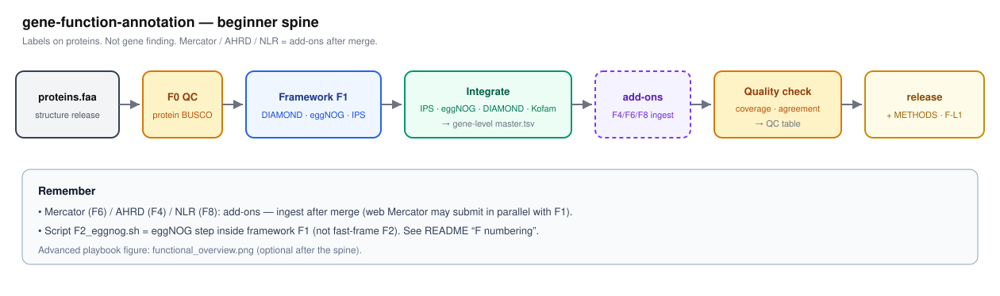
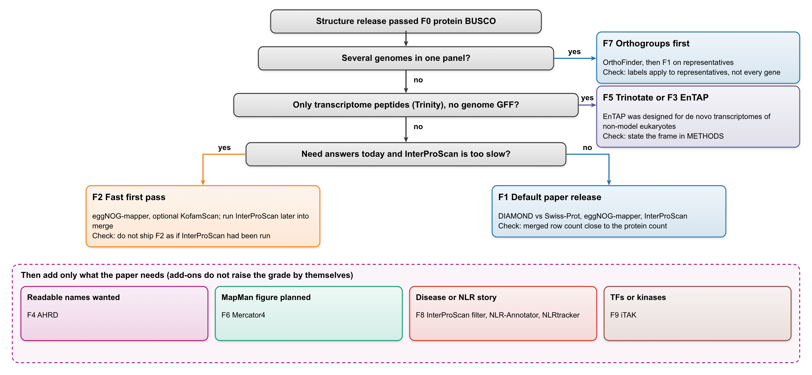
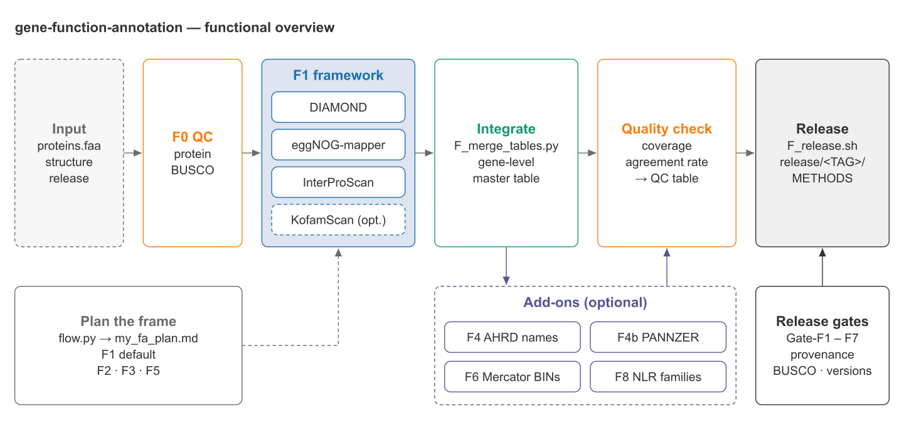

# gene-function-annotation
[English](README.md)

本仓库是关于植物蛋白功能注释的知识库：名称、GO、通路和结构域各是什么意思，每一步有哪些软件和数据库，怎样检查一张功能表，以及一条带小型示例脚本的参考路线。以葡萄（*Vitis*）贯穿举例，内容同样适用于其他植物蛋白组。

本页是英文首页 [`README.md`](README.md) 的平行译本，结构相同。

## 本仓库怎么组织

结构与 [TE-Lib](https://github.com/Xuzhen-Li/TE-Lib) 一致：先知识，再软件，再流程。全部页面按主题索引在 [`docs/KNOWLEDGE_MAP.zh.md`](docs/KNOWLEDGE_MAP.zh.md)。

| 部分 | 用来 | 位置 |
|---|---|---|
| 知识单元 | 读一个概念或一组判据，每句话都有论断和来源 | [`docs/kb/`](docs/kb/README.zh.md) |
| 书 | 学习概念和每一步的取舍 | [`book/`](book/README.zh.md)；目录见下 |
| 主题 | 把一步的所有内容放在一处看 | [`docs/KNOWLEDGE_MAP.zh.md`](docs/KNOWLEDGE_MAP.zh.md#topics) |
| 软件与数据库 | 按步骤比较 194 条工具、数据库与思路，附论文、实验室和权威度 | [`catalog/METHODS_CATALOG.zh.md`](catalog/METHODS_CATALOG.zh.md)；[`catalog/README.by-type.zh.md`](catalog/README.by-type.zh.md)；[`catalog/SOFTWARE_AUTHORITY.tsv`](catalog/SOFTWARE_AUTHORITY.tsv) |
| 参考流程 | 走一条路线并选框架 | [`docs/workflow/README.zh.md`](docs/workflow/README.zh.md)；[Usage](#usage) |
| 检查 | 判断一张功能表是否合格 | [`docs/EVALUATION.md`](docs/EVALUATION.md)；[`docs/EVALUATION_CHECKLIST.md`](docs/EVALUATION_CHECKLIST.md) |
| 示例代码与测试数据 | 阅读或运行展示每一步的小脚本 | [`pipeline/`](pipeline/00_overview.md)；[`examples/`](examples/plant_sim/README.md)；[`tests/`](tests/) |
| 图 | 查看各页用到的示意图和统计图 | [`docs/figures/guide/`](docs/figures/guide/README.md) |
| 英文页面 | 阅读英文原版 | [`README.md`](README.md) |
| 旧页面 | 查找作为记录保留的带日期清单、检查和勘误 | [`docs/KNOWLEDGE_MAP.zh.md`](docs/KNOWLEDGE_MAP.zh.md#older-pages) |

`pipeline/` 里的代码是本仓库所述各步的参考代码，规模小，在玩具数据上测试过，不是维护中的软件。

## 知识地图

先读知识单元，再读需要那一步的书章：

- [功能标签与四套编号](docs/kb/function-concepts.zh.md)
- [按同源和直系同源转移功能](docs/kb/homology-transfer.zh.md)
- [功能表可信到什么程度（判据）](docs/kb/credibility-criteria.zh.md)
- 编号体系及旧编号与现行编号的对照：[`docs/kb/NUMBERING.zh.md`](docs/kb/NUMBERING.zh.md)
- 全部主题、工具、步骤卡片和示例代码：[`docs/KNOWLEDGE_MAP.zh.md`](docs/KNOWLEDGE_MAP.zh.md)

## 书的目录

书稿《植物基因功能注释学习笔记：以葡萄为例》有中英文两版。从 [`book/README.zh.md`](book/README.zh.md) 开始读，全文见 [`book/BOOK_full.zh.md`](book/BOOK_full.zh.md)。

- [前言](book/chapters/00-preface.zh.md)
- [第 1 章 概念与原理](book/chapters/01-concepts.zh.md)
- [第 2 章 同源搜索](book/chapters/02-homology-search.zh.md)
- [第 3 章 参考序列与本体数据库](book/chapters/03-reference-sequence-and-ontology-databases.zh.md)
- [第 4 章 结构域与家族注释](book/chapters/04-domain-and-family-annotation.zh.md)
- [第 5 章 基于直系同源的名称、GO 与 KEGG](book/chapters/05-orthology-based-names-go-and-kegg.zh.md)
- [第 6 章 机器学习 GO 预测](book/chapters/06-machine-learning-go-prediction.zh.md)
- [第 7 章 通路、KO 与 EC](book/chapters/07-pathways-ko-and-ec.zh.md)
- [第 8 章 多基因组直系同源](book/chapters/08-multi-genome-orthology.zh.md)
- [第 9 章 定位与拓扑](book/chapters/09-localization-and-topology.zh.md)
- [第 10 章 植物基因家族](book/chapters/10-plant-gene-families.zh.md)
- [第 11 章 非编码 RNA 功能资源](book/chapters/11-non-coding-rna-function-resources.zh.md)
- [第 12 章 表达支持的功能](book/chapters/12-expression-supported-function.zh.md)
- [第 13 章 社区目录与命名](book/chapters/13-community-catalogues-and-naming.zh.md)
- [第 14 章 蛋白三维结构](book/chapters/14-protein-3d-structure.zh.md)
- [第 15 章 下游富集](book/chapters/15-downstream-enrichment.zh.md)
- [第 16 章 想法、格式与合并规则](book/chapters/16-ideas-formats-and-merge-rules.zh.md)
- [第 17 章 可视化工具](book/chapters/17-visualization-tools.zh.md)
- [第 18 章 怎么选框架和加件](book/chapters/18-choosing-tools.zh.md)
- [第 19 章 常见问题与质控](book/chapters/19-pitfalls-and-qc.zh.md)
- [第 20 章 实例：葡萄蛋白走 F1 框架加 F8 加件](book/chapters/20-worked-example.zh.md)
- [附录 A 术语表](book/chapters/appendix-a-glossary.zh.md)

## Overview

本仓库在基因结构注释完成后，为蛋白质序列分配名称、GO/KEGG通路和结构域等功能标签。流程仅在结构注释输出 `proteins.faa` 后开始。本工具不执行 BRAKER、软屏蔽、GFF 编辑或基因预测。上游基因模型由 [`gene-structure-annotation`](https://github.com/Xuzhen-Li/gene-structure-annotation) 处理。结构与功能的边界在 [structure `docs/BOUNDARY.md`](https://github.com/Xuzhen-Li/gene-structure-annotation/blob/main/docs/BOUNDARY.md) 中定义。转座子软屏蔽和转座子库构建不属于功能注释环节。

中文教学：[`docs/zh/`](docs/zh/)（是什么，与结构的关系，怎么跑，F线）
英文操作：[`docs/BILINGUAL.md`](docs/BILINGUAL.md)
植物模拟：[`examples/plant_sim/`](examples/plant_sim/)（与结构 Vitis+NLR，Oryza plain F1，Solanum+Mercator 配对）




*图：本仓库的功能注释路线：F0 蛋白质控、框架 F1（DIAMOND 比对 Swiss-Prot、eggNOG-mapper、InterProScan）、合并成 `merged_function_table.tsv`、功能质控与发布。可选加件（F4、F6、F8、F9）在合并时并入；其他框架（F2、F3、F5）和多基因组入口 F7 也在合并处汇合。示意图，据 `docs/ROADMAP.md` 与 README 为本仓库绘制；可编辑 SVG：[`function_route_map_v2.svg`](docs/figures/guide/function_route_map_v2.svg)。*

命名说明：文件 `pipeline/F2_eggnog.sh` 是默认 F1 框架内的 eggNOG 步骤，而不是快速框架分支 F2。
入门：英文见 [`docs/START_HERE.md`](docs/START_HERE.md)，中文见 [`docs/zh/README.md`](docs/zh/README.md)。旧的快速开始页、课堂页和任务看板列在[旧页面](docs/KNOWLEDGE_MAP.zh.md#older-pages)。

## Concepts

1. 框架 F1 / F2 / F3 / F5 指代你声明的完整注释框架。默认 F1 包含 DIAMOND、eggNOG 和 IPS。
2. 脚本 `F2_eggnog.sh` 是 F1 框架内部的 eggNOG 步骤，并非 F2 框架。
3. 工具卡片 F1a / F1b / F1c 对应上述 F1 的三个步骤的知识页面。
4. 门控 `Gate-F1` 等是发布的硬性检查点，不是框架选择。深入说明见 [`docs/zh/FAQ_入门.md`](docs/zh/FAQ_入门.md)。



*图：按数据与时间选择框架，再只加论文需要的加件（与第 18 章表格及 `docs/ROADMAP.md` 一致）。示意图，为本仓库绘制；可编辑 SVG：[`function_frame_decision_v2.svg`](docs/figures/guide/function_frame_decision_v2.svg)。*


完整方法目录见 [`catalog/METHODS_CATALOG.zh.md`](catalog/METHODS_CATALOG.zh.md)，概要见下文[方法目录](#方法目录)。

## Usage

下面的命令是书中各步的参考代码，在玩具数据上测试过，不是维护中的软件。步骤顺序以哪一页为准，见 [`docs/workflow/README.zh.md`](docs/workflow/README.zh.md)。

你必须已经具备蛋白质序列。如果没有，请先用结构注释仓库的 `flow_tool` 跑完，得到 GFF 和 `proteins.faa`。参考 [`docs/HANDOFF_STRUCTURE_TO_FUNCTION.md`](docs/HANDOFF_STRUCTURE_TO_FUNCTION.md)。

自动规划 FA 框架：

```bash
git clone https://github.com/Xuzhen-Li/gene-function-annotation.git
cd gene-function-annotation
cp pipeline/flow_tool/answers.example.yaml my_answers.yaml
# edit: prefer_fast? plant add-ons?
python3 pipeline/flow_tool/flow.py --answers my_answers.yaml -o my_fa_plan.md
```

初始设置时，完成 `my_fa_plan.md` 并列出数据库磁盘路径。此时不需要 InterProScan。在 [Wiki Concepts](https://github.com/Xuzhen-Li/gene-function-annotation/wiki/Concepts) 或离线文件 [`docs/zh/02_和结构注释的关系.md`](docs/zh/02_和结构注释的关系.md) 检查概念。分开填写 `grade=` 和 `status=`，不要写成 `status=F-L1`。

在集群执行时，必须在勾选 [Done when](https://github.com/Xuzhen-Li/gene-function-annotation/wiki/Start-tonight#done-when) 且 `python3 pipeline/print_qc_commands.py` 退出码为 0 并无 `[STOP]` 时才可继续。否则不要设置 `RUN=1`。使用 `--env config/example.env` 浏览时会显示 `[STOP]`，这是预期行为。METHODS 必填字段必须能够起草，见 [Wiki Evaluate-release](https://github.com/Xuzhen-Li/gene-function-annotation/wiki/Evaluate-release)。

按照 [`docs/INSTALL_FUNCTIONAL.md`](docs/INSTALL_FUNCTIONAL.md) 和 [`docs/DB_INSTALL_CHECKLIST.md`](docs/DB_INSTALL_CHECKLIST.md) 安装。然后对 F1 框架设置 `RUN=1` 并勾选 [`docs/EVALUATION_CHECKLIST.md`](docs/EVALUATION_CHECKLIST.md)。F-L1 是验收标准，而不是要求今晚必须完成 IPS。

```bash
cp config/example.env config/local.env
# set PROTEINS_FA to your structure release proteins (one representative per gene)
# set DIAMOND_DB, EGGNOG_*, INTERPROSCAN_HOME, BUSCO_LINEAGE_PROTEIN, …
```

<details>
<summary>Namespace details</summary>

存在四个命名空间，在 METHODS 中不要混淆。
框架：F1 / F2 / F3 / F5 指代完整的注释框架。默认 F1 为 DIAMOND+eggNOG+IPS。
脚本文件名：`F1_diamond.sh`、`F2_eggnog.sh`、`F3_interproscan.sh` 是 F1 框架内的步骤。
工具卡片：F1a / F1b / F1c 映射到三个知识页面。
门控：Gate-F1 至 Gate-F7 是涵盖数据来源、BUSCO、版本和行数等发布的硬性检查点。

中文参考见 [`docs/zh/FAQ_入门.md`](docs/zh/FAQ_入门.md)。
</details>

## Documentation

知识地图：[`docs/KNOWLEDGE_MAP.zh.md`](docs/KNOWLEDGE_MAP.zh.md)。知识单元：[`docs/kb/`](docs/kb/README.zh.md)。流程索引：[`docs/workflow/README.zh.md`](docs/workflow/README.zh.md)。按日期的改动：[`CHANGELOG.zh.md`](CHANGELOG.zh.md)。

中文教学与入门：[`docs/zh/`](docs/zh/)
从这里开始：[`docs/START_HERE.md`](docs/START_HERE.md)

<details>
<summary>Additional documentation</summary>

流程工具：[`pipeline/flow_tool/`](pipeline/flow_tool/)
安装：[`docs/INSTALL_FUNCTIONAL.md`](docs/INSTALL_FUNCTIONAL.md)
安装检查表：[`docs/DB_INSTALL_CHECKLIST.md`](docs/DB_INSTALL_CHECKLIST.md)
评估检查表：[`docs/EVALUATION_CHECKLIST.md`](docs/EVALUATION_CHECKLIST.md)
结构注释之后：[`docs/POST_STRUCTURE.md`](docs/POST_STRUCTURE.md)
阶段输入输出：[`docs/STAGE_IO.md`](docs/STAGE_IO.md)
路线图：[`docs/ROADMAP.md`](docs/ROADMAP.md)
含框架选择与判断节点的流程图（2026-11-14）：[`docs/ROADMAP.md#workflow-2026-11-14`](docs/ROADMAP.md#workflow-2026-11-14)
工具指南：[`docs/TOOLS.md`](docs/TOOLS.md)
工具文档：[`docs/tools/`](docs/tools/)
评估规则：[`docs/EVALUATION.md`](docs/EVALUATION.md)
质控方法与文献：[`docs/QUALITY_SOURCES.md`](docs/QUALITY_SOURCES.md)
操作演练：[`docs/QUICKSTART.md`](docs/QUICKSTART.md)
Mercator4 网页版：[`docs/MERCATOR_WHEN.md`](docs/MERCATOR_WHEN.md)
教程：[`docs/TUTORIALS_AND_MEETINGS.md`](docs/TUTORIALS_AND_MEETINGS.md)
近期高质量资源：[`docs/RECENT_HIGH_QUALITY.md`](docs/RECENT_HIGH_QUALITY.md)

</details>

<details>
<summary>Overview figure</summary>



</details>

作者：Xuzhen Li，[ORCID](https://orcid.org/0000-0003-3670-6657)

## 方法目录

完整目录（含各节说明、工具表、权威度规则、流程覆盖表、所需数据和图注）见 [`catalog/METHODS_CATALOG.zh.md`](catalog/METHODS_CATALOG.zh.md)。不含各节说明的同样表格见 [`docs/software/README.zh.md`](docs/software/README.zh.md)；按类型的索引见 [`catalog/README.by-type.zh.md`](catalog/README.by-type.zh.md)；逐条数据见 [`catalog/SOFTWARE_AUTHORITY.tsv`](catalog/SOFTWARE_AUTHORITY.tsv)。目录共 **194 条**，2026-11-26 按 TSV 重新统计（命令和分项见 [`catalog/COUNTS.md`](catalog/COUNTS.md)）。目录是阅读清单，下面的默认框架不随它改变。

<a id="default-route"></a>
### 默认路线

默认框架是 F1：对结构发布的 `proteins.faa` 运行 DIAMOND (v2)、eggNOG-mapper v2 和 InterProScan 6。附加步骤：AHRD 给可读名称（F4），OrthoFinder 3 做直系同源组（F7），SignalP 6.0 加 DeepTMHMM 或 TMbed 做拓扑，Foldseek 对 AFDB 做结构搜索。这一框架以本页“使用方法”、各节“分组”以及 `docs/ROADMAP.md` 为准；下表把这些工具标为默认，其余条目标为备选或资源。

<a id="tier-rule"></a><a id="pipelines"></a><a id="section-1"></a><a id="section-2"></a><a id="section-3"></a><a id="section-4"></a><a id="section-5"></a><a id="section-6"></a><a id="section-7"></a><a id="section-8"></a><a id="section-9"></a><a id="section-10"></a><a id="section-11"></a><a id="section-12"></a><a id="section-13"></a><a id="section-14"></a><a id="section-15"></a><a id="visualization"></a><a id="data-needs"></a><a id="1-同源搜索"></a><a id="10-非编码-rna-功能资源"></a><a id="11-表达支持的功能"></a><a id="12-社区目录与命名"></a><a id="13-蛋白三维结构"></a><a id="14-下游富集"></a><a id="15-想法格式与合并规则"></a><a id="2-参考序列与本体数据库"></a><a id="3-结构域与家族注释"></a><a id="4-基于直系同源的名称go-与-kegg"></a><a id="5-机器学习-go-预测"></a><a id="6-通路ko-与-ec"></a><a id="7-多基因组直系同源"></a><a id="8-定位与拓扑"></a><a id="9-植物基因家族"></a><a id="go-与富集图"></a><a id="viz-1"></a><a id="viz-2"></a><a id="viz-3"></a><a id="viz-4"></a><a id="viz-5"></a><a id="三维结构查看器"></a><a id="可视化工具"></a><a id="整套流程覆盖哪些步骤"></a><a id="权威度规则"></a><a id="目录"></a><a id="结构域与基序图"></a><a id="网络图"></a><a id="蛋白序列之外还需要的数据"></a><a id="跨切陷阱"></a><a id="通路图"></a>
### 目录各节

| 小节 | 条目数 | 完整表格 |
|---|---|---|
| 1. 同源搜索 | 8 | [第 1 节](catalog/METHODS_CATALOG.zh.md#section-1) |
| 2. 参考序列与本体数据库 | 11 | [第 2 节](catalog/METHODS_CATALOG.zh.md#section-2) |
| 3. 结构域与家族注释 | 6 | [第 3 节](catalog/METHODS_CATALOG.zh.md#section-3) |
| 4. 基于直系同源的名称、GO 与 KEGG | 12 | [第 4 节](catalog/METHODS_CATALOG.zh.md#section-4) |
| 5. 机器学习 GO 预测 | 11 | [第 5 节](catalog/METHODS_CATALOG.zh.md#section-5) |
| 6. 通路、KO 与 EC | 18 | [第 6 节](catalog/METHODS_CATALOG.zh.md#section-6) |
| 7. 多基因组直系同源 | 16 | [第 7 节](catalog/METHODS_CATALOG.zh.md#section-7) |
| 8. 定位与拓扑 | 11 | [第 8 节](catalog/METHODS_CATALOG.zh.md#section-8) |
| 9. 植物基因家族 | 20 | [第 9 节](catalog/METHODS_CATALOG.zh.md#section-9) |
| 10. 非编码 RNA 功能资源 | 11 | [第 10 节](catalog/METHODS_CATALOG.zh.md#section-10) |
| 11. 表达支持的功能 | 9 | [第 11 节](catalog/METHODS_CATALOG.zh.md#section-11) |
| 12. 社区目录与命名 | 4 | [第 12 节](catalog/METHODS_CATALOG.zh.md#section-12) |
| 13. 蛋白三维结构 | 23 | [第 13 节](catalog/METHODS_CATALOG.zh.md#section-13) |
| 14. 下游富集 | 15 | [第 14 节](catalog/METHODS_CATALOG.zh.md#section-14) |
| 15. 想法、格式与合并规则 | 9 | [第 15 节](catalog/METHODS_CATALOG.zh.md#section-15) |
| 可视化工具 | 10 | [可视化](catalog/METHODS_CATALOG.zh.md#visualization) |
| 权威度规则 | — | [权威度规则](catalog/METHODS_CATALOG.zh.md#tier-rule) |
| 整套流程覆盖哪些步骤 | — | [整套流程覆盖哪些步骤](catalog/METHODS_CATALOG.zh.md#pipelines) |
| 蛋白序列之外还需要的数据 | — | [蛋白序列之外还需要的数据](catalog/METHODS_CATALOG.zh.md#data-needs) |
| 图注与许可 | — | [图注与许可](catalog/METHODS_CATALOG.zh.md#figure-credits) |

## 许可

本仓库的代码（脚本、流程文件、配置示例和测试）采用 [MIT 许可](LICENSE)。为本仓库撰写的文字、表格和绘制的图采用 [CC BY 4.0](https://creativecommons.org/licenses/by/4.0/deed.zh-hans)。转载自已发表论文的图沿用原文许可，见各图注。详见 [`NOTICE.md`](NOTICE.md)。

<a id="figure-credits"></a>
## 图注与许可

`docs/figures/` 中的自绘概览图归本仓库所有。下方的目录配图均为取自 CC BY 论文的原始未修改 JPEG（Europe PMC 许可字段为 `cc by`，于 2026-11-13 核实），未包含任何 NC/ND 限制素材。

| 文件 | 图注与出处 |
|---|---|
| [`docs/figures/catalog/01_eggnogmapper_v2_runtime.jpg`](docs/figures/catalog/01_eggnogmapper_v2_runtime.jpg) | eggNOG-mapper v2 与其他功能注释工具的运行耗时对比（图 2）。 Cantalapiedra 等 2021，《Molecular Biology and Evolution》图 2，doi:10.1093/molbev/msab293，PMC8662613，CC BY。 |
| [`docs/figures/catalog/02_eggnogmapper_vs_interproscan.jpg`](docs/figures/catalog/02_eggnogmapper_vs_interproscan.jpg) | eggNOG-mapper 与 InterProScan 的注释结果对比（图 3）。 Huerta-Cepas 等 2017，《Molecular Biology and Evolution》图 3，doi:10.1093/molbev/msx148，PMC5850834，CC BY。 |
| [`docs/figures/catalog/03_eggnogmapper_rhogap1_go.jpg`](docs/figures/catalog/03_eggnogmapper_rhogap1_go.jpg) | eggNOG-mapper 在具体实例上的 GO 分配过程（图 4）。 Huerta-Cepas 等 2017，《Molecular Biology and Evolution》图 4，doi:10.1093/molbev/msx148，PMC5850834，CC BY。 |
| [`docs/figures/catalog/04_interpro_pik3ca_domains.jpg`](docs/figures/catalog/04_interpro_pik3ca_domains.jpg) | InterPro 对 PIK3CA 蛋白的结构域注释展示（图 4）。 Blum、Andreeva、Florentino 等 2025，《Nucleic Acids Research》图 4，doi:10.1093/nar/gkae1082，PMC11701551，CC BY。 |
| [`docs/figures/catalog/05_interproscan_human_runtime.jpg`](docs/figures/catalog/05_interproscan_human_runtime.jpg) | InterProScan 在人类蛋白组上的运行耗时表现（图 6）。 Blum、Andreeva、Florentino 等 2025，《Nucleic Acids Research》图 6，doi:10.1093/nar/gkae1082，PMC11701551，CC BY。 |
| [`docs/figures/catalog/06_orthofinder_chordata_summary.jpg`](docs/figures/catalog/06_orthofinder_chordata_summary.jpg) | OrthoFinder 在脊索动物数据集上的分析结果概览（图 3）。 Emms 与 Kelly 2019，《Genome Biology》图 3，doi:10.1186/s13059-019-1832-y，PMC6857279，CC BY。 |
| [`docs/figures/catalog/07_omark_vs_busco_proteomes.jpg`](docs/figures/catalog/07_omark_vs_busco_proteomes.jpg) | OMArk 与 BUSCO 在 1,805 个真核生物 UniProt 参考蛋白组上的完整性评估对比（图 5）。因 F0 输入质控未单列为类型小节，故置于此处。 Nevers 等 2025，《Nature Biotechnology》43(1):124-133，图 5，doi:10.1038/s41587-024-02147-w（线上发表于 2024-02-21），PMC11738984，CC BY。 |

> 需要做基因家族功能注释的葡萄项目见 [vitis-open-directions](https://github.com/Xuzhen-Li/vitis-open-directions)。
