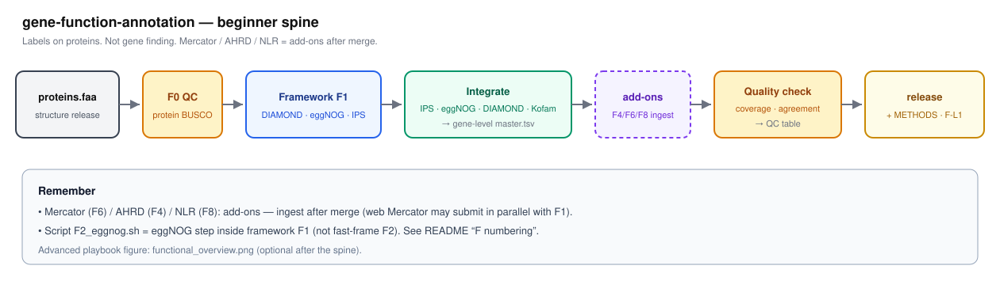
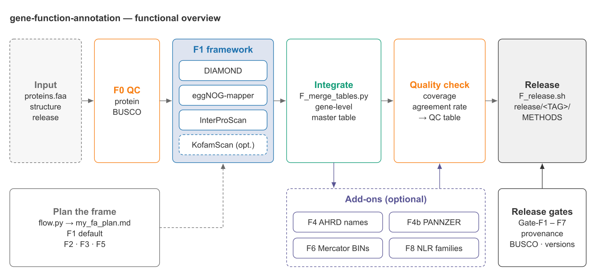
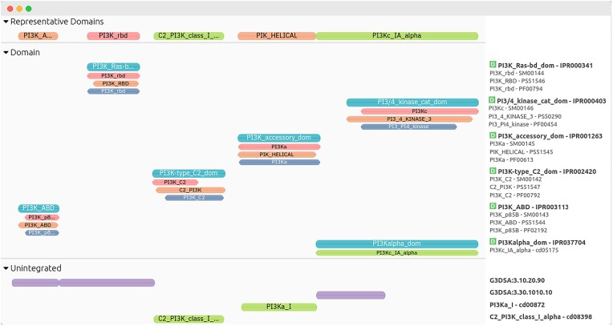
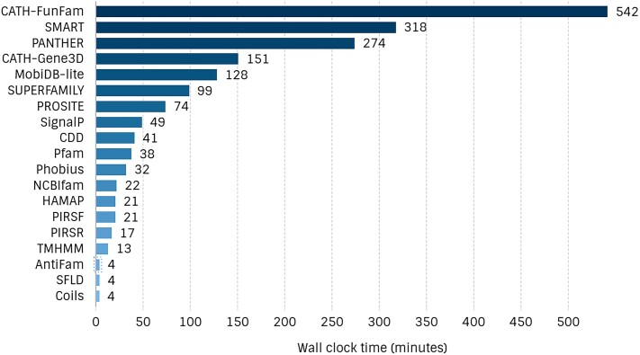
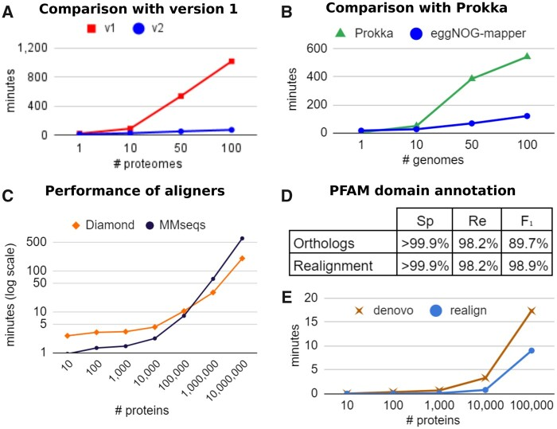
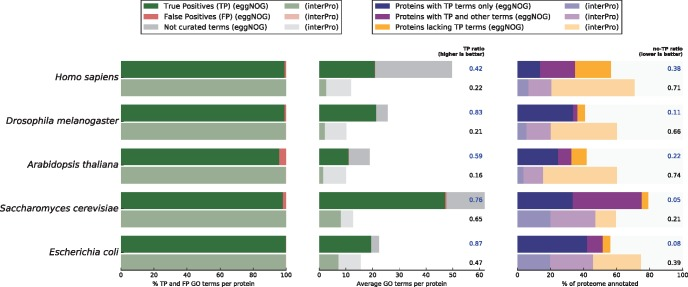
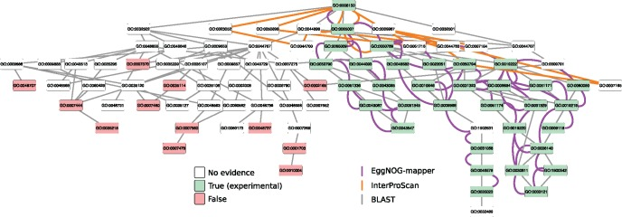
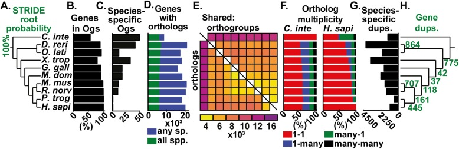
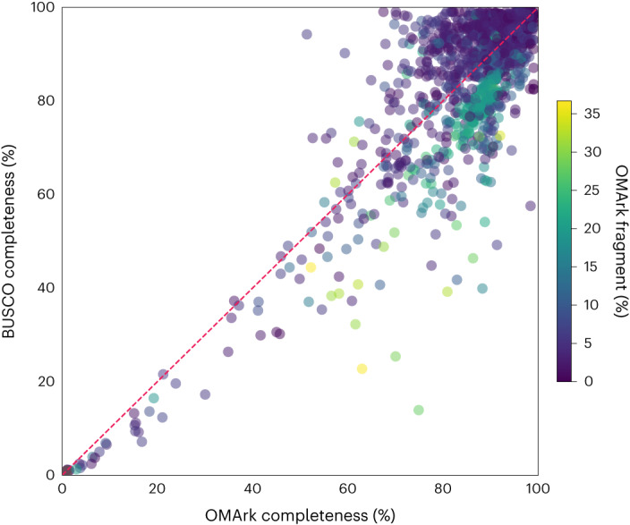

# gene-function-annotation
[English](README.md)

## Overview

本仓库在基因结构注释完成后，为蛋白质序列分配名称、GO/KEGG通路和结构域等功能标签。流程仅在结构注释输出 `proteins.faa` 后开始。本工具不执行 BRAKER、软屏蔽、GFF 编辑或基因预测。上游基因模型由 [`gene-structure-annotation`](https://github.com/Xuzhen-Li/gene-structure-annotation) 处理。结构与功能的边界在 [structure `docs/BOUNDARY.md`](https://github.com/Xuzhen-Li/gene-structure-annotation/blob/main/docs/BOUNDARY.md) 中定义。转座子软屏蔽和转座子库构建不属于功能注释环节。

中文教学：[`docs/zh/`](docs/zh/)（是什么，与结构的关系，怎么跑，F线）
英文操作：[`docs/BILINGUAL.md`](docs/BILINGUAL.md)
植物模拟：[`examples/plant_sim/`](examples/plant_sim/)（与结构 Vitis+NLR，Oryza plain F1，Solanum+Mercator 配对）



命名说明：文件 `pipeline/F2_eggnog.sh` 是默认 F1 框架内的 eggNOG 步骤，而不是快速框架分支 F2。
今晚入门：[Wiki Start-tonight](https://github.com/Xuzhen-Li/gene-function-annotation/wiki/Start-tonight)（GitHub Wiki，不在克隆仓库中）。
离线课堂：[`docs/CLASSROOM_TONIGHT.md`](docs/CLASSROOM_TONIGHT.md)。
进度追踪：[Annotation board (Project #2)](https://github.com/users/Xuzhen-Li/projects/2)。

## Concepts

1. 框架 F1 / F2 / F3 / F5 指代你声明的完整注释框架。默认 F1 包含 DIAMOND、eggNOG 和 IPS。
2. 脚本 `F2_eggnog.sh` 是 F1 框架内部的 eggNOG 步骤，并非 F2 框架。
3. 工具卡片 F1a / F1b / F1c 对应上述 F1 的三个步骤的知识页面。
4. 门控 `Gate-F1` 等是发布的硬性检查点，不是框架选择。深入说明见 [`docs/zh/FAQ_入门.md`](docs/zh/FAQ_入门.md)。


本页同时也是 2026-11 方法目录，分 15 个类型小节，共收录 167 条工具、数据库与思路（2026-11-14 更新）。默认框架 F1 不变（见 Usage 和 `docs/ROADMAP.md`）。框架与步骤顺序仍以路线图和 `catalog/` 为准。

## Usage

你必须已经具备蛋白质序列。如果没有，请先用结构注释仓库的 `flow_tool` 跑完，得到 GFF 和 `proteins.faa`。参考 [`docs/HANDOFF_STRUCTURE_TO_FUNCTION.md`](docs/HANDOFF_STRUCTURE_TO_FUNCTION.md)。

自动规划 FA 框架：

```bash
git clone https://github.com/Xuzhen-Li/gene-function-annotation.git
cd gene-function-annotation
cp pipeline/flow_tool/answers.example.yaml my_answers.yaml
# edit: prefer_fast? plant add-ons?
python3 pipeline/flow_tool/flow.py --answers my_answers.yaml -o my_fa_plan.md
```

初始设置时，完成 `my_fa_plan.md` 并列出数据库磁盘路径。此时不需要 InterProScan。在 [Wiki Concepts](https://github.com/Xuzhen-Li/gene-function-annotation/wiki/Concepts) 或离线文件 [`docs/zh/02_和结构注释的关系.md`](docs/zh/02_和结构注释的关系.md) 检查概念。分开填写 `grade=` 和 `status=`，不要写成 `status=F-L1`。

在集群执行时，必须在勾选 [Done when](https://github.com/Xuzhen-Li/gene-function-annotation/wiki/Start-tonight#done-when) 且 `python3 pipeline/print_qc_commands.py` 退出码为 0 并无 `[STOP]` 时才可继续。否则不要设置 `RUN=1`。使用 `--env config/example.env` 浏览时会显示 `[STOP]`，这是预期行为。METHODS 必填字段必须能够起草，见 [Wiki Evaluate-release](https://github.com/Xuzhen-Li/gene-function-annotation/wiki/Evaluate-release)。

按照 [`docs/INSTALL_FUNCTIONAL.md`](docs/INSTALL_FUNCTIONAL.md) 和 [`docs/DB_INSTALL_CHECKLIST.md`](docs/DB_INSTALL_CHECKLIST.md) 安装。然后对 F1 框架设置 `RUN=1` 并勾选 [`docs/EVALUATION_CHECKLIST.md`](docs/EVALUATION_CHECKLIST.md)。F-L1 是验收标准，而不是要求今晚必须完成 IPS。

```bash
cp config/example.env config/local.env
# set PROTEINS_FA to your structure release proteins (one representative per gene)
# set DIAMOND_DB, EGGNOG_*, INTERPROSCAN_HOME, BUSCO_LINEAGE_PROTEIN, …
```

<details>
<summary>Namespace details</summary>

存在四个命名空间，在 METHODS 中不要混淆。
框架：F1 / F2 / F3 / F5 指代完整的注释框架。默认 F1 为 DIAMOND+eggNOG+IPS。
脚本文件名：`F1_diamond.sh`、`F2_eggnog.sh`、`F3_interproscan.sh` 是 F1 框架内的步骤。
工具卡片：F1a / F1b / F1c 映射到三个知识页面。
门控：Gate-F1 至 Gate-F7 是涵盖数据来源、BUSCO、版本和行数等发布的硬性检查点。

中文参考见 [`docs/zh/FAQ_入门.md`](docs/zh/FAQ_入门.md)。
</details>

## Documentation

中文教学与入门：[`docs/zh/`](docs/zh/)
从这里开始：[`docs/START_HERE.md`](docs/START_HERE.md)

<details>
<summary>Additional documentation</summary>

流程工具：[`pipeline/flow_tool/`](pipeline/flow_tool/)
安装：[`docs/INSTALL_FUNCTIONAL.md`](docs/INSTALL_FUNCTIONAL.md)
安装检查表：[`docs/DB_INSTALL_CHECKLIST.md`](docs/DB_INSTALL_CHECKLIST.md)
评估检查表：[`docs/EVALUATION_CHECKLIST.md`](docs/EVALUATION_CHECKLIST.md)
结构注释之后：[`docs/POST_STRUCTURE.md`](docs/POST_STRUCTURE.md)
阶段输入输出：[`docs/STAGE_IO.md`](docs/STAGE_IO.md)
路线图：[`docs/ROADMAP.md`](docs/ROADMAP.md)
含框架选择与判断节点的流程图（2026-11-14）：[`docs/ROADMAP.md#workflow-2026-11-14`](docs/ROADMAP.md#workflow-2026-11-14)
工具指南：[`docs/TOOLS.md`](docs/TOOLS.md)
工具文档：[`docs/tools/`](docs/tools/)
评估规则：[`docs/EVALUATION.md`](docs/EVALUATION.md)
质控方法与文献：[`docs/QUALITY_SOURCES.md`](docs/QUALITY_SOURCES.md)
操作演练：[`docs/QUICKSTART.md`](docs/QUICKSTART.md)
Mercator4 网页版：[`docs/MERCATOR_WHEN.md`](docs/MERCATOR_WHEN.md)
教程：[`docs/TUTORIALS_AND_MEETINGS.md`](docs/TUTORIALS_AND_MEETINGS.md)
近期高质量资源：[`docs/RECENT_HIGH_QUALITY.md`](docs/RECENT_HIGH_QUALITY.md)

</details>

<details>
<summary>Overview figure</summary>



</details>

作者：李旭真，[ORCID](https://orcid.org/0000-0003-3670-6657)

## 方法目录

本页按类型列出 2026-11 调研整理及 2026-11-14 更新后的 167 条方法、工具、数据库与思路（类型目录 61 条，`catalog/` 首轮卡片 68 条；2026-11-14 合并旧版本条目 3 条，新增 41 条）。默认框架仍为 F1（DIAMOND + eggNOG + InterProScan），本目录不作改动。框架与步骤顺序仍见 `docs/ROADMAP.md` 和 `catalog/`。完整表格与勘误见 `docs/CATALOG_BY_TYPE_2026-11.md` 和 `docs/CATALOG_NEW_TOOLS_2026-11.md`。

**2026-11-14 更新。** 每节开头新增 **分组：** 列表，把本节条目分为可替代（选一个）、互补（一起用）或按顺序（依次运行），并说明什么情况下选哪个。列表中的「A 或 B」表示二选一，「A → B」表示一条固定路线。同一软件的不同版本现在合并为一条，以最新版本命名；旧版本只在该条的说明里提及。带框架选择和判断节点的流程图见 [`docs/ROADMAP.md`](docs/ROADMAP.md#workflow-2026-11-14)。

## 目录

1. [同源搜索](#section-1) (8)
2. [参考序列与本体数据库](#section-2) (11)
3. [结构域与家族注释](#section-3) (6)
4. [基于直系同源的名称、GO 与 KEGG](#section-4) (12)
5. [机器学习 GO 预测](#section-5) (10)
6. [通路、KO 与 EC](#section-6) (17)
7. [多基因组直系同源](#section-7) (11)
8. [定位与拓扑](#section-8) (10)
9. [植物基因家族](#section-9) (16)
10. [非编码 RNA 功能资源](#section-10) (11)
11. [表达支持的功能](#section-11) (8)
12. [社区目录与命名](#section-12) (4)
13. [蛋白三维结构](#section-13) (22)
14. [下游富集](#section-14) (12)
15. [想法、格式与合并规则](#section-15) (9)

- [蛋白序列之外还需要的数据](#data-needs)
- [图注与许可](#figure-credits)

各节与本库框架的对应关系：输入质控（F0）归在数据需求一节，不单列类型小节 → 默认框架 F1（同源、结构域、直系同源/GO）→ 可选附加项（通路、多基因组、定位、植物家族）→ 合并生成 `merged_function_table.tsv` → 发布。框架编号仍见 `docs/ROADMAP.md` 和 `catalog/`。

<a id="section-1"></a>
## 1. 同源搜索

框架 F1 同源搜索步骤所用的序列相似性比对工具。

**需要：** 本地 DIAMOND（或 BLAST）数据库，一般选用 Swiss-Prot 或有书面说明的同等级库，并将版本号记入 METHODS。[按场景列出的数据需求](#data-needs)

**分组：**
- *快速两两搜索*（可替代）：DIAMOND (v2)、MMseqs2、BLAST+。F1 默认用 DIAMOND；聚类和超大数据集用 MMseqs2（CPU 或 GPU）；小规模参考核对用 BLAST+。
- *谱搜索*（互补）：HMMER 3、HH-suite3。Pfam 式 HMM 搜索用 HMMER；疑难蛋白用 HH-suite3 做谱对谱比对。
- *语言模型远缘同源*（可替代）：PLMSearch、pLM-BLAST、Dense Homolog Retriever (DHR)。仅用于经 DIAMOND 和 HMMER 检索后仍无命中的蛋白；结果作为独立证据类别报告。

各条目的单句简介译自英文目录，英文原句见英文版 README。


- **BLAST+** (tool) — NCBI BLAST 命令行工具集（含 blastp、makeblastdb）。 [doi:10.1186/1471-2105-10-421](https://doi.org/10.1186/1471-2105-10-421) · [link](https://blast.ncbi.nlm.nih.gov/)
- **DIAMOND (v2)** (tool) — 高速蛋白序列比对工具，支持类 BLAST 的高灵敏度模式（`--ultra-sensitive`）。 [doi:10.1038/s41592-021-01101-x](https://doi.org/10.1038/s41592-021-01101-x) · [link](https://github.com/bbuchfink/diamond)
- **MMseqs2** (tool) — 快速、高灵敏度的蛋白序列搜索与聚类工具。GPU 加速版（MMseqs2-GPU，doi:10.1038/s41592-025-02819-8）基于同一套代码，并能加速 ColabFold 的多序列比对。 [doi:10.1038/nbt.3988](https://doi.org/10.1038/nbt.3988) · [link](https://github.com/soedinglab/MMseqs2)
- **HMMER 3** (tool) — 基于 profile HMM 的同源搜索工具（含 hmmscan、hmmsearch、jackhmmer）。 [doi:10.1371/journal.pcbi.1002195](https://doi.org/10.1371/journal.pcbi.1002195) · [link](https://github.com/EddyRivasLab/hmmer) [待确认]
- **HH-suite3** (tool) — 用于远缘同源检测的 HMM-HMM 比对工具（含 HHblits、HHsearch）。 [doi:10.1186/s12859-019-3019-7](https://doi.org/10.1186/s12859-019-3019-7) · [link](https://github.com/soedinglab/hh-suite)
- **PLMSearch** (tool) — 通过比对蛋白语言模型嵌入检测远缘同源蛋白；能检出低序列一致性下被 BLAST 和 DIAMOND 遗漏的命中。 [doi:10.1038/s41467-024-46808-5](https://doi.org/10.1038/s41467-024-46808-5) · [link](https://github.com/maovshao/PLMSearch)
- **pLM-BLAST** (tool) — 对逐残基语言模型嵌入执行局部比对，用于检测远缘同源关系并定位匹配区域。 [doi:10.1093/bioinformatics/btad579](https://doi.org/10.1093/bioinformatics/btad579) · [link](https://github.com/labstructbioinf/pLM-BLAST)
- **Dense Homolog Retriever (DHR)** (tool) — 基于稠密检索的远缘同源搜索工具，兼顾速度与灵敏度；同时可为结构预测构建多序列比对。 [doi:10.1038/s41587-024-02353-6](https://doi.org/10.1038/s41587-024-02353-6) · [link](https://github.com/ml4bio/Dense-Homolog-Retrieval)

<a id="section-2"></a>
## 2. 参考序列与本体数据库

序列搜索和基因命名步骤所需的参考序列与本体数据库。

**需要：** 数据库文件本体（UniProt、GO、eggNOG、InterPro 成员库等）及对应版本号。这些内容无法仅凭待测蛋白序列推算出来。[按场景列出的数据需求](#data-needs)

**分组：**
- *序列检索库*（互补）：UniRef、UniProt 2025、TAIR、Ensembl Plants、Carbon Annotation Database (CADB)。F1 的 DIAMOND 比对 Swiss-Prot；需要更广覆盖时用 UniRef；人工审校的名称取自 TAIR 和 Swiss-Prot。
- *特征与家族*（互补）：Pfam (2025)、InterPro 2025、eggNOG 6。Pfam 和 InterPro 支撑 InterProScan；eggNOG 6 支撑 eggNOG-mapper。
- *本体、反应与网络*（互补）：Gene Ontology knowledgebase (2026)、Rhea、STRING (2025)。锁定 GO 版本；精确生化反应用 Rhea；互作网络背景用 STRING。


- **UniRef** (resource) — 按序列相似性聚类的 UniProt 数据集（UniRef100/90/50）。 [doi:10.1093/bioinformatics/btu739](https://doi.org/10.1093/bioinformatics/btu739) · [link](https://www.uniprot.org/help/uniref)
- **Pfam (2025)** (resource) — 蛋白家族 HMM 库，现已并入 InterPro；2025 年论文介绍了 AI 辅助的家族构建。早期论文：Pfam 2021（doi:10.1093/nar/gkaa913）。 [doi:10.1093/nar/gkae997](https://doi.org/10.1093/nar/gkae997) · [link](https://www.ebi.ac.uk/interpro/entry/pfam/)
- **TAIR** (resource) — 拟南芥信息资源库（TAIR）：人工审定的拟南芥基因功能与命名数据库。 [doi:10.1002/dvg.22877](https://doi.org/10.1002/dvg.22877) · [link](https://www.arabidopsis.org/)
- **eggNOG 6** (resource) — 支撑 eggNOG-mapper 的层级直系同源数据库。 [doi:10.1093/nar/gkac1022](https://doi.org/10.1093/nar/gkac1022) · [link](http://eggnog6.embl.de/) [待确认]
- **UniProt 2025** (resource) — Swiss-Prot/TrEMBL 参考数据库；撰写 METHODS 时请引用最新的 NAR 年度更新论文。 [doi:10.1093/nar/gkae1010](https://doi.org/10.1093/nar/gkae1010) · [link](https://www.uniprot.org)
- **Carbon Annotation Database (CADB)** (resource) — 使用 Carbon-A 预测的约 48k 个 GenBank 真核组装的蛋白编码位点与蛋白序列库。 [doi:10.64898/2026.10.20.760448](https://doi.org/10.64898/2026.10.20.760448) · [link](https://huggingface.co/blog/HuggingFaceBio/carbon-annotator-genbank-genome-annotation)
- **Gene Ontology knowledgebase (2026)** (resource) — 当前 GO 知识库发布论文（发表于 2026 年 NAR；附有一篇更正声明，doi 10.1093/nar/gkag678）。 [doi:10.1093/nar/gkaf1292](https://doi.org/10.1093/nar/gkaf1292) · [link](https://geneontology.org)
- **Ensembl Plants** (resource) — 收录植物基因组、基因树与投射注释的综合数据库。 [link](https://plants.ensembl.org)
- **InterPro 2025** (resource) — 支撑 InterProScan 的综合特征数据库；2025 版新增了 AI 辅助整理的 Pfam 家族与基于三维结构的视图。 [doi:10.1093/nar/gkae1082](https://doi.org/10.1093/nar/gkae1082) · [link](https://www.ebi.ac.uk/interpro/)
- **Rhea** (resource) — 经专家审校的生化反应数据库，供 UniProt 开展酶功能注释；将 EC 编号关联至具体化学反应。 [doi:10.1093/nar/gkab1016](https://doi.org/10.1093/nar/gkab1016) · [link](https://www.rhea-db.org/)
- **STRING (2025)** (resource) — 覆盖数千个基因组（含葡萄属）的蛋白关联网络库；支持基于网络的功能推断与富集分析。 [doi:10.1093/nar/gkae1113](https://doi.org/10.1093/nar/gkae1113) · [link](https://string-db.org/)

<a id="section-3"></a>
## 3. 结构域与家族注释

框架 F1 结构域步骤中的蛋白结构域与家族注释（InterProScan 及配套数据）。

**需要：** 正常可用的 InterProScan 程序及配套数据库；这一步耗时较长，虽属默认框架 F1，但 F-L1 并不要求当天跑完 IPS。[按场景列出的数据需求](#data-needs)

**分组：**
- *HMM 特征*（互补）：InterProScan 6、SMART (2021 update)、CDD / CD-Search (2023)。F1 默认用 InterProScan；信号域与结构域架构核对用 SMART 和 CDD。
- *家族树定位*（按顺序）：PANTHER、TreeGrafter。TreeGrafter 将蛋白放置到 PANTHER 进化树上，完成基于系统发育的 GO 注释。



*InterPro 对 PIK3CA 蛋白的结构域注释展示（图 4）。 Blum、Andreeva、Florentino 等 2025，《Nucleic Acids Research》图 4，doi:10.1093/nar/gkae1082，PMC11701551，CC BY。*



*InterProScan 在人类蛋白组上的运行耗时表现（图 6）。 Blum、Andreeva、Florentino 等 2025，《Nucleic Acids Research》图 6，doi:10.1093/nar/gkae1082，PMC11701551，CC BY。*

- **InterProScan 6** (tool) — 调用 InterPro 各成员库（Pfam、PANTHER、SMART、CDD、Gene3D 等）并完成 InterPro2GO 映射。当前版本为 6（2025–2026 年基于 Nextflow 发布），引用论文仍沿用 InterProScan 5。本仓库 F1 的运行脚本针对 v5 编写 [待确认：切换前先测试 v6 的输出列]。 [doi:10.1093/bioinformatics/btu031](https://doi.org/10.1093/bioinformatics/btu031) · [link](https://github.com/ebi-pf-team/interproscan6)
- **SMART (2021 update)** (resource) — 信号转导与胞外结构域资源库（InterPro 成员数据库）。 [doi:10.1093/nar/gkaa937](https://doi.org/10.1093/nar/gkaa937) · [link](https://smart.embl.de)
- **CDD / CD-Search (2023)** (resource) — NCBI 保守结构域模型与 SPARCLE 结构域架构数据库。 [doi:10.1093/nar/gkac1096](https://doi.org/10.1093/nar/gkac1096) · [link](https://www.ncbi.nlm.nih.gov/Structure/cdd/cdd.shtml)
- **PANTHER** (resource) — 附带进化树推断 GO 注释的系统发育蛋白家族与亚家族数据库；InterProScan 可直接报告 PANTHER 命中。 [doi:10.1002/pro.4218](https://doi.org/10.1002/pro.4218) · [link](https://www.pantherdb.org/)
- **TreeGrafter** (tool) — 将查询蛋白嫁接至 PANTHER 家族进化树，并从最近的已注释祖先节点转移 GO 条目。 [doi:10.1093/bioinformatics/bty625](https://doi.org/10.1093/bioinformatics/bty625) · [link](https://github.com/pantherdb/TreeGrafter)
- **ProteInfer** (tool) — 直接从氨基酸序列预测 Pfam、EC 和 GO 标签的深度神经网络；适合快速核查无 HMM 命中的蛋白。 [doi:10.7554/eLife.80942](https://doi.org/10.7554/eLife.80942) · [link](https://github.com/google-research/proteinfer)

<a id="section-4"></a>
## 4. 基于直系同源的名称、GO 与 KEGG

基于直系同源或序列相似性的基因名称、GO 与 KEGG 注释，亦涵盖完整注释框架（F1 直系同源步骤、快速框架 F2、EnTAP 框架 F3、F4 可读名称）。

**需要：** eggNOG-mapper 数据库（若需生成可读名称，再补充可选的 AHRD / PANNZER 输入）。机器自动分配的 GO 仍归为电子注释证据（IEA）。[按场景列出的数据需求](#data-needs)

**分组：**
- *可读名称*（可替代）：AHRD、PANNZER2、Sma3s v2。F4 默认用 AHRD；PANNZER2 同时输出带评分的 GO 预测。
- *一体化套件*（可替代）：EnTAP、Trinotate、Blast2GO、FA-nf、GOMAP、TRAPID 2.0。均为 F1 的替代方案而非附加步骤：含 EnTAP（F3）和 Trinotate（F5）；GOMAP 面向植物；Blast2GO 为商业软件。
- *直系同源转移与定位*（互补）：eggNOG-mapper v2、OMAmer、FANTASIA。eggNOG-mapper v2 是 F1 中 GO、KEGG 和 EC 的默认来源；OMAmer 用于快速定位家族；FANTASIA 只用于没有同源命中的蛋白。



*eggNOG-mapper v2 与其他功能注释工具的运行耗时对比（图 2）。 Cantalapiedra 等 2021，《Molecular Biology and Evolution》图 2，doi:10.1093/molbev/msab293，PMC8662613，CC BY。*



*eggNOG-mapper 与 InterProScan 的注释结果对比（图 3）。 Huerta-Cepas 等 2017，《Molecular Biology and Evolution》图 3，doi:10.1093/molbev/msx148，PMC5850834，CC BY。*



*eggNOG-mapper 在具体实例上的 GO 分配过程（图 4）。 Huerta-Cepas 等 2017，《Molecular Biology and Evolution》图 4，doi:10.1093/molbev/msx148，PMC5850834，CC BY。*

- **eggNOG-mapper v2** (tool) — 基于直系同源的功能注释工具：分配基因名称、GO、KEGG、EC 与 COG。 [doi:10.1093/molbev/msab293](https://doi.org/10.1093/molbev/msab293) · [link](https://github.com/eggnogdb/eggnog-mapper)
- **PANNZER2** (tool) — 快速的网页端及本地端 GO 与自由文本功能描述预测工具。 [doi:10.1093/nar/gky350](https://doi.org/10.1093/nar/gky350) · [link](http://ekhidna2.biocenter.helsinki.fi/sanspanz/) [待确认]
- **Blast2GO** (tool) — 基于 BLAST 的 GO 注释与可视化工具（现已并入商业软件 OmicsBox）。 [doi:10.1093/bioinformatics/bti610](https://doi.org/10.1093/bioinformatics/bti610) · [link](https://www.biobam.com/omicsbox/)
- **EnTAP** (tool) — 非模式真核生物注释流程：整合序列过滤、相似性搜索、污染标记、eggNOG 与 InterPro。 [doi:10.1111/1755-0998.13106](https://doi.org/10.1111/1755-0998.13106) · [link](https://github.com/harta55/EnTAP)
- **FA-nf** (tool) — 面向非模式生物蛋白的 Nextflow 功能注释流程（串联 BLAST、InterProScan、KEGG 与信号肽预测）。 [doi:10.3390/genes12101645](https://doi.org/10.3390/genes12101645) · [link](https://github.com/guigolab/FA-nf)
- **Sma3s v2** (tool) — 比对 UniProt 为蛋白组或转录组分配 GO、关键词与代谢通路的功能注释工具。 [doi:10.1002/pmic.201700071](https://doi.org/10.1002/pmic.201700071) · [link](https://github.com/UPOBioinfo/sma3s)
- **AHRD** (tool) — 根据 BLAST 比对结果自动分配可读基因功能描述（Human Readable Descriptions）的工具。 [link](https://github.com/groupschoof/AHRD)
- **GOMAP** (tool) — 面向植物的 GO 元注释工具（GOMAP）：整合序列相似性、结构域与混合方法预测结果以生成植物 GO 集。 [doi:10.1186/s13007-021-00754-1](https://doi.org/10.1186/s13007-021-00754-1) · [link](https://github.com/Dill-PICL/GOMAP)
- **TRAPID 2.0** (tool) — 基于 PLAZA 参考库对从头组装的植物转录组做分类学与功能分析的网页工具。 [doi:10.1093/nar/gkab565](https://doi.org/10.1093/nar/gkab565) · [link](https://bioinformatics.psb.ugent.be/trapid_02/) [待确认]
- **OMAmer** (tool) — 将蛋白免比对归入 OMA 层级直系同源群；运行速度快且能区分亚家族（OMArk 底层亦调用该工具）。 [doi:10.1093/bioinformatics/btab219](https://doi.org/10.1093/bioinformatics/btab219) · [link](https://github.com/DessimozLab/omamer)
- **FANTASIA** (tool) — 基于嵌入相似度在全蛋白组范围转移 GO 条目；专用于缺乏同源注释的"暗"蛋白。 [doi:10.1038/s42003-025-08651-2](https://doi.org/10.1038/s42003-025-08651-2) · [link](https://github.com/CBBIO/FANTASIA)
- **Trinotate** (tool) — 面向从头组装转录组预测肽段的注释套件（将 BLAST、Pfam、SignalP 和 GO 结果汇总至 SQLite）；对应 F5 路线。此处列出的是作者指定引用的文献。 [doi:10.1016/j.celrep.2016.12.063](https://doi.org/10.1016/j.celrep.2016.12.063) · [link](https://github.com/Trinotate/Trinotate)

<a id="section-5"></a>
## 5. 机器学习 GO 预测

基于机器学习的 GO 预测。属于框架 F1 之后的可选附加项，不能替代 F1。

**需要：** 通常只需输入蛋白序列，配合工具自带的模型。这些工具是框架 F1 之后的可选附加项，不能替代 F1。[按场景列出的数据需求](#data-needs)

**分组：**
- *序列与语言模型预测器*（可替代）：DeepGO-SE、GoPredSim、SPROF-GO、TALE、NetGO 3.0、ProtGO、AltereGO、DeepGOPlus。填补 F1 注释空白时优先选用 DeepGO-SE 或 GoPredSim；DeepGOPlus 主要用于复现旧表。机器学习预测的 GO 须单独存为一列证据。
- *利用结构的预测器*（可替代）：DeepFRI、DPFunc。依赖预测的三维结构（第 13 节）；适用于序列分化较大的蛋白家族。


- **DeepGOPlus** (tool) — 结合 CNN 与 DIAMOND 从序列预测 GO 的工具。 [doi:10.1093/bioinformatics/btz595](https://doi.org/10.1093/bioinformatics/btz595) · [link](https://github.com/bio-ontology-research-group/deepgoplus)
- **NetGO 3.0** (tool) — 基于蛋白语言模型的 GO 预测在线服务（CAFA 评测名列前茅）。 [doi:10.1016/j.gpb.2023.04.001](https://doi.org/10.1016/j.gpb.2023.04.001)
- **DeepFRI** (tool) — 结合三维结构与蛋白序列预测功能的图卷积网络工具。规模化流程 metagenomic-DeepFRI（2026 预印本，doi:10.64898/2026.04.27.720983）将该算法扩展至大规模蛋白集。 [doi:10.1038/s41467-021-23303-9](https://doi.org/10.1038/s41467-021-23303-9) · [link](https://github.com/flatironinstitute/DeepFRI)
- **GoPredSim** (tool) — 基于序列嵌入向量（SeqVec/ProtT5）相似性转移 GO 标签的工具。 [doi:10.1038/s41598-020-80786-0](https://doi.org/10.1038/s41598-020-80786-0) · [link](https://github.com/Rostlab/goPredSim)
- **DeepGO-SE** (tool) — 基于 ESM2 嵌入向量与 GO 公理、通过近似语义蕴涵预测 GO 的工具。 [doi:10.1038/s42256-024-00795-w](https://doi.org/10.1038/s42256-024-00795-w) · [link](https://github.com/bio-ontology-research-group/deepgo2)
- **ProtGO** (tool) — 多模态 GO 预测工具（整合蛋白语言模型、文本、分类学信息与 GO 图结构）。 [doi:10.1093/bioinformatics/btaf390](https://doi.org/10.1093/bioinformatics/btaf390) · [link](https://github.com/sunyatawang/ProtGO)
- **AltereGO** (tool) — 在打分层面融合 ESM2、ProtT5、Ankh 与 ProstT5-3Di 预测器以预测 GO 分子功能的工具（2026 预印本）。 [doi:10.64898/2026.10.23.761425](https://doi.org/10.64898/2026.10.23.761425)
- **DPFunc** (tool) — 结合结构域与三维结构信息的深度学习 GO 预测工具。 [doi:10.1038/s41467-024-54816-8](https://doi.org/10.1038/s41467-024-54816-8) · [link](https://github.com/CSUBioGroup/DPFunc)
- **SPROF-GO** (tool) — 结合蛋白语言模型特征与基于同源的标签扩散算法预测 GO 条目。 [doi:10.1093/bib/bbad117](https://doi.org/10.1093/bib/bbad117) · [link](https://github.com/biomed-AI/SPROF-GO)
- **TALE** (tool) — 用 Transformer 把序列和 GO 标签联合嵌入，因此能为很少被注释的条目排序。 [doi:10.1093/bioinformatics/btab198](https://doi.org/10.1093/bioinformatics/btab198) · [link](https://github.com/Shen-Lab/TALE)

<a id="section-6"></a>
## 6. 通路、KO 与 EC

代谢通路、KO 与 EC 注释（F1+ Kofam、框架 F6 MapMan 及相关附加项）。

**需要：** 跑 Kofam / KO 需准备 HMM 模型库及打分阈值；跑 MapMan（F6）需准备 Mercator4 结果（网页版或本地版，见 `docs/MERCATOR_WHEN.md`）。KEGG 的再分发规定目前标为 `[待确认]`，此处不作预设。[按场景列出的数据需求](#data-needs)

**分组：**
- *KO 分配*（可替代）：KofamKOALA / KofamScan、BlastKOALA / GhostKOALA、KAAS。KofamScan 支持本地运行（F1+ 可选）；BlastKOALA 和 KAAS 为网页端替代方案。
- *植物通路框架与酶参考*（互补）：MapMan4 / Mercator4、Plant Reactome (2024)、Plant Metabolic Network / E2P2、Pathway Tools、MetaCyc、KEGG (2025 NAR)、BRENDA。植物 BIN 用 Mercator4（F6）；先用 E2P2 预测酶，再用 Pathway Tools 构建葡萄通路数据库；核对 EC 结果时以 BRENDA 为酶参考。
- *EC 预测*（可替代）：DeepEC、CLEAN、EZpred、ProteEC-CLA。没有 KO 的酶先用 CLEAN；结果对照 BRENDA 核对。
- *完整度与基因簇*（互补）：KEGG Mapper、kegg-pathways-completeness、plantiSMASH 2.0。基于 KO 集合评估通路完整度；生物合成基因簇识别用 plantiSMASH。


- **MapMan4 / Mercator4** (tool / resource) — 由 Mercator4 分配的植物专用功能分类体系（MapMan4）。 [doi:10.1016/j.molp.2019.01.003](https://doi.org/10.1016/j.molp.2019.01.003) · [link](https://www.plabipd.de/mercator_main.html)
- **KofamKOALA / KofamScan** (tool) — 利用自适应阈值 profile HMM 分配 KEGG Orthology（KO）的工具。 [doi:10.1093/bioinformatics/btz859](https://doi.org/10.1093/bioinformatics/btz859) · [link](https://www.genome.jp/tools/kofamkoala/)
- **BlastKOALA / GhostKOALA** (tool) — 基于序列相似性分配 KO 编号的 KEGG 在线服务。 [doi:10.1016/j.jmb.2015.11.006](https://doi.org/10.1016/j.jmb.2015.11.006) · [link](https://www.kegg.jp/blastkoala/)
- **KEGG Mapper** (tool) — 将 KO 列表映射至 KEGG 代谢通路、BRITE 层级与功能模块的工具。 [doi:10.1002/pro.3711](https://doi.org/10.1002/pro.3711) · [link](https://www.kegg.jp/kegg/mapper/)
- **kegg-pathways-completeness** (tool) — 根据 KO 列表计算 KEGG 功能模块完整度的工具。 [link](https://github.com/EBI-Metagenomics/kegg-pathways-completeness-tool)
- **MetaCyc** (resource) — 跨物种的人工审定代谢通路与酶数据库。 [doi:10.1093/nar/gkz862](https://doi.org/10.1093/nar/gkz862) · [link](https://metacyc.org/) [待确认]
- **BRENDA** (resource) — 综合性的酶功能与 EC 编号数据库。 [doi:10.1093/nar/gkaa1025](https://doi.org/10.1093/nar/gkaa1025) · [link](https://www.brenda-enzymes.org/)
- **DeepEC** (tool) — 基于深度学习预测 EC 编号的工具。 [doi:10.1073/pnas.1821905116](https://doi.org/10.1073/pnas.1821905116)
- **KEGG (2025 NAR)** (resource) — 用于 KO 与代谢通路映射的当前 KEGG 引用文献（2025 NAR）。 [doi:10.1093/nar/gkae909](https://doi.org/10.1093/nar/gkae909) · [link](https://www.kegg.jp)
- **Plant Reactome (2024)** (resource) — 人工审定的植物代谢通路数据库（以水稻为参考并投射至其他植物）。 [doi:10.1093/nar/gkad1052](https://doi.org/10.1093/nar/gkad1052) · [link](https://plantreactome.gramene.org) [待确认]
- **Plant Metabolic Network / E2P2** (tool / resource) — 利用 E2P2 酶预测工具构建的 PlantCyc 及各物种代谢通路数据库。 [link](https://plantcyc.org) [待确认]
- **CLEAN** (tool) — 基于对比学习预测 EC 编号的工具。 [doi:10.1126/science.adf2465](https://doi.org/10.1126/science.adf2465) · [link](https://github.com/tttianhao/CLEAN)
- **EZpred** (tool) — 利用无标签同源序列预测 EC 编号的工具（发表于 Advanced Science 2026）。 [doi:10.1002/advs.78703](https://doi.org/10.1002/advs.78703) [待确认]
- **ProteEC-CLA** (tool) — 在 ESM2 基础上结合对比学习与代理注意力机制（agent attention）预测 EC 编号的工具。 [doi:10.1002/prot.26822](https://doi.org/10.1002/prot.26822)
- **plantiSMASH 2.0** (tool) — 植物生物合成基因簇（BGC）检测工具，支持部分酶家族底物预测与启动子 TF 结合位点分析；内置覆盖 430 个基因组约 30k 个 BGC 的数据库。 [doi:10.1016/j.jmb.2026.169798](https://doi.org/10.1016/j.jmb.2026.169798) · [link](https://github.com/plantismash/plantismash)
- **KAAS** (tool) — KEGG 在线注释服务，通过双向最佳命中分配 KO 编号并重建通路图。 [doi:10.1093/nar/gkm321](https://doi.org/10.1093/nar/gkm321) · [link](https://www.genome.jp/kegg/kaas/)
- **Pathway Tools** (tool) — 构建物种专属的通路/基因组数据库；在 PMN 流程中，先由 E2P2 预测酶，再用 Pathway Tools 建库（PlantCyc 即如此构建）。 [doi:10.1093/bib/bbz104](https://doi.org/10.1093/bib/bbz104) · [link](https://bioinformatics.ai.sri.com/ptools/)

<a id="section-7"></a>
## 7. 多基因组直系同源

跨基因组的直系同源基因群划分。框架 F7 仅对直系同源群的代表序列做功能注释，而非逐个基因注释。

**需要：** 数据集中各个基因组的蛋白 FASTA。框架 F7 仅注释直系同源群的代表序列，而非每个基因。[按场景列出的数据需求](#data-needs)

**分组：**
- *直系同源群推断*（可替代）：OrthoFinder 3、SonicParanoid2、Broccoli、Proteinortho6、FastOMA。F7 默认用 OrthoFinder 3；物种面板很大时选用 FastOMA 或 SonicParanoid2。
- *参考目录*（互补）：PLAZA 5.0、OrthoDB v12、OMA browser 2024、PhylomeDB V5、OrthoVenn3。利用植物库和基于进化树的参考库交叉核对直系同源群。
- *家族演化*（按顺序）：OrthoFinder 3 或 SonicParanoid2 或 Broccoli 或 Proteinortho6 或 FastOMA、CAFE 5。先确定直系同源群，再用 CAFE 5 估计扩张和收缩。



*OrthoFinder 在脊索动物数据集上的分析结果概览（图 3）。 Emms 与 Kelly 2019，《Genome Biology》图 3，doi:10.1186/s13059-019-1832-y，PMC6857279，CC BY。*

- **Broccoli** (tool) — 结合系统发育树与网络标签传播推断直系同源关系的工具。 [doi:10.1093/molbev/msaa159](https://doi.org/10.1093/molbev/msaa159) · [link](https://github.com/rderelle/Broccoli)
- **Proteinortho6** (tool) — 面向大规模数据的图算法（共）直系同源检测工具。 [doi:10.3389/fbinf.2023.1322477](https://doi.org/10.3389/fbinf.2023.1322477) · [link](https://gitlab.com/paulklemm_PHD/proteinortho)
- **CAFE 5** (tool) — 在演化速率变异模型下分析基因家族扩张与收缩的工具。 [doi:10.1093/bioinformatics/btaa1022](https://doi.org/10.1093/bioinformatics/btaa1022) · [link](https://github.com/hahnlab/CAFE5)
- **PLAZA 5.0** (resource) — 植物比较基因组学平台：涵盖基因家族、直系同源与 GO/InterPro 注释投射。 [doi:10.1093/nar/gkab1024](https://doi.org/10.1093/nar/gkab1024) · [link](https://bioinformatics.psb.ugent.be/plaza/) [待确认]
- **OrthoFinder 3** (tool) — 可扩展的系统发育直系同源推断工具（v3.x 版本采用 FAMSA 比对）。 [doi:10.1101/2025.07.15.664860](https://doi.org/10.1101/2025.07.15.664860) · [link](https://github.com/OrthoFinder/OrthoFinder)
- **FastOMA** (tool) — 呈线性扩展的快速直系同源推断工具（基于 OMAmer 归置）。 [doi:10.1038/s41592-024-02552-8](https://doi.org/10.1038/s41592-024-02552-8) · [link](https://github.com/DessimozLab/FastOMA)
- **SonicParanoid2** (tool) — 结合机器学习与语言模型的快速直系同源推断工具。 [doi:10.1186/s13059-024-03298-4](https://doi.org/10.1186/s13059-024-03298-4) · [link](https://gitlab.com/salvo981/sonicparanoid2)
- **OrthoDB v12** (resource) — 附带功能描述的层级直系同源数据库（见 OrthoDB 与 BUSCO 联合更新论文）。 [doi:10.1093/nar/gkae987](https://doi.org/10.1093/nar/gkae987) · [link](https://www.orthodb.org)
- **OMA browser 2024** (resource) — OMA 直系同源数据库 2024 更新版。 [doi:10.1093/nar/gkad1020](https://doi.org/10.1093/nar/gkad1020) · [link](https://omabrowser.org)
- **OrthoVenn3** (tool) — 在线比较基因组平台，支持跨多个基因组聚类并对比直系同源群，提供韦恩图与系统发育视图。 [doi:10.1093/nar/gkad313](https://doi.org/10.1093/nar/gkad313) · [link](https://orthovenn3.bioinfotoolkits.net/)
- **PhylomeDB V5** (resource) — 全基因组基因树目录及基于进化树的直系同源预测库；可用于核对基于图聚类的直系同源群。[待确认: 2026-11-14 访问 phylomedb.org 返回 503] [doi:10.1093/nar/gkab966](https://doi.org/10.1093/nar/gkab966)

<a id="section-8"></a>
## 8. 定位与拓扑

信号肽、跨膜拓扑结构与亚细胞定位预测（F1+ 附加项）。

**需要：** 通常只需蛋白序列（用于 SignalP、TargetP 等工具）。结果应作为 F1+ 的附加列并入总表，不要另建第二张主表。[按场景列出的数据需求](#data-needs)

**分组：**
- *信号肽与拓扑*（互补）：SignalP 6.0、DeepTMHMM 或 TMbed 或 TMHMM 2.0 或 Phobius。信号肽用 SignalP 6.0，再加一个跨膜拓扑工具：默认用 DeepTMHMM 或 TMbed，TMHMM 2.0 只用于复现旧表。Phobius 和 TMbed 也能判定信号肽。
- *细胞器定位*（可替代）：TargetP 2.0、LOCALIZER、DeepLoc 2.1、WoLF PSORT。质体与线粒体定位用 TargetP 2.0；多亚细胞区室判定用 DeepLoc 2.1。
- *植物分泌组*（按顺序）：SignalP 6.0、ApoplastP。在 SignalP 之后用 ApoplastP 区分质外体蛋白。


- **SignalP 6.0** (tool) — 基于蛋白语言模型预测全部五类信号肽的工具。 [doi:10.1038/s41587-021-01156-3](https://doi.org/10.1038/s41587-021-01156-3) · [link](https://services.healthtech.dtu.dk/services/SignalP-6.0/)
- **TMHMM 2.0** (tool) — 基于 HMM 预测跨膜螺旋的工具。 [doi:10.1006/jmbi.2000.4315](https://doi.org/10.1006/jmbi.2000.4315) · [link](https://services.healthtech.dtu.dk/services/TMHMM-2.0/)
- **Phobius** (tool) — 联合预测跨膜拓扑结构与信号肽的工具。 [doi:10.1016/j.jmb.2004.03.016](https://doi.org/10.1016/j.jmb.2004.03.016) · [link](https://phobius.sbc.su.se/)
- **WoLF PSORT** (tool) — 内置植物模型的亚细胞定位预测工具。 [doi:10.1093/nar/gkm259](https://doi.org/10.1093/nar/gkm259) · [link](https://wolfpsort.hgc.jp/)
- **LOCALIZER** (tool) — 预测植物蛋白与病原效应蛋白在叶绿体、线粒体及细胞核定位的工具。 [doi:10.1038/srep44598](https://doi.org/10.1038/srep44598) · [link](https://localizer.csiro.au/)
- **DeepLoc 2.1** (tool) — 基于蛋白语言模型预测亚细胞定位与膜蛋白类型的工具。 [doi:10.1093/nar/gkae237](https://doi.org/10.1093/nar/gkae237) · [link](https://services.healthtech.dtu.dk/services/DeepLoc-2.1/)
- **TargetP 2.0** (tool) — 预测 N 端靶向肽（信号肽、线粒体、叶绿体与类囊体转运肽）的工具。 [doi:10.26508/lsa.201900429](https://doi.org/10.26508/lsa.201900429) · [link](https://services.healthtech.dtu.dk/services/TargetP-2.0/)
- **DeepTMHMM** (tool) — 跨膜拓扑结构预测工具（预印本）。 [doi:10.1101/2022.04.08.487609](https://doi.org/10.1101/2022.04.08.487609) · [link](https://dtu.biolib.com/DeepTMHMM)
- **TMbed** (tool) — 基于 ProtT5 嵌入预测跨膜螺旋、β-桶和信号肽；在全蛋白组规模下运行很快。 [doi:10.1186/s12859-022-04873-x](https://doi.org/10.1186/s12859-022-04873-x) · [link](https://github.com/BernhoferM/TMbed)
- **ApoplastP** (tool) — 预测植物蛋白或效应蛋白是否定位于质外体；构建分泌组时可与 SignalP 互补。 [doi:10.1111/nph.14946](https://doi.org/10.1111/nph.14946) · [link](https://apoplastp.csiro.au/)

<a id="section-9"></a>
## 9. 植物基因家族

植物特定基因家族分类工具（框架 F8 NLR、框架 F9 TF/激酶）。

**需要：** NLR（F8）需输入 InterProScan 结果，并可附上可选的 HRP 窗口列表；TF / 激酶（F9）需使用 iTAK（或有书面说明的同等级工具）。若课题不涉及抗病或 NLR 分析，可直接跳过 F8。[按场景列出的数据需求](#data-needs)

**分组：**
- *转录因子与激酶*（互补）：iTAK、TAPscan v4、PlantTFDB / PlantRegMap、PlantPAN (latest)、JASPAR 2026。家族分类用 iTAK 或 TAPscan；结合基序分析用 PlantTFDB、PlantPAN 和 JASPAR。
- *蛋白组上的 NLR 识别*（可替代）：NLRtracker + RefPlantNLR、Resistify、NLRexpress、RGAugury。F8：NLRtracker 基于 InterProScan 的输出；Resistify 直接读蛋白序列；两者对比使用。抗病基因的参考数据库是 PRGdb 4.0。
- *基因组上的 NLR 位点*（可替代）：NLR-Annotator、NLRSeek。二选一；两者都与蛋白侧的识别互补，因为很多 NLR 在基因注释中被漏掉。NLR-Annotator 单独使用时不依赖基因模型、直接在基因组上找 NLR 位点（结构层）；NLRSeek 已包含 NLR-Annotator，并加上定点重注释和 NLRtracker。
- *酶与转运蛋白分类*（互补）：dbCAN3、CAZy、MEROPS、TCDB (2021)。dbCAN3 用于分配 CAZy 家族；蛋白酶用 MEROPS；转运蛋白用 TCDB。


- **iTAK** (tool) — 植物转录因子与蛋白激酶识别及分类工具。 [doi:10.1016/j.molp.2016.09.014](https://doi.org/10.1016/j.molp.2016.09.014) · [link](https://github.com/kentnf/iTAK)
- **TAPscan v4** (tool / resource) — 基于家族规则检测转录相关蛋白的工具，配套链型植物（streptophyte）范围的数据库。 [doi:10.1111/tpj.17184](https://doi.org/10.1111/tpj.17184) · [link](https://tapscan.plantcode.cup.uni-freiburg.de/)
- **PRGdb 4.0** (tool / resource) — 附带 DRAGO 注释流程的植物抗病基因数据库。 [doi:10.1093/nar/gkab1087](https://doi.org/10.1093/nar/gkab1087) · [link](http://prgdb.org/) [待确认]
- **RGAugury** (tool) — 识别抗病基因类似物（NBS、RLK、RLP）的分析流程。 [doi:10.1186/s12864-016-3197-x](https://doi.org/10.1186/s12864-016-3197-x) · [link](https://bitbucket.org/yaanlpc/rgaugury)
- **Resistify** (tool) — 利用 NLRexpress 基序从蛋白序列中快速识别并分类 NLR 的工具。 [doi:10.1177/11779322241308944](https://doi.org/10.1177/11779322241308944) · [link](https://github.com/SwiftSeal/resistify)
- **NLRtracker + RefPlantNLR** (tool / resource) — 利用 RefPlantNLR 特征从蛋白组或转录本中提取并分类 NLR 的工具与参考集。 [doi:10.1371/journal.pbio.3001124](https://doi.org/10.1371/journal.pbio.3001124) · [link](https://github.com/slt666666/NLRtracker)
- **NLR-Annotator** (tool) — 不依赖已有基因注释、直接在基因组序列上定位 NLR 位点的工具。 [doi:10.1104/pp.19.01273](https://doi.org/10.1104/pp.19.01273) · [link](https://github.com/steuernb/NLR-Annotator)
- **NLRexpress** (tool) — 基于机器学习预测 CC/TIR/NB-ARC/LRR 基序的工具。 [doi:10.3389/fpls.2022.975888](https://doi.org/10.3389/fpls.2022.975888) · [link](https://github.com/eliza-m/NLRexpress)
- **NLRSeek** (tool) — 结合 NLR-Annotator 位点、靶向重注释与 NLRtracker 以找回蛋白组中遗漏 NLR 的流程。 [doi:10.1016/j.abiote.2025.100001](https://doi.org/10.1016/j.abiote.2025.100001) · [link](https://github.com/Wang-Mengda/NLRSeek)
- **PlantTFDB / PlantRegMap** (resource) — 植物转录因子家族、结合基序与调控网络数据库。 [doi:10.1093/nar/gkz1020](https://doi.org/10.1093/nar/gkz1020) · [link](http://planttfdb.gao-lab.org) [待确认]
- **PlantPAN (latest)** (resource) — 植物启动子与转录因子结合位点分析平台。 [doi:10.1093/nar/gkad945](https://doi.org/10.1093/nar/gkad945) · [link](https://plantpan.itps.ncku.edu.tw)
- **dbCAN3** (tool) — 碳水化合物活性酶（CAZyme）及其底物注释工具。 [doi:10.1093/nar/gkad328](https://doi.org/10.1093/nar/gkad328) · [link](https://github.com/linnabrown/run_dbcan)
- **CAZy** (resource) — 碳水化合物活性酶家族的参考分类体系，也是 dbCAN3 注释所依据的分类标准。 [doi:10.1093/nar/gkab1045](https://doi.org/10.1093/nar/gkab1045) · [link](http://www.cazy.org/)
- **MEROPS** (resource) — 肽酶与蛋白酶抑制剂家族数据库，附带经审校的底物信息；用于整理蛋白酶基因家族表。 [doi:10.1093/nar/gkx1134](https://doi.org/10.1093/nar/gkx1134) · [link](https://www.ebi.ac.uk/merops/)
- **TCDB (2021)** (resource) — 转运蛋白分类数据库；为膜转运蛋白（如浆果中的糖和离子转运蛋白）分配 TC 家族。 [doi:10.1093/nar/gkaa1004](https://doi.org/10.1093/nar/gkaa1004) · [link](https://www.tcdb.org/)
- **JASPAR 2026** (resource) — 开放的经审校转录因子结合谱数据库（含植物转录因子）；可用于查看 PlantTFDB/PlantPAN 预测结果背后的基序。 [doi:10.1093/nar/gkaf1209](https://doi.org/10.1093/nar/gkaf1209) · [link](https://jaspar.elixir.no/)

<a id="section-10"></a>
## 10. 非编码 RNA 功能资源

非编码 RNA 功能注释资源。通常需要转录组或已知的 ncRNA 位点，不能单靠蛋白表。

**需要：** 转录组数据或已知的 ncRNA 位点——不能只靠蛋白表。基因结构预测与 TE 库构建仍分别归属结构注释库和 vitis-te。[按场景列出的数据需求](#data-needs)

**分组：**
- *miRNA 参考*（互补）：miRBase、PmiREN 2.0、sRNAanno。对照 miRBase 和 PmiREN 为 miRNA 命名；phasiRNA 位点注释用 sRNAanno。
- *靶标*（按顺序）：psRNATarget (2017 release) 或 psRobot、TarDB。先用 psRNATarget 或 psRobot 预测，再到 TarDB 查降解组支持。
- *lncRNA 与 circRNA 目录*（互补）：PLncDB V2.0、GreeNC 2.0、CANTATAdb 3.0、PlantCircRNA、ncPlantDB。仅用于查询，本身不直接赋予功能注释。


- **miRBase** (resource) — microRNA 参考序列与命名数据库。 [doi:10.1093/nar/gky1141](https://doi.org/10.1093/nar/gky1141) · [link](https://www.mirbase.org/)
- **psRobot** (tool) — 植物小 RNA 荟萃分析与靶基因预测工具。 [doi:10.1093/nar/gks554](https://doi.org/10.1093/nar/gks554) · [link](http://omicslab.genetics.ac.cn/psRobot/) [待确认]
- **ncPlantDB** (resource) — 涵盖 43 个物种的植物 ncRNA 数据库，包含潜在 ncRNA 编码小肽与细胞类型互作信息。 [doi:10.1093/nar/gkae1017](https://doi.org/10.1093/nar/gkae1017) · [link](https://bis.zju.edu.cn/ncPlantDB)
- **PLncDB V2.0** (resource) — 植物 lncRNA 百科数据库。 [doi:10.1093/nar/gkaa910](https://doi.org/10.1093/nar/gkaa910) · [link](https://www.tobaccodb.org/plncdb/) [待确认]
- **GreeNC 2.0** (resource) — 植物 lncRNA 目录数据库。 [doi:10.1093/nar/gkab1014](https://doi.org/10.1093/nar/gkab1014) · [link](http://greenc.sequentiabiotech.com) [待确认]
- **CANTATAdb 3.0** (resource) — 更新版植物 lncRNA 数据库。 [doi:10.1093/pcp/pcae081](https://doi.org/10.1093/pcp/pcae081) · [link](http://cantata.amu.edu.pl) [待确认]
- **PlantCircRNA** (resource) — 植物环状 RNA（circRNA）数据库。 [doi:10.1093/nar/gkae709](https://doi.org/10.1093/nar/gkae709) · [link](https://plant.deepbiology.cn/PlantCircRNA/)
- **psRNATarget (2017 release)** (tool) — 植物小 RNA 靶基因预测在线服务。 [doi:10.1093/nar/gky316](https://doi.org/10.1093/nar/gky316) · [link](https://www.zhaolab.org/psRNATarget/) [待确认]
- **PmiREN 2.0** (resource) — 植物 miRNA 百科数据库。 [doi:10.1093/nar/gkab811](https://doi.org/10.1093/nar/gkab811) · [link](https://pmiren.com)
- **sRNAanno** (resource) — 跨多个植物物种（含葡萄）统一注释的小 RNA 位点资源库（涵盖 miRNA、phasiRNA 和 hc-siRNA）。 [doi:10.1038/s41438-021-00480-8](https://doi.org/10.1038/s41438-021-00480-8) · [link](http://www.plantsrnas.org/)
- **TarDB** (resource) — 具降解组数据支持的植物 miRNA 靶标及 miRNA 触发的 phasiRNA 数据库；可用于核验 psRNATarget 的预测结果。 [doi:10.1186/s12864-021-07680-5](https://doi.org/10.1186/s12864-021-07680-5) · [link](http://www.biosequencing.cn/TarDB/)

<a id="section-11"></a>
## 11. 表达支持的功能

利用基因表达或共表达数据佐证功能假说，但不作为实验级 GO 证据。

**需要：** 若要用表达数据佐证基因功能，需准备 RNA-seq 数据（最好来自同一基因型）。[按场景列出的数据需求](#data-needs)

**分组：**
- *表达图谱*（互补）：Grapevine Expression Atlas、Expression Atlas (2024)、scPlantDB。查询葡萄基因的时空表达模式。
- *网络构建*（可替代）：WGCNA、hdWGCNA、GENIE3。bulk 转录组用 WGCNA，单细胞数据用 hdWGCNA，推断转录因子-靶基因调控关系用 GENIE3。
- *共表达门户*（互补）：ATTED-II v11、CoNekT。无需自行建网即可快速完成“关联推断功能”核查。


- **Grapevine Expression Atlas** (resource) — 欧亚葡萄（V. vinifera Corvina）多器官与发育时期表达图谱。 [doi:10.1105/tpc.112.100230](https://doi.org/10.1105/tpc.112.100230)
- **ATTED-II v11** (resource) — 植物基因共表达数据库。 [doi:10.1093/pcp/pcac041](https://doi.org/10.1093/pcp/pcac041) · [link](https://atted.jp/)
- **scPlantDB** (resource) — 植物单细胞图谱数据库：收录细胞类型与标记基因。 [doi:10.1093/nar/gkad706](https://doi.org/10.1093/nar/gkad706) · [link](https://biobigdata.nju.edu.cn/scplantdb/) [待确认]
- **hdWGCNA** (tool) — 面向单细胞与空间转录组数据的共表达网络分析工具。 [doi:10.1016/j.crmeth.2023.100498](https://doi.org/10.1016/j.crmeth.2023.100498) · [link](https://github.com/smorabit/hdWGCNA)
- **CoNekT** (tool / resource) — 面向植物的共表达网络分析工具包与平台。 [doi:10.1101/255075](https://doi.org/10.1101/255075) · [link](https://conekt.sbs.ntu.edu.sg) [待确认]
- **WGCNA** (tool) — 基于 bulk RNA-seq 构建加权基因共表达模块；与单细胞工具 hdWGCNA 对应，用于通过共表达关联推断基因功能。 [doi:10.1186/1471-2105-9-559](https://doi.org/10.1186/1471-2105-9-559) · [link](https://cran.r-project.org/package=WGCNA)
- **GENIE3** (tool) — 利用树集成算法从表达矩阵推断转录因子与靶基因的调控关系；可搭配 iTAK/PlantTFDB 的转录因子列表使用。 [doi:10.1371/journal.pone.0012776](https://doi.org/10.1371/journal.pone.0012776) · [link](https://github.com/aertslab/GENIE3)
- **Expression Atlas (2024)** (resource) — EMBL-EBI 旗下的基线与差异表达数据库，涵盖 bulk 和单细胞数据集（含植物实验）。 [doi:10.1093/nar/gkad1021](https://doi.org/10.1093/nar/gkad1021) · [link](https://www.ebi.ac.uk/gxa/)

<a id="section-12"></a>
## 12. 社区目录与命名

经整理的社区目录与命名参考源。

**需要：** 能够访问指定的社区目录（并记录其版本号或访问日期）。[按场景列出的数据需求](#data-needs)

**分组：**
- *葡萄命名*（按顺序）：The grapevine gene nomenclature system、Grapedia Grapevine Reference Gene Catalogue、PN40024 reference annotation (PN_T2T / v5)。先将基因 ID 映射至当前 PN_T2T 版本，再按命名规范从 Grapedia 目录提取基因符号。


- **The grapevine gene nomenclature system** (idea) — 葡萄基因命名规则建议。 [doi:10.1186/1471-2164-15-1077](https://doi.org/10.1186/1471-2164-15-1077)
- **Grapedia Grapevine Reference Gene Catalogue** (resource) — 经人工审校的欧亚葡萄（V. vinifera）基因 ID 与符号对照目录，附带功能描述、文献及置信度；v3.1 版（2025 年 11 月）已对齐至 T2T v5.1 注释。最早以 Grape Gene Reference Catalogue 为名发表（doi:10.3389/fpls.2021.803977）。 [link](https://grapedia.org/genes/)
- **ProtNLM (UniProt names)** (idea) — UniProt 采用 Google 蛋白命名模型为未审定条目提供推荐名称，并附带自动注释证据标签。 [link](https://www.uniprot.org/help/ProtNLM)
- **PN40024 reference annotation (PN_T2T / v5)** (resource) — PN_T2T（v5）参考基因 ID，并含早期 v4（doi:10.1093/g3journal/jkad067）及 12X.v2 上的 VCost.v3（doi:10.1016/j.gdata.2017.09.002）；发布前须将基因名称与 ID 映射至当前版本。 [doi:10.1093/hr/uhad061](https://doi.org/10.1093/hr/uhad061) · [link](https://grapedia.org/)

<a id="section-13"></a>
## 13. 蛋白三维结构

蛋白三维结构预测、搜索与结构域划分。此处的 structure 指蛋白三维空间结构，而非基因模型。

**需要：** 蛋白序列；部分工具还需搭配 AlphaFold / PDB 类结构库。此处的 “structure” 指蛋白三维结构，不是基因模型。[按场景列出的数据需求](#data-needs)

**分组：**
- *整组蛋白单体预测*（可替代）：ColabFold、ESMFold / ESM-2、AlphaFold2。整个蛋白组用 ColabFold（带快速多序列比对的 AlphaFold2）或 ESMFold；AlphaFold2 本身的代码和权重都是开放的。
- *复合物预测*（可替代）：AlphaFold 3、RoseTTAFold All-Atom、Boltz-1。只用于蛋白与蛋白、核酸或配体的复合物；AlphaFold 3 的权重仅限非商业用途，需申请获取。
- *结构检索后确认*（按顺序）：Foldseek 或 TM-Vec 2s 或 AlphaFind v2 或 DALI、TM-align 或 US-align。先检索（默认用 Foldseek 搜 AFDB），再用 TM-align 逐对确认命中；复合物用 US-align。
- *结构检索目标库*（互补）：AlphaFold Protein Structure Database (2024)、AFDB clusters (Foldseek)。它们是检索的目标库，不是工具：先用 AFDB clusters 快速初筛，再用完整的 AFDB 看细节。
- *基于结构的结构域*（互补）：TED (The Encyclopedia of Domains)、CATH (2021)、Merizo。Merizo 用于切分自建结构模型；TED 和 CATH 提供参考结构域定义。
- *嵌入*（互补）：ProtTrans (ProtT5)、ESM3、ProstT5。为第 1、5、8 节中的语言模型工具提供特征输入。
- *位点与口袋*（互补）：PARSE、WASP。从三维结构推断功能位点；仅用于后续深入分析。


- **AlphaFold2** (tool) — 蛋白三维结构预测工具。 [doi:10.1038/s41586-021-03819-2](https://doi.org/10.1038/s41586-021-03819-2) · [link](https://github.com/google-deepmind/alphafold)
- **ColabFold** (tool) — 采用 MMseqs2 生成多序列比对的快速 AlphaFold2 流程。 [doi:10.1038/s41592-022-01488-1](https://doi.org/10.1038/s41592-022-01488-1) · [link](https://github.com/sokrypton/ColabFold)
- **ESMFold / ESM-2** (tool) — 基于蛋白语言模型的单序列三维结构预测工具。 [doi:10.1126/science.ade2574](https://doi.org/10.1126/science.ade2574) · [link](https://github.com/facebookresearch/esm)
- **AlphaFold 3** (tool) — 联合预测蛋白与核酸、配体及离子复合物三维结构的工具。 模型权重只按申请提供，且仅限非商业用途；批量预测单体时，开放的 AlphaFold2（另列一条）仍是可用选择。 [doi:10.1038/s41586-024-07487-w](https://doi.org/10.1038/s41586-024-07487-w) · [link](https://github.com/google-deepmind/alphafold3)
- **TED (The Encyclopedia of Domains)** (resource) — 对 AlphaFold DB 做基于三维结构的结构域切分数据库（TED）。 [doi:10.1126/science.adq4946](https://doi.org/10.1126/science.adq4946) · [link](https://ted.cathdb.info/)
- **CATH (2021)** (resource) — 蛋白三维结构域层级分类数据库。 [doi:10.1093/nar/gkaa1079](https://doi.org/10.1093/nar/gkaa1079) · [link](https://www.cathdb.info/)
- **TM-align** (tool) — 基于 TM-score 的蛋白三维结构比对工具。 [doi:10.1093/nar/gki524](https://doi.org/10.1093/nar/gki524) · [link](https://zhanggroup.org/TM-align/)
- **US-align** (tool) — 通用于蛋白与核酸的三维结构比对工具。 [doi:10.1038/s41592-022-01585-1](https://doi.org/10.1038/s41592-022-01585-1) · [link](https://github.com/pylelab/USalign)
- **DALI** (tool) — 比对 PDB 或 AlphaFold DB 的三维结构比较在线服务。 [doi:10.1002/pro.3749](https://doi.org/10.1002/pro.3749) · [link](http://ekhidna2.biocenter.helsinki.fi/dali/) [待确认]
- **Foldseek** (tool) — 基于 3Di 字母表的蛋白三维结构搜索工具，可检出序列搜索遗漏的远缘同源蛋白。 [doi:10.1038/s41587-023-01773-0](https://doi.org/10.1038/s41587-023-01773-0) · [link](https://github.com/steineggerlab/foldseek)
- **ProstT5** (tool) — 将氨基酸序列直接翻译为 3Di 符号的蛋白语言模型，使 Foldseek 无需预先预测三维结构即可运行。 [doi:10.1093/nargab/lqae150](https://doi.org/10.1093/nargab/lqae150) · [link](https://github.com/mheinzinger/ProstT5)
- **TM-Vec 2s** (tool) — 基于嵌入向量做远缘同源检测与 TM-score 预测的工具（2026 预印本）。 [doi:10.64898/2026.02.05.704073](https://doi.org/10.64898/2026.02.05.704073)
- **AlphaFold Protein Structure Database (2024)** (resource) — 覆盖 UniProt 的预测蛋白三维结构数据库；常作为 Foldseek 的搜索目标库。 [doi:10.1093/nar/gkad1011](https://doi.org/10.1093/nar/gkad1011) · [link](https://alphafold.ebi.ac.uk)
- **AlphaFind v2** (tool) — 在 AlphaFold DB 与 TED 结构域上做三维结构相似性搜索的工具。 [doi:10.1093/nar/gkag372](https://doi.org/10.1093/nar/gkag372) · [link](https://alphafind.fi.muni.cz)
- **WASP** (tool) — 通过 Foldseek 比对 AlphaFold DB 完成全蛋白组注释（涵盖 GO、Pfam、PANTHER、CATH、Rhea、EC）的工具。 [link](https://github.com/gioodm/wasp-proteins-annotation)
- **PARSE** (tool) — 利用局部三维结构嵌入向量注释蛋白功能位点的工具。 [doi:10.1073/pnas.2513219122](https://doi.org/10.1073/pnas.2513219122)
- **Merizo** (tool) — 对预测的蛋白三维结构做结构域切分的工具。 [doi:10.1038/s41467-023-43934-4](https://doi.org/10.1038/s41467-023-43934-4) · [link](https://github.com/psipred/Merizo)
- **RoseTTAFold All-Atom** (tool) — 联合预测蛋白与配体、核酸及修饰的三维结构；是复合物建模的开源替代方案。 [doi:10.1126/science.adl2528](https://doi.org/10.1126/science.adl2528) · [link](https://github.com/baker-laboratory/RoseTTAFold-All-Atom)
- **Boltz-1** (tool) — 开源生物分子复合物结构预测工具（MIT 许可），准确度接近 AlphaFold 3，且不受 AF3 权重条款限制。 [preprint] [doi:10.1101/2024.11.19.624167](https://doi.org/10.1101/2024.11.19.624167) · [link](https://github.com/jwohlwend/boltz)
- **ESM3** (tool) — 融合序列、结构与功能的多模态蛋白语言模型；提供开源轻量模型用于特征嵌入提取与蛋白设计。 [doi:10.1126/science.ads0018](https://doi.org/10.1126/science.ads0018) · [link](https://github.com/evolutionaryscale/esm)
- **ProtTrans (ProtT5)** (tool) — 预训练蛋白语言模型；其生成的 ProtT5 嵌入是本目录中 goPredSim、TMbed、ProstT5 等多款工具的输入特征。 [doi:10.1109/TPAMI.2021.3095381](https://doi.org/10.1109/TPAMI.2021.3095381) · [link](https://github.com/agemagician/ProtTrans)
- **AFDB clusters (Foldseek)** (resource) — 基于三维结构的 AlphaFold 数据库聚类资源；可揭示哪些缺乏注释的"暗"蛋白家族与已知家族共享折叠构象。 [doi:10.1038/s41586-023-06510-w](https://doi.org/10.1038/s41586-023-06510-w) · [link](https://cluster.foldseek.com/)

<a id="section-14"></a>
## 14. 下游富集

下游 GO/KEGG 富集分析。直接读取已生成的注释总表，本身不产出新的功能标签。

**需要：** 已完成的功能注释表，外加界定清晰的背景基因集（通常取当次发布的全部基因）。这属于合并总表之后的下游分析，并非功能标签的来源。[按场景列出的数据需求](#data-needs)

**分组：**
- *过表示分析*（可替代）：topGO、GOATOOLS、clusterProfiler 4.0、GOseq、g:Profiler (2023)、ShinyGO、DAVID (2025 update)、agriGO v2.0。以葡萄背景集运行 topGO 或 clusterProfiler；存在基因长度检出偏倚时选用 GOseq。
- *排序列表*（可替代）：GSEA、clusterProfiler 4.0。信号是一个排序而不是基因名单时：用 GSEA，或 clusterProfiler 的 GSEA 模式。
- *条目精简*（可替代）：Revigo、simplifyEnrichment。报告前先去掉冗余条目；GOSemSim 计算这类聚类所依据的语义相似度，做自定义比较时直接用它。


- **topGO** (tool) — 兼顾 GO 图拓扑结构的 GO 富集分析工具。 [doi:10.18129/B9.bioc.topGO](https://doi.org/10.18129/B9.bioc.topGO) · [link](https://bioconductor.org/packages/topGO/)
- **GOATOOLS** (tool) — Python GO 分析库：支持有向无环图（DAG）向上传播、GO slim 提取与富集分析。 [doi:10.1038/s41598-018-28948-z](https://doi.org/10.1038/s41598-018-28948-z) · [link](https://github.com/tanghaibao/goatools)
- **GOseq** (tool) — 校正 RNA-seq 基因长度偏好性的 GO 富集分析工具。 [doi:10.1186/gb-2010-11-2-r14](https://doi.org/10.1186/gb-2010-11-2-r14) · [link](https://bioconductor.org/packages/goseq/)
- **ShinyGO** (tool) — 收录 Ensembl/STRING 植物物种的在线富集分析工具。 [doi:10.1093/bioinformatics/btz931](https://doi.org/10.1093/bioinformatics/btz931) · [link](http://bioinformatics.sdstate.edu/go/) [待确认]
- **DAVID (2025 update)** (tool) — 在线富集分析服务；2025 更新版新增用于跨物种分析的 DAVID Ortholog。 [doi:10.1093/nar/gkag470](https://doi.org/10.1093/nar/gkag470) · [link](https://davidbioinformatics.nih.gov)
- **g:Profiler (2023)** (tool) — 功能富集分析与基因 ID 转换工具。 [doi:10.1093/nar/gkad347](https://doi.org/10.1093/nar/gkad347) · [link](https://biit.cs.ut.ee/gprofiler)
- **agriGO v2.0** (tool) — 面向农业物种的 GO 富集分析平台。 [doi:10.1093/nar/gkx382](https://doi.org/10.1093/nar/gkx382) · [link](http://systemsbiology.cau.edu.cn/agriGOv2/) [待确认]
- **clusterProfiler 4.0** (tool) — R 语言富集分析包，支持直接读取 `merged_function_table.tsv` 构建自定义 TERM2GENE。 [doi:10.1016/j.xinn.2021.100141](https://doi.org/10.1016/j.xinn.2021.100141) · [link](https://github.com/YuLab-SMU/clusterProfiler)
- **Revigo** (tool) — 按语义相似度将冗长的富集 GO 条目列表归并为精简的分组。 [doi:10.1371/journal.pone.0021800](https://doi.org/10.1371/journal.pone.0021800) · [link](http://revigo.irb.hr/)
- **simplifyEnrichment** (tool) — 按语义相似度对富集 GO 条目进行聚类，并为每个聚类生成词云摘要。 [doi:10.1016/j.gpb.2022.04.008](https://doi.org/10.1016/j.gpb.2022.04.008) · [link](https://github.com/jokergoo/simplifyEnrichment)
- **GOSemSim** (tool) — 计算 GO 条目间及基因间的语义相似度；是冗余条目精简步骤的底层工具。 [doi:10.1093/bioinformatics/btq064](https://doi.org/10.1093/bioinformatics/btq064) · [link](https://github.com/YuLab-SMU/GOSemSim)
- **GSEA** (tool) — 对不设阈值的排序基因列表开展基因集富集分析；适用于差异表达呈连续梯度而非一份基因列表的场景。 [doi:10.1073/pnas.0506580102](https://doi.org/10.1073/pnas.0506580102)

<a id="section-15"></a>
## 15. 想法、格式与合并规则

相关思路、文件格式与总表合并规则。最终合并产物仍为 `merged_function_table.tsv`。在完成实测前，不改变框架 F1。

**需要：** 视具体思路而定；合并产物仍为 `merged_function_table.tsv`。在完成实测前，不改变框架 F1。[按场景列出的数据需求](#data-needs)

**分组：**
- *格式与证据*（互补）：Evidence & Conclusion Ontology (ECO, 2022)、GO Annotation File (GAF 2.2) format、GO-CAM。每条 GO 注释均须附带 ECO 证据代码；发布用 GAF 格式，经审校的通路用 GO-CAM。
- *错误与特异性*（互补）：GO specificity balance (Genome Res 2026)、CAFA lessons (idea)、Misannotation in enzyme superfamilies。阐明转移标签出错的原因，以及如何把握 GO 条目的特异性层级。
- *大语言模型代理*（可替代）：GeneAgent、LLM-assisted Reactome annotation、Agentic AI for gene function across genomes。目前仅处方案阶段；使用时必须保留人工审核。


- **Evidence & Conclusion Ontology (ECO, 2022)** (idea) — 描述注释背后证据类型的标准本体（可映射至 GO 证据代码）。 [doi:10.1093/nar/gkab1025](https://doi.org/10.1093/nar/gkab1025) · [link](https://evidenceontology.org/)
- **GO Annotation File (GAF 2.2) format** (idea) — 记录基因与 GO 关联及证据代码的标准制表符分隔格式（GAF 2.2）。 [link](https://geneontology.org/docs/go-annotation-file-gaf-format-2.2/)
- **GO specificity balance (Genome Res 2026)** (idea) — 探讨如何在序列语言模型预测中平衡 GO 条目特异度的论文（Genome Res 2026）。 [doi:10.1101/gr.280816.125](https://doi.org/10.1101/gr.280816.125) [待确认]
- **CAFA lessons (idea)** (idea) — 社区评测（CAFA）持续表明，对背景知识有限的蛋白做 GO 预测依然困难；机器学习给出的 GO 仅可作为电子注释证据（IEA）发布。 [link](https://biofunctionprediction.org/cafa/) [待确认]
- **GeneAgent** (idea) — 结合领域数据库做基因集分析并支持自我核验的大语言模型智能体（LLM agent）。 [doi:10.1038/s41592-025-02748-6](https://doi.org/10.1038/s41592-025-02748-6)
- **LLM-assisted Reactome annotation** (idea) — 利用 LLM/RAG 生成代谢通路注释草稿供审定员复核的方法（预印本）。 [doi:10.64898/2025.12.20.695723](https://doi.org/10.64898/2025.12.20.695723)
- **Agentic AI for gene function across genomes** (idea) — GO 审定团队采用受控模式（schema）与校验器构建的跨基因组基因功能智能体工作流（Zenodo 记录）。 [doi:10.5281/zenodo.18904049](https://doi.org/10.5281/zenodo.18904049)
- **Misannotation in enzyme superfamilies** (idea) — 量化了酶超家族中转移分子功能标签的错误率；论证了保留证据代码并优先采用人工审校资源的必要性。 [doi:10.1371/journal.pcbi.1000605](https://doi.org/10.1371/journal.pcbi.1000605)
- **GO-CAM** (idea) — 将 GO 注释连接为结构化的因果活性模型；对于经人工整理的葡萄通路，是超越扁平 GAF 表格的目标格式。 [doi:10.1038/s41588-019-0500-1](https://doi.org/10.1038/s41588-019-0500-1) · [link](https://geneontology.org/docs/gocam-overview/)

<a id="data-needs"></a>
## 蛋白序列之外还需要的数据

主要输入是结构注释库发布的 `proteins.faa`（每个基因保留一条代表序列）。下文说明各个步骤通常还需补充哪些数据。在改动经过实测验证前，默认框架 F1 保持不变。

| 场景 | 最低要求 | 建议再加 | 本库常用工具 | 常见陷阱 |
|---|---|---|---|---|
| 输入质控（F0） | `PROTEINS_FA` + 蛋白模式的 BUSCO lineage | 补充 OMArk 做一致性检查 | BUSCO 蛋白模式、OMArk（可选） | 把 F0 当作功能标签的来源；试图在这一步“修补”质量欠佳的蛋白组，而不是退回结构注释库处理 |
| 默认框架 F1 | 本地 DIAMOND 库、eggNOG-mapper 数据、InterProScan 数据（版本号记入 METHODS） | DIAMOND 选用 Swiss-Prot（或有书面说明的同等级库） | `F1_diamond.sh`、`F2_eggnog.sh`、`F3_interproscan.sh` | 把步骤脚本 `F2_eggnog.sh` 与备选框架 F2 混为一谈 |
| 快速框架 F2 | 仅需 eggNOG-mapper 数据 | 后续将 Kofam 结果并入合并总表 | eggNOG-mapper ± Kofam | 将仅跑完 F2 的结果当作已跑过 IPS 的完整版发布 |
| 名称（F4，可选） | AHRD 所需的 Blast/DIAMOND 格式比对结果 | 有书面说明的命名参考源 | AHRD，可选 PANNZER（2026-11 目录中其网站状态标为 `[待确认]`） | 以为加上可读名称就能直接提升 F-L 质量等级 |
| MapMan（F6，可选） | Mercator4 运行结果（网页版或本地版） | 参照 `docs/MERCATOR_WHEN.md` 执行 | `F6_ingest_mercator.py` | 仅因研究对象是植物就去跑 Mercator，手头却并无绘制 MapMan 图的计划 |
| 多基因组（F7） | 数据集中各个基因组的蛋白序列 | 先注释直系同源群的代表序列，随后合并 | OrthoFinder，再对代表序列跑 F1 | 在说明中写得像每个基因都单独跑过全套 F1 |
| NLR（F8，可选） | InterProScan 输出；可附上结构注释叠加层提供的 HRP 窗口 | 仅在课题涉及抗病 / NLR 分析时启用 | `F8_run.sh` | 将 IPS+HRP 初步筛查结果直接称作已审定的 NLR 集 |
| TF / 激酶（F9，可选） | iTAK（或有书面说明的同等级工具） | 仅在需要分析该基因家族时启用 | `F9_itak.sh` | 把 F9 当作植物基因组注释的必跑清单项 |
| 富集（下游） | `merged_function_table.tsv` + 界定清晰的背景集 | 以当次发布的全部基因作为背景集 | 目录已收录 clusterProfiler 等工具；部分工具含 NC/ND 许可限制，不用于配图 | 图省事拿局部子集当背景，却未在文中如实说明 |
| 通路 / KO | Kofam HMM 库与阈值文件，或直接用 eggNOG 的 KO 字段 | 记录所用数据库版本 | KofamScan、eggNOG | 默认 KEGG 数据可以再分发（`[待确认]`） |

### 跨切陷阱

- 本库不负责基因结构预测、soft-mask、构建 TE 库或编辑 GFF。这些任务归属结构注释库或 vitis-te。
- 在撰写 METHODS 时，务必区分四套编号：注释框架（F1/F2/F3/F5）、执行脚本（如 `F2_eggnog.sh` 只是框架 F1 中的一步）、工具卡片（F1a/F1b/F1c）与质控门控（Gate-F1…F7）。
- 最终合并产物是 `merged_function_table.tsv`。由机器预测出的 GO/EC 仍带 IEA 证据代码。
- 框架 F7 仅对直系同源群的代表序列做注释，并非逐一注释每个基因。
- Foldseek、DeepFRI 与 AlphaFold DB 中提到的 “structure” 均指蛋白三维结构。
- InterProScan 属于默认框架 F1 的一环，但耗时较长；F-L1 是交付验收标准，并不意味着今晚就得跑完 IPS。
- F4/F6/F8/F9 等面向植物的可选附加步骤，本身并不会提高注释产物的质量等级。

目录中仍标有 `[待确认]` 的条目（HMMER 3、eggNOG 6、PANNZER2、MetaCyc、PRGdb 4.0、psRobot、DALI、ShinyGO — 2026-11-13 网站核查）保留原标记，直至有人实际打开对应网页核实。本文未重新核查这些网站。

更详细的说明（含英文表格）见 [`docs/SCENARIOS_FUNCTIONAL.md#data-needs-zh`](docs/SCENARIOS_FUNCTIONAL.md#data-needs-zh)。



*OMArk 与 BUSCO 在 1,805 个真核生物 UniProt 参考蛋白组上的完整性评估对比（图 5）。因 F0 输入质控未单列为类型小节，故置于此处。 Nevers 等 2025，《Nature Biotechnology》43(1):124-133，图 5，doi:10.1038/s41587-024-02147-w（线上发表于 2024-02-21），PMC11738984，CC BY。*

<a id="figure-credits"></a>
## 图注与许可

`docs/figures/` 中的自绘概览图归本仓库所有。下方的目录配图均为取自 CC BY 论文的原始未修改 JPEG（Europe PMC 许可字段为 `cc by`，于 2026-11-13 核实），未包含任何 NC/ND 限制素材。

| 文件 | 图注与出处 |
|---|---|
| [`docs/figures/catalog/01_eggnogmapper_v2_runtime.jpg`](docs/figures/catalog/01_eggnogmapper_v2_runtime.jpg) | eggNOG-mapper v2 与其他功能注释工具的运行耗时对比（图 2）。 Cantalapiedra 等 2021，《Molecular Biology and Evolution》图 2，doi:10.1093/molbev/msab293，PMC8662613，CC BY。 |
| [`docs/figures/catalog/02_eggnogmapper_vs_interproscan.jpg`](docs/figures/catalog/02_eggnogmapper_vs_interproscan.jpg) | eggNOG-mapper 与 InterProScan 的注释结果对比（图 3）。 Huerta-Cepas 等 2017，《Molecular Biology and Evolution》图 3，doi:10.1093/molbev/msx148，PMC5850834，CC BY。 |
| [`docs/figures/catalog/03_eggnogmapper_rhogap1_go.jpg`](docs/figures/catalog/03_eggnogmapper_rhogap1_go.jpg) | eggNOG-mapper 在具体实例上的 GO 分配过程（图 4）。 Huerta-Cepas 等 2017，《Molecular Biology and Evolution》图 4，doi:10.1093/molbev/msx148，PMC5850834，CC BY。 |
| [`docs/figures/catalog/04_interpro_pik3ca_domains.jpg`](docs/figures/catalog/04_interpro_pik3ca_domains.jpg) | InterPro 对 PIK3CA 蛋白的结构域注释展示（图 4）。 Blum、Andreeva、Florentino 等 2025，《Nucleic Acids Research》图 4，doi:10.1093/nar/gkae1082，PMC11701551，CC BY。 |
| [`docs/figures/catalog/05_interproscan_human_runtime.jpg`](docs/figures/catalog/05_interproscan_human_runtime.jpg) | InterProScan 在人类蛋白组上的运行耗时表现（图 6）。 Blum、Andreeva、Florentino 等 2025，《Nucleic Acids Research》图 6，doi:10.1093/nar/gkae1082，PMC11701551，CC BY。 |
| [`docs/figures/catalog/06_orthofinder_chordata_summary.jpg`](docs/figures/catalog/06_orthofinder_chordata_summary.jpg) | OrthoFinder 在脊索动物数据集上的分析结果概览（图 3）。 Emms 与 Kelly 2019，《Genome Biology》图 3，doi:10.1186/s13059-019-1832-y，PMC6857279，CC BY。 |
| [`docs/figures/catalog/07_omark_vs_busco_proteomes.jpg`](docs/figures/catalog/07_omark_vs_busco_proteomes.jpg) | OMArk 与 BUSCO 在 1,805 个真核生物 UniProt 参考蛋白组上的完整性评估对比（图 5）。因 F0 输入质控未单列为类型小节，故置于此处。 Nevers 等 2025，《Nature Biotechnology》43(1):124-133，图 5，doi:10.1038/s41587-024-02147-w（线上发表于 2024-02-21），PMC11738984，CC BY。 |

> 需要做基因家族功能注释的葡萄项目见 [vitis-open-directions](https://github.com/Xuzhen-Li/vitis-open-directions)。
