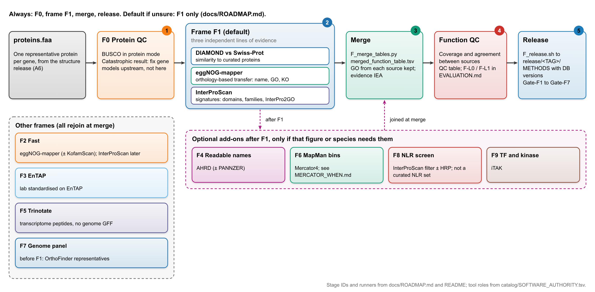

# Preface

This book is a study guide for functional annotation of plant proteomes. It sits beside the gene-function-annotation repository and explains what each step does, why it is there, which tools exist for it, and how to judge the result. The runnable frames (F1, F2, F3, F5, F7), add-ons and acceptance levels stay in the repository ([`README.md`](../../README.md), [`docs/ROADMAP.md`](../../docs/ROADMAP.md), [`docs/EVALUATION.md`](../../docs/EVALUATION.md)); the book does not change the default frame.

*Figure. The functional annotation route of this repository: F0 protein QC, frame F1 (DIAMOND against Swiss-Prot, eggNOG-mapper, InterProScan), merge into `merged_function_table.tsv`, function QC and release. Optional add-ons (F4, F6, F8, F9) join at merge; the other frames (F2, F3, F5) and the F7 panel entry also rejoin at merge. Schematic drawn for this repository from `docs/ROADMAP.md` and README; editable SVG: [`function_route_map_v2.svg`](../../docs/figures/guide/function_route_map_v2.svg).*

## How to read it

- Chapter 1 sets out the concepts: the three ways function is inferred, the vocabularies (GO, KEGG, MapMan), evidence codes, and why errors spread.
- Chapters 2 to 16 follow the type sections of the catalog in the README, one chapter per section. Each chapter repeats the section notes from the README, lists every tool with its paper, lab, tier and a short evaluation, and ends with the benchmark evidence for that step.
- Chapter 17 covers visualization. Chapter 18 explains how to choose a frame and add-ons, Chapter 19 collects pitfalls and quality checks, and Chapter 20 walks through the grapevine teaching example in `examples/plant_sim/01_vitis_s1_s7/`.
- Appendix A is a glossary.

## Sources and how claims are marked

Every statement cites a paper by DOI or a file in this repository. A quote marked “Authors:” is a claim the tool authors make in their own abstract, not an independent result; independent results come from community assessments such as CAFA3 ([doi:10.1186/s13059-019-1835-8](https://doi.org/10.1186/s13059-019-1835-8)) and Quest for Orthologs ([doi:10.1038/nmeth.3830](https://doi.org/10.1038/nmeth.3830)). Tiers and citation counts come from OpenAlex and were retrieved on 2026-11-25; a high count means a tool is widely used, not that it is the most accurate. Chinese teaching notes that go deeper into the repository workflow are in [`docs/zh/`](../../docs/zh/README.md).
