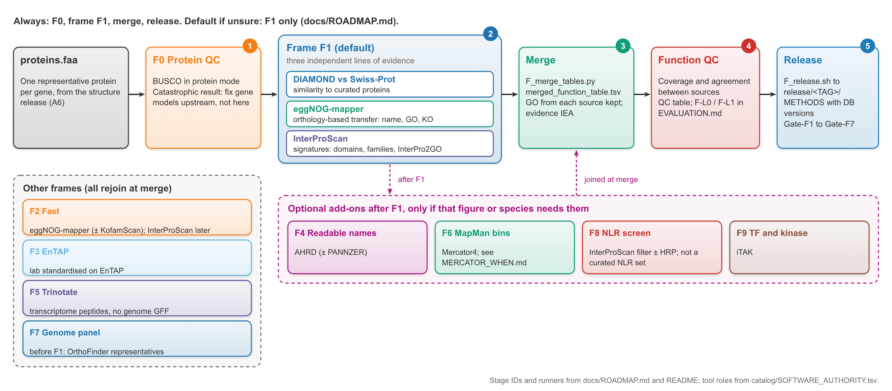

# 前言

本书是植物蛋白组功能注释的学习笔记，与 gene-function-annotation 仓库配套，讲每一步做什么、为什么要做、有哪些工具、结果怎么判断。可运行的框架（F1、F2、F3、F5、F7）、加件和验收等级仍以仓库为准（[`README.zh.md`](../../README.zh.md)、[`docs/ROADMAP.md`](../../docs/ROADMAP.md)、[`docs/EVALUATION.md`](../../docs/EVALUATION.md)）；本书不改变默认框架。

*图：本仓库的功能注释路线：F0 蛋白质控、框架 F1（DIAMOND 比对 Swiss-Prot、eggNOG-mapper、InterProScan）、合并成 `merged_function_table.tsv`、功能质控与发布。可选加件（F4、F6、F8、F9）在合并时并入；其他框架（F2、F3、F5）和多基因组入口 F7 也在合并处汇合。示意图，据 `docs/ROADMAP.md` 与 README 为本仓库绘制；可编辑 SVG：[`function_route_map.svg`](../../docs/figures/guide/function_route_map.svg)。*

## 怎么读

- 第 1 章讲概念：推断功能的三条路、词表（GO、KEGG、MapMan）、证据代码，以及错误为什么会扩散。
- 第 2 至 16 章对应主页目录的类型小节，一节一章。每章先给出主页该节的说明，再列出每个工具的论文、实验室、权威度和一句评价，最后是这一步的评测证据。
- 第 17 章讲可视化，第 18 章讲怎么选框架和加件，第 19 章汇总常见问题和质控，第 20 章用 `examples/plant_sim/01_vitis_s1_s7/` 的葡萄教学例子走一遍。
- 附录 A 是术语表。

## 出处与标注

每个说法都引用带 DOI 的论文或本仓库中的文件。标为“作者摘要原句”的引文是工具作者在自己摘要中的说法，不是独立结果；独立结果来自 CAFA3（[doi:10.1186/s13059-019-1835-8](https://doi.org/10.1186/s13059-019-1835-8)）和 Quest for Orthologs（[doi:10.1038/nmeth.3830](https://doi.org/10.1038/nmeth.3830)）这类社区评测。权威度和被引次数取自 OpenAlex（2026-11-25 取数）；被引多说明用的人多，不等于最准确。更细的仓库流程中文讲解见 [`docs/zh/`](../../docs/zh/README.md)。
