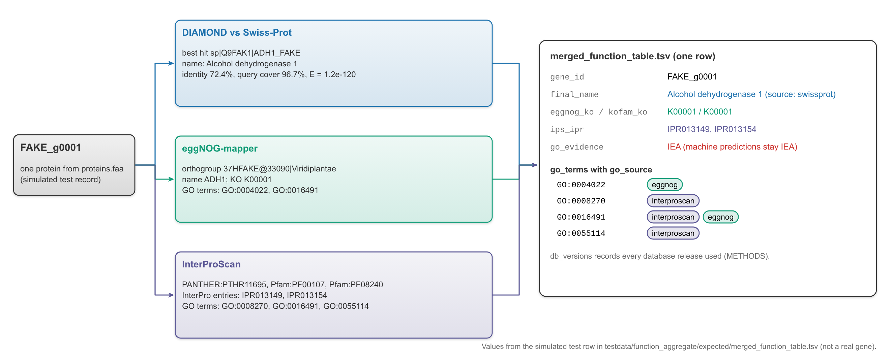

# Chapter 1. Concepts and principles

## 1.1 What functional annotation produces

Functional annotation attaches labels to the proteins of a structure release: readable names, Gene Ontology (GO) terms, KEGG orthologs and pathways, protein domains and families, and optional plant classes such as MapMan bins, NLR or transcription-factor families (README, Overview). The input is `proteins.faa` with one representative sequence per gene, and the product is `merged_function_table.tsv` (README, Data needed alongside the proteins). Gene finding and GFF editing happen in gene-structure-annotation, not here.

## 1.2 Three ways to infer function

- **Similarity to curated proteins.** A fast aligner searches the proteome against a curated set such as Swiss-Prot. The DIAMOND v2 authors report tree-of-life scale searches in hours while matching the sensitivity of BLASTP ([doi:10.1038/s41592-021-01101-x](https://doi.org/10.1038/s41592-021-01101-x)). UniProtKB adds functional data by manual curation of the literature and is moving to limit its sequences to high-quality, non-redundant reference proteomes ([doi:10.1093/nar/gkae1010](https://doi.org/10.1093/nar/gkae1010)).
- **Signatures and domains.** InterPro integrates signatures from several member databases to classify sequences into families and predict domains and sites, with mappings to GO ([doi:10.1093/nar/gkae1082](https://doi.org/10.1093/nar/gkae1082)); InterProScan runs those signatures locally on many sequences ([doi:10.1093/bioinformatics/btu031](https://doi.org/10.1093/bioinformatics/btu031)).
- **Orthology-based transfer.** eggNOG-mapper transfers annotation through precomputed orthology assignments ([doi:10.1093/molbev/msab293](https://doi.org/10.1093/molbev/msab293)); the eggNOG 6.0 database covers 12,535 reference species ([doi:10.1093/nar/gkac1022](https://doi.org/10.1093/nar/gkac1022)).

Newer approaches add protein language models and 3D structure. FANTASIA, applied to about 1,000 animal proteomes, predicted functions for up to 50 percent of proteins left unannotated by homology methods ([doi:10.1038/s42003-025-08651-2](https://doi.org/10.1038/s42003-025-08651-2)). AlphaFold DB holds over 214 million predicted structures ([doi:10.1093/nar/gkad1011](https://doi.org/10.1093/nar/gkad1011)), and Foldseek searches structures four to five orders of magnitude faster than older structural aligners ([doi:10.1038/s41587-023-01773-0](https://doi.org/10.1038/s41587-023-01773-0)).

*Figure. How the three F1 evidence lines for one protein become one row of `merged_function_table.tsv`: each GO term keeps the source that gave it, and machine predictions stay IEA. Values are the simulated test row FAKE_g0001 in `testdata/function_aggregate/expected/merged_function_table.tsv`, not a real gene; schematic drawn for this repository.*

## 1.3 Vocabularies and evidence

- **GO** is a resource describing the functions of genes and is updated regularly ([doi:10.1093/nar/gkaf1292](https://doi.org/10.1093/nar/gkaf1292)); predictions are assessed separately for molecular function, biological process and cellular component ([doi:10.1186/s13059-019-1835-8](https://doi.org/10.1186/s13059-019-1835-8)).
- **Evidence codes.** The Evidence and Conclusion Ontology records the type of evidence behind each annotation so that provenance can be tracked ([doi:10.1093/nar/gkab1025](https://doi.org/10.1093/nar/gkab1025)). In this repository machine-predicted GO and EC stay IEA (inferred from electronic annotation) (README, Cross-cutting pitfalls).
- **KEGG.** Each KEGG Ortholog (KO) is a generic gene identifier, and pathway maps are networks of KO nodes ([doi:10.1093/nar/gkae909](https://doi.org/10.1093/nar/gkae909)). KofamKOALA assigns KOs with profile HMMs and precomputed adaptive score thresholds ([doi:10.1093/bioinformatics/btz859](https://doi.org/10.1093/bioinformatics/btz859)).
- **MapMan.** MapMan4 is a protein classification framework for plants, with the Mercator tool for automated annotation ([doi:10.1016/j.molp.2019.01.003](https://doi.org/10.1016/j.molp.2019.01.003)).

## 1.4 Why errors matter

A study of 37 enzyme families found misannotation levels of 5 to 63 percent on average in GenBank NR, TrEMBL and KEGG, against close to 0 percent in manually curated Swiss-Prot, mostly from overprediction of molecular function ([doi:10.1371/journal.pcbi.1000605](https://doi.org/10.1371/journal.pcbi.1000605)). The CAFA3 assessment found that predictions of molecular function and biological process had only slightly improved and cellular component had not ([doi:10.1186/s13059-019-1835-8](https://doi.org/10.1186/s13059-019-1835-8)). Very specific GO terms are harder to predict than general ones ([doi:10.1101/gr.280816.125](https://doi.org/10.1101/gr.280816.125)). This is why the repository keeps predicted labels marked as predictions and records database versions in METHODS.

## 1.5 Structure comes first

Function labels inherit every error in the gene models. Different annotation sources for the same genomes gave markedly different orthology results ([doi:10.1093/bioinformatics/btaf365](https://doi.org/10.1093/bioinformatics/btaf365)). The repository therefore starts with F0, a protein BUSCO check, and sends a bad proteome back to structure annotation instead of fixing it here (`examples/plant_sim/01_vitis_s1_s7/plan.md`; README, Data needed).

## 1.6 Orthology across genomes

Orthology inference methods trade precision against recall; the Quest for Orthologs service benchmarked 15 methods on 20 benchmarks ([doi:10.1038/nmeth.3830](https://doi.org/10.1038/nmeth.3830)). OrthoFinder 3 reports a 7 percent relative increase in orthogroup accuracy over the previous version ([doi:10.1101/2025.07.15.664860](https://doi.org/10.1101/2025.07.15.664860)). For a genome panel the repository annotates orthogroup representatives (frame F7), not each gene (README, Cross-cutting pitfalls).

## 1.7 Targeting and topology

SignalP 6.0 detects all five signal peptide types ([doi:10.1038/s41587-021-01156-3](https://doi.org/10.1038/s41587-021-01156-3)); TargetP 2.0 identifies N-terminal signals to the secretory pathway, mitochondria and chloroplasts ([doi:10.26508/lsa.201900429](https://doi.org/10.26508/lsa.201900429)); DeepLoc 2.1 predicts subcellular location and membrane protein type ([doi:10.1093/nar/gkae237](https://doi.org/10.1093/nar/gkae237)); DeepTMHMM predicts the topology of alpha-helical and beta-barrel transmembrane proteins ([doi:10.1101/2022.04.08.487609](https://doi.org/10.1101/2022.04.08.487609)).

## 1.8 Enrichment

Enrichment tests ask whether a gene list carries some labels more often than a background. Standard methods are biased on RNA-seq data because long and highly expressed transcripts are detected more often ([doi:10.1186/gb-2010-11-2-r14](https://doi.org/10.1186/gb-2010-11-2-r14)). Long GO lists are redundant and can be summarized by semantic similarity ([doi:10.1371/journal.pone.0021800](https://doi.org/10.1371/journal.pone.0021800)). The background should be the full release gene set (README, Data needed).
