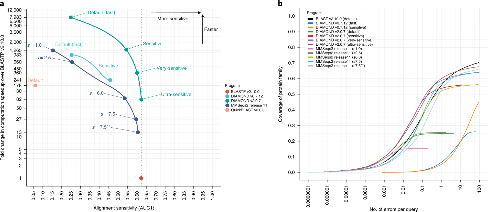

# 第 2 章 同源搜索

*本章收录[主页第 1 节](../../README.zh.md#section-1)：该节说明、含论文、实验室、权威度和评价的完整工具表，以及评测要点。链接指回仓库。*

框架 F1 同源搜索步骤所用的序列相似性比对工具。

**需要：** 本地 DIAMOND（或 BLAST）数据库，一般选用 Swiss-Prot 或有书面说明的同等级库，并将版本号记入 METHODS。[按场景列出的数据需求](../../README.zh.md#data-needs)

*图：DIAMOND、MMseqs2 等各搜索模式相对 BLASTP 的加速倍数与比对灵敏度（a），以及每条查询的错误数与蛋白家族覆盖度的关系（b）。原图未修改，引自 Buchfink B、Reuter K、Drost H-G（2021），Sensitive protein alignments at tree-of-life scale using DIAMOND，Nature Methods 18:366-368，Fig. 1，doi:10.1038/s41592-021-01101-x，PMC8026399，许可 CC BY 4.0 (https://creativecommons.org/licenses/by/4.0/)。*

**分组：**
- *快速两两搜索*（可替代）：DIAMOND (v2)、MMseqs2、BLAST+。F1 默认用 DIAMOND；聚类和超大数据集用 MMseqs2（CPU 或 GPU）；小规模参考核对用 BLAST+。
- *谱搜索*（互补）：HMMER 3、HH-suite3。Pfam 式 HMM 搜索用 HMMER；疑难蛋白用 HH-suite3 做谱对谱比对。
- *语言模型远缘同源*（可替代）：PLMSearch、pLM-BLAST、Dense Homolog Retriever (DHR)。仅用于经 DIAMOND 和 HMMER 检索后仍无命中的蛋白；结果作为独立证据类别报告。

各条目的单句简介译自英文目录，英文原句见英文版 README。

| 工具 | 角色 | 用途 / 何时用 | 原始论文 | 实验室（通讯作者，机构） | 权威度（档位 · 被引） | 评价（出处） |
|---|---|---|---|---|---|---|
| [BLAST+](https://blast.ncbi.nlm.nih.gov/) | 备选 | NCBI BLAST 命令行工具集（含 blastp、makeblastdb）。 | [BMC Bioinformatics 2009](https://doi.org/10.1186/1471-2105-10-421) | Thomas Madden (National Institutes of Health) | 标准 · 25016 次 | 无摘要或仓库说明可引；见原文 |
| [DIAMOND (v2)](https://github.com/bbuchfink/diamond) | 默认（F1） | 高速蛋白序列比对工具，支持类 BLAST 的高灵敏度模式（`--ultra-sensitive`）。 | [Nature Methods 2021](https://doi.org/10.1038/s41592-021-01101-x) | Hajk‐Georg Drost (Max Planck Institute for Developmental Biology) | 标准 · 5873 次 | 作者摘要原句：“Here, we introduce an improved version of DIAMOND that greatly exceeds previous search performances and harnesses supercomputing to perform tree-of-life scale protein alignments in hours, while matching the sensitivity of the gold standard BLASTP.”；GitHub 最后提交 2026-11 |
| [MMseqs2](https://github.com/soedinglab/MMseqs2) | 备选 | 快速、高灵敏度的蛋白序列搜索与聚类工具。GPU 加速版（MMseqs2-GPU，doi:10.1038/s41592-025-02819-8）基于同一套代码，并能加速 ColabFold 的多序列比对。 | [Nature Biotechnology 2017](https://doi.org/10.1038/nbt.3988) | Johannes Söding (Max Planck Institute for Biophysical Chemistry) | 标准 · 5716 次 | GitHub 最后提交 2026-11 |
| [HMMER 3](https://github.com/EddyRivasLab/hmmer) | 备选 | 基于 profile HMM 的同源搜索工具（含 hmmscan、hmmsearch、jackhmmer）。 | [PLoS Computational Biology 2011](https://doi.org/10.1371/journal.pcbi.1002195) | Sean R. Eddy (Howard Hughes Medical Institute) | 标准 · 7895 次 | 作者摘要原句：“HMMER3 is substantially more sensitive and 100- to 1000-fold faster than HMMER2.”；GitHub 最后提交 2026-10 |
| [HH-suite3](https://github.com/soedinglab/hh-suite) | 备选 | 用于远缘同源检测的 HMM-HMM 比对工具（含 HHblits、HHsearch）。 | [BMC Bioinformatics 2019](https://doi.org/10.1186/s12859-019-3019-7) | Johannes Söding (Max Planck Institute for Biophysical Chemistry) | 标准 · 1253 次 | GitHub 最后提交 2026-10 |
| [PLMSearch](https://github.com/maovshao/PLMSearch) | 备选 | 通过比对蛋白语言模型嵌入检测远缘同源蛋白；能检出低序列一致性下被 BLAST 和 DIAMOND 遗漏的命中。 | [Nature Communications 2024](https://doi.org/10.1038/s41467-024-46808-5) | Jianyi Yang (Shandong University) +1 | 成熟 · 125 次 | 作者摘要原句：“Extensive experimental results show that PLMSearch can search millions of query-target protein pairs in seconds like MMseqs2 while increasing the sensitivity by more than threefold, and is comparable to state-of-the-art structure search methods.”；GitHub 最后提交 2025-09 |
| [pLM-BLAST](https://github.com/labstructbioinf/pLM-BLAST) | 备选 | 对逐残基语言模型嵌入执行局部比对，用于检测远缘同源关系并定位匹配区域。 | [Bioinformatics 2023](https://doi.org/10.1093/bioinformatics/btad579) | Stanisław Dunin-Horkawicz (Max Planck Institute for Biology) | 较新 · 96 次 | 作者摘要原句：“Our benchmarks reveal that pLM-BLAST maintains a level of accuracy on par with HHsearch for both highly similar sequences (with >50% identity) and markedly divergent sequences (with <30% identity), while being significantly faster.”；GitHub 最后提交 2026-10 |
| [Dense Homolog Retriever (DHR)](https://github.com/ml4bio/Dense-Homolog-Retrieval) | 备选 | 基于稠密检索的远缘同源搜索工具，兼顾速度与灵敏度；同时可为结构预测构建多序列比对。 | [Nature Biotechnology 2024](https://doi.org/10.1038/s41587-024-02353-6) | Siqi Sun (Fudan University) +2 | 较新 · 58 次 | 作者摘要原句：“Here, we offer an ultrafast, highly sensitive method, dense homolog retriever (DHR), for detecting homologs on the basis of a protein language model and dense retrieval techniques.”；GitHub 最后提交 2026-06 |
