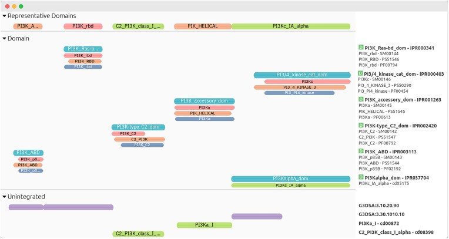
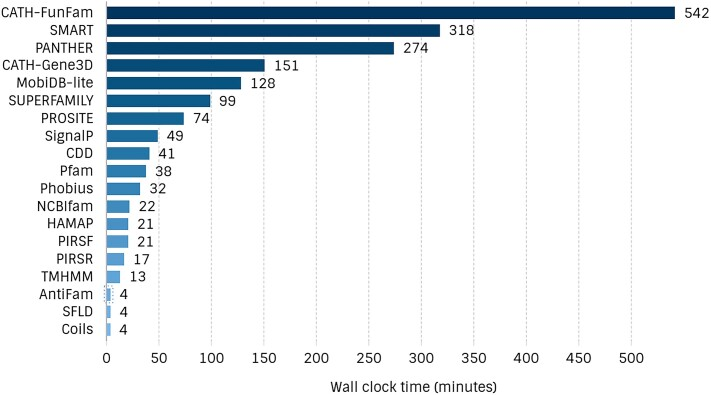

# Chapter 4. Domain and family annotation

*This chapter reproduces [README section 3](../../README.md#section-3): the section notes, the full tool table with paper, lab, tier and evaluation, and the benchmark notes. Links point back into the repository.*

Domain and family annotation in the frame F1 domain step (InterProScan and related data).

**Needs:** a working InterProScan install and its data; this step is slow and is part of default frame F1, but F-L1 does not require finishing IPS the same day. [Data needs by scenario](../../README.md#data-needs)

**Clusters:**
- *HMM signatures* (complementary): InterProScan 6, SMART (2021 update), CDD / CD-Search (2023). InterProScan is the F1 default; use SMART and CDD for signalling and domain-architecture checks.
- *Family-tree placement* (in order): PANTHER, TreeGrafter. TreeGrafter places proteins onto PANTHER trees for phylogenetic GO assignment.

*InterPro domain annotation of PIK3CA (Fig. 4). Blum, Andreeva, Florentino et al. 2025, Nucleic Acids Res., Fig. 4, doi:10.1093/nar/gkae1082, PMC11701551, CC BY.*

*InterProScan runtime on a human proteome (Fig. 6). Blum, Andreeva, Florentino et al. 2025, Nucleic Acids Res., Fig. 6, doi:10.1093/nar/gkae1082, PMC11701551, CC BY.*

| Tool | Role | What it does / when to use | Paper | Lab (corresponding author, institution) | Tier · citations | Evaluation (source) |
|---|---|---|---|---|---|---|
| [InterProScan 6](https://github.com/ebi-pf-team/interproscan6) | default (F1) | Runs InterPro member databases (Pfam, PANTHER, SMART, CDD, Gene3D…) and maps InterPro2GO. Version 6 (2025–2026 Nextflow releases) is current, while the citable paper remains InterProScan 5. This repo's F1 runner was written for v5 [待确认: test v6 output columns before switching]. | [Bioinformatics 2014](https://doi.org/10.1093/bioinformatics/btu031) | Alex Mitchell (European Bioinformatics Institute) +1 | standard · 10656 | Paper: “Here, we describe a new Java-based architecture for the widely used protein function prediction software package InterProScan.”; GitHub last push 2026-11 |
| [SMART (2021 update)](https://smart.embl.de) | resource | Signalling/extracellular domain resource (member DB of InterPro). | [Nucleic Acids Research 2020](https://doi.org/10.1093/nar/gkaa937) | Peer Bork (Max Delbrück Center) | standard · 2441 | no abstract or repo text available; see paper |
| [CDD / CD-Search (2023)](https://www.ncbi.nlm.nih.gov/Structure/cdd/cdd.shtml) | resource | NCBI conserved-domain models and SPARCLE architectures. | [Nucleic Acids Research 2022](https://doi.org/10.1093/nar/gkac1096) | Aron Marchler‐Bauer (National Institutes of Health) | standard · 1479 | no abstract or repo text available; see paper |
| [PANTHER](https://www.pantherdb.org/) | resource | Phylogenetic protein families and subfamilies with tree-inferred GO annotations; InterProScan can report PANTHER hits. | [Protein Science 2021](https://doi.org/10.1002/pro.4218) | Paul D. Thomas (University of Southern California) | standard · 2293 | Paper: “Here, we describe in detail the current contents of PANTHER, how those contents are generated, and how they can be used in a variety of applications.” |
| [TreeGrafter](https://github.com/pantherdb/TreeGrafter) | alternative | Grafts query proteins onto PANTHER family trees and transfers GO terms from the nearest annotated ancestor. | [Bioinformatics 2018](https://doi.org/10.1093/bioinformatics/bty625) | Paul D. Thomas (University of Southern California) | niche · 81 | Authors: “We show that TreeGrafter outperforms subfamily HMM scoring for correctly assigning subfamily membership, and that it produces highly specific annotations of GO terms based on annotated reference phylogenetic trees.”; GitHub last push 2026-04 |
| [ProteInfer](https://github.com/google-research/proteinfer) | alternative | Deep neural network that predicts Pfam, EC and GO labels directly from sequence; provides a fast check for proteins without HMM hits. | [eLife 2023](https://doi.org/10.7554/eLife.80942) | Theo Sanderson (The Francis Crick Institute) | established · 216 | Paper: “Here we introduce ProteInfer, which instead employs deep convolutional neural networks to directly predict a variety of protein functions - Enzyme Commission (EC) numbers and Gene Ontology (GO) terms - directly from an unaligned amino acid sequence.”; GitHub last push 2026-03 |
