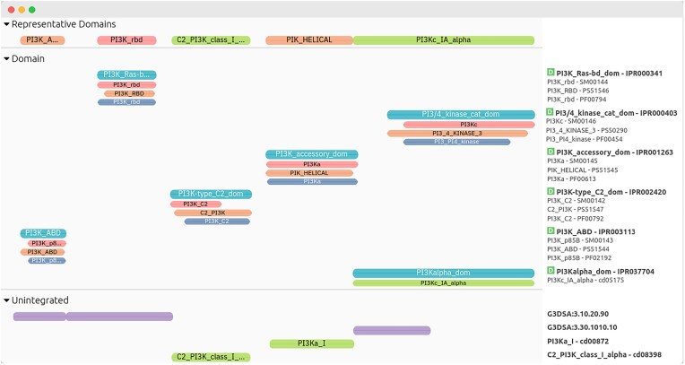
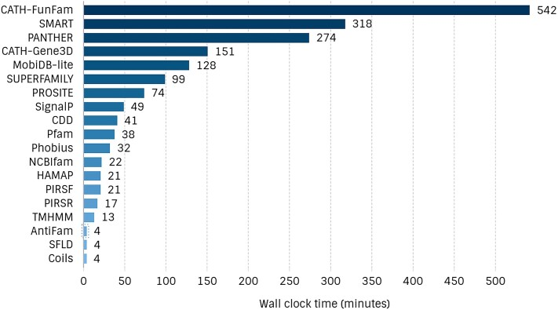

# 第 4 章 结构域与家族注释

*本章收录[主页第 3 节](../../README.zh.md#section-3)：该节说明、含论文、实验室、权威度和评价的完整工具表，以及评测要点。链接指回仓库。*

框架 F1 结构域步骤中的蛋白结构域与家族注释（InterProScan 及配套数据）。

**需要：** 正常可用的 InterProScan 程序及配套数据库；这一步耗时较长，虽属默认框架 F1，但 F-L1 并不要求当天跑完 IPS。[按场景列出的数据需求](../../README.zh.md#data-needs)

**分组：**
- *HMM 特征*（互补）：InterProScan 6、SMART (2021 update)、CDD / CD-Search (2023)。F1 默认用 InterProScan；信号域与结构域架构核对用 SMART 和 CDD。
- *家族树定位*（按顺序）：PANTHER、TreeGrafter。TreeGrafter 将蛋白放置到 PANTHER 进化树上，完成基于系统发育的 GO 注释。

*InterPro 对 PIK3CA 蛋白的结构域注释展示（图 4）。 Blum、Andreeva、Florentino 等 2025，《Nucleic Acids Research》图 4，doi:10.1093/nar/gkae1082，PMC11701551，CC BY。*

*InterProScan 在人类蛋白组上的运行耗时表现（图 6）。 Blum、Andreeva、Florentino 等 2025，《Nucleic Acids Research》图 6，doi:10.1093/nar/gkae1082，PMC11701551，CC BY。*

| 工具 | 角色 | 用途 / 何时用 | 原始论文 | 实验室（通讯作者，机构） | 权威度（档位 · 被引） | 评价（出处） |
|---|---|---|---|---|---|---|
| [InterProScan 6](https://github.com/ebi-pf-team/interproscan6) | 默认（F1） | 调用 InterPro 各成员库（Pfam、PANTHER、SMART、CDD、Gene3D 等）并完成 InterPro2GO 映射。当前版本为 6（2025–2026 年基于 Nextflow 发布），引用论文仍沿用 InterProScan 5。本仓库 F1 的运行脚本针对 v5 编写 [待确认：切换前先测试 v6 的输出列]。 | [Bioinformatics 2014](https://doi.org/10.1093/bioinformatics/btu031) | Alex Mitchell (European Bioinformatics Institute) +1 | 标准 · 10656 次 | 论文摘要：“Here, we describe a new Java-based architecture for the widely used protein function prediction software package InterProScan.”；GitHub 最后提交 2026-11 |
| [SMART (2021 update)](https://smart.embl.de) | 资源 | 信号转导与胞外结构域资源库（InterPro 成员数据库）。 | [Nucleic Acids Research 2020](https://doi.org/10.1093/nar/gkaa937) | Peer Bork (Max Delbrück Center) | 标准 · 2441 次 | 无摘要或仓库说明可引；见原文 |
| [CDD / CD-Search (2023)](https://www.ncbi.nlm.nih.gov/Structure/cdd/cdd.shtml) | 资源 | NCBI 保守结构域模型与 SPARCLE 结构域架构数据库。 | [Nucleic Acids Research 2022](https://doi.org/10.1093/nar/gkac1096) | Aron Marchler‐Bauer (National Institutes of Health) | 标准 · 1479 次 | 无摘要或仓库说明可引；见原文 |
| [PANTHER](https://www.pantherdb.org/) | 资源 | 附带进化树推断 GO 注释的系统发育蛋白家族与亚家族数据库；InterProScan 可直接报告 PANTHER 命中。 | [Protein Science 2021](https://doi.org/10.1002/pro.4218) | Paul D. Thomas (University of Southern California) | 标准 · 2293 次 | 论文摘要：“Here, we describe in detail the current contents of PANTHER, how those contents are generated, and how they can be used in a variety of applications.” |
| [TreeGrafter](https://github.com/pantherdb/TreeGrafter) | 备选 | 将查询蛋白嫁接至 PANTHER 家族进化树，并从最近的已注释祖先节点转移 GO 条目。 | [Bioinformatics 2018](https://doi.org/10.1093/bioinformatics/bty625) | Paul D. Thomas (University of Southern California) | 小众 · 81 次 | 作者摘要原句：“We show that TreeGrafter outperforms subfamily HMM scoring for correctly assigning subfamily membership, and that it produces highly specific annotations of GO terms based on annotated reference phylogenetic trees.”；GitHub 最后提交 2026-04 |
| [ProteInfer](https://github.com/google-research/proteinfer) | 备选 | 直接从氨基酸序列预测 Pfam、EC 和 GO 标签的深度神经网络；适合快速核查无 HMM 命中的蛋白。 | [eLife 2023](https://doi.org/10.7554/eLife.80942) | Theo Sanderson (The Francis Crick Institute) | 成熟 · 216 次 | 论文摘要：“Here we introduce ProteInfer, which instead employs deep convolutional neural networks to directly predict a variety of protein functions - Enzyme Commission (EC) numbers and Gene Ontology (GO) terms - directly from an unaligned amino acid sequence.”；GitHub 最后提交 2026-03 |
