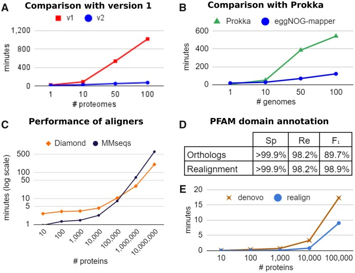
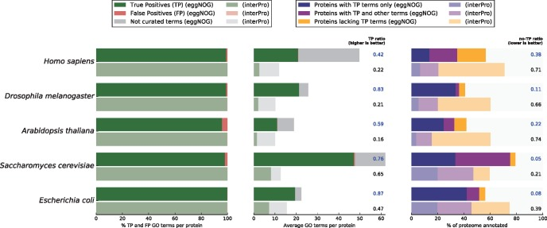
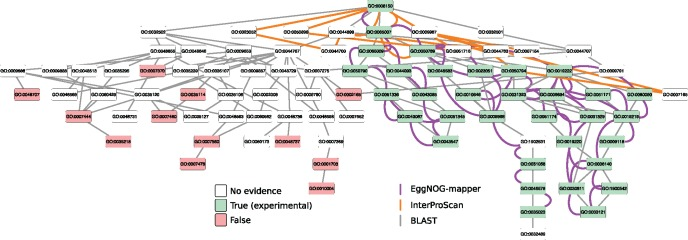

# Chapter 5. Orthology-based names, GO and KEGG

*This chapter reproduces [README section 4](../../README.md#section-4): the section notes, the full tool table with paper, lab, tier and evaluation, and the benchmark notes. Links point back into the repository.*

Orthology or similarity-based names, GO and KEGG, including whole frames (F1 orthology step, fast frame F2, EnTAP frame F3, F4 readable names).

**Needs:** the eggNOG-mapper database (and, for names, optional AHRD / PANNZER inputs). Machine-assigned GO remains electronic evidence (IEA). [Data needs by scenario](../../README.md#data-needs)

**Clusters:**
- *Readable names* (alternatives): AHRD, PANNZER2, Sma3s v2. AHRD is the F4 default; PANNZER2 adds scored GO predictions.
- *All-in-one suites* (alternatives): EnTAP, Trinotate, Blast2GO, FA-nf, GOMAP, TRAPID 2.0. Alternatives to F1 rather than add-ons: EnTAP (F3), Trinotate (F5); GOMAP is plant-focused, and Blast2GO is commercial.
- *Orthology and placement* (complementary): eggNOG-mapper v2, OMAmer, FANTASIA. eggNOG-mapper v2 is the F1 default for GO, KEGG and EC; OMAmer for quick family placement; FANTASIA only for proteins with no homology hits.

*eggNOG-mapper v2 runtime compared with other annotators (Fig. 2). Cantalapiedra et al. 2021, Mol. Biol. Evol., Fig. 2, doi:10.1093/molbev/msab293, PMC8662613, CC BY.*

*eggNOG-mapper compared with InterProScan (Fig. 3). Huerta-Cepas et al. 2017, Mol. Biol. Evol., Fig. 3, doi:10.1093/molbev/msx148, PMC5850834, CC BY.*

*eggNOG-mapper GO assignment on a worked example (Fig. 4). Huerta-Cepas et al. 2017, Mol. Biol. Evol., Fig. 4, doi:10.1093/molbev/msx148, PMC5850834, CC BY.*

| Tool | Role | What it does / when to use | Paper | Lab (corresponding author, institution) | Tier · citations | Evaluation (source) |
|---|---|---|---|---|---|---|
| [eggNOG-mapper v2](https://github.com/eggnogdb/eggnog-mapper) | default (F1) | Orthology-based functional annotation: names, GO, KEGG, EC, COG. | [Molecular Biology and Evolution 2021](https://doi.org/10.1093/molbev/msab293) | Peer Bork (Yonsei University) +1 | standard · 6146 | Paper: “Here, we describe a major upgrade to eggNOG-mapper, a tool for functional annotation based on precomputed orthology assignments, now optimized for vast (meta)genomic data sets.”; GitHub last push 2026-08 |
| [PANNZER2](http://ekhidna2.biocenter.helsinki.fi/sanspanz/) | alternative | Fast web/standalone GO and free-text description prediction. | [Nucleic Acids Research 2018](https://doi.org/10.1093/nar/gky350) | Petri Törönen (University of Helsinki) +1 | standard · 595 | Paper: “Here, we introduce PANNZER2 (Protein ANNotation with Z-scoRE), a fast functional annotation web server that provides both Gene Ontology (GO) annotations and free text description predictions.” |
| [Blast2GO](https://www.biobam.com/omicsbox/) | alternative | BLAST-based GO annotation and visualisation (now in commercial OmicsBox). | [Bioinformatics 2005](https://doi.org/10.1093/bioinformatics/bti610) | Ana Conesa (Alfred-Wegener-Institut Helmholtz-Zentrum für Polar- und Meeresforschung) | standard · 12842 | Paper: “We present here Blast2GO (B2G), a research tool designed with the main purpose of enabling Gene Ontology (GO) based data mining on sequence data for which no GO annotation is yet available.” |
| [EnTAP](https://github.com/harta55/EnTAP) | alternative | Eukaryotic non-model annotation pipeline: filtering, similarity search, contaminant flags, eggNOG and InterPro. | [Molecular Ecology Resources 2019](https://doi.org/10.1111/1755-0998.13106) | Jill Wegrzyn (University of Connecticut) | established · 250 | Authors: “EnTAP (Eukaryotic Non-Model Transcriptome Annotation Pipeline) was designed to improve the accuracy, speed, and flexibility of functional gene annotation for de novo assembled transcriptomes in non-model eukaryotes.”; archived on GitHub (last push 2025-01) |
| [FA-nf](https://github.com/guigolab/FA-nf) | alternative | Nextflow functional annotation pipeline for non-model proteins (BLAST, InterProScan, KEGG, signal peptides). | [Genes 2021](https://doi.org/10.3390/genes12101645) | Antonio Hermoso (Barcelona Institute of Science and Technology) | niche · 7 | Authors: “It is also useful for proofreading and improving gene structural annotation.”; GitHub last push 2022-02 |
| [Sma3s v2](https://github.com/UPOBioinfo/sma3s) | alternative | Functional annotation of proteomes/transcriptomes against UniProt (GO, keywords, pathways). | [PROTEOMICS 2017](https://doi.org/10.1002/pmic.201700071) | Antonio J. Pérez‐Pulido (Consejo Superior de Investigaciones Científicas) | established · 107 | Authors: “Sma3s is an accurate computational tool for annotating proteins in an unattended way.”; GitHub last push 2026-09 |
| [AHRD](https://github.com/groupschoof/AHRD) | default (F4) | Automated assignment of Human Readable Descriptions from BLAST results. | no paper | — | no paper | Repo description: “High throughput protein function annotation with Human Readable Description (HRDs) and Gene Ontology (GO) Terms.”; GitHub last push 2023-08 |
| [GOMAP](https://github.com/Dill-PICL/GOMAP) | alternative | Gene Ontology Meta Annotator for Plants: combines sequence similarity, domains and mixed-method predictors into plant GO sets. | [Plant Methods 2021](https://doi.org/10.1186/s13007-021-00754-1) | Kokulapalan Wimalanathan (Iowa State University) +1 | niche · 56 | Authors: “Assessment shows that GOMAP expands and improves the number of genes annotated and annotations assigned per gene as well as the quality (based on [Formula: see text]) of GO assignments in maize.”; GitHub last push 2023-05 |
| [TRAPID 2.0](https://bioinformatics.psb.ugent.be/trapid_02/) | alternative | Web app for taxonomic and functional analysis of de novo plant transcriptomes using PLAZA references. | [Nucleic Acids Research 2021](https://doi.org/10.1093/nar/gkab565) | Klaas Vandepoele (Ghent University) | niche · 79 | Paper: “To alleviate some of these challenges, we developed TRAPID 2.0, a web application for the fast and efficient processing of assembled transcriptome data.” |
| [OMAmer](https://github.com/DessimozLab/omamer) | alternative | Alignment-free placement of proteins into OMA hierarchical orthologous groups; fast and subfamily-aware (also used by OMArk). | [Bioinformatics 2021](https://doi.org/10.1093/bioinformatics/btab219) | Marc Robinson‐Rechavi (SIB Swiss Institute of Bioinformatics) +1 | niche · 25 | Authors: “Whilst able to reject non-homologous family-level assignments, we show that OMAmer provides better and quicker subfamily-level assignments than approaches relying on the closest sequence, whether inferred exactly by Smith-Waterman or by the fast heuristic …”; GitHub last push 2026-11 |
| [FANTASIA](https://github.com/CBBIO/FANTASIA) | alternative | Transfers GO terms via embedding similarity across whole proteomes; targets "dark" proteins with no homology-based annotation. | [Communications Biology 2025](https://doi.org/10.1038/s42003-025-08651-2) | Gemma I. Martínez‐Redondo (Institut de Biologia Evolutiva) +2 | newer · 38 | Authors: “FANTASIA holds particular promise for functional discovery in non-model taxa, offering advantages over homology-based tools in sensitivity and generalizability.”; GitHub last push 2026-09 |
| [Trinotate](https://github.com/Trinotate/Trinotate) | F5 path | Annotation suite for de novo transcriptome peptides (loads BLAST, Pfam, SignalP and GO results into SQLite); serves as the F5 path. The cited study is the reference requested by the authors. | [Cell Reports 2017](https://doi.org/10.1016/j.celrep.2016.12.063) | Brian J. Haas (Broad Institute) +1 | standard · 1176 | GitHub last push 2026-11 |
