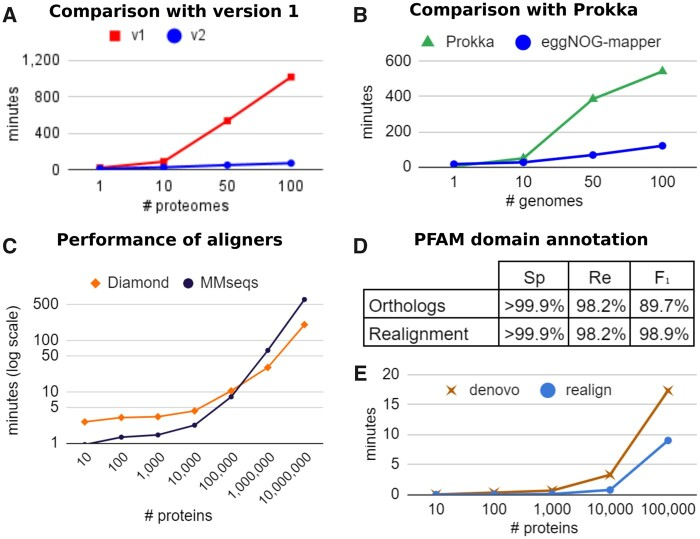
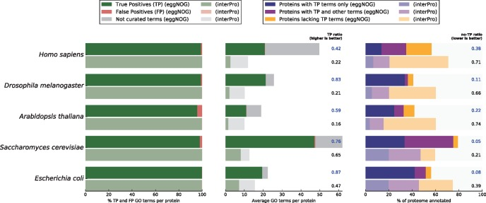
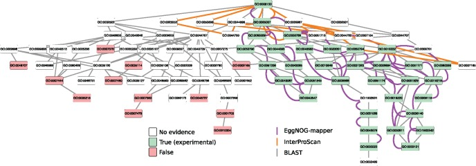

# 第 5 章 基于直系同源的名称、GO 与 KEGG

*本章收录[主页第 4 节](../../README.zh.md#section-4)：该节说明、含论文、实验室、权威度和评价的完整工具表，以及评测要点。链接指回仓库。*

基于直系同源或序列相似性的基因名称、GO 与 KEGG 注释，亦涵盖完整注释框架（F1 直系同源步骤、快速框架 F2、EnTAP 框架 F3、F4 可读名称）。

**需要：** eggNOG-mapper 数据库（若需生成可读名称，再补充可选的 AHRD / PANNZER 输入）。机器自动分配的 GO 仍归为电子注释证据（IEA）。[按场景列出的数据需求](../../README.zh.md#data-needs)

**分组：**
- *可读名称*（可替代）：AHRD、PANNZER2、Sma3s v2。F4 默认用 AHRD；PANNZER2 同时输出带评分的 GO 预测。
- *一体化套件*（可替代）：EnTAP、Trinotate、Blast2GO、FA-nf、GOMAP、TRAPID 2.0。均为 F1 的替代方案而非附加步骤：含 EnTAP（F3）和 Trinotate（F5）；GOMAP 面向植物；Blast2GO 为商业软件。
- *直系同源转移与定位*（互补）：eggNOG-mapper v2、OMAmer、FANTASIA。eggNOG-mapper v2 是 F1 中 GO、KEGG 和 EC 的默认来源；OMAmer 用于快速定位家族；FANTASIA 只用于没有同源命中的蛋白。

*eggNOG-mapper v2 与其他功能注释工具的运行耗时对比（图 2）。 Cantalapiedra 等 2021，《Molecular Biology and Evolution》图 2，doi:10.1093/molbev/msab293，PMC8662613，CC BY。*

*eggNOG-mapper 与 InterProScan 的注释结果对比（图 3）。 Huerta-Cepas 等 2017，《Molecular Biology and Evolution》图 3，doi:10.1093/molbev/msx148，PMC5850834，CC BY。*

*eggNOG-mapper 在具体实例上的 GO 分配过程（图 4）。 Huerta-Cepas 等 2017，《Molecular Biology and Evolution》图 4，doi:10.1093/molbev/msx148，PMC5850834，CC BY。*

| 工具 | 角色 | 用途 / 何时用 | 原始论文 | 实验室（通讯作者，机构） | 权威度（档位 · 被引） | 评价（出处） |
|---|---|---|---|---|---|---|
| [eggNOG-mapper v2](https://github.com/eggnogdb/eggnog-mapper) | 默认（F1） | 基于直系同源的功能注释工具：分配基因名称、GO、KEGG、EC 与 COG。 | [Molecular Biology and Evolution 2021](https://doi.org/10.1093/molbev/msab293) | Peer Bork (Yonsei University) +1 | 标准 · 6146 次 | 论文摘要：“Here, we describe a major upgrade to eggNOG-mapper, a tool for functional annotation based on precomputed orthology assignments, now optimized for vast (meta)genomic data sets.”；GitHub 最后提交 2026-08 |
| [PANNZER2](http://ekhidna2.biocenter.helsinki.fi/sanspanz/) | 备选 | 快速的网页端及本地端 GO 与自由文本功能描述预测工具。 | [Nucleic Acids Research 2018](https://doi.org/10.1093/nar/gky350) | Petri Törönen (University of Helsinki) +1 | 标准 · 595 次 | 论文摘要：“Here, we introduce PANNZER2 (Protein ANNotation with Z-scoRE), a fast functional annotation web server that provides both Gene Ontology (GO) annotations and free text description predictions.” |
| [Blast2GO](https://www.biobam.com/omicsbox/) | 备选 | 基于 BLAST 的 GO 注释与可视化工具（现已并入商业软件 OmicsBox）。 | [Bioinformatics 2005](https://doi.org/10.1093/bioinformatics/bti610) | Ana Conesa (Alfred-Wegener-Institut Helmholtz-Zentrum für Polar- und Meeresforschung) | 标准 · 12842 次 | 论文摘要：“We present here Blast2GO (B2G), a research tool designed with the main purpose of enabling Gene Ontology (GO) based data mining on sequence data for which no GO annotation is yet available.” |
| [EnTAP](https://github.com/harta55/EnTAP) | 备选 | 非模式真核生物注释流程：整合序列过滤、相似性搜索、污染标记、eggNOG 与 InterPro。 | [Molecular Ecology Resources 2019](https://doi.org/10.1111/1755-0998.13106) | Jill Wegrzyn (University of Connecticut) | 成熟 · 250 次 | 作者摘要原句：“EnTAP (Eukaryotic Non-Model Transcriptome Annotation Pipeline) was designed to improve the accuracy, speed, and flexibility of functional gene annotation for de novo assembled transcriptomes in non-model eukaryotes.”；GitHub 已归档（最后提交 2025-01） |
| [FA-nf](https://github.com/guigolab/FA-nf) | 备选 | 面向非模式生物蛋白的 Nextflow 功能注释流程（串联 BLAST、InterProScan、KEGG 与信号肽预测）。 | [Genes 2021](https://doi.org/10.3390/genes12101645) | Antonio Hermoso (Barcelona Institute of Science and Technology) | 小众 · 7 次 | 作者摘要原句：“It is also useful for proofreading and improving gene structural annotation.”；GitHub 最后提交 2022-02 |
| [Sma3s v2](https://github.com/UPOBioinfo/sma3s) | 备选 | 比对 UniProt 为蛋白组或转录组分配 GO、关键词与代谢通路的功能注释工具。 | [PROTEOMICS 2017](https://doi.org/10.1002/pmic.201700071) | Antonio J. Pérez‐Pulido (Consejo Superior de Investigaciones Científicas) | 成熟 · 107 次 | 作者摘要原句：“Sma3s is an accurate computational tool for annotating proteins in an unattended way.”；GitHub 最后提交 2026-09 |
| [AHRD](https://github.com/groupschoof/AHRD) | 默认（F4） | 根据 BLAST 比对结果自动分配可读基因功能描述（Human Readable Descriptions）的工具。 | 无文章 | — | 无论文 | 仓库简介：“High throughput protein function annotation with Human Readable Description (HRDs) and Gene Ontology (GO) Terms.”；GitHub 最后提交 2023-08 |
| [GOMAP](https://github.com/Dill-PICL/GOMAP) | 备选 | 面向植物的 GO 元注释工具（GOMAP）：整合序列相似性、结构域与混合方法预测结果以生成植物 GO 集。 | [Plant Methods 2021](https://doi.org/10.1186/s13007-021-00754-1) | Kokulapalan Wimalanathan (Iowa State University) +1 | 小众 · 56 次 | 作者摘要原句：“Assessment shows that GOMAP expands and improves the number of genes annotated and annotations assigned per gene as well as the quality (based on [Formula: see text]) of GO assignments in maize.”；GitHub 最后提交 2023-05 |
| [TRAPID 2.0](https://bioinformatics.psb.ugent.be/trapid_02/) | 备选 | 基于 PLAZA 参考库对从头组装的植物转录组做分类学与功能分析的网页工具。 | [Nucleic Acids Research 2021](https://doi.org/10.1093/nar/gkab565) | Klaas Vandepoele (Ghent University) | 小众 · 79 次 | 论文摘要：“To alleviate some of these challenges, we developed TRAPID 2.0, a web application for the fast and efficient processing of assembled transcriptome data.” |
| [OMAmer](https://github.com/DessimozLab/omamer) | 备选 | 将蛋白免比对归入 OMA 层级直系同源群；运行速度快且能区分亚家族（OMArk 底层亦调用该工具）。 | [Bioinformatics 2021](https://doi.org/10.1093/bioinformatics/btab219) | Marc Robinson‐Rechavi (SIB Swiss Institute of Bioinformatics) +1 | 小众 · 25 次 | 作者摘要原句：“Whilst able to reject non-homologous family-level assignments, we show that OMAmer provides better and quicker subfamily-level assignments than approaches relying on the closest sequence, whether inferred exactly by Smith-Waterman or by the fast heuristic …”；GitHub 最后提交 2026-11 |
| [FANTASIA](https://github.com/CBBIO/FANTASIA) | 备选 | 基于嵌入相似度在全蛋白组范围转移 GO 条目；专用于缺乏同源注释的"暗"蛋白。 | [Communications Biology 2025](https://doi.org/10.1038/s42003-025-08651-2) | Gemma I. Martínez‐Redondo (Institut de Biologia Evolutiva) +2 | 较新 · 38 次 | 作者摘要原句：“FANTASIA holds particular promise for functional discovery in non-model taxa, offering advantages over homology-based tools in sensitivity and generalizability.”；GitHub 最后提交 2026-09 |
| [Trinotate](https://github.com/Trinotate/Trinotate) | F5 路线 | 面向从头组装转录组预测肽段的注释套件（将 BLAST、Pfam、SignalP 和 GO 结果汇总至 SQLite）；对应 F5 路线。此处列出的是作者指定引用的文献。 | [Cell Reports 2017](https://doi.org/10.1016/j.celrep.2016.12.063) | Brian J. Haas (Broad Institute) +1 | 标准 · 1176 次 | GitHub 最后提交 2026-11 |
