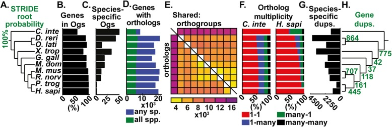

# Chapter 8. Multi-genome orthology

*This chapter reproduces [README section 7](../../README.md#section-7): the section notes, the full tool table with paper, lab, tier and evaluation, and the benchmark notes. Links point back into the repository.*

Orthogroups across genomes. Frame F7 annotates orthogroup representatives, not every gene.

**Needs:** protein FASTA from each genome in the panel. Frame F7 annotates orthogroup representatives, not every gene. [Data needs by scenario](../../README.md#data-needs)

**Clusters:**
- *Orthogroup inference* (alternatives): OrthoFinder 3, SonicParanoid2, Broccoli, Proteinortho6, FastOMA. OrthoFinder 3 is the F7 default; use FastOMA or SonicParanoid2 for very large panels.
- *Reference catalogues* (complementary): PLAZA 5.0, OrthoDB v12, OMA browser 2024, PhylomeDB V5, OrthoVenn3. Cross-check orthogroups against plant and tree-based references.
- *Family evolution* (in order): OrthoFinder 3 or SonicParanoid2 or Broccoli or Proteinortho6 or FastOMA, CAFE 5. Fix orthogroups first, then estimate expansion and contraction with CAFE 5.

*OrthoFinder summary for a Chordata example (Fig. 3). Emms and Kelly 2019, Genome Biol., Fig. 3, doi:10.1186/s13059-019-1832-y, PMC6857279, CC BY.*

| Tool | Role | What it does / when to use | Paper | Lab (corresponding author, institution) | Tier · citations | Evaluation (source) |
|---|---|---|---|---|---|---|
| [Broccoli](https://github.com/rderelle/Broccoli) | alternative | Orthology via phylogeny and network label propagation. | [Molecular Biology and Evolution 2020](https://doi.org/10.1093/molbev/msaa159) | Romain Derelle (University of Birmingham) | established · 113 | Authors: “In this article, we introduce Broccoli, a user-friendly pipeline designed to infer, with high precision, orthologous groups, and pairs of proteins using a phylogeny-based approach.”; GitHub last push 2026-10 |
| [Proteinortho6](https://gitlab.com/paulklemm_PHD/proteinortho) | alternative | Graph-based (co-)orthology detection at scale. | [Frontiers in Bioinformatics 2023](https://doi.org/10.3389/fbinf.2023.1322477) | Marcus Lechner (Philipps University of Marburg) | newer · 46 | Authors: “In this contribution, we evaluate and implement major algorithmic improvements that significantly enhance the speed of the analysis without reducing precision.” |
| [CAFE 5](https://github.com/hahnlab/CAFE5) | alternative | Gene family expansion/contraction under rate variation. | [Bioinformatics 2020](https://doi.org/10.1093/bioinformatics/btaa1022) | Dan Vanderpool (Indiana University Bloomington) | standard · 949 | Authors: “These include improved support for multithreading, the explicit modeling of rate variation among families using gamma-distributed rate categories, and command-line arguments that preclude the use of accessory scripts.”; GitHub last push 2026-10 |
| [PLAZA 5.0](https://bioinformatics.psb.ugent.be/plaza/) | resource | Plant comparative genomics: gene families, orthologs, GO/InterPro projections. | [Nucleic Acids Research 2021](https://doi.org/10.1093/nar/gkab1024) | Klaas Vandepoele (Ghent University) | established · 281 | Authors: “This latest release also comes with a set of new and updated features: a new BED import functionality for the workbench, improved interactive visualizations for functional enrichments and genome-wide mapping of gene sets, and a fully redesigned and extended …” |
| [OrthoFinder 3](https://github.com/OrthoFinder/OrthoFinder) | default (F7) | Scalable phylogenetic orthology (v3.x, FAMSA alignment). | [Nature Methods 2026](https://doi.org/10.1101/2025.07.15.664860) | Steven L. Kelly (University of Oxford) | established · 122 | Authors: “This extends OrthoFinder's high-accuracy comparative genomic framework to provide substantially enhanced scalability and accuracy.”; GitHub last push 2026-11 |
| [FastOMA](https://github.com/DessimozLab/FastOMA) | alternative | Linear-scaling orthology inference (OMAmer placement). | [Nature Methods 2025](https://doi.org/10.1038/s41592-024-02552-8) | Christophe Dessimoz (SIB Swiss Institute of Bioinformatics) | newer · 37 | Authors: “Here, addressing this, 'FastOMA' provides linear scalability for orthology inference, enabling the processing of thousands of eukaryotic genomes within a day.”; GitHub last push 2026-11 |
| [SonicParanoid2](https://gitlab.com/salvo981/sonicparanoid2) | alternative | Fast orthology with ML and language models. | [Genome biology 2024](https://doi.org/10.1186/s13059-024-03298-4) | Wataru Iwasaki (Institute for Quantitative Biosciences, The University of Tokyo) | newer · 56 | Authors: “SonicParanoid is one of the fastest tools for orthology inference; however, its scalability and accuracy have been hampered by time-consuming all-versus-all alignments and the existence of proteins with complex domain architectures.” |
| [OrthoDB v12](https://www.orthodb.org) | resource | Hierarchical orthologs with functional descriptors (OrthoDB + BUSCO update paper). | [Nucleic Acids Research 2024](https://doi.org/10.1093/nar/gkae987) | Evgeny M. Zdobnov (University of Geneva) +1 | standard · 592 | no abstract or repo text available; see paper |
| [OMA browser 2024](https://omabrowser.org) | resource | OMA orthology resource update. | [Nucleic Acids Research 2023](https://doi.org/10.1093/nar/gkad1020) | Natasha Glover (SIB Swiss Institute of Bioinformatics) | established · 112 | Paper: “In this update paper, we present the latest developments in the OMA browser knowledgebase, which aims to provide high-quality orthology inferences and facilitate the study of gene families, genomes and their evolution.” |
| [OrthoVenn3](https://orthovenn3.bioinfotoolkits.net/) | alternative | Web platform for clustering and comparing orthologous groups across multiple genomes, with Venn and phylogenetic views. | [Nucleic Acids Research 2023](https://doi.org/10.1093/nar/gkad313) | Ling Xu (China Agricultural University) +1 | standard · 582 | Authors: “Furthermore, OrthoVenn3 now provides gene family contraction and expansion analysis to support researchers better understanding the evolutionary history of gene families, as well as collinearity analysis to detect conserved and variable genomic structures.” |
| PhylomeDB V5 | resource | Genome-wide catalogues of gene trees and tree-based orthology predictions; serves as a check on graph-based orthogroups. [待确认: phylomedb.org returned 503 on 2026-11-14] | [Nucleic Acids Research 2021](https://doi.org/10.1093/nar/gkab966) | Toni Gabaldón (Institució Catalana de Recerca i Estudis Avançats) | niche · 99 | Paper: “Here, we describe the latest evolution of PhylomeDB (version 5).” |
| [OrthoMCL](https://orthomcl.org/) | alternative | Classic graph-clustering ortholog grouping; still cited, largely replaced by OrthoFinder for new work. | [Genome Research 2003](https://doi.org/10.1101/gr.1224503) | David S. Roos (University of Pennsylvania) | standard · 6548 | Authors: “OrthoMCL provides a scalable method for constructing orthologous groups across multiple eukaryotic taxa, using a Markov Cluster algorithm to group (putative) orthologs and paralogs.” |
| [Quest for Orthologs benchmark](https://orthology.benchmarkservice.org/) | reference | Standard benchmark service for orthology inference methods. | [Nature Methods 2016](https://doi.org/10.1038/nmeth.3830) | Christophe Dessimoz (SIB Swiss Institute of Bioinformatics) | established · 259 | Authors: “Achieving high accuracy in orthology inference is essential for many comparative, evolutionary and functional genomic analyses, yet the true evolutionary history of genes is generally unknown and orthologs are used for very different applications across …” |
| [OMA standalone](https://omabrowser.org/standalone/) | alternative | Runs the OMA orthology algorithm on your own genomes and transcriptomes, optionally with public OMA genomes. | [Genome Research 2019](https://doi.org/10.1101/gr.243212.118) | Christophe Dessimoz (SIB Swiss Institute of Bioinformatics) | established · 187 | Paper: “Here, we describe the OMA pipeline available as a standalone program for Linux and Mac.” |
| [Count](https://www.iro.umontreal.ca/~csuros/gene_content/count.html) | alternative | Gene family gain/loss and size evolution on a tree by parsimony or likelihood. | [Bioinformatics 2010](https://doi.org/10.1093/bioinformatics/btq315) | Miklós Csűös (Université de Montréal) | standard · 506 | no abstract or repo text available; see paper |
| [BadiRate](https://github.com/fgvieira/badirate) | alternative | Likelihood estimates of gene family birth, death and innovation rates per branch. | [Bioinformatics 2011](https://doi.org/10.1093/bioinformatics/btr623) | Julio Rozas (Institut de Recerca de la Biodiversitat de la Universitat de Barcelona) | established · 133 | Authors: “We have assessed the accuracy of BadiRate by computer simulations, and have also illustrated its functionality by analyzing a representative empirical dataset.”; GitHub last push 2020-08 |

> Benchmark note: The Quest for Orthologs benchmark service compares orthology methods on 20 benchmarks with different precision-recall trade-offs; pick the method that does best on the benchmark closest to your use (doi:10.1038/nmeth.3830).
