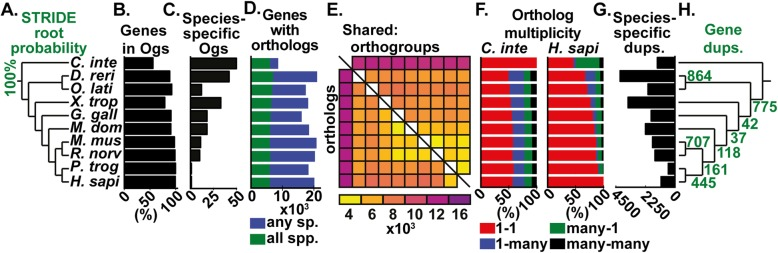

# 第 8 章 多基因组直系同源

*本章收录[主页第 7 节](../../README.zh.md#section-7)：该节说明、含论文、实验室、权威度和评价的完整工具表，以及评测要点。链接指回仓库。*

跨基因组的直系同源基因群划分。框架 F7 仅对直系同源群的代表序列做功能注释，而非逐个基因注释。

**需要：** 数据集中各个基因组的蛋白 FASTA。框架 F7 仅注释直系同源群的代表序列，而非每个基因。[按场景列出的数据需求](../../README.zh.md#data-needs)

**分组：**
- *直系同源群推断*（可替代）：OrthoFinder 3、SonicParanoid2、Broccoli、Proteinortho6、FastOMA。F7 默认用 OrthoFinder 3；物种面板很大时选用 FastOMA 或 SonicParanoid2。
- *参考目录*（互补）：PLAZA 5.0、OrthoDB v12、OMA browser 2024、PhylomeDB V5、OrthoVenn3。利用植物库和基于进化树的参考库交叉核对直系同源群。
- *家族演化*（按顺序）：OrthoFinder 3 或 SonicParanoid2 或 Broccoli 或 Proteinortho6 或 FastOMA、CAFE 5。先确定直系同源群，再用 CAFE 5 估计扩张和收缩。

*OrthoFinder 在脊索动物数据集上的分析结果概览（图 3）。 Emms 与 Kelly 2019，《Genome Biology》图 3，doi:10.1186/s13059-019-1832-y，PMC6857279，CC BY。*

| 工具 | 角色 | 用途 / 何时用 | 原始论文 | 实验室（通讯作者，机构） | 权威度（档位 · 被引） | 评价（出处） |
|---|---|---|---|---|---|---|
| [Broccoli](https://github.com/rderelle/Broccoli) | 备选 | 结合系统发育树与网络标签传播推断直系同源关系的工具。 | [Molecular Biology and Evolution 2020](https://doi.org/10.1093/molbev/msaa159) | Romain Derelle (University of Birmingham) | 成熟 · 113 次 | 作者摘要原句：“In this article, we introduce Broccoli, a user-friendly pipeline designed to infer, with high precision, orthologous groups, and pairs of proteins using a phylogeny-based approach.”；GitHub 最后提交 2026-10 |
| [Proteinortho6](https://gitlab.com/paulklemm_PHD/proteinortho) | 备选 | 面向大规模数据的图算法（共）直系同源检测工具。 | [Frontiers in Bioinformatics 2023](https://doi.org/10.3389/fbinf.2023.1322477) | Marcus Lechner (Philipps University of Marburg) | 较新 · 46 次 | 作者摘要原句：“In this contribution, we evaluate and implement major algorithmic improvements that significantly enhance the speed of the analysis without reducing precision.” |
| [CAFE 5](https://github.com/hahnlab/CAFE5) | 备选 | 在演化速率变异模型下分析基因家族扩张与收缩的工具。 | [Bioinformatics 2020](https://doi.org/10.1093/bioinformatics/btaa1022) | Dan Vanderpool (Indiana University Bloomington) | 标准 · 949 次 | 作者摘要原句：“These include improved support for multithreading, the explicit modeling of rate variation among families using gamma-distributed rate categories, and command-line arguments that preclude the use of accessory scripts.”；GitHub 最后提交 2026-10 |
| [PLAZA 5.0](https://bioinformatics.psb.ugent.be/plaza/) | 资源 | 植物比较基因组学平台：涵盖基因家族、直系同源与 GO/InterPro 注释投射。 | [Nucleic Acids Research 2021](https://doi.org/10.1093/nar/gkab1024) | Klaas Vandepoele (Ghent University) | 成熟 · 281 次 | 作者摘要原句：“This latest release also comes with a set of new and updated features: a new BED import functionality for the workbench, improved interactive visualizations for functional enrichments and genome-wide mapping of gene sets, and a fully redesigned and extended …” |
| [OrthoFinder 3](https://github.com/OrthoFinder/OrthoFinder) | 默认（F7） | 可扩展的系统发育直系同源推断工具（v3.x 版本采用 FAMSA 比对）。 | [Nature Methods 2026](https://doi.org/10.1101/2025.07.15.664860) | Steven L. Kelly (University of Oxford) | 成熟 · 122 次 | 作者摘要原句：“This extends OrthoFinder's high-accuracy comparative genomic framework to provide substantially enhanced scalability and accuracy.”；GitHub 最后提交 2026-11 |
| [FastOMA](https://github.com/DessimozLab/FastOMA) | 备选 | 呈线性扩展的快速直系同源推断工具（基于 OMAmer 归置）。 | [Nature Methods 2025](https://doi.org/10.1038/s41592-024-02552-8) | Christophe Dessimoz (SIB Swiss Institute of Bioinformatics) | 较新 · 37 次 | 作者摘要原句：“Here, addressing this, 'FastOMA' provides linear scalability for orthology inference, enabling the processing of thousands of eukaryotic genomes within a day.”；GitHub 最后提交 2026-11 |
| [SonicParanoid2](https://gitlab.com/salvo981/sonicparanoid2) | 备选 | 结合机器学习与语言模型的快速直系同源推断工具。 | [Genome biology 2024](https://doi.org/10.1186/s13059-024-03298-4) | Wataru Iwasaki (Institute for Quantitative Biosciences, The University of Tokyo) | 较新 · 56 次 | 作者摘要原句：“SonicParanoid is one of the fastest tools for orthology inference; however, its scalability and accuracy have been hampered by time-consuming all-versus-all alignments and the existence of proteins with complex domain architectures.” |
| [OrthoDB v12](https://www.orthodb.org) | 资源 | 附带功能描述的层级直系同源数据库（见 OrthoDB 与 BUSCO 联合更新论文）。 | [Nucleic Acids Research 2024](https://doi.org/10.1093/nar/gkae987) | Evgeny M. Zdobnov (University of Geneva) +1 | 标准 · 592 次 | 无摘要或仓库说明可引；见原文 |
| [OMA browser 2024](https://omabrowser.org) | 资源 | OMA 直系同源数据库 2024 更新版。 | [Nucleic Acids Research 2023](https://doi.org/10.1093/nar/gkad1020) | Natasha Glover (SIB Swiss Institute of Bioinformatics) | 成熟 · 112 次 | 论文摘要：“In this update paper, we present the latest developments in the OMA browser knowledgebase, which aims to provide high-quality orthology inferences and facilitate the study of gene families, genomes and their evolution.” |
| [OrthoVenn3](https://orthovenn3.bioinfotoolkits.net/) | 备选 | 在线比较基因组平台，支持跨多个基因组聚类并对比直系同源群，提供韦恩图与系统发育视图。 | [Nucleic Acids Research 2023](https://doi.org/10.1093/nar/gkad313) | Ling Xu (China Agricultural University) +1 | 标准 · 582 次 | 作者摘要原句：“Furthermore, OrthoVenn3 now provides gene family contraction and expansion analysis to support researchers better understanding the evolutionary history of gene families, as well as collinearity analysis to detect conserved and variable genomic structures.” |
| PhylomeDB V5 | 资源 | 全基因组基因树目录及基于进化树的直系同源预测库；可用于核对基于图聚类的直系同源群。[待确认: 2026-11-14 访问 phylomedb.org 返回 503] | [Nucleic Acids Research 2021](https://doi.org/10.1093/nar/gkab966) | Toni Gabaldón (Institució Catalana de Recerca i Estudis Avançats) | 小众 · 99 次 | 论文摘要：“Here, we describe the latest evolution of PhylomeDB (version 5).” |
| [OrthoMCL](https://orthomcl.org/) | 备选 | 经典图聚类直系同源分组；仍被引用，新项目多改用 OrthoFinder。 | [Genome Research 2003](https://doi.org/10.1101/gr.1224503) | David S. Roos (University of Pennsylvania) | 标准 · 6548 次 | 作者摘要原句：“OrthoMCL provides a scalable method for constructing orthologous groups across multiple eukaryotic taxa, using a Markov Cluster algorithm to group (putative) orthologs and paralogs.” |
| [Quest for Orthologs benchmark](https://orthology.benchmarkservice.org/) | 参考 | 直系同源推断方法的标准基准评测服务。 | [Nature Methods 2016](https://doi.org/10.1038/nmeth.3830) | Christophe Dessimoz (SIB Swiss Institute of Bioinformatics) | 成熟 · 259 次 | 作者摘要原句：“Achieving high accuracy in orthology inference is essential for many comparative, evolutionary and functional genomic analyses, yet the true evolutionary history of genes is generally unknown and orthologs are used for very different applications across …” |
| [OMA standalone](https://omabrowser.org/standalone/) | 备选 | 在自有基因组和转录组上运行 OMA 直系同源算法，可并入 OMA 公共基因组。 | [Genome Research 2019](https://doi.org/10.1101/gr.243212.118) | Christophe Dessimoz (SIB Swiss Institute of Bioinformatics) | 成熟 · 187 次 | 论文摘要：“Here, we describe the OMA pipeline available as a standalone program for Linux and Mac.” |
| [Count](https://www.iro.umontreal.ca/~csuros/gene_content/count.html) | 备选 | 在系统树上用简约法或似然法分析基因家族获得/丢失与大小演化。 | [Bioinformatics 2010](https://doi.org/10.1093/bioinformatics/btq315) | Miklós Csűös (Université de Montréal) | 标准 · 506 次 | 无摘要或仓库说明可引；见原文 |
| [BadiRate](https://github.com/fgvieira/badirate) | 备选 | 按分支估计基因家族出生、死亡与创新速率的似然方法。 | [Bioinformatics 2011](https://doi.org/10.1093/bioinformatics/btr623) | Julio Rozas (Institut de Recerca de la Biodiversitat de la Universitat de Barcelona) | 成熟 · 133 次 | 作者摘要原句：“We have assessed the accuracy of BadiRate by computer simulations, and have also illustrated its functionality by analyzing a representative empirical dataset.”；GitHub 最后提交 2020-08 |

> 评测要点： Quest for Orthologs 基准服务在 20 个基准上比较直系同源方法，各有不同的精度与召回取舍；按与自己用途最接近的基准选方法（doi:10.1038/nmeth.3830）。
