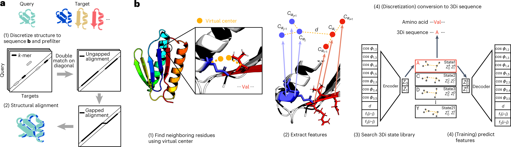

# Chapter 14. Protein 3D structure

*This chapter reproduces [README section 13](../../README.md#section-13): the section notes, the full tool table with paper, lab, tier and evaluation, and the benchmark notes. Links point back into the repository.*

Protein 3D structure prediction, search and domains. “Structure” here means 3D structure, not gene models.

**Needs:** the proteins; some tools also need AlphaFold / PDB style libraries. “Structure” here means protein 3D structure, not gene models. [Data needs by scenario](../../README.md#data-needs)

*Figure. Foldseek: query and target structures are turned into 3Di sequences, prefiltered by double k-mer matches on a diagonal, then aligned without and with gaps (a); the 3Di state of each residue is learned from features of that residue and its nearest neighbour in space (b). Reproduced without changes from van Kempen M, Kim SS, Tumescheit C, Mirdita M, Lee J, Gilchrist CLM, Söding J and Steinegger M (2024), Fast and accurate protein structure search with Foldseek, Nature Biotechnology 42:243-246, Fig. 1, doi:10.1038/s41587-023-01773-0, PMC10869269, licensed CC BY 4.0 (https://creativecommons.org/licenses/by/4.0/).*

**Clusters:**
- *Whole-proteome monomers* (alternatives): ColabFold, ESMFold / ESM-2, AlphaFold2. ColabFold (AlphaFold2 with fast MSAs) or ESMFold for whole proteomes; AlphaFold2 itself has open code and weights.
- *Complexes* (alternatives): AlphaFold 3, RoseTTAFold All-Atom, Boltz-1. Only for complexes with proteins, nucleic acids or ligands; AlphaFold 3 weights are non-commercial and released on request.
- *Structure search then confirmation* (in order): Foldseek or TM-Vec 2s or AlphaFind v2 or DALI, TM-align or US-align. Search first (Foldseek against AFDB by default), then confirm a hit pairwise with TM-align, or US-align for complexes.
- *Structure target databases* (complementary): AlphaFold Protein Structure Database (2024), AFDB clusters (Foldseek). Search targets, not tools: AFDB clusters for a fast first pass, the full AFDB for detail.
- *Domains from structures* (complementary): TED (The Encyclopedia of Domains), CATH (2021), Merizo. Merizo segments custom structural models; TED and CATH provide reference domain definitions.
- *Embeddings* (complementary): ProtTrans (ProtT5), ESM3, ProstT5. Provide feature representations for the language-model tools in sections 1, 5 and 8.
- *Sites and pockets* (complementary): PARSE, WASP. Predict functional sites from structure; use for follow-up analysis only.

| Tool | Role | What it does / when to use | Paper | Lab (corresponding author, institution) | Tier · citations | Evaluation (source) |
|---|---|---|---|---|---|---|
| [AlphaFold2](https://github.com/google-deepmind/alphafold) | alternative | Protein 3D structure prediction. | [Nature 2021](https://doi.org/10.1038/s41586-021-03819-2) | John Jumper (Google DeepMind (United Kingdom)) +1 | standard · 51454 | GitHub last push 2026-04 |
| [ColabFold](https://github.com/sokrypton/ColabFold) | alternative | Fast AlphaFold2 with MMseqs2 MSAs. | [Nature Methods 2022](https://doi.org/10.1038/s41592-022-01488-1) | Milot Mirdita (Max Planck Institute for Multidisciplinary Sciences) +2 | standard · 9964 | Authors: “ColabFold's 40-60-fold faster search and optimized model utilization enables prediction of close to 1,000 structures per day on a server with one graphics processing unit.”; GitHub last push 2026-11 |
| [ESMFold / ESM-2](https://github.com/facebookresearch/esm) | alternative | Single-sequence 3D structure prediction from a protein language model. | [Science 2023](https://doi.org/10.1126/science.ade2574) | Alexander W. Rives (New York University) | standard · 7612 | archived on GitHub (last push 2024-02) |
| [AlphaFold 3](https://github.com/google-deepmind/alphafold3) | alternative | Joint structure prediction of complexes with nucleic acids, ligands and ions. Model weights are released for non-commercial use on request; AlphaFold2 (separate entry) stays the open option for bulk monomer prediction. | [Nature 2024](https://doi.org/10.1038/s41586-024-07487-w) | Max Jaderberg +2 | standard · 19677 | Authors: “The new AlphaFold model demonstrates substantially improved accuracy over many previous specialized tools: far greater accuracy for protein–ligand interactions compared with state-of-the-art docking tools, much higher accuracy for protein–nucleic acid …”; GitHub last push 2026-11 |
| [TED (The Encyclopedia of Domains)](https://ted.cathdb.info/) | resource | Structure-based domain segmentation of AlphaFold DB. | [Science 2024](https://doi.org/10.1126/science.adq4946) | Christine Anne Orengo (Institute of Structural and Molecular Biology) +1 | established · 181 | no abstract or repo text available; see paper |
| [CATH (2021)](https://www.cathdb.info/) | resource | Hierarchical classification of protein 3D domains. | [Nucleic Acids Research 2020](https://doi.org/10.1093/nar/gkaa1079) | Ian Sillitoe (Institute of Structural and Molecular Biology) | standard · 578 | Authors: “Finally, we have improved links to and from CATH including SCOP, InterPro, Aquaria and 2DProt.” |
| [TM-align](https://zhanggroup.org/TM-align/) | alternative | Structure alignment with TM-score. | [Nucleic Acids Research 2005](https://doi.org/10.1093/nar/gki524) | Yang Zhang (University at Buffalo, State University of New York) | standard · 4278 | Authors: “On average, the resulting structure alignments have higher accuracy and coverage than those provided by these most often-used methods.” |
| [US-align](https://github.com/pylelab/USalign) | alternative | Universal structure alignment for proteins and nucleic acids. | [Nature Methods 2022](https://doi.org/10.1038/s41592-022-01585-1) | Yang Zhang (University of Michigan) | standard · 595 | Authors: “Detailed analyses showed that the main advantage of US-align lies in the extensive optimization of the unified objective function powered by efficient heuristic search iterations, which substantially improve the accuracy and speed of the structural alignment …”; GitHub last push 2026-10 |
| [DALI](http://ekhidna2.biocenter.helsinki.fi/dali/) | alternative | Structure comparison server against PDB/AlphaFold DB. | [Protein Science 2019](https://doi.org/10.1002/pro.3749) | Liisa Holm (University of Helsinki) | standard · 737 | Authors: “Meta-analysis of independent reference-based evaluations of alignment accuracy and fold discrimination shows DALI at top rank in six out of 12 studies.” |
| [Foldseek](https://github.com/steineggerlab/foldseek) | default (structure search) | Protein 3D-structure search via 3Di alphabet; finds remote homologs missed by sequence search. | [Nature Biotechnology 2023](https://doi.org/10.1038/s41587-023-01773-0) | Johannes Söding (Max Planck Institute for Multidisciplinary Sciences) +1 | standard · 3169 | Authors: “Foldseek decreases computation times by four to five orders of magnitude with 86%, 88% and 133% of the sensitivities of Dali, TM-align and CE, respectively.”; GitHub last push 2026-11 |
| [ProstT5](https://github.com/mheinzinger/ProstT5) | alternative | Protein language model translating sequence to 3Di tokens so Foldseek can run without predicted structures. | [NAR Genomics and Bioinformatics 2024](https://doi.org/10.1093/nargab/lqae150) | Michael Heinzinger (Technical University of Munich) | established · 454 | Authors: “As a proof-of-concept for our novel approach, dubbed Protein ‘structure-sequence’ T5 (ProstT5), we showed improved performance for subsequent, structure-related prediction tasks, leading to three orders of magnitude speedup for deriving 3Di.”; GitHub last push 2026-03 |
| TM-Vec 2s | alternative | Embedding-based remote homology / TM-score prediction (preprint 2026). | [bioRxiv (Cold Spring Harbor Laboratory) 2026](https://doi.org/10.64898/2026.02.05.704073) | Qiyun Zhu (Arizona State University) | newer · 2 | Authors: “Benchmarks on the CATH and SCOPe domains for large-scale database queries showed that TM-Vec 2s is 185× faster than the original TM-Vec, while achieving higher TM-score prediction accuracy.” |
| [AlphaFold Protein Structure Database (2024)](https://alphafold.ebi.ac.uk) | resource | Predicted protein 3D structures for UniProt; target for Foldseek searches. | [Nucleic Acids Research 2023](https://doi.org/10.1093/nar/gkad1011) | Demis Hassabis (Google DeepMind (United Kingdom)) +1 | standard · 2431 | Authors: “We also discuss the improvements and services added since its initial release, including enhancements to the Predicted Aligned Error viewer, customisation options for the 3D viewer, and improvements in the search engine of AlphaFold DB.” |
| [AlphaFind v2](https://alphafind.fi.muni.cz) | alternative | Similarity search over AlphaFold DB and TED domains. | [Nucleic Acids Research 2026](https://doi.org/10.1093/nar/gkag372) | Matej Antol (Masaryk University) | newer · 2 | Paper: “In this paper, we present AlphaFind v2, an application for finding structurally similar proteins in the AlphaFold Database (https://alphafold.ebi.ac.uk/) of predicted structures.” |
| [WASP](https://github.com/gioodm/wasp-proteins-annotation) | alternative | Whole-proteome annotation via Foldseek against AlphaFold DB (GO, Pfam, PANTHER, CATH, Rhea, EC). | no paper | — | no paper | Repo description: “Python command-line software for whole-proteomes annotation based on structural homology.”; GitHub last push 2026-10 |
| PARSE | alternative | Functional site annotation from local 3D-structure embeddings. | [Proceedings of the National Academy of Sciences 2025](https://doi.org/10.1073/pnas.2513219122) | Russ Biagio Altman (Stanford Medicine) | newer · 27 | Authors: “For the task of predicting the catalytic function of enzymes, PARSE achieves comparable or superior global performance to state-of-the-art machine learning methods (F1 score [Formula: see text] 85%) while simultaneously annotating the specific residues …” |
| [Merizo](https://github.com/psipred/Merizo) | alternative | Domain segmentation of predicted 3D structures. | [Nature Communications 2023](https://doi.org/10.1038/s41467-023-43934-4) | David T. Jones (University College London) | newer · 63 | Paper: “Here, we describe a deep learning method for domain segmentation called Merizo, which learns to cluster residues into domains in a bottom-up manner.”; GitHub last push 2025-05 |
| [RoseTTAFold All-Atom](https://github.com/baker-laboratory/RoseTTAFold-All-Atom) | alternative | Predicts protein structures together with ligands, nucleic acids and modifications; an open alternative for complexes. | [Science 2024](https://doi.org/10.1126/science.adl2528) | Rohith Krishna (University of Washington) +6 | standard · 1298 | Paper: “We describe RoseTTAFold All-Atom (RFAA), which combines a residue-based representation of amino acids and DNA bases with an atomic representation of all other groups to model assemblies that contain proteins, nucleic acids, small molecules, metals, and …”; GitHub last push 2026-05 |
| [Boltz-1](https://github.com/jwohlwend/boltz) | alternative | Open-source biomolecular complex predictor (MIT licence) with AlphaFold 3-like accuracy; usable without AF3 weight restrictions. [preprint] | [bioRxiv (Cold Spring Harbor Laboratory) 2024](https://doi.org/10.1101/2024.11.19.624167) | Jeremy Wohlwend (MIT Computer Science and Artificial Intelligence Laboratory) | standard · 795 | Authors: “In this paper, we introduce Boltz-1, an open-source deep learning model incorporating innovations in model architecture, speed optimization, and data processing achieving Alphafold3-level accuracy in predicting the 3D structures of biomolecular complexes.”; GitHub last push 2026-05 |
| [ESM3](https://github.com/evolutionaryscale/esm) | alternative | Multimodal protein language model trained across sequence, structure and function; provides an open small model for embeddings and design. | [Science 2025](https://doi.org/10.1126/science.ads0018) | Alexander W. Rives | standard · 1442 | Authors: “ESM3 can follow complex prompts combining its modalities and is highly responsive to alignment to improve its fidelity.”; GitHub last push 2026-11 |
| [ProtTrans (ProtT5)](https://github.com/agemagician/ProtTrans) | alternative | Pretrained protein language models; ProtT5 embeddings power goPredSim, TMbed, ProstT5 and other tools in this catalog. | [IEEE Transactions on Pattern Analysis and Machine Intelligence 2021](https://doi.org/10.1109/TPAMI.2021.3095381) | Burkhard Rost (Technical University of Munich) | standard · 3008 | Authors: “We validated the advantage of using the embeddings as exclusive input for several subsequent tasks: (1) a per-residue (per-token) prediction of protein secondary structure (3-state accuracy Q3=81%-87%); (2) per-protein (pooling) predictions of protein …”; GitHub last push 2025-05 |
| [AFDB clusters (Foldseek)](https://cluster.foldseek.com/) | resource | Structure-based clusters of the AlphaFold Database; reveals which unannotated "dark" families share folds with annotated ones. | [Nature 2023](https://doi.org/10.1038/s41586-023-06510-w) | Pedro Beltrão (SIB Swiss Institute of Bioinformatics) +1 | established · 421 | Paper: “Here, we developed a structural-alignment-based clustering algorithm—Foldseek cluster—that can cluster hundreds of millions of structures.” |
| [SWISS-MODEL](https://swissmodel.expasy.org/) | alternative | Template-based homology modelling server. | [Nucleic Acids Research 2018](https://doi.org/10.1093/nar/gky427) | Torsten F. Schwede (SIB Swiss Institute of Bioinformatics) | standard · 14323 | Paper: “Here, we present an update to the SWISS-MODEL server, which pioneered the field of automated modelling 25 years ago and been continuously further developed.” |
