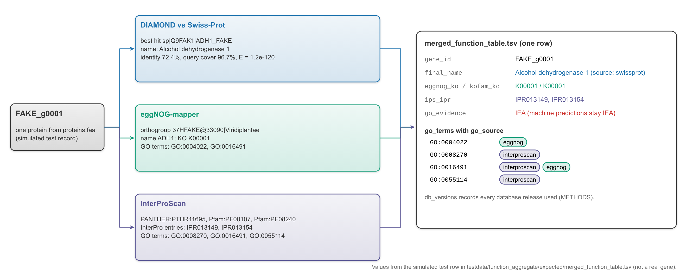

# Chapter 16. Ideas, formats and merge rules

*This chapter reproduces [README section 15](../../README.md#section-15): the section notes, the full tool table with paper, lab, tier and evaluation, and the benchmark notes. Links point back into the repository.*

Ideas, formats and merge rules. The merge product remains `merged_function_table.tsv`. Nothing here changes frame F1 until tested.

**Needs:** depends on the idea; the merge product remains `merged_function_table.tsv`. Nothing here changes frame F1 until tested. [Data needs by scenario](../../README.md#data-needs)

*Figure. How the three F1 evidence lines for one protein become one row of `merged_function_table.tsv`: each GO term keeps the source that gave it, and machine predictions stay IEA. Values are the simulated test row FAKE_g0001 in `testdata/function_aggregate/expected/merged_function_table.tsv`, not a real gene; schematic drawn for this repository.*

**Clusters:**
- *Formats and evidence* (complementary): Evidence & Conclusion Ontology (ECO, 2022), GO Annotation File (GAF 2.2) format, GO-CAM. Every GO row carries an ECO code; use GAF for releases and GO-CAM for curated pathways.
- *Error and specificity* (complementary): GO specificity balance (Genome Res 2026), CAFA lessons (idea), Misannotation in enzyme superfamilies. Explain why transferred labels fail and how to choose appropriate term specificity.
- *LLM agents* (alternatives): GeneAgent, LLM-assisted Reactome annotation, Agentic AI for gene function across genomes. Proposals only; keep a human check.

| Tool | Role | What it does / when to use | Paper | Lab (corresponding author, institution) | Tier · citations | Evaluation (source) |
|---|---|---|---|---|---|---|
| [Evidence & Conclusion Ontology (ECO, 2022)](https://evidenceontology.org/) | idea | Ontology of evidence types behind annotations (maps to GO evidence codes). | [Nucleic Acids Research 2021](https://doi.org/10.1093/nar/gkab1025) | Michelle Gwinn Giglio (University of Maryland, Baltimore) | niche · 62 | Paper: “Here we report on recent updates to the ECO ontology itself as well as associated resources that are available through this project.” |
| [GO Annotation File (GAF 2.2) format](https://geneontology.org/docs/go-annotation-file-gaf-format-2.2/) | idea | Standard tab format for gene–GO associations with evidence codes. | no paper | — | no paper | no abstract or repo text available; see paper |
| GO specificity balance (Genome Res 2026) | idea | Balancing GO term specificity in sequence-language-model predictions. | [Genome Research 2026](https://doi.org/10.1101/gr.280816.125) | Bin Liu (Beijing Institute of Technology) | newer · 1 | Authors: “Our model consistently outperforms state-of-the-art methods by 5%-15% across all specificity levels and on both a benchmark data set and an independent test set, demonstrating robust generalization.” |
| [CAFA lessons (idea)](https://biofunctionprediction.org/cafa/) | idea | Community assessments keep showing GO prediction is hard for proteins with partial knowledge; publish ML GO as electronic evidence (IEA) only. | no paper | — | no paper | no abstract or repo text available; see paper |
| GeneAgent | idea | Self-verifying LLM agent for gene-set analysis using domain databases. | [Nature Methods 2025](https://doi.org/10.1038/s41592-025-02748-6) | Zhiyong Lu (National Institutes of Health) | established · 160 | Authors: “Here we present GeneAgent, an LLM-based AI agent for gene-set analysis that reduces hallucinations by autonomously interacting with biological databases to verify its own output.” |
| LLM-assisted Reactome annotation | idea | LLM/RAG proposals of pathway annotations for curator check (preprint). | [bioRxiv (Cold Spring Harbor Laboratory) 2025](https://doi.org/10.64898/2025.12.20.695723) | Guanming Wu (Oregon Health & Science University) | newer · 4 | Paper: “We developed an LLM workflow that can assist curators in adding new genes to existing pathways and refining the functional annotations of existing ones.” |
| Agentic AI for gene function across genomes | idea | GO curators' agent workflow with constrained schemas and validators (Zenodo record). | [Zenodo (CERN European Organization for Nuclear Research) 2026](https://doi.org/10.5281/zenodo.18904049) | Chris Mungall (Lawrence Berkeley National Laboratory) | newer · 0 | no abstract or repo text available; see paper |
| Misannotation in enzyme superfamilies | idea | Quantifies error rates in transferred molecular-function labels; motivates retaining evidence codes and preferring curated sources. | [PLoS Computational Biology 2009](https://doi.org/10.1371/journal.pcbi.1000605) | Patricia Clement Babbitt (QB3) | standard · 842 | no abstract or repo text available; see paper |
| [GO-CAM](https://geneontology.org/docs/gocam-overview/) | idea | Links GO annotations into structured causal activity models; serves as a target format for curated grape pathways beyond flat GAF tables. | [Nature Genetics 2019](https://doi.org/10.1038/s41588-019-0500-1) | Paul D. Thomas (University of Southern California) | established · 148 | no abstract or repo text available; see paper |
