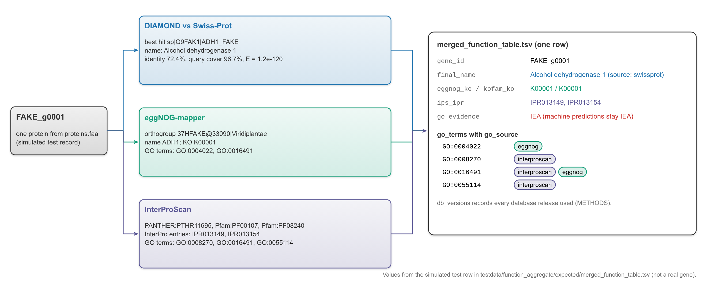

# 第 16 章 想法、格式与合并规则

*本章收录[主页第 15 节](../../README.zh.md#section-15)：该节说明、含论文、实验室、权威度和评价的完整工具表，以及评测要点。链接指回仓库。*

相关思路、文件格式与总表合并规则。最终合并产物仍为 `merged_function_table.tsv`。在完成实测前，不改变框架 F1。

**需要：** 视具体思路而定；合并产物仍为 `merged_function_table.tsv`。在完成实测前，不改变框架 F1。[按场景列出的数据需求](../../README.zh.md#data-needs)

*图：一条蛋白的三条 F1 证据如何合成 `merged_function_table.tsv` 中的一行：每个 GO 词条都保留给出它的来源，机器预测一律标 IEA。数值取自 `testdata/function_aggregate/expected/merged_function_table.tsv` 中的模拟测试行 FAKE_g0001，不是真实基因；示意图，为本仓库绘制。*

**分组：**
- *格式与证据*（互补）：Evidence & Conclusion Ontology (ECO, 2022)、GO Annotation File (GAF 2.2) format、GO-CAM。每条 GO 注释均须附带 ECO 证据代码；发布用 GAF 格式，经审校的通路用 GO-CAM。
- *错误与特异性*（互补）：GO specificity balance (Genome Res 2026)、CAFA lessons (idea)、Misannotation in enzyme superfamilies。阐明转移标签出错的原因，以及如何把握 GO 条目的特异性层级。
- *大语言模型代理*（可替代）：GeneAgent、LLM-assisted Reactome annotation、Agentic AI for gene function across genomes。目前仅处方案阶段；使用时必须保留人工审核。

| 工具 | 角色 | 用途 / 何时用 | 原始论文 | 实验室（通讯作者，机构） | 权威度（档位 · 被引） | 评价（出处） |
|---|---|---|---|---|---|---|
| [Evidence & Conclusion Ontology (ECO, 2022)](https://evidenceontology.org/) | 思路 | 描述注释背后证据类型的标准本体（可映射至 GO 证据代码）。 | [Nucleic Acids Research 2021](https://doi.org/10.1093/nar/gkab1025) | Michelle Gwinn Giglio (University of Maryland, Baltimore) | 小众 · 62 次 | 论文摘要：“Here we report on recent updates to the ECO ontology itself as well as associated resources that are available through this project.” |
| [GO Annotation File (GAF 2.2) format](https://geneontology.org/docs/go-annotation-file-gaf-format-2.2/) | 思路 | 记录基因与 GO 关联及证据代码的标准制表符分隔格式（GAF 2.2）。 | 无文章 | — | 无论文 | 无摘要或仓库说明可引；见原文 |
| GO specificity balance (Genome Res 2026) | 思路 | 探讨如何在序列语言模型预测中平衡 GO 条目特异度的论文（Genome Res 2026）。 | [Genome Research 2026](https://doi.org/10.1101/gr.280816.125) | Bin Liu (Beijing Institute of Technology) | 较新 · 1 次 | 作者摘要原句：“Our model consistently outperforms state-of-the-art methods by 5%-15% across all specificity levels and on both a benchmark data set and an independent test set, demonstrating robust generalization.” |
| [CAFA lessons (idea)](https://biofunctionprediction.org/cafa/) | 思路 | 社区评测（CAFA）持续表明，对背景知识有限的蛋白做 GO 预测依然困难；机器学习给出的 GO 仅可作为电子注释证据（IEA）发布。 | 无文章 | — | 无论文 | 无摘要或仓库说明可引；见原文 |
| GeneAgent | 思路 | 结合领域数据库做基因集分析并支持自我核验的大语言模型智能体（LLM agent）。 | [Nature Methods 2025](https://doi.org/10.1038/s41592-025-02748-6) | Zhiyong Lu (National Institutes of Health) | 成熟 · 160 次 | 作者摘要原句：“Here we present GeneAgent, an LLM-based AI agent for gene-set analysis that reduces hallucinations by autonomously interacting with biological databases to verify its own output.” |
| LLM-assisted Reactome annotation | 思路 | 利用 LLM/RAG 生成代谢通路注释草稿供审定员复核的方法（预印本）。 | [bioRxiv (Cold Spring Harbor Laboratory) 2025](https://doi.org/10.64898/2025.12.20.695723) | Guanming Wu (Oregon Health & Science University) | 较新 · 4 次 | 论文摘要：“We developed an LLM workflow that can assist curators in adding new genes to existing pathways and refining the functional annotations of existing ones.” |
| Agentic AI for gene function across genomes | 思路 | GO 审定团队采用受控模式（schema）与校验器构建的跨基因组基因功能智能体工作流（Zenodo 记录）。 | [Zenodo (CERN European Organization for Nuclear Research) 2026](https://doi.org/10.5281/zenodo.18904049) | Chris Mungall (Lawrence Berkeley National Laboratory) | 较新 · 0 次 | 无摘要或仓库说明可引；见原文 |
| Misannotation in enzyme superfamilies | 思路 | 量化了酶超家族中转移分子功能标签的错误率；论证了保留证据代码并优先采用人工审校资源的必要性。 | [PLoS Computational Biology 2009](https://doi.org/10.1371/journal.pcbi.1000605) | Patricia Clement Babbitt (QB3) | 标准 · 842 次 | 无摘要或仓库说明可引；见原文 |
| [GO-CAM](https://geneontology.org/docs/gocam-overview/) | 思路 | 将 GO 注释连接为结构化的因果活性模型；对于经人工整理的葡萄通路，是超越扁平 GAF 表格的目标格式。 | [Nature Genetics 2019](https://doi.org/10.1038/s41588-019-0500-1) | Paul D. Thomas (University of Southern California) | 成熟 · 148 次 | 无摘要或仓库说明可引；见原文 |
