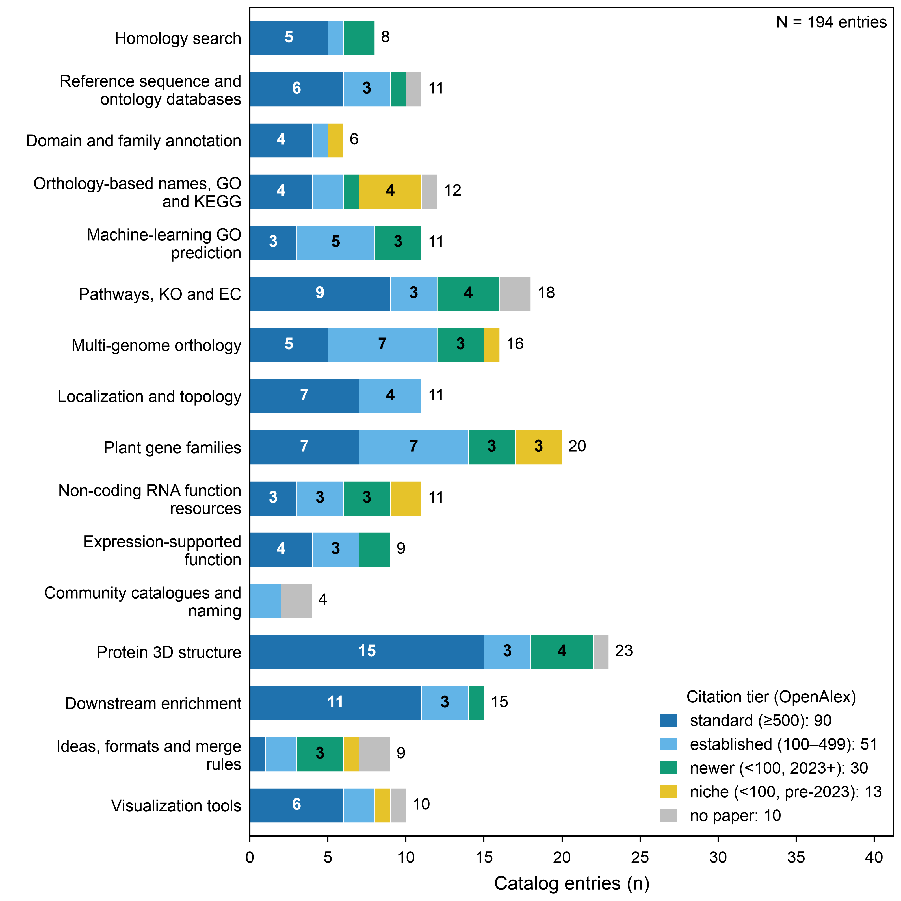
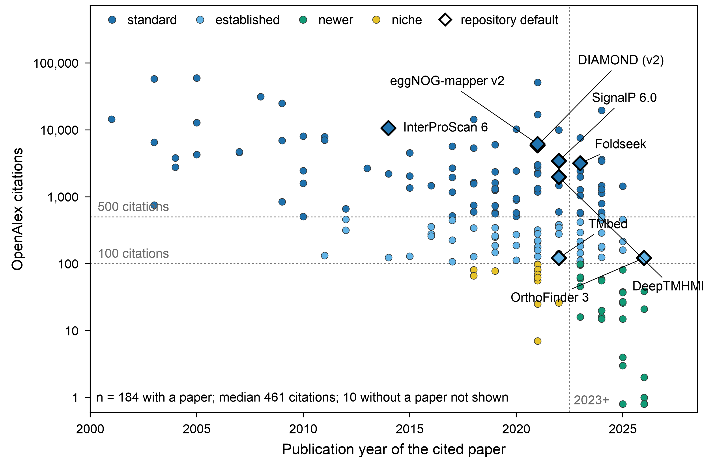
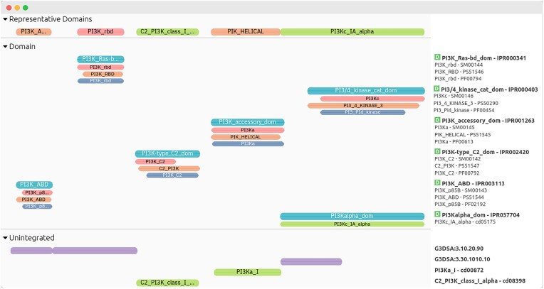
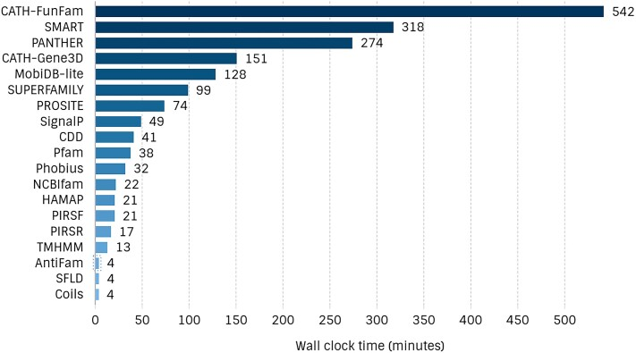
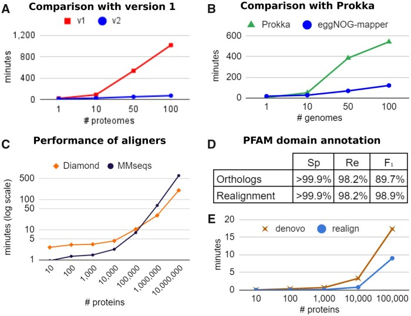
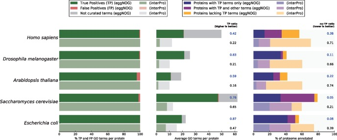
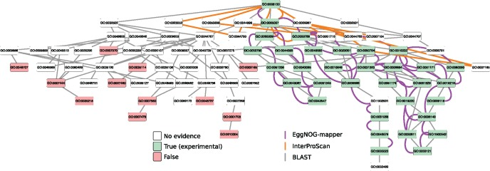
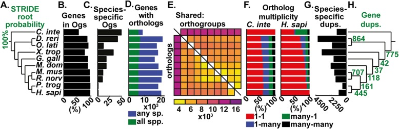
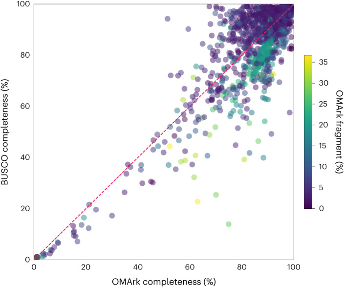

# Methods catalog

[中文](METHODS_CATALOG.zh.md) · [Home page](../README.md) · [Catalogue by type](README.by-type.md) · [Counts](COUNTS.md)

> This page holds the full catalogue that was on the home page until 2026-11-26. The text below is unchanged apart from relative links, which were adjusted for the new location, and one reworded phrase. The counts are rechecked in [`COUNTS.md`](COUNTS.md). In the text below, vitis-te is the former name of the [TE-Lib](https://github.com/Xuzhen-Li/TE-Lib) repository.

## Methods catalog

This page lists, by type, the 194 methods, tools, databases and ideas from the 2026-11 survey (61 in the type catalog, 68 first-pass cards in `catalog/`) and the 2026-11-14 update (3 older-version entries merged, 41 added). The default frame is still F1 (DIAMOND + eggNOG + InterProScan); the catalog does not change it. Framework / step order stays in `docs/ROADMAP.md` and in `catalog/`. Full tables and errata are in `docs/CATALOG_BY_TYPE_2026-11.md` and `docs/CATALOG_NEW_TOOLS_2026-11.md`.

**2026-11-14 update.** Each section now opens with a **Clusters:** list. It groups the entries as alternatives (pick one), complementary (use together) or in order (run in sequence), with a note on when to pick which. Inside a list, “A or B” means pick one of the two and “A → B” is one fixed route. Different versions of one program are now one entry named for the latest version; older versions are only mentioned in that entry's note. A workflow chart with frame choices and decision points is in [`docs/ROADMAP.md`](../docs/ROADMAP.md#workflow-2026-11-14).

**2026-11-25 update.** Each type section now shows its entries as one table: tool link, role (default, branch tool or alternative, as stated on this page), what it does and when to use it, paper, lab, tier with OpenAlex citations, and a short evaluation quoted from the paper abstract, a benchmark paper or the GitHub repository. 27 entries were added after three search passes (a drafted candidate list, OpenAlex keyword searches, and curated tool lists plus benchmark papers); each added entry has a DOI that resolves to a matching title, and each link was opened before use. The catalog now has 194 entries, including a new visualization section; the counts in the list below are current. Per-entry data are in `catalog/SOFTWARE_AUTHORITY.tsv` and the same tables, without the section notes, are in [`docs/software/README.md`](../docs/software/README.md). A book-style study guide is in [`book/`](../book/README.md).

## Contents

- [Default route](#default-route)
- [Tier rule](#tier-rule)
- [Pipelines and the steps they cover](#pipelines) (13)
- [1. Homology search](#section-1) (8)
- [2. Reference sequence and ontology databases](#section-2) (11)
- [3. Domain and family annotation](#section-3) (6)
- [4. Orthology-based names, GO and KEGG](#section-4) (12)
- [5. Machine-learning GO prediction](#section-5) (11)
- [6. Pathways, KO and EC](#section-6) (18)
- [7. Multi-genome orthology](#section-7) (16)
- [8. Localization and topology](#section-8) (11)
- [9. Plant gene families](#section-9) (20)
- [10. Non-coding RNA function resources](#section-10) (11)
- [11. Expression-supported function](#section-11) (9)
- [12. Community catalogues and naming](#section-12) (4)
- [13. Protein 3D structure](#section-13) (23)
- [14. Downstream enrichment](#section-14) (15)
- [15. Ideas, formats and merge rules](#section-15) (9)
- [Visualization tools](#visualization) (10 new, plus cross-listed entries)
  - [Domain and motif diagrams](#viz-1) (2)
  - [GO and enrichment plots](#viz-2) (6)
  - [Pathway maps](#viz-3) (4)
  - [Networks](#viz-4) (2)
  - [3D structure viewers](#viz-5) (2)
- [Data needed alongside the proteins](#data-needs)
- [Figure credits](#figure-credits)

How the sections line up with this repo: input QC (F0) is under data needs, not a type section → default frame F1 (homology, domains, orthology/GO) → optional add-ons (pathways, multi-genome, localization, plant families) → merge `merged_function_table.tsv` → release. Frame IDs stay in `docs/ROADMAP.md` and `catalog/`.

### Default route

The default frame is F1: DIAMOND (v2), eggNOG-mapper v2 and InterProScan 6 on `proteins.faa` from a structure release. Add-ons: readable names with AHRD (F4), orthogroups with OrthoFinder 3 (F7), SignalP 6.0 plus DeepTMHMM or TMbed for topology, and Foldseek against AFDB for structure search. This is the frame stated in Usage and in the Clusters lists on this page and in `docs/ROADMAP.md`; the tables below mark these tools as default and every other entry as an alternative or resource.

### Tier rule

> **Tier rule (stated once):** the indicator is the OpenAlex citation count of the paper (retrieved 2026-11-25). standard: 500 or more; established: 100–499; newer: fewer than 100 and the paper is from 2023 or later; niche: fewer than 100 and from before 2023; no paper: no title-matched paper. General-purpose tools have counts from every field. Lab is the corresponding author in the paper metadata with the first institution (+N for further corresponding authors; the last author when none is flagged). Evaluation quotes the paper abstract (“Authors:” marks a claim made by the tool authors), a benchmark paper with its DOI, or the GitHub repository (description and last push date). This catalog has 194 entries: standard 90, established 51, newer 30, niche 13, no paper 10.

*Figure. Catalog entries per type section, coloured by citation tier (tier rule above). Counts computed from `catalog/SOFTWARE_AUTHORITY.tsv` (194 entries; OpenAlex counts retrieved 2026-11-25) by `docs/figures/guide/src/make_catalog_charts.py`.*

*Figure. Publication year against OpenAlex citations for the 184 catalog entries with a paper; diamonds mark repository defaults. Databases and general tools collect citations from every field; a count is not a measure of accuracy on your proteome. Source: `catalog/SOFTWARE_AUTHORITY.tsv`; script `docs/figures/guide/src/make_catalog_charts.py`.*

### Pipelines and the steps they cover

yes means the paper abstract or the catalog note states the step; a dash only means it is not stated there. The Basis column names the source.

| Pipeline | Homology search | Domains | Orthology / GO | KEGG / EC / pathways | Readable names | Localization | Tier · citations | Basis |
|---|---|---|---|---|---|---|---|---|
| [eggNOG-mapper v2](https://github.com/eggnogdb/eggnog-mapper) · default (F1) | yes (built in) | yes | yes | yes | yes | — | standard · 6146 | doi:10.1093/molbev/msab293 (abstract) and catalog note |
| [InterProScan 6](https://github.com/ebi-pf-team/interproscan6) · default (F1) | — | yes | — | — | — | — | standard · 10656 | catalog note |
| [DIAMOND (v2)](https://github.com/bbuchfink/diamond) · default (F1) | yes | — | — | — | — | — | standard · 5873 | catalog note |
| [AHRD](https://github.com/groupschoof/AHRD) · default (F4) | uses BLAST results | — | — | — | yes | — | no paper | catalog note |
| [PANNZER2](http://ekhidna2.biocenter.helsinki.fi/sanspanz/) | yes (SANSparallel) | — | yes | — | yes | — | standard · 595 | doi:10.1093/nar/gky350 (abstract) |
| [Blast2GO](https://www.biobam.com/omicsbox/) | yes | — | yes | — | — | — | standard · 12842 | doi:10.1093/bioinformatics/bti610 (abstract) |
| [EnTAP](https://github.com/harta55/EnTAP) | yes | yes | yes | — | — | — | established · 250 | doi:10.1111/1755-0998.13106 (abstract) |
| [FA-nf](https://github.com/guigolab/FA-nf) | yes (BLAST+, DIAMOND) | yes (InterProScan) | yes | yes | — | signal peptides | niche · 7 | abstract and catalog note |
| [Sma3s v2](https://github.com/UPOBioinfo/sma3s) | yes (UniProt) | — | yes | yes | — | — | established · 107 | catalog note |
| [GOMAP](https://github.com/Dill-PICL/GOMAP) | yes | yes | yes | — | — | — | niche · 56 | catalog note |
| [TRAPID 2.0](https://bioinformatics.psb.ugent.be/trapid_02/) | yes (PLAZA) | — | yes | — | — | — | niche · 79 | catalog note |
| [Trinotate](https://github.com/Trinotate/Trinotate) · F5 path | yes | yes (Pfam) | yes | — | — | SignalP | standard · 1176 | catalog note |
| [FANTASIA](https://github.com/CBBIO/FANTASIA) | embeddings, not alignment | — | yes | — | — | — | newer · 38 | doi:10.1038/s42003-025-08651-2 (abstract) |

## 1. Homology search

Sequence similarity engines used in the frame F1 homology-search step.

**Needs:** a local DIAMOND (or BLAST) database, typically Swiss-Prot or a documented equivalent, with the version recorded in METHODS. [Data needs by scenario](#data-needs)

**Clusters:**
- *Fast pairwise search* (alternatives): DIAMOND (v2), MMseqs2, BLAST+. DIAMOND is the F1 default; use MMseqs2 (CPU or GPU) for clustering and very large sets, and BLAST+ for small reference checks.
- *Profile search* (complementary): HMMER 3, HH-suite3. Use HMMER for Pfam-style HMMs and HH-suite3 for profile-profile hits on difficult cases.
- *Language-model remote homology* (alternatives): PLMSearch, pLM-BLAST, Dense Homolog Retriever (DHR). Use only for proteins without hits after DIAMOND and HMMER; report them as a separate evidence class.

| Tool | Role | What it does / when to use | Paper | Lab (corresponding author, institution) | Tier · citations | Evaluation (source) |
|---|---|---|---|---|---|---|
| [BLAST+](https://blast.ncbi.nlm.nih.gov/) | alternative | NCBI BLAST command-line suite (blastp, makeblastdb). | [BMC Bioinformatics 2009](https://doi.org/10.1186/1471-2105-10-421) | Thomas Madden (National Institutes of Health) | standard · 25016 | no abstract or repo text available; see paper |
| [DIAMOND (v2)](https://github.com/bbuchfink/diamond) | default (F1) | Fast protein aligner with BLAST-like sensitivity modes (--ultra-sensitive). | [Nature Methods 2021](https://doi.org/10.1038/s41592-021-01101-x) | Hajk‐Georg Drost (Max Planck Institute for Developmental Biology) | standard · 5873 | Authors: “Here, we introduce an improved version of DIAMOND that greatly exceeds previous search performances and harnesses supercomputing to perform tree-of-life scale protein alignments in hours, while matching the sensitivity of the gold standard BLASTP.”; GitHub last push 2026-11 |
| [MMseqs2](https://github.com/soedinglab/MMseqs2) | alternative | Fast, sensitive protein search and clustering. The GPU-accelerated release (MMseqs2-GPU, doi:10.1038/s41592-025-02819-8) uses the same codebase and also accelerates ColabFold MSAs. | [Nature Biotechnology 2017](https://doi.org/10.1038/nbt.3988) | Johannes Söding (Max Planck Institute for Biophysical Chemistry) | standard · 5716 | GitHub last push 2026-11 |
| [HMMER 3](https://github.com/EddyRivasLab/hmmer) | alternative | Profile HMM search (hmmscan, hmmsearch, jackhmmer). | [PLoS Computational Biology 2011](https://doi.org/10.1371/journal.pcbi.1002195) | Sean R. Eddy (Howard Hughes Medical Institute) | standard · 7895 | Authors: “HMMER3 is substantially more sensitive and 100- to 1000-fold faster than HMMER2.”; GitHub last push 2026-10 |
| [HH-suite3](https://github.com/soedinglab/hh-suite) | alternative | HMM-HMM comparison for remote homology (HHblits, HHsearch). | [BMC Bioinformatics 2019](https://doi.org/10.1186/s12859-019-3019-7) | Johannes Söding (Max Planck Institute for Biophysical Chemistry) | standard · 1253 | GitHub last push 2026-10 |
| [PLMSearch](https://github.com/maovshao/PLMSearch) | alternative | Detects remote homologs by comparing protein language-model embeddings; recovers low-identity hits missed by BLAST and DIAMOND. | [Nature Communications 2024](https://doi.org/10.1038/s41467-024-46808-5) | Jianyi Yang (Shandong University) +1 | established · 125 | Authors: “Extensive experimental results show that PLMSearch can search millions of query-target protein pairs in seconds like MMseqs2 while increasing the sensitivity by more than threefold, and is comparable to state-of-the-art structure search methods.”; GitHub last push 2025-09 |
| [pLM-BLAST](https://github.com/labstructbioinf/pLM-BLAST) | alternative | Performs local alignment of per-residue language-model embeddings to detect distant homology and identify matching regions. | [Bioinformatics 2023](https://doi.org/10.1093/bioinformatics/btad579) | Stanisław Dunin-Horkawicz (Max Planck Institute for Biology) | newer · 96 | Authors: “Our benchmarks reveal that pLM-BLAST maintains a level of accuracy on par with HHsearch for both highly similar sequences (with >50% identity) and markedly divergent sequences (with <30% identity), while being significantly faster.”; GitHub last push 2026-10 |
| [Dense Homolog Retriever (DHR)](https://github.com/ml4bio/Dense-Homolog-Retrieval) | alternative | Fast, sensitive remote-homolog search based on dense retrieval; also builds MSAs for structure prediction. | [Nature Biotechnology 2024](https://doi.org/10.1038/s41587-024-02353-6) | Siqi Sun (Fudan University) +2 | newer · 58 | Authors: “Here, we offer an ultrafast, highly sensitive method, dense homolog retriever (DHR), for detecting homologs on the basis of a protein language model and dense retrieval techniques.”; GitHub last push 2026-06 |

## 2. Reference sequence and ontology databases

Reference sequence and ontology databases that the search and naming steps need.

**Needs:** the database files themselves (UniProt, GO, eggNOG, InterPro member data, and so on), with versions. These are not computed from the proteins alone. [Data needs by scenario](#data-needs)

**Clusters:**
- *Sequence targets* (complementary): UniRef, UniProt 2025, TAIR, Ensembl Plants, Carbon Annotation Database (CADB). Swiss-Prot is the F1 DIAMOND target; UniRef for wider coverage; TAIR and Swiss-Prot for curated names.
- *Signatures and families* (complementary): Pfam (2025), InterPro 2025, eggNOG 6. Pfam and InterPro power InterProScan; eggNOG 6 powers eggNOG-mapper.
- *Ontologies, reactions and networks* (complementary): Gene Ontology knowledgebase (2026), Rhea, STRING (2025). Pin the GO release; use Rhea for exact reactions and STRING for network context.

| Tool | Role | What it does / when to use | Paper | Lab (corresponding author, institution) | Tier · citations | Evaluation (source) |
|---|---|---|---|---|---|---|
| [UniRef](https://www.uniprot.org/help/uniref) | resource | Clustered UniProt sets (UniRef100/90/50). | [Bioinformatics 2014](https://doi.org/10.1093/bioinformatics/btu739) | Hongzhan Huang (European Bioinformatics Institute) | standard · 2209 | Authors: “Non-redundancy and intra-cluster homogeneity in UniRef were recently improved by adding a sequence length overlap threshold.” |
| [Pfam (2025)](https://www.ebi.ac.uk/interpro/entry/pfam/) | resource | Protein family HMM library now hosted in InterPro; the 2025 paper covers AI-assisted family building. Earlier paper: Pfam 2021 (doi:10.1093/nar/gkaa913). | [Nucleic Acids Research 2024](https://doi.org/10.1093/nar/gkae997) | Typhaine Paysan‐Lafosse (European Bioinformatics Institute) | standard · 537 | no abstract or repo text available; see paper |
| [TAIR](https://www.arabidopsis.org/) | resource | The Arabidopsis Information Resource: curated Arabidopsis gene function and nomenclature. | [genesis 2015](https://doi.org/10.1002/dvg.22877) | Tanya Berardini (Phoenix Bioinformatics) | standard · 1358 | no abstract or repo text available; see paper |
| [eggNOG 6](http://eggnog6.embl.de/) | resource | Hierarchical orthology database behind eggNOG-mapper. | [Nucleic Acids Research 2022](https://doi.org/10.1093/nar/gkac1022) | Peer Bork (Yonsei University) +2 | established · 383 | Paper: “Here, we present a major update of the database and website (version 6.0), which increases the number of covered organisms to 12 535 reference species, expands functional annotations, and implements new functionality.” |
| [UniProt 2025](https://www.uniprot.org) | resource | Swiss-Prot/TrEMBL reference; cite the current NAR update for METHODS. | [Nucleic Acids Research 2024](https://doi.org/10.1093/nar/gkae1010) | Jian Zhang | standard · 3617 | Paper: “In this publication, we describe ongoing changes to our production pipeline to limit the sequences available in UniProtKB to high-quality, non-redundant reference proteomes.” |
| [Carbon Annotation Database (CADB)](https://huggingface.co/blog/HuggingFaceBio/carbon-annotator-genbank-genome-annotation) | resource | Predicted protein-coding loci and proteins for ~48k GenBank eukaryote assemblies (Carbon-A). | [bioRxiv (Cold Spring Harbor Laboratory) 2026](https://doi.org/10.64898/2026.10.20.760448) | Qiuyi Li (Beijing Academy of Artificial Intelligence) | newer · 0 | Authors: “Across 42 benchmark genomes, Carbon-A achieves the highest overall nucleotide-, exon-, and gene-level F1 scores among the evaluated models.” |
| [Gene Ontology knowledgebase (2026)](https://geneontology.org) | resource | Current GO release paper (NAR, issue 2026; a correction notice exists, doi 10.1093/nar/gkag678). | [Nucleic Acids Research 2025](https://doi.org/10.1093/nar/gkaf1292) | Monte Westerfield | established · 461 | Authors: “The GO knowledgebase is regularly updated and improved.” |
| [Ensembl Plants](https://plants.ensembl.org) | resource | Plant genomes with gene trees and projected annotation. | no paper | — | no paper | no abstract or repo text available; see paper |
| [InterPro 2025](https://www.ebi.ac.uk/interpro/) | resource | Integrated signature database behind InterProScan; the 2025 release adds AI-curated Pfam families and structure-based views. | [Nucleic Acids Research 2024](https://doi.org/10.1093/nar/gkae1082) | Matthias Blum (European Bioinformatics Institute) | standard · 1464 | Paper: “In this publication, we report on the status of InterPro (version 101.0), detailing new developments in the database, associated web interface and software.” |
| [Rhea](https://www.rhea-db.org/) | resource | Expert-curated biochemical reaction database used by UniProt for enzyme annotation; links EC numbers to exact reactions. | [Nucleic Acids Research 2021](https://doi.org/10.1093/nar/gkab1016) | Parit Bansal (SIB Swiss Institute of Bioinformatics) +2 | established · 319 | Paper: “In this paper, we describe a number of key developments in Rhea since our last report in the database issue of Nucleic Acids Research in 2019.” |
| [STRING (2025)](https://string-db.org/) | resource | Protein association networks across thousands of genomes, including Vitis; supports network-based function inference and enrichment. | [Nucleic Acids Research 2024](https://doi.org/10.1093/nar/gkae1113) | Peer Bork (Max Delbrück Center) +2 | standard · 1138 | Authors: “The resource now also offers improved annotations of clustered networks and provides users with downloadable network embeddings, which facilitate the use of STRING networks in machine learning and allow cross-species transfer of protein information.” |

## 3. Domain and family annotation

Domain and family annotation in the frame F1 domain step (InterProScan and related data).

**Needs:** a working InterProScan install and its data; this step is slow and is part of default frame F1, but F-L1 does not require finishing IPS the same day. [Data needs by scenario](#data-needs)

**Clusters:**
- *HMM signatures* (complementary): InterProScan 6, SMART (2021 update), CDD / CD-Search (2023). InterProScan is the F1 default; use SMART and CDD for signalling and domain-architecture checks.
- *Family-tree placement* (in order): PANTHER, TreeGrafter. TreeGrafter places proteins onto PANTHER trees for phylogenetic GO assignment.

*InterPro domain annotation of PIK3CA (Fig. 4). Blum, Andreeva, Florentino et al. 2025, Nucleic Acids Res., Fig. 4, doi:10.1093/nar/gkae1082, PMC11701551, CC BY.*

*InterProScan runtime on a human proteome (Fig. 6). Blum, Andreeva, Florentino et al. 2025, Nucleic Acids Res., Fig. 6, doi:10.1093/nar/gkae1082, PMC11701551, CC BY.*

| Tool | Role | What it does / when to use | Paper | Lab (corresponding author, institution) | Tier · citations | Evaluation (source) |
|---|---|---|---|---|---|---|
| [InterProScan 6](https://github.com/ebi-pf-team/interproscan6) | default (F1) | Runs InterPro member databases (Pfam, PANTHER, SMART, CDD, Gene3D…) and maps InterPro2GO. Version 6 (2025–2026 Nextflow releases) is current, while the citable paper remains InterProScan 5. This repo's F1 runner was written for v5 [待确认: test v6 output columns before switching]. | [Bioinformatics 2014](https://doi.org/10.1093/bioinformatics/btu031) | Alex Mitchell (European Bioinformatics Institute) +1 | standard · 10656 | Paper: “Here, we describe a new Java-based architecture for the widely used protein function prediction software package InterProScan.”; GitHub last push 2026-11 |
| [SMART (2021 update)](https://smart.embl.de) | resource | Signalling/extracellular domain resource (member DB of InterPro). | [Nucleic Acids Research 2020](https://doi.org/10.1093/nar/gkaa937) | Peer Bork (Max Delbrück Center) | standard · 2441 | no abstract or repo text available; see paper |
| [CDD / CD-Search (2023)](https://www.ncbi.nlm.nih.gov/Structure/cdd/cdd.shtml) | resource | NCBI conserved-domain models and SPARCLE architectures. | [Nucleic Acids Research 2022](https://doi.org/10.1093/nar/gkac1096) | Aron Marchler‐Bauer (National Institutes of Health) | standard · 1479 | no abstract or repo text available; see paper |
| [PANTHER](https://www.pantherdb.org/) | resource | Phylogenetic protein families and subfamilies with tree-inferred GO annotations; InterProScan can report PANTHER hits. | [Protein Science 2021](https://doi.org/10.1002/pro.4218) | Paul D. Thomas (University of Southern California) | standard · 2293 | Paper: “Here, we describe in detail the current contents of PANTHER, how those contents are generated, and how they can be used in a variety of applications.” |
| [TreeGrafter](https://github.com/pantherdb/TreeGrafter) | alternative | Grafts query proteins onto PANTHER family trees and transfers GO terms from the nearest annotated ancestor. | [Bioinformatics 2018](https://doi.org/10.1093/bioinformatics/bty625) | Paul D. Thomas (University of Southern California) | niche · 81 | Authors: “We show that TreeGrafter outperforms subfamily HMM scoring for correctly assigning subfamily membership, and that it produces highly specific annotations of GO terms based on annotated reference phylogenetic trees.”; GitHub last push 2026-04 |
| [ProteInfer](https://github.com/google-research/proteinfer) | alternative | Deep neural network that predicts Pfam, EC and GO labels directly from sequence; provides a fast check for proteins without HMM hits. | [eLife 2023](https://doi.org/10.7554/eLife.80942) | Theo Sanderson (The Francis Crick Institute) | established · 216 | Paper: “Here we introduce ProteInfer, which instead employs deep convolutional neural networks to directly predict a variety of protein functions - Enzyme Commission (EC) numbers and Gene Ontology (GO) terms - directly from an unaligned amino acid sequence.”; GitHub last push 2026-03 |

## 4. Orthology-based names, GO and KEGG

Orthology or similarity-based names, GO and KEGG, including whole frames (F1 orthology step, fast frame F2, EnTAP frame F3, F4 readable names).

**Needs:** the eggNOG-mapper database (and, for names, optional AHRD / PANNZER inputs). Machine-assigned GO remains electronic evidence (IEA). [Data needs by scenario](#data-needs)

**Clusters:**
- *Readable names* (alternatives): AHRD, PANNZER2, Sma3s v2. AHRD is the F4 default; PANNZER2 adds scored GO predictions.
- *All-in-one suites* (alternatives): EnTAP, Trinotate, Blast2GO, FA-nf, GOMAP, TRAPID 2.0. Alternatives to F1 rather than add-ons: EnTAP (F3), Trinotate (F5); GOMAP is plant-focused, and Blast2GO is commercial.
- *Orthology and placement* (complementary): eggNOG-mapper v2, OMAmer, FANTASIA. eggNOG-mapper v2 is the F1 default for GO, KEGG and EC; OMAmer for quick family placement; FANTASIA only for proteins with no homology hits.

*eggNOG-mapper v2 runtime compared with other annotators (Fig. 2). Cantalapiedra et al. 2021, Mol. Biol. Evol., Fig. 2, doi:10.1093/molbev/msab293, PMC8662613, CC BY.*

*eggNOG-mapper compared with InterProScan (Fig. 3). Huerta-Cepas et al. 2017, Mol. Biol. Evol., Fig. 3, doi:10.1093/molbev/msx148, PMC5850834, CC BY.*

*eggNOG-mapper GO assignment on a worked example (Fig. 4). Huerta-Cepas et al. 2017, Mol. Biol. Evol., Fig. 4, doi:10.1093/molbev/msx148, PMC5850834, CC BY.*

| Tool | Role | What it does / when to use | Paper | Lab (corresponding author, institution) | Tier · citations | Evaluation (source) |
|---|---|---|---|---|---|---|
| [eggNOG-mapper v2](https://github.com/eggnogdb/eggnog-mapper) | default (F1) | Orthology-based functional annotation: names, GO, KEGG, EC, COG. | [Molecular Biology and Evolution 2021](https://doi.org/10.1093/molbev/msab293) | Peer Bork (Yonsei University) +1 | standard · 6146 | Paper: “Here, we describe a major upgrade to eggNOG-mapper, a tool for functional annotation based on precomputed orthology assignments, now optimized for vast (meta)genomic data sets.”; GitHub last push 2026-08 |
| [PANNZER2](http://ekhidna2.biocenter.helsinki.fi/sanspanz/) | alternative | Fast web/standalone GO and free-text description prediction. | [Nucleic Acids Research 2018](https://doi.org/10.1093/nar/gky350) | Petri Törönen (University of Helsinki) +1 | standard · 595 | Paper: “Here, we introduce PANNZER2 (Protein ANNotation with Z-scoRE), a fast functional annotation web server that provides both Gene Ontology (GO) annotations and free text description predictions.” |
| [Blast2GO](https://www.biobam.com/omicsbox/) | alternative | BLAST-based GO annotation and visualisation (now in commercial OmicsBox). | [Bioinformatics 2005](https://doi.org/10.1093/bioinformatics/bti610) | Ana Conesa (Alfred-Wegener-Institut Helmholtz-Zentrum für Polar- und Meeresforschung) | standard · 12842 | Paper: “We present here Blast2GO (B2G), a research tool designed with the main purpose of enabling Gene Ontology (GO) based data mining on sequence data for which no GO annotation is yet available.” |
| [EnTAP](https://github.com/harta55/EnTAP) | alternative | Eukaryotic non-model annotation pipeline: filtering, similarity search, contaminant flags, eggNOG and InterPro. | [Molecular Ecology Resources 2019](https://doi.org/10.1111/1755-0998.13106) | Jill Wegrzyn (University of Connecticut) | established · 250 | Authors: “EnTAP (Eukaryotic Non-Model Transcriptome Annotation Pipeline) was designed to improve the accuracy, speed, and flexibility of functional gene annotation for de novo assembled transcriptomes in non-model eukaryotes.”; archived on GitHub (last push 2025-01) |
| [FA-nf](https://github.com/guigolab/FA-nf) | alternative | Nextflow functional annotation pipeline for non-model proteins (BLAST, InterProScan, KEGG, signal peptides). | [Genes 2021](https://doi.org/10.3390/genes12101645) | Antonio Hermoso (Barcelona Institute of Science and Technology) | niche · 7 | Authors: “It is also useful for proofreading and improving gene structural annotation.”; GitHub last push 2022-02 |
| [Sma3s v2](https://github.com/UPOBioinfo/sma3s) | alternative | Functional annotation of proteomes/transcriptomes against UniProt (GO, keywords, pathways). | [PROTEOMICS 2017](https://doi.org/10.1002/pmic.201700071) | Antonio J. Pérez‐Pulido (Consejo Superior de Investigaciones Científicas) | established · 107 | Authors: “Sma3s is an accurate computational tool for annotating proteins in an unattended way.”; GitHub last push 2026-09 |
| [AHRD](https://github.com/groupschoof/AHRD) | default (F4) | Automated assignment of Human Readable Descriptions from BLAST results. | no paper | — | no paper | Repo description: “High throughput protein function annotation with Human Readable Description (HRDs) and Gene Ontology (GO) Terms.”; GitHub last push 2023-08 |
| [GOMAP](https://github.com/Dill-PICL/GOMAP) | alternative | Gene Ontology Meta Annotator for Plants: combines sequence similarity, domains and mixed-method predictors into plant GO sets. | [Plant Methods 2021](https://doi.org/10.1186/s13007-021-00754-1) | Kokulapalan Wimalanathan (Iowa State University) +1 | niche · 56 | Authors: “Assessment shows that GOMAP expands and improves the number of genes annotated and annotations assigned per gene as well as the quality (based on [Formula: see text]) of GO assignments in maize.”; GitHub last push 2023-05 |
| [TRAPID 2.0](https://bioinformatics.psb.ugent.be/trapid_02/) | alternative | Web app for taxonomic and functional analysis of de novo plant transcriptomes using PLAZA references. | [Nucleic Acids Research 2021](https://doi.org/10.1093/nar/gkab565) | Klaas Vandepoele (Ghent University) | niche · 79 | Paper: “To alleviate some of these challenges, we developed TRAPID 2.0, a web application for the fast and efficient processing of assembled transcriptome data.” |
| [OMAmer](https://github.com/DessimozLab/omamer) | alternative | Alignment-free placement of proteins into OMA hierarchical orthologous groups; fast and subfamily-aware (also used by OMArk). | [Bioinformatics 2021](https://doi.org/10.1093/bioinformatics/btab219) | Marc Robinson‐Rechavi (SIB Swiss Institute of Bioinformatics) +1 | niche · 25 | Authors: “Whilst able to reject non-homologous family-level assignments, we show that OMAmer provides better and quicker subfamily-level assignments than approaches relying on the closest sequence, whether inferred exactly by Smith-Waterman or by the fast heuristic …”; GitHub last push 2026-11 |
| [FANTASIA](https://github.com/CBBIO/FANTASIA) | alternative | Transfers GO terms via embedding similarity across whole proteomes; targets "dark" proteins with no homology-based annotation. | [Communications Biology 2025](https://doi.org/10.1038/s42003-025-08651-2) | Gemma I. Martínez‐Redondo (Institut de Biologia Evolutiva) +2 | newer · 38 | Authors: “FANTASIA holds particular promise for functional discovery in non-model taxa, offering advantages over homology-based tools in sensitivity and generalizability.”; GitHub last push 2026-09 |
| [Trinotate](https://github.com/Trinotate/Trinotate) | F5 path | Annotation suite for de novo transcriptome peptides (loads BLAST, Pfam, SignalP and GO results into SQLite); serves as the F5 path. The cited study is the reference requested by the authors. | [Cell Reports 2017](https://doi.org/10.1016/j.celrep.2016.12.063) | Brian J. Haas (Broad Institute) +1 | standard · 1176 | GitHub last push 2026-11 |

## 5. Machine-learning GO prediction

Machine-learning GO prediction. Optional add-ons after frame F1, not a replacement for F1.

**Needs:** usually only the proteins, plus the tool’s own models. These are optional add-ons after frame F1, not a replacement for F1. [Data needs by scenario](#data-needs)

**Clusters:**
- *Sequence and language-model predictors* (alternatives): DeepGO-SE, GoPredSim, SPROF-GO, TALE, NetGO 3.0, ProtGO, AltereGO, DeepGOPlus. Prefer DeepGO-SE or GoPredSim to fill gaps left by F1; use DeepGOPlus mainly to reproduce older tables. Keep ML GO predictions in a separate evidence column.
- *Structure-aware predictors* (alternatives): DeepFRI, DPFunc. Require predicted structures (section 13); useful for divergent protein families.

| Tool | Role | What it does / when to use | Paper | Lab (corresponding author, institution) | Tier · citations | Evaluation (source) |
|---|---|---|---|---|---|---|
| [DeepGOPlus](https://github.com/bio-ontology-research-group/deepgoplus) | alternative | CNN + DIAMOND GO prediction from sequence. | [Bioinformatics 2019](https://doi.org/10.1093/bioinformatics/btz595) | Robert Hoehndorf (King Abdullah University of Science and Technology) | standard · 562 | Authors: “DeepGOPlus can annotate around 40 protein sequences per second on common hardware, thereby making fast and accurate function predictions available for a wide range of proteins.”; GitHub last push 2026-10 |
| NetGO 3.0 | alternative | Protein-language-model GO prediction server (CAFA top performer). | [Genomics Proteomics & Bioinformatics 2023](https://doi.org/10.1016/j.gpb.2023.04.001) | Shanfeng Zhu (Fudan University) | established · 108 | Authors: “As one of the state-of-the-art automated function prediction (AFP) methods, NetGO 2.0 integrates multi-source information to improve the performance.” |
| [DeepFRI](https://github.com/flatironinstitute/DeepFRI) | alternative | Predicts protein function from 3D structure and sequence using graph convolutional networks. A scaled pipeline, metagenomic-DeepFRI (preprint 2026, doi:10.64898/2026.04.27.720983), applies the same method to large protein sets. | [Nature Communications 2021](https://doi.org/10.1038/s41467-021-23303-9) | Vladimir Gligorijević (Flatiron Institute) +1 | standard · 1186 | Authors: “It outperforms current leading methods and sequence-based Convolutional Neural Networks and scales to the size of current sequence repositories.”; GitHub last push 2023-03 |
| [GoPredSim](https://github.com/Rostlab/goPredSim) | alternative | GO transfer by embedding similarity (SeqVec/ProtT5). | [Scientific Reports 2021](https://doi.org/10.1038/s41598-020-80786-0) | Maria Littmann (Technical University of Munich) | established · 216 | GitHub last push 2024-12 |
| [DeepGO-SE](https://github.com/bio-ontology-research-group/deepgo2) | alternative | GO prediction as approximate semantic entailment over ESM2 embeddings and GO axioms. | [Nature Machine Intelligence 2024](https://doi.org/10.1038/s42256-024-00795-w) | Maxat Kulmanov (King Abdullah University of Science and Technology) +1 | established · 173 | Authors: “We show, using several benchmarks, that the approach effectively exploits background knowledge in the GO and improves protein function prediction compared to state-of-the-art methods.”; GitHub last push 2026-10 |
| [ProtGO](https://github.com/sunyatawang/ProtGO) | alternative | Multi-modal GO prediction (PLM + text + taxonomy + GO graph). | [Bioinformatics 2025](https://doi.org/10.1093/bioinformatics/btaf390) | Jie Tang (Tsinghua University) +1 | newer · 15 | Authors: “Extensive experiments demonstrate that ProtGO significantly advances the abilities of state-of-the-art PLMs to predict protein functions: approximately 8% to 27% increase in the maximum F1 measure (Fmax) compared to base models.”; GitHub last push 2024-07 |
| AltereGO | alternative | Score-level fusion of ESM2, ProtT5, Ankh and ProstT5-3Di predictors for GO molecular function (preprint 2026). | [bioRxiv (Cold Spring Harbor Laboratory) 2026](https://doi.org/10.64898/2026.10.23.761425) | J. Andrew Amburn (University of Tennessee at Knoxville) | newer · 0 | Authors: “In matched comparisons with eight released prediction methods, AltereGO achieved significantly improved ranking capabilities AUPRC in every comparison and significantly better F max and S min in six.” |
| [DPFunc](https://github.com/CSUBioGroup/DPFunc) | alternative | Deep learning GO prediction guided by domain + 3D-structure information. | [Nature Communications 2025](https://doi.org/10.1038/s41467-024-54816-8) | Min Li (Central South University) | newer · 81 | Authors: “In this study, we propose a deep learning-based solution, named DPFunc, for accurate protein function prediction with domain-guided structure information.”; GitHub last push 2026-03 |
| [SPROF-GO](https://github.com/biomed-AI/SPROF-GO) | alternative | Predicts GO terms by combining protein language-model features with homology-based label diffusion. | [Briefings in Bioinformatics 2023](https://doi.org/10.1093/bib/bbad117) | Huiying Zhao (Sun Yat-sen University) +1 | established · 107 | Authors: “Due to the explosive growth of proteins in sequence databases and the diversity of their functions, it remains challenging to fast and accurately predict protein functions from sequences alone.”; GitHub last push 2024-07 |
| [TALE](https://github.com/Shen-Lab/TALE) | alternative | Transformer model that jointly embeds sequences and GO labels so it can rank rarely annotated terms. | [Bioinformatics 2021](https://doi.org/10.1093/bioinformatics/btab198) | Yang Shen (Texas A&M University) | established · 178 | Authors: “Combining TALE and a sequence similarity-based method, TALE+ outperformed competing methods when only sequence input is available.”; GitHub last push 2024-12 |
| [CAFA3 assessment](https://biofunctionprediction.org/cafa/) | reference | Community assessment of protein function prediction methods. | [Genome biology 2019](https://doi.org/10.1186/s13059-019-1835-8) | Iddo Friedberg (Iowa State University) | standard · 561 | Authors: “We conclude that while predictions of the molecular function and biological process annotations have slightly improved over time, those of the cellular component have not.” |

> Benchmark note: CAFA3: molecular-function and biological-process prediction improved slightly over earlier CAFA challenges while cellular component did not, and the top methods still leave much room for improvement (doi:10.1186/s13059-019-1835-8). Treat machine-learning GO calls as candidates.

## 6. Pathways, KO and EC

Pathways, KO and EC (F1+ Kofam, frame F6 MapMan, and related add-ons).

**Needs:** for Kofam / KO, a hidden-Markov model set and its score thresholds; for MapMan (F6), a Mercator4 result (web or local — see `docs/MERCATOR_WHEN.md`). KEGG redistribution rules are `[待确认]` and are not assumed here. [Data needs by scenario](#data-needs)

**Clusters:**
- *KO assignment* (alternatives): KofamKOALA / KofamScan, BlastKOALA / GhostKOALA, KAAS. KofamScan runs locally (F1+ optional); BlastKOALA and KAAS are web-based alternatives.
- *Plant pathway frames and enzyme reference* (complementary): MapMan4 / Mercator4, Plant Reactome (2024), Plant Metabolic Network / E2P2, Pathway Tools, MetaCyc, KEGG (2025 NAR), BRENDA. Mercator4 (F6) for plant BINs; E2P2 predicts enzymes and Pathway Tools then builds a grape pathway database; BRENDA is the enzyme reference for checking EC calls.
- *EC predictors* (alternatives): DeepEC, CLEAN, EZpred, ProteEC-CLA. CLEAN first for enzymes without KO; check the calls against BRENDA.
- *Completeness and clusters* (complementary): KEGG Mapper, kegg-pathways-completeness, plantiSMASH 2.0. Assess pathway completeness from KO sets; use plantiSMASH for biosynthetic gene clusters.

| Tool | Role | What it does / when to use | Paper | Lab (corresponding author, institution) | Tier · citations | Evaluation (source) |
|---|---|---|---|---|---|---|
| [MapMan4 / Mercator4](https://www.plabipd.de/mercator_main.html) | alternative | Plant-specific functional bins (MapMan4) assigned by Mercator4. | [Molecular Plant 2019](https://doi.org/10.1016/j.molp.2019.01.003) | Marie Bolger (Forschungszentrum Jülich) | standard · 585 | Paper: “Here we present a redesigned and significantly enhanced MapMan4 framework, together with a revised version of the associated online Mercator annotation tool.” |
| [KofamKOALA / KofamScan](https://www.genome.jp/tools/kofamkoala/) | alternative | KEGG Orthology assignment with adaptive-threshold profile HMMs. | [Bioinformatics 2019](https://doi.org/10.1093/bioinformatics/btz859) | Hiroyuki Ogata (Kyoto University) | standard · 2358 | Authors: “KofamKOALA is faster than existing KO assignment tools with its accuracy being comparable to the best performing tools.” |
| [BlastKOALA / GhostKOALA](https://www.kegg.jp/blastkoala/) | alternative | KEGG web servers assigning KO numbers by sequence similarity. | [Journal of Molecular Biology 2015](https://doi.org/10.1016/j.jmb.2015.11.006) | Minoru I. Kanehisa (Kyoto University) | standard · 4552 | no abstract or repo text available; see paper |
| [KEGG Mapper](https://www.kegg.jp/kegg/mapper/) | alternative | Maps KO lists onto KEGG pathways, BRITE and modules. | [Protein Science 2019](https://doi.org/10.1002/pro.3711) | Minoru I. Kanehisa (Kyoto University Institute for Chemical Research) | standard · 1339 | Paper: “Here we report a new version of KEGG Mapper, a suite of KEGG mapping tools available at the KEGG website (https://www.kegg.jp/ or https://www.genome.jp/kegg/), together with the KOALA family tools for automatic assignment of KO (KEGG Orthology) identifiers …” |
| [kegg-pathways-completeness](https://github.com/EBI-Metagenomics/kegg-pathways-completeness-tool) | alternative | Computes KEGG module completeness from a KO list. | no paper | — | no paper | Repo description: “This tool estimates the completeness of KEGG pathway modules from the presence or absence of KEGG orthologues (KOs)”; GitHub last push 2026-10 |
| [MetaCyc](https://metacyc.org/) | resource | Curated metabolic pathways and enzymes across life. | [Nucleic Acids Research 2019](https://doi.org/10.1093/nar/gkz862) | Ron Caspi (SRI International) +1 | standard · 1617 | no abstract or repo text available; see paper |
| [BRENDA](https://www.brenda-enzymes.org/) | resource | Comprehensive enzyme function database (EC). | [Nucleic Acids Research 2020](https://doi.org/10.1093/nar/gkaa1025) | Dietmar Schomburg (Technische Universität Braunschweig) | standard · 899 | no abstract or repo text available; see paper |
| DeepEC | alternative | Deep-learning EC number prediction. | [Proceedings of the National Academy of Sciences 2019](https://doi.org/10.1073/pnas.1821905116) | Sang Yup Lee (Korea Advanced Institute of Science and Technology) | established · 346 | Authors: “Here, we report DeepEC, a deep learning-based computational framework that predicts EC numbers for protein sequences with high precision and in a high-throughput manner.” |
| [KEGG (2025 NAR)](https://www.kegg.jp) | resource | Current KEGG citation for KO/pathway mapping. | [Nucleic Acids Research 2024](https://doi.org/10.1093/nar/gkae909) | Minoru I. Kanehisa (Kyoto University) | standard · 3418 | no abstract or repo text available; see paper |
| [Plant Reactome (2024)](https://plantreactome.gramene.org) | resource | Curated plant pathways (rice reference, projected to other plants). | [Nucleic Acids Research 2023](https://doi.org/10.1093/nar/gkad1052) | Pankaj Jaiswal (Oregon State University) +1 | newer · 16 | Authors: “It provides curated reference pathways from rice (Oryza sativa) and gene-orthology-based pathway projections to 129 additional species, spanning single-cell photoautotrophs, non-vascular plants, and higher plants, thus encompassing a wide-ranging taxonomic …” |
| [Plant Metabolic Network / E2P2](https://plantcyc.org) | alternative | PlantCyc and species pathway DBs built with the E2P2 enzyme predictor. | no paper | — | no paper | no abstract or repo text available; see paper |
| [CLEAN](https://github.com/tttianhao/CLEAN) | alternative | Contrastive-learning EC number prediction. | [Science 2023](https://doi.org/10.1126/science.adf2465) | Tianhao Yu (University of Illinois Urbana-Champaign) +2 | standard · 566 | Authors: “We present a machine learning algorithm named CLEAN (contrastive learning-enabled enzyme annotation) to assign EC numbers to enzymes with better accuracy, reliability, and sensitivity compared with the state-of-the-art tool BLASTp.”; GitHub last push 2025-04 |
| EZpred | alternative | EC prediction using unlabeled sequence homologs (Advanced Science 2026). | [Advanced Science 2026](https://doi.org/10.1002/advs.78703) | Quancheng Liu (University of Michigan) +1 | newer · 1 | Authors: “For test enzymes with < 30% sequence identity to any training proteins, the F1‐score of EZpred EC number prediction is at least 34% higher than state‐of‐the‐art EC number prediction models.” |
| ProteEC-CLA | alternative | EC prediction with contrastive learning + agent attention on ESM2. | [Proteins Structure Function and Bioinformatics 2025](https://doi.org/10.1002/prot.26822) | Yue Zhao (Beijing Forestry University) | newer · 3 | Authors: “ProteEC-CLA utilizes contrastive learning to construct positive and negative sample pairs, which not only enhances sequence feature extraction but also improves the utilization of unlabeled data.” |
| [plantiSMASH 2.0](https://github.com/plantismash/plantismash) | alternative | Plant biosynthetic gene cluster detection, substrate prediction for some enzyme families, promoter TF sites; DB of ~30k BGCs over 430 genomes. | [Journal of Molecular Biology 2026](https://doi.org/10.1016/j.jmb.2026.169798) | Elena Del Pup (Wageningen University & Research) +3 | newer · 21 | Authors: “Together, these improvements make plantiSMASH 2.0 a powerful and comprehensive platform for the detection and characterization of plant biosynthetic pathways, supporting and accelerating research in plant specialized metabolism and plant natural product …”; GitHub last push 2026-02 |
| [KAAS](https://www.genome.jp/kegg/kaas/) | alternative | KEGG web server that assigns KO numbers via bidirectional best hits and reconstructs pathway maps. | [Nucleic Acids Research 2007](https://doi.org/10.1093/nar/gkm321) | Minoru I. Kanehisa (Kyoto University Institute for Chemical Research) | standard · 4594 | Paper: “Here, we have developed a web-based server called KAAS (KEGG Automatic Annotation Server: http://www.genome.jp/kegg/kaas/) i.e. an implementation of a rapid method to automatically assign K numbers to genes in the genome, enabling reconstruction of KEGG …” |
| [Pathway Tools](https://bioinformatics.ai.sri.com/ptools/) | alternative | Builds an organism-specific pathway/genome database; in the PMN pipeline E2P2 first predicts enzymes, then Pathway Tools builds the database (as for PlantCyc). | [Briefings in Bioinformatics 2019](https://doi.org/10.1093/bib/bbz104) | Peter E Midford (SRI International) | established · 260 | Authors: “It can now support metabolic-model execution through the Web, it provides a more accurate gap filler for metabolic models; it supports development of models for organism communities distributed across a spatial grid; and model results may be visualized …” |
| [DeepECtransformer](https://github.com/kaistsystemsbiology/DeepProZyme) | alternative | Transformer model that predicts EC numbers from sequence. | [Nature Communications 2023](https://doi.org/10.1038/s41467-023-43216-z) | Sang Yup Lee (Korea Advanced Institute of Science and Technology) | established · 144 | Paper: “Here we present a deep learning model, DeepECtransformer, which utilizes transformer layers as a neural network architecture to predict EC numbers.”; GitHub last push 2023-10 |

## 7. Multi-genome orthology

Orthogroups across genomes. Frame F7 annotates orthogroup representatives, not every gene.

**Needs:** protein FASTA from each genome in the panel. Frame F7 annotates orthogroup representatives, not every gene. [Data needs by scenario](#data-needs)

**Clusters:**
- *Orthogroup inference* (alternatives): OrthoFinder 3, SonicParanoid2, Broccoli, Proteinortho6, FastOMA. OrthoFinder 3 is the F7 default; use FastOMA or SonicParanoid2 for very large panels.
- *Reference catalogues* (complementary): PLAZA 5.0, OrthoDB v12, OMA browser 2024, PhylomeDB V5, OrthoVenn3. Cross-check orthogroups against plant and tree-based references.
- *Family evolution* (in order): OrthoFinder 3 or SonicParanoid2 or Broccoli or Proteinortho6 or FastOMA, CAFE 5. Fix orthogroups first, then estimate expansion and contraction with CAFE 5.

*OrthoFinder summary for a Chordata example (Fig. 3). Emms and Kelly 2019, Genome Biol., Fig. 3, doi:10.1186/s13059-019-1832-y, PMC6857279, CC BY.*

| Tool | Role | What it does / when to use | Paper | Lab (corresponding author, institution) | Tier · citations | Evaluation (source) |
|---|---|---|---|---|---|---|
| [Broccoli](https://github.com/rderelle/Broccoli) | alternative | Orthology via phylogeny and network label propagation. | [Molecular Biology and Evolution 2020](https://doi.org/10.1093/molbev/msaa159) | Romain Derelle (University of Birmingham) | established · 113 | Authors: “In this article, we introduce Broccoli, a user-friendly pipeline designed to infer, with high precision, orthologous groups, and pairs of proteins using a phylogeny-based approach.”; GitHub last push 2026-10 |
| [Proteinortho6](https://gitlab.com/paulklemm_PHD/proteinortho) | alternative | Graph-based (co-)orthology detection at scale. | [Frontiers in Bioinformatics 2023](https://doi.org/10.3389/fbinf.2023.1322477) | Marcus Lechner (Philipps University of Marburg) | newer · 46 | Authors: “In this contribution, we evaluate and implement major algorithmic improvements that significantly enhance the speed of the analysis without reducing precision.” |
| [CAFE 5](https://github.com/hahnlab/CAFE5) | alternative | Gene family expansion/contraction under rate variation. | [Bioinformatics 2020](https://doi.org/10.1093/bioinformatics/btaa1022) | Dan Vanderpool (Indiana University Bloomington) | standard · 949 | Authors: “These include improved support for multithreading, the explicit modeling of rate variation among families using gamma-distributed rate categories, and command-line arguments that preclude the use of accessory scripts.”; GitHub last push 2026-10 |
| [PLAZA 5.0](https://bioinformatics.psb.ugent.be/plaza/) | resource | Plant comparative genomics: gene families, orthologs, GO/InterPro projections. | [Nucleic Acids Research 2021](https://doi.org/10.1093/nar/gkab1024) | Klaas Vandepoele (Ghent University) | established · 281 | Authors: “This latest release also comes with a set of new and updated features: a new BED import functionality for the workbench, improved interactive visualizations for functional enrichments and genome-wide mapping of gene sets, and a fully redesigned and extended …” |
| [OrthoFinder 3](https://github.com/OrthoFinder/OrthoFinder) | default (F7) | Scalable phylogenetic orthology (v3.x, FAMSA alignment). | [Nature Methods 2026](https://doi.org/10.1101/2025.07.15.664860) | Steven L. Kelly (University of Oxford) | established · 122 | Authors: “This extends OrthoFinder's high-accuracy comparative genomic framework to provide substantially enhanced scalability and accuracy.”; GitHub last push 2026-11 |
| [FastOMA](https://github.com/DessimozLab/FastOMA) | alternative | Linear-scaling orthology inference (OMAmer placement). | [Nature Methods 2025](https://doi.org/10.1038/s41592-024-02552-8) | Christophe Dessimoz (SIB Swiss Institute of Bioinformatics) | newer · 37 | Authors: “Here, addressing this, 'FastOMA' provides linear scalability for orthology inference, enabling the processing of thousands of eukaryotic genomes within a day.”; GitHub last push 2026-11 |
| [SonicParanoid2](https://gitlab.com/salvo981/sonicparanoid2) | alternative | Fast orthology with ML and language models. | [Genome biology 2024](https://doi.org/10.1186/s13059-024-03298-4) | Wataru Iwasaki (Institute for Quantitative Biosciences, The University of Tokyo) | newer · 56 | Authors: “SonicParanoid is one of the fastest tools for orthology inference; however, its scalability and accuracy have been hampered by time-consuming all-versus-all alignments and the existence of proteins with complex domain architectures.” |
| [OrthoDB v12](https://www.orthodb.org) | resource | Hierarchical orthologs with functional descriptors (OrthoDB + BUSCO update paper). | [Nucleic Acids Research 2024](https://doi.org/10.1093/nar/gkae987) | Evgeny M. Zdobnov (University of Geneva) +1 | standard · 592 | no abstract or repo text available; see paper |
| [OMA browser 2024](https://omabrowser.org) | resource | OMA orthology resource update. | [Nucleic Acids Research 2023](https://doi.org/10.1093/nar/gkad1020) | Natasha Glover (SIB Swiss Institute of Bioinformatics) | established · 112 | Paper: “In this update paper, we present the latest developments in the OMA browser knowledgebase, which aims to provide high-quality orthology inferences and facilitate the study of gene families, genomes and their evolution.” |
| [OrthoVenn3](https://orthovenn3.bioinfotoolkits.net/) | alternative | Web platform for clustering and comparing orthologous groups across multiple genomes, with Venn and phylogenetic views. | [Nucleic Acids Research 2023](https://doi.org/10.1093/nar/gkad313) | Ling Xu (China Agricultural University) +1 | standard · 582 | Authors: “Furthermore, OrthoVenn3 now provides gene family contraction and expansion analysis to support researchers better understanding the evolutionary history of gene families, as well as collinearity analysis to detect conserved and variable genomic structures.” |
| PhylomeDB V5 | resource | Genome-wide catalogues of gene trees and tree-based orthology predictions; serves as a check on graph-based orthogroups. [待确认: phylomedb.org returned 503 on 2026-11-14] | [Nucleic Acids Research 2021](https://doi.org/10.1093/nar/gkab966) | Toni Gabaldón (Institució Catalana de Recerca i Estudis Avançats) | niche · 99 | Paper: “Here, we describe the latest evolution of PhylomeDB (version 5).” |
| [OrthoMCL](https://orthomcl.org/) | alternative | Classic graph-clustering ortholog grouping; still cited, largely replaced by OrthoFinder for new work. | [Genome Research 2003](https://doi.org/10.1101/gr.1224503) | David S. Roos (University of Pennsylvania) | standard · 6548 | Authors: “OrthoMCL provides a scalable method for constructing orthologous groups across multiple eukaryotic taxa, using a Markov Cluster algorithm to group (putative) orthologs and paralogs.” |
| [Quest for Orthologs benchmark](https://orthology.benchmarkservice.org/) | reference | Standard benchmark service for orthology inference methods. | [Nature Methods 2016](https://doi.org/10.1038/nmeth.3830) | Christophe Dessimoz (SIB Swiss Institute of Bioinformatics) | established · 259 | Authors: “Achieving high accuracy in orthology inference is essential for many comparative, evolutionary and functional genomic analyses, yet the true evolutionary history of genes is generally unknown and orthologs are used for very different applications across …” |
| [OMA standalone](https://omabrowser.org/standalone/) | alternative | Runs the OMA orthology algorithm on your own genomes and transcriptomes, optionally with public OMA genomes. | [Genome Research 2019](https://doi.org/10.1101/gr.243212.118) | Christophe Dessimoz (SIB Swiss Institute of Bioinformatics) | established · 187 | Paper: “Here, we describe the OMA pipeline available as a standalone program for Linux and Mac.” |
| [Count](https://www.iro.umontreal.ca/~csuros/gene_content/count.html) | alternative | Gene family gain/loss and size evolution on a tree by parsimony or likelihood. | [Bioinformatics 2010](https://doi.org/10.1093/bioinformatics/btq315) | Miklós Csűös (Université de Montréal) | standard · 506 | no abstract or repo text available; see paper |
| [BadiRate](https://github.com/fgvieira/badirate) | alternative | Likelihood estimates of gene family birth, death and innovation rates per branch. | [Bioinformatics 2011](https://doi.org/10.1093/bioinformatics/btr623) | Julio Rozas (Institut de Recerca de la Biodiversitat de la Universitat de Barcelona) | established · 133 | Authors: “We have assessed the accuracy of BadiRate by computer simulations, and have also illustrated its functionality by analyzing a representative empirical dataset.”; GitHub last push 2020-08 |

> Benchmark note: The Quest for Orthologs benchmark service compares orthology methods on 20 benchmarks with different precision-recall trade-offs; pick the method that does best on the benchmark closest to your use (doi:10.1038/nmeth.3830).

## 8. Localization and topology

Signal peptides, topology and subcellular localization (F1+ add-ons).

**Needs:** usually only the proteins (SignalP, TargetP and similar). Keep these as F1+ add-on columns, not as a second master table. [Data needs by scenario](#data-needs)

**Clusters:**
- *Signal peptide and topology* (complementary): SignalP 6.0, DeepTMHMM or TMbed or TMHMM 2.0 or Phobius. SignalP 6.0 for signal peptides plus one topology tool: DeepTMHMM or TMbed by default, TMHMM 2.0 only to reproduce older tables. Phobius and TMbed also call signal peptides.
- *Organelle targeting* (alternatives): TargetP 2.0, LOCALIZER, DeepLoc 2.1, WoLF PSORT. Use TargetP 2.0 for plastid and mitochondrial targeting, and DeepLoc 2.1 for multi-compartment calls.
- *Plant secretome* (in order): SignalP 6.0, ApoplastP. After SignalP, ApoplastP separates apoplastic proteins.

| Tool | Role | What it does / when to use | Paper | Lab (corresponding author, institution) | Tier · citations | Evaluation (source) |
|---|---|---|---|---|---|---|
| [SignalP 6.0](https://services.healthtech.dtu.dk/services/SignalP-6.0/) | default (signal peptides) | Signal peptide prediction (all five types) with protein language model. | [Nature Biotechnology 2022](https://doi.org/10.1038/s41587-021-01156-3) | Henrik Nielsen (Technical University of Denmark) | standard · 3441 | Paper: “We introduce SignalP 6.0, a machine learning model that detects all five SP types and is applicable to metagenomic data.” |
| [TMHMM 2.0](https://services.healthtech.dtu.dk/services/TMHMM-2.0/) | alternative | Transmembrane helix prediction (HMM). | [Journal of Molecular Biology 2001](https://doi.org/10.1006/jmbi.2000.4315) | Anders Krogh (Technical University of Denmark) | standard · 14533 | no abstract or repo text available; see paper |
| [Phobius](https://phobius.sbc.su.se/) | alternative | Combined transmembrane topology and signal peptide predictor. | [Journal of Molecular Biology 2004](https://doi.org/10.1016/j.jmb.2004.03.016) | Erik L. L. Sonnhammer (Karolinska Institutet) | standard · 2783 | no abstract or repo text available; see paper |
| [WoLF PSORT](https://wolfpsort.hgc.jp/) | alternative | Subcellular localization prediction with a plant model. | [Nucleic Acids Research 2007](https://doi.org/10.1093/nar/gkm259) | Kenta Nakai (Korea Center for Disease Control and Prevention) | standard · 4718 | no abstract or repo text available; see paper |
| [LOCALIZER](https://localizer.csiro.au/) | alternative | Predicts chloroplast, mitochondrial and nuclear localization of plant and effector proteins. | [Scientific Reports 2017](https://doi.org/10.1038/srep44598) | Jana Sperschneider (Commonwealth Scientific and Industrial Research Organisation) | standard · 521 | Authors: “LOCALIZER shows greater prediction accuracy for chloroplast and mitochondrial targeting compared to other methods for 652 plant proteins.” |
| [DeepLoc 2.1](https://services.healthtech.dtu.dk/services/DeepLoc-2.1/) | alternative | Subcellular localization + membrane protein type from PLMs. | [Nucleic Acids Research 2024](https://doi.org/10.1093/nar/gkae237) | Henrik Nielsen (Technical University of Denmark) | established · 290 | Authors: “Notably, DeepLoc 2.1 outperforms existing models, with the larger ProtT5 model exhibiting a marginal advantage over the ESM-1B model.” |
| [TargetP 2.0](https://services.healthtech.dtu.dk/services/TargetP-2.0/) | alternative | N-terminal targeting peptides (signal, mitochondrial, chloroplast, thylakoid). | [Life Science Alliance 2019](https://doi.org/10.26508/lsa.201900429) | Arne Elofsson (Stockholm University) +1 | standard · 1263 | Paper: “Here, we demonstrate this by presenting TargetP 2.0, a novel state-of-the-art method to identify N-terminal sorting signals, which direct proteins to the secretory pathway, mitochondria, and chloroplasts or other plastids.” |
| [DeepTMHMM](https://dtu.biolib.com/DeepTMHMM) | default topology (DeepTMHMM or TMbed) | Transmembrane topology prediction (preprint). | [bioRxiv (Cold Spring Harbor Laboratory) 2022](https://doi.org/10.1101/2022.04.08.487609) | Ole Winther (University of Copenhagen) | standard · 1984 | Authors: “We introduce DeepTMHMM, a deep learning protein language model-based algorithm that can detect and predict the topology of both alpha helical and beta barrels proteins with unprecedented accuracy.” |
| [TMbed](https://github.com/BernhoferM/TMbed) | default topology (DeepTMHMM or TMbed) | Predicts transmembrane helices, beta-barrels and signal peptides from ProtT5 embeddings; fast across whole proteomes. | [BMC Bioinformatics 2022](https://doi.org/10.1186/s12859-022-04873-x) | Michael Bernhofer (Technical University of Munich) | established · 122 | Authors: “TMbed completes predictions for entire proteomes within hours on a single consumer-grade desktop machine at performance levels similar or better than methods, which are using evolutionary information from multiple sequence alignments (MSAs) of protein …”; GitHub last push 2026-02 |
| [ApoplastP](https://apoplastp.csiro.au/) | alternative | Predicts whether a plant or effector protein localises to the apoplast; complements SignalP when defining a secretome. | [New Phytologist 2017](https://doi.org/10.1111/nph.14946) | Jana Sperschneider (Commonwealth Scientific and Industrial Research Organisation) | established · 225 | Authors: “ApoplastP predicts apoplastic localization in effectors with a sensitivity of 75% and a false positive rate of 5%, improving the accuracy of cysteine-rich classifiers by > 13%.” |
| [SUBA3](https://suba.live/) | alternative | Arabidopsis subcellular location database combining experiments and predictors; use to check plant localization calls. | [Nucleic Acids Research 2012](https://doi.org/10.1093/nar/gks1151) | A. Harvey Millar (The University of Western Australia) | established · 318 | no abstract or repo text available; see paper |

## 9. Plant gene families

Plant gene-family classifiers (frame F8 NLR, frame F9 TF/kinase).

**Needs:** for NLR (F8), InterProScan output and optional HRP window lists; for TF / kinase (F9), iTAK (or a documented equivalent). Skip F8 if there is no disease / NLR story. [Data needs by scenario](#data-needs)

**Clusters:**
- *Transcription factors and kinases* (complementary): iTAK, TAPscan v4, PlantTFDB / PlantRegMap, PlantPAN (latest), JASPAR 2026. Use iTAK or TAPscan for family classification, and PlantTFDB, PlantPAN and JASPAR for binding motifs.
- *NLR calls on proteins* (alternatives): NLRtracker + RefPlantNLR, Resistify, NLRexpress, RGAugury. F8: NLRtracker works on InterProScan output; Resistify works directly on protein sequences; compare the two. PRGdb 4.0 is the reference database for resistance genes.
- *NLR loci on the genome* (alternatives): NLR-Annotator, NLRSeek. Pick one; either complements the protein calls, because many NLRs are missed by gene annotation. NLR-Annotator alone finds NLR loci on the genome without gene models (structure layer); NLRSeek already runs NLR-Annotator and adds targeted re-annotation and NLRtracker.
- *Enzyme and transporter classes* (complementary): dbCAN3, CAZy, MEROPS, TCDB (2021). dbCAN3 assigns CAZy families; use MEROPS for proteases and TCDB for transporters.

| Tool | Role | What it does / when to use | Paper | Lab (corresponding author, institution) | Tier · citations | Evaluation (source) |
|---|---|---|---|---|---|---|
| [iTAK](https://github.com/kentnf/iTAK) | alternative | Plant transcription factor and protein kinase identification and classification. | [Molecular Plant 2016](https://doi.org/10.1016/j.molp.2016.09.014) | Zhangjun Fei (Robert W. Holley Center for Agriculture & Health) | standard · 1466 | GitHub last push 2026-04 |
| [TAPscan v4](https://tapscan.plantcode.cup.uni-freiburg.de/) | alternative | Detects transcription-associated proteins with family rules; streptophyte-wide database. | [The Plant Journal 2024](https://doi.org/10.1111/tpj.17184) | Stefan Andreas Rensing (University of Freiburg) | newer · 20 | Paper: “Here, we present TAPscan v4, including an updated web interface (https://tapscan.plantcode.cup.uni-freiburg.de/), which enables an in-depth representation of the distribution of 138 TAP families across 678 species from diverse groups of organisms, with a …” |
| [PRGdb 4.0](http://prgdb.org/) | alternative | Plant resistance gene database with DRAGO annotation pipeline. | [Nucleic Acids Research 2021](https://doi.org/10.1093/nar/gkab1087) | Walter Sanseverino +1 | niche · 97 | Authors: “DRAGO3, the tool for automatic annotation and prediction of plant resistance genes behind PRGdb, has been improved in both accuracy and sensitivity, leading to more reliable predictions.” |
| [RGAugury](https://bitbucket.org/yaanlpc/rgaugury) | alternative | Pipeline identifying resistance gene analogs (NBS, RLK, RLP). | [BMC Genomics 2016](https://doi.org/10.1186/s12864-016-3197-x) | Frank M. You (Agriculture and Agri-Food Canada) | established · 280 | no abstract or repo text available; see paper |
| [Resistify](https://github.com/SwiftSeal/resistify) | alternative | Fast NLR identification/classification from proteins using NLRexpress motifs. | [Bioinformatics and Biology Insights 2025](https://doi.org/10.1177/11779322241308944) | Moray Smith (James Hutton Institute) | newer · 26 | Authors: “Accurately identifying NLRs from these genomes is a prerequisite for improving our understanding of NLRs and identifying novel sources of disease resistance.”; GitHub last push 2026-07 |
| [NLRtracker + RefPlantNLR](https://github.com/slt666666/NLRtracker) | alternative | Extracts and classifies NLRs from proteomes/transcripts using features of RefPlantNLR. | [PLoS Biology 2021](https://doi.org/10.1371/journal.pbio.3001124) | Sophien Kamoun (University of East Anglia) | established · 223 | Paper: “Here, we describe a comprehensive reference dataset of experimentally validated plant nucleotide-binding leucine-rich repeat (NLR) immune receptors.”; GitHub last push 2024-03 |
| [NLR-Annotator](https://github.com/steuernb/NLR-Annotator) | alternative | Annotation-independent NLR locus finder on genomic sequence. | [PLANT PHYSIOLOGY 2020](https://doi.org/10.1104/pp.19.01273) | Brande B. H. Wulff (John Innes Centre) | established · 273 | Paper: “Here, we developed NLR-Annotator, a software tool for in silico NLR identification independent of transcript support.”; GitHub last push 2023-07 |
| [NLRexpress](https://github.com/eliza-m/NLRexpress) | alternative | ML motif predictors for CC/TIR/NB-ARC/LRR motifs. | [Frontiers in Plant Science 2022](https://doi.org/10.3389/fpls.2022.975888) | Andrei‐José Petrescu (Institute of Biochemistry) | niche · 26 | GitHub last push 2022-08 |
| [NLRSeek](https://github.com/Wang-Mengda/NLRSeek) | alternative | Combines NLR-Annotator loci, targeted re-annotation and NLRtracker to recover NLRs missing from proteomes. | [aBIOTECH 2025](https://doi.org/10.1016/j.abiote.2025.100001) | Jinding Liu (Nanjing Agricultural University) +1 | newer · 0 | Paper: “To address this problem, we developed NLRSeek ( https://github.com/Wang-Mengda/NLRSeek ), a genome reannotation–based pipeline for NLR identification.”; GitHub last push 2026-02 |
| [PlantTFDB / PlantRegMap](http://planttfdb.gao-lab.org) | resource | Plant TF families, binding motifs and regulatory map. | [Nucleic Acids Research 2019](https://doi.org/10.1093/nar/gkz1020) | Jinpu Jin (Peking University) +1 | standard · 1310 | no abstract or repo text available; see paper |
| [PlantPAN (latest)](https://plantpan.itps.ncku.edu.tw) | resource | Plant promoter / TF-binding analysis navigator. | [Nucleic Acids Research 2023](https://doi.org/10.1093/nar/gkad945) | Wen-Chi Chang (Academia Sinica) | established · 183 | Authors: “These improvements included easy-to-read experimental condition clusters, searchable gene-centered interfaces for the identification of promoter regions' binding preferences by considering experimental condition clusters and peak visualization for all …” |
| [dbCAN3](https://github.com/linnabrown/run_dbcan) | alternative | CAZyme and substrate annotation. | [Nucleic Acids Research 2023](https://doi.org/10.1093/nar/gkad328) | Yanbin Yin (University of Nebraska–Lincoln) | standard · 1282 | Authors: “We have updated the meta server to dbCAN3 with the following new functions and components: (i) dbCAN-sub as a profile Hidden Markov Model database (HMMdb) for substrate prediction at the CAZyme subfamily level; (ii) searching against experimentally …”; GitHub last push 2025-04 |
| [CAZy](http://www.cazy.org/) | resource | Reference classification of carbohydrate-active enzyme families; defines the class system assigned by dbCAN3. | [Nucleic Acids Research 2021](https://doi.org/10.1093/nar/gkab1045) | Nicolas Terrapon (Centre National de la Recherche Scientifique) | standard · 2795 | Paper: “Here we briefly summarize the increase in novel families and the annotations conducted during the last 8 years.” |
| [MEROPS](https://www.ebi.ac.uk/merops/) | resource | Database of peptidase and inhibitor families with curated substrates; use for protease gene-family tables. | [Nucleic Acids Research 2017](https://doi.org/10.1093/nar/gkx1134) | Neil David Rawlings (European Bioinformatics Institute) | standard · 1961 | Authors: “Cross-references have been established between MEROPS and the PANTHER database at both the family and protein-species level, which will help to improve curation and coverage between the resources.” |
| [TCDB (2021)](https://www.tcdb.org/) | resource | Transporter Classification Database; assigns TC families to membrane transporters, e.g. sugar and ion transporters in berries. | [Nucleic Acids Research 2020](https://doi.org/10.1093/nar/gkaa1004) | Milton H. Saier (University of California San Diego) +1 | standard · 511 | no abstract or repo text available; see paper |
| [JASPAR 2026](https://jaspar.elixir.no/) | resource | Open database of curated transcription-factor binding profiles, including plant TFs; use to inspect the motifs behind PlantTFDB/PlantPAN predictions. | [Nucleic Acids Research 2025](https://doi.org/10.1093/nar/gkaf1209) | Boris Lenhard (Hammersmith Hospital) +5 | established · 216 | no abstract or repo text available; see paper |
| [NLR-Parser](https://github.com/steuernb/NLR-Parser) | alternative | MEME-motif based screen for plant NLR genes; fast first pass before NLR-Annotator or NLRtracker. | [Bioinformatics 2015](https://doi.org/10.1093/bioinformatics/btv005) | Burkhard Steuernagel (John Innes Centre) +1 | established · 130 | GitHub last push 2018-12 |
| [CUPP](https://cupp.info/) | alternative | Peptide-pattern based CAZyme family and function assignment; alternative to dbCAN HMMs. | [Biotechnology for Biofuels 2019](https://doi.org/10.1186/s13068-019-1436-5) | Kristian Barrett (Technical University of Denmark) | niche · 78 | Authors: “The CUPP runtime, F-score, sensitivity, and precisions of family and subfamily annotations match or represent an improvement compared to state-of-the-art tools.” |
| [TransportDB 2.0](http://www.membranetransport.org/transportDB2/index.html) | alternative | Transporter annotations across sequenced genomes, with the TransAAP annotation pipeline. | [Nucleic Acids Research 2016](https://doi.org/10.1093/nar/gkw1068) | Liam D. H. Elbourne (Macquarie University) | established · 358 | Authors: “This pipeline is now fully automated enabling it to better keep pace with the accelerating rate of genome sequencing.” |
| ARAMEMNON | alternative | Arabidopsis membrane-protein database with consensus topology and localization predictions. | [PLANT PHYSIOLOGY 2003](https://doi.org/10.1104/pp.011577) | Reinhard Kunze (University of Cologne) | standard · 751 | no abstract or repo text available; see paper |

## 10. Non-coding RNA function resources

Resources for non-coding RNA function. These usually need transcriptome or known ncRNA loci, not the protein table alone.

**Needs:** transcriptome or known ncRNA loci — not the protein table alone. Gene finders and TE libraries stay in the structure / vitis-te repos. [Data needs by scenario](#data-needs)

**Clusters:**
- *miRNA references* (complementary): miRBase, PmiREN 2.0, sRNAanno. Name miRNAs against miRBase and PmiREN; use sRNAanno for phasiRNA loci.
- *Targets* (in order): psRNATarget (2017 release) or psRobot, TarDB. Predict with psRNATarget or psRobot, then check degradome support in TarDB.
- *lncRNA and circRNA catalogues* (complementary): PLncDB V2.0, GreeNC 2.0, CANTATAdb 3.0, PlantCircRNA, ncPlantDB. Use for lookups only; they do not assign function on their own.

| Tool | Role | What it does / when to use | Paper | Lab (corresponding author, institution) | Tier · citations | Evaluation (source) |
|---|---|---|---|---|---|---|
| [miRBase](https://www.mirbase.org/) | resource | Reference microRNA sequence and nomenclature database. | [Nucleic Acids Research 2018](https://doi.org/10.1093/nar/gky1141) | Sam Griffiths‐Jones (University of Manchester) | standard · 5364 | Authors: “We describe improvements to the database and website to provide more information about the quality of microRNA gene annotations, and the cellular functions of their products.” |
| [psRobot](http://omicslab.genetics.ac.cn/psRobot/) | alternative | Plant small-RNA meta-analysis and target prediction. | [Nucleic Acids Research 2012](https://doi.org/10.1093/nar/gks554) | Meng Wang (Chinese Academy of Sciences) +1 | standard · 660 | no abstract or repo text available; see paper |
| [ncPlantDB](https://bis.zju.edu.cn/ncPlantDB) | resource | Plant ncRNAs with potential ncRNA-encoded peptides and cell-type interactions (43 species). | [Nucleic Acids Research 2024](https://doi.org/10.1093/nar/gkae1017) | Ming Chen (Zhejiang University) | newer · 16 | Paper: “To address this gap, we present ncPlantDB (https://bis.zju.edu.cn/ncPlantDB), a comprehensive database integrating ncRNA and ncPEP data across 43 plant species. ncPlantDB encompasses 353 140 ncRNAs, 3799 ncPEPs and 4 647 071 interactions, sourced from …” |
| [PLncDB V2.0](https://www.tobaccodb.org/plncdb/) | resource | Plant lncRNA encyclopedia. | [Nucleic Acids Research 2020](https://doi.org/10.1093/nar/gkaa910) | Peijian Cao (China Tobacco) | established · 188 | no abstract or repo text available; see paper |
| [GreeNC 2.0](http://greenc.sequentiabiotech.com) | resource | Plant lncRNA catalog. | [Nucleic Acids Research 2021](https://doi.org/10.1093/nar/gkab1014) | Riccardo Aiese Cigliano | niche · 82 | Paper: “Here we present our most recent update where 16 species have been updated, while 78 species have been added, resulting in the annotation of more than 495 000 lncRNAs.” |
| [CANTATAdb 3.0](http://cantata.amu.edu.pl) | resource | Updated plant lncRNA repository. | [Plant and Cell Physiology 2024](https://doi.org/10.1093/pcp/pcae081) | Michał Wojciech Szcześniak (Adam Mickiewicz University in Poznań) | newer · 20 | no abstract or repo text available; see paper |
| [PlantCircRNA](https://plant.deepbiology.cn/PlantCircRNA/) | resource | Plant circular RNA database. | [Nucleic Acids Research 2024](https://doi.org/10.1093/nar/gkae709) | Xiaoyong Sun (Shandong Agricultural University) | newer · 15 | Paper: “We developed PlantCircRNA (https://plant.deepbiology.cn/PlantCircRNA/) to fill this gap.” |
| [psRNATarget (2017 release)](https://www.zhaolab.org/psRNATarget/) | alternative | Plant small-RNA target prediction server. | [Nucleic Acids Research 2018](https://doi.org/10.1093/nar/gky316) | Patrick Xuechun Zhao (Noble Research Institute) | standard · 1644 | Authors: “This update enhances its analytical performance by developing a new scoring schema that is capable of discovering miRNA-mRNA interactions at higher 'recall rates' without significantly increasing total prediction output.” |
| [PmiREN 2.0](https://pmiren.com) | resource | Plant miRNA encyclopedia. | [Nucleic Acids Research 2021](https://doi.org/10.1093/nar/gkab811) | Lei Li (Peking University) +1 | established · 129 | Paper: “Here we report the update of PmiREN2.0 (https://pmiren.com/) with an addition of 19 363 miRNA entries from 91 plants, doubling the amount of data in the original version.” |
| [sRNAanno](http://www.plantsrnas.org/) | resource | Uniformly annotated plant small-RNA loci (miRNA, phasiRNA, hc-siRNA) across many species, including grape. | [Horticulture Research 2021](https://doi.org/10.1038/s41438-021-00480-8) | Rui Xia (South China Agricultural University) | established · 159 | no abstract or repo text available; see paper |
| [TarDB](http://www.biosequencing.cn/TarDB/) | resource | Database of plant miRNA targets supported by degradome data, plus miRNA-triggered phasiRNAs; serves as a check on psRNATarget predictions. | [BMC Genomics 2021](https://doi.org/10.1186/s12864-021-07680-5) | Xuan Ma (Tianjin Normal University) | niche · 69 | Paper: “Here, we report TarDB, an online database that collects three categories of relatively high-confidence plant miRNA targets: (i) cross-species conserved miRNA targets; (ii) degradome/PARE (Parallel Analysis of RNA Ends) sequencing supported miRNA targets; …” |

## 11. Expression-supported function

Expression or co-expression used to support a function hypothesis, not as experimental GO.

**Needs:** RNA-seq (preferably from the same genotype) if using expression to support a function claim. [Data needs by scenario](#data-needs)

**Clusters:**
- *Expression atlases* (complementary): Grapevine Expression Atlas, Expression Atlas (2024), scPlantDB. Show where and when a grape gene is expressed.
- *Network building* (alternatives): WGCNA, hdWGCNA, GENIE3. Use WGCNA for bulk data, hdWGCNA for single-cell data, and GENIE3 for TF-to-target links.
- *Co-expression portals* (complementary): ATTED-II v11, CoNekT. Provide quick guilt-by-association checks without building a network.

| Tool | Role | What it does / when to use | Paper | Lab (corresponding author, institution) | Tier · citations | Evaluation (source) |
|---|---|---|---|---|---|---|
| Grapevine Expression Atlas | resource | Organ/stage expression atlas of V. vinifera Corvina. | [The Plant Cell 2012](https://doi.org/10.1105/tpc.112.100230) | Mario Pezzotti (University of Verona) | established · 461 | Paper: “We developed a genome-wide transcriptomic atlas of grapevine (Vitis vinifera) based on 54 samples representing green and woody tissues and organs at different developmental stages as well as specialized tissues such as pollen and senescent leaves.” |
| [ATTED-II v11](https://atted.jp/) | resource | Plant gene coexpression database. | [Plant and Cell Physiology 2022](https://doi.org/10.1093/pcp/pcac041) | Takeshi Obayashi (Tohoku University) | established · 141 | Authors: “We believe that with these improvements, ATTED-II is more valuable and powerful for supporting interspecies comparative studies and integrated analyses using heterogeneous data.” |
| [scPlantDB](https://biobigdata.nju.edu.cn/scplantdb/) | resource | Plant single-cell atlas: cell types and markers. | [Nucleic Acids Research 2023](https://doi.org/10.1093/nar/gkad706) | Dijun Chen (State Key Laboratory of Pharmaceutical Biotechnology) | newer · 99 | Paper: “In this study, we present a systematic approach to construct a plant single-cell database, scPlantDB, which is publicly available at https://biobigdata.nju.edu.cn/scplantdb.” |
| [hdWGCNA](https://github.com/smorabit/hdWGCNA) | alternative | Co-expression networks in single-cell/spatial data. | [Cell Reports Methods 2023](https://doi.org/10.1016/j.crmeth.2023.100498) | Vivek Swarup (University of California, Irvine) | standard · 1047 | Authors: “We showcase hdWGCNA using data from autism spectrum disorder and Alzheimer's disease brain samples, identifying disease-relevant co-expression network modules. hdWGCNA is directly compatible with Seurat, a widely used R package for single-cell and spatial …”; GitHub last push 2026-06 |
| [CoNekT](https://conekt.sbs.ntu.edu.sg) | alternative | Co-expression network toolkit/framework for plants. | [Nucleic Acids Research 2018](https://doi.org/10.1101/255075) | Sebastian Proost (Max Planck Institute of Molecular Plant Physiology) +1 | established · 128 | Paper: “Here, we present CoNekT (Co-expression Network Toolkit), an open source web server, that contains user-friendly tools and interactive visualizations for comparative analyses of gene expression data and co-expression networks.” |
| [WGCNA](https://cran.r-project.org/package=WGCNA) | alternative | Builds weighted gene co-expression modules from bulk RNA-seq; serves as the bulk counterpart to hdWGCNA for guilt-by-association inference. | [BMC Bioinformatics 2008](https://doi.org/10.1186/1471-2105-9-559) | Steve Horvath (University of California, Los Angeles) | standard · 31417 | no abstract or repo text available; see paper |
| [GENIE3](https://github.com/aertslab/GENIE3) | alternative | Infers transcription-factor-to-target links from expression data using tree ensembles; pairs well with iTAK/PlantTFDB TF lists. | [PLoS ONE 2010](https://doi.org/10.1371/journal.pone.0012776) | Vân Anh Huynh‐Thu (University of Liège) | standard · 2449 | Authors: “It doesn't make any assumption about the nature of gene regulation, can deal with combinatorial and non-linear interactions, produces directed GRNs, and is fast and scalable.”; GitHub last push 2022-04 |
| [Expression Atlas (2024)](https://www.ebi.ac.uk/gxa/) | resource | EMBL-EBI resource for baseline and differential expression across bulk and single-cell datasets, including plant experiments. | [Nucleic Acids Research 2023](https://doi.org/10.1093/nar/gkad1021) | Irene Papatheodorou (European Bioinformatics Institute) | newer · 60 | no abstract or repo text available; see paper |
| [GRNBoost2 / Arboreto](https://github.com/aertslab/arboreto) | alternative | Scalable GENIE3-style gene regulatory network inference. | [Bioinformatics 2018](https://doi.org/10.1093/bioinformatics/bty916) | Stein Aerts (VIB-KU Leuven Center for Brain & Disease Research) | standard · 745 | Authors: “Arboreto includes both GRNBoost2 and an improved implementation of GENIE3, as a user-friendly open source Python package.”; GitHub last push 2024-04 |

## 12. Community catalogues and naming

Curated community catalogues and naming sources.

**Needs:** access to the named community catalogue (and its version or date). [Data needs by scenario](#data-needs)

**Clusters:**
- *Grape naming* (in order): The grapevine gene nomenclature system, Grapedia Grapevine Reference Gene Catalogue, PN40024 reference annotation (PN_T2T / v5). Map IDs to the current PN_T2T version, then assign symbols from the Grapedia catalogue following the nomenclature rules.

| Tool | Role | What it does / when to use | Paper | Lab (corresponding author, institution) | Tier · citations | Evaluation (source) |
|---|---|---|---|---|---|---|
| The grapevine gene nomenclature system | idea | Proposed rules for naming grapevine genes. | [BMC Genomics 2014](https://doi.org/10.1186/1471-2164-15-1077) | Jérôme Grimplet (Consejo Superior de Investigaciones Científicas) | established · 124 | Authors: “To better exploit the results obtained by the international community, we think that a coordinated nomenclature for gene naming in species with sequenced genomes is essential.” |
| [Grapedia Grapevine Reference Gene Catalogue](https://grapedia.org/genes/) | resource | Curated V. vinifera gene ID and symbol pairs with functional notes, literature links and confidence levels; v3.1 (Nov 2025) is aligned to the T2T v5.1 annotation. First described as the Grape Gene Reference Catalogue (doi:10.3389/fpls.2021.803977). | no paper | — | no paper | no abstract or repo text available; see paper |
| [ProtNLM (UniProt names)](https://www.uniprot.org/help/ProtNLM) | idea | UniProt uses a Google protein-naming model to propose names for unreviewed entries; names carry an automatic evidence tag. | no paper | — | no paper | no abstract or repo text available; see paper |
| [PN40024 reference annotation (PN_T2T / v5)](https://grapedia.org/) | resource | Reference gene IDs on PN_T2T (v5), alongside earlier v4 (doi:10.1093/g3journal/jkad067) and VCost.v3 on 12X.v2 (doi:10.1016/j.gdata.2017.09.002); map names and IDs to the current version before release. | [Horticulture Research 2023](https://doi.org/10.1093/hr/uhad061) | Camille Rustenholz (Institut National de Recherche pour l'Agriculture, l'Alimentation et l'Environnement) +3 | established · 294 | Authors: “Even though PN40024 derives from nine generations of selfing, we still found nine genomic hotspots of heterozygous sites associated with biological processes, such as the oxidation-reduction process and protein phosphorylation.” |

## 13. Protein 3D structure

Protein 3D structure prediction, search and domains. “Structure” here means 3D structure, not gene models.

**Needs:** the proteins; some tools also need AlphaFold / PDB style libraries. “Structure” here means protein 3D structure, not gene models. [Data needs by scenario](#data-needs)

**Clusters:**
- *Whole-proteome monomers* (alternatives): ColabFold, ESMFold / ESM-2, AlphaFold2. ColabFold (AlphaFold2 with fast MSAs) or ESMFold for whole proteomes; AlphaFold2 itself has open code and weights.
- *Complexes* (alternatives): AlphaFold 3, RoseTTAFold All-Atom, Boltz-1. Only for complexes with proteins, nucleic acids or ligands; AlphaFold 3 weights are non-commercial and released on request.
- *Structure search then confirmation* (in order): Foldseek or TM-Vec 2s or AlphaFind v2 or DALI, TM-align or US-align. Search first (Foldseek against AFDB by default), then confirm a hit pairwise with TM-align, or US-align for complexes.
- *Structure target databases* (complementary): AlphaFold Protein Structure Database (2024), AFDB clusters (Foldseek). Search targets, not tools: AFDB clusters for a fast first pass, the full AFDB for detail.
- *Domains from structures* (complementary): TED (The Encyclopedia of Domains), CATH (2021), Merizo. Merizo segments custom structural models; TED and CATH provide reference domain definitions.
- *Embeddings* (complementary): ProtTrans (ProtT5), ESM3, ProstT5. Provide feature representations for the language-model tools in sections 1, 5 and 8.
- *Sites and pockets* (complementary): PARSE, WASP. Predict functional sites from structure; use for follow-up analysis only.

| Tool | Role | What it does / when to use | Paper | Lab (corresponding author, institution) | Tier · citations | Evaluation (source) |
|---|---|---|---|---|---|---|
| [AlphaFold2](https://github.com/google-deepmind/alphafold) | alternative | Protein 3D structure prediction. | [Nature 2021](https://doi.org/10.1038/s41586-021-03819-2) | John Jumper (Google DeepMind (United Kingdom)) +1 | standard · 51454 | GitHub last push 2026-04 |
| [ColabFold](https://github.com/sokrypton/ColabFold) | alternative | Fast AlphaFold2 with MMseqs2 MSAs. | [Nature Methods 2022](https://doi.org/10.1038/s41592-022-01488-1) | Milot Mirdita (Max Planck Institute for Multidisciplinary Sciences) +2 | standard · 9964 | Authors: “ColabFold's 40-60-fold faster search and optimized model utilization enables prediction of close to 1,000 structures per day on a server with one graphics processing unit.”; GitHub last push 2026-11 |
| [ESMFold / ESM-2](https://github.com/facebookresearch/esm) | alternative | Single-sequence 3D structure prediction from a protein language model. | [Science 2023](https://doi.org/10.1126/science.ade2574) | Alexander W. Rives (New York University) | standard · 7612 | archived on GitHub (last push 2024-02) |
| [AlphaFold 3](https://github.com/google-deepmind/alphafold3) | alternative | Joint structure prediction of complexes with nucleic acids, ligands and ions. Model weights are released for non-commercial use on request; AlphaFold2 (separate entry) stays the open option for bulk monomer prediction. | [Nature 2024](https://doi.org/10.1038/s41586-024-07487-w) | Max Jaderberg +2 | standard · 19677 | Authors: “The new AlphaFold model demonstrates substantially improved accuracy over many previous specialized tools: far greater accuracy for protein–ligand interactions compared with state-of-the-art docking tools, much higher accuracy for protein–nucleic acid …”; GitHub last push 2026-11 |
| [TED (The Encyclopedia of Domains)](https://ted.cathdb.info/) | resource | Structure-based domain segmentation of AlphaFold DB. | [Science 2024](https://doi.org/10.1126/science.adq4946) | Christine Anne Orengo (Institute of Structural and Molecular Biology) +1 | established · 181 | no abstract or repo text available; see paper |
| [CATH (2021)](https://www.cathdb.info/) | resource | Hierarchical classification of protein 3D domains. | [Nucleic Acids Research 2020](https://doi.org/10.1093/nar/gkaa1079) | Ian Sillitoe (Institute of Structural and Molecular Biology) | standard · 578 | Authors: “Finally, we have improved links to and from CATH including SCOP, InterPro, Aquaria and 2DProt.” |
| [TM-align](https://zhanggroup.org/TM-align/) | alternative | Structure alignment with TM-score. | [Nucleic Acids Research 2005](https://doi.org/10.1093/nar/gki524) | Yang Zhang (University at Buffalo, State University of New York) | standard · 4278 | Authors: “On average, the resulting structure alignments have higher accuracy and coverage than those provided by these most often-used methods.” |
| [US-align](https://github.com/pylelab/USalign) | alternative | Universal structure alignment for proteins and nucleic acids. | [Nature Methods 2022](https://doi.org/10.1038/s41592-022-01585-1) | Yang Zhang (University of Michigan) | standard · 595 | Authors: “Detailed analyses showed that the main advantage of US-align lies in the extensive optimization of the unified objective function powered by efficient heuristic search iterations, which substantially improve the accuracy and speed of the structural alignment …”; GitHub last push 2026-10 |
| [DALI](http://ekhidna2.biocenter.helsinki.fi/dali/) | alternative | Structure comparison server against PDB/AlphaFold DB. | [Protein Science 2019](https://doi.org/10.1002/pro.3749) | Liisa Holm (University of Helsinki) | standard · 737 | Authors: “Meta-analysis of independent reference-based evaluations of alignment accuracy and fold discrimination shows DALI at top rank in six out of 12 studies.” |
| [Foldseek](https://github.com/steineggerlab/foldseek) | default (structure search) | Protein 3D-structure search via 3Di alphabet; finds remote homologs missed by sequence search. | [Nature Biotechnology 2023](https://doi.org/10.1038/s41587-023-01773-0) | Johannes Söding (Max Planck Institute for Multidisciplinary Sciences) +1 | standard · 3169 | Authors: “Foldseek decreases computation times by four to five orders of magnitude with 86%, 88% and 133% of the sensitivities of Dali, TM-align and CE, respectively.”; GitHub last push 2026-11 |
| [ProstT5](https://github.com/mheinzinger/ProstT5) | alternative | Protein language model translating sequence to 3Di tokens so Foldseek can run without predicted structures. | [NAR Genomics and Bioinformatics 2024](https://doi.org/10.1093/nargab/lqae150) | Michael Heinzinger (Technical University of Munich) | established · 454 | Authors: “As a proof-of-concept for our novel approach, dubbed Protein ‘structure-sequence’ T5 (ProstT5), we showed improved performance for subsequent, structure-related prediction tasks, leading to three orders of magnitude speedup for deriving 3Di.”; GitHub last push 2026-03 |
| TM-Vec 2s | alternative | Embedding-based remote homology / TM-score prediction (preprint 2026). | [bioRxiv (Cold Spring Harbor Laboratory) 2026](https://doi.org/10.64898/2026.02.05.704073) | Qiyun Zhu (Arizona State University) | newer · 2 | Authors: “Benchmarks on the CATH and SCOPe domains for large-scale database queries showed that TM-Vec 2s is 185× faster than the original TM-Vec, while achieving higher TM-score prediction accuracy.” |
| [AlphaFold Protein Structure Database (2024)](https://alphafold.ebi.ac.uk) | resource | Predicted protein 3D structures for UniProt; target for Foldseek searches. | [Nucleic Acids Research 2023](https://doi.org/10.1093/nar/gkad1011) | Demis Hassabis (Google DeepMind (United Kingdom)) +1 | standard · 2431 | Authors: “We also discuss the improvements and services added since its initial release, including enhancements to the Predicted Aligned Error viewer, customisation options for the 3D viewer, and improvements in the search engine of AlphaFold DB.” |
| [AlphaFind v2](https://alphafind.fi.muni.cz) | alternative | Similarity search over AlphaFold DB and TED domains. | [Nucleic Acids Research 2026](https://doi.org/10.1093/nar/gkag372) | Matej Antol (Masaryk University) | newer · 2 | Paper: “In this paper, we present AlphaFind v2, an application for finding structurally similar proteins in the AlphaFold Database (https://alphafold.ebi.ac.uk/) of predicted structures.” |
| [WASP](https://github.com/gioodm/wasp-proteins-annotation) | alternative | Whole-proteome annotation via Foldseek against AlphaFold DB (GO, Pfam, PANTHER, CATH, Rhea, EC). | no paper | — | no paper | Repo description: “Python command-line software for whole-proteomes annotation based on structural homology.”; GitHub last push 2026-10 |
| PARSE | alternative | Functional site annotation from local 3D-structure embeddings. | [Proceedings of the National Academy of Sciences 2025](https://doi.org/10.1073/pnas.2513219122) | Russ Biagio Altman (Stanford Medicine) | newer · 27 | Authors: “For the task of predicting the catalytic function of enzymes, PARSE achieves comparable or superior global performance to state-of-the-art machine learning methods (F1 score [Formula: see text] 85%) while simultaneously annotating the specific residues …” |
| [Merizo](https://github.com/psipred/Merizo) | alternative | Domain segmentation of predicted 3D structures. | [Nature Communications 2023](https://doi.org/10.1038/s41467-023-43934-4) | David T. Jones (University College London) | newer · 63 | Paper: “Here, we describe a deep learning method for domain segmentation called Merizo, which learns to cluster residues into domains in a bottom-up manner.”; GitHub last push 2025-05 |
| [RoseTTAFold All-Atom](https://github.com/baker-laboratory/RoseTTAFold-All-Atom) | alternative | Predicts protein structures together with ligands, nucleic acids and modifications; an open alternative for complexes. | [Science 2024](https://doi.org/10.1126/science.adl2528) | Rohith Krishna (University of Washington) +6 | standard · 1298 | Paper: “We describe RoseTTAFold All-Atom (RFAA), which combines a residue-based representation of amino acids and DNA bases with an atomic representation of all other groups to model assemblies that contain proteins, nucleic acids, small molecules, metals, and …”; GitHub last push 2026-05 |
| [Boltz-1](https://github.com/jwohlwend/boltz) | alternative | Open-source biomolecular complex predictor (MIT licence) with AlphaFold 3-like accuracy; usable without AF3 weight restrictions. [preprint] | [bioRxiv (Cold Spring Harbor Laboratory) 2024](https://doi.org/10.1101/2024.11.19.624167) | Jeremy Wohlwend (MIT Computer Science and Artificial Intelligence Laboratory) | standard · 795 | Authors: “In this paper, we introduce Boltz-1, an open-source deep learning model incorporating innovations in model architecture, speed optimization, and data processing achieving Alphafold3-level accuracy in predicting the 3D structures of biomolecular complexes.”; GitHub last push 2026-05 |
| [ESM3](https://github.com/evolutionaryscale/esm) | alternative | Multimodal protein language model trained across sequence, structure and function; provides an open small model for embeddings and design. | [Science 2025](https://doi.org/10.1126/science.ads0018) | Alexander W. Rives | standard · 1442 | Authors: “ESM3 can follow complex prompts combining its modalities and is highly responsive to alignment to improve its fidelity.”; GitHub last push 2026-11 |
| [ProtTrans (ProtT5)](https://github.com/agemagician/ProtTrans) | alternative | Pretrained protein language models; ProtT5 embeddings power goPredSim, TMbed, ProstT5 and other tools in this catalog. | [IEEE Transactions on Pattern Analysis and Machine Intelligence 2021](https://doi.org/10.1109/TPAMI.2021.3095381) | Burkhard Rost (Technical University of Munich) | standard · 3008 | Authors: “We validated the advantage of using the embeddings as exclusive input for several subsequent tasks: (1) a per-residue (per-token) prediction of protein secondary structure (3-state accuracy Q3=81%-87%); (2) per-protein (pooling) predictions of protein …”; GitHub last push 2025-05 |
| [AFDB clusters (Foldseek)](https://cluster.foldseek.com/) | resource | Structure-based clusters of the AlphaFold Database; reveals which unannotated "dark" families share folds with annotated ones. | [Nature 2023](https://doi.org/10.1038/s41586-023-06510-w) | Pedro Beltrão (SIB Swiss Institute of Bioinformatics) +1 | established · 421 | Paper: “Here, we developed a structural-alignment-based clustering algorithm—Foldseek cluster—that can cluster hundreds of millions of structures.” |
| [SWISS-MODEL](https://swissmodel.expasy.org/) | alternative | Template-based homology modelling server. | [Nucleic Acids Research 2018](https://doi.org/10.1093/nar/gky427) | Torsten F. Schwede (SIB Swiss Institute of Bioinformatics) | standard · 14323 | Paper: “Here, we present an update to the SWISS-MODEL server, which pioneered the field of automated modelling 25 years ago and been continuously further developed.” |

## 14. Downstream enrichment

Downstream GO/KEGG enrichment. This uses the finished function table; it is not a source of labels.

**Needs:** a finished function table plus a clearly defined gene-set background (usually all genes in the release). This is downstream of merge, not a source of labels. [Data needs by scenario](#data-needs)

**Clusters:**
- *Over-representation* (alternatives): topGO, GOATOOLS, clusterProfiler 4.0, GOseq, g:Profiler (2023), ShinyGO, DAVID (2025 update), agriGO v2.0. Run topGO or clusterProfiler with the grape background; use GOseq when gene length biases detection.
- *Ranked lists* (alternatives): GSEA, clusterProfiler 4.0. When the signal is a ranking, not a gene list: GSEA, or the GSEA mode of clusterProfiler.
- *Term reduction* (alternatives): Revigo, simplifyEnrichment. Reduce redundant terms before reporting; GOSemSim computes the semantic similarity behind such clustering and is used directly for custom comparisons.

| Tool | Role | What it does / when to use | Paper | Lab (corresponding author, institution) | Tier · citations | Evaluation (source) |
|---|---|---|---|---|---|---|
| [topGO](https://bioconductor.org/packages/topGO/) | alternative | GO enrichment accounting for GO graph topology. | [NCI BioConductor 2017](https://doi.org/10.18129/B9.bioc.topGO) | Adrian Alexa, Jorg Rahnenfuhrer | established · 445 | no abstract or repo text available; see paper |
| [GOATOOLS](https://github.com/tanghaibao/goatools) | alternative | Python GO library: DAG propagation, slims, enrichment. | [Scientific Reports 2018](https://doi.org/10.1038/s41598-018-28948-z) | Haibao Tang (Fujian Agriculture and Forestry University) | standard · 1572 | GitHub last push 2026-11 |
| [GOseq](https://bioconductor.org/packages/goseq/) | alternative | GO enrichment correcting for length bias in RNA-seq. | [Genome biology 2010](https://doi.org/10.1186/gb-2010-11-2-r14) | Alicia Oshlack (Walter and Eliza Hall Institute of Medical Research) | standard · 8066 | Paper: “We present GOseq, an application for performing Gene Ontology (GO) analysis on RNA-seq data.” |
| [ShinyGO](http://bioinformatics.sdstate.edu/go/) | alternative | Web enrichment with plant species from Ensembl/STRING. | [Bioinformatics 2019](https://doi.org/10.1093/bioinformatics/btz931) | Xijin Ge (South Dakota State University) | standard · 6004 | Paper: “To complement existing tools, we developed ShinyGO based on a large annotation database derived from Ensembl and STRING-db for 59 plant, 256 animal, 115 archeal and 1678 bacterial species.” |
| [DAVID (2025 update)](https://davidbioinformatics.nih.gov) | alternative | Enrichment server; adds DAVID Ortholog for cross-species analysis. | [Nucleic Acids Research 2026](https://doi.org/10.1093/nar/gkag470) | Weizhong Chang (Frederick National Laboratory for Cancer Research) | newer · 39 | Authors: “Since its initial release in 2003, DAVID developments have been published in 12 papers and cited >80 000 times.” |
| [g:Profiler (2023)](https://biit.cs.ut.ee/gprofiler) | alternative | Enrichment and ID conversion. | [Nucleic Acids Research 2023](https://doi.org/10.1093/nar/gkad347) | Hedi Peterson (University of Tartu) | standard · 1981 | Paper: “In this update article, we introduce a novel filtering method highlighting Gene Ontology driver terms, accompanied by new graph visualizations providing a broader context for significant Gene Ontology terms.” |
| [agriGO v2.0](http://systemsbiology.cau.edu.cn/agriGOv2/) | alternative | GO enrichment for agricultural species. | [Nucleic Acids Research 2017](https://doi.org/10.1093/nar/gkx382) | Tian Tian (State Key Laboratory of Plant Physiology and Biochemistry) +4 | standard · 2700 | Paper: “Here, we present our updated agriGO that has a largely expanded number of supporting species (394) and datatypes (865).” |
| [clusterProfiler 4.0](https://github.com/YuLab-SMU/clusterProfiler) | alternative | R enrichment with custom TERM2GENE from merged_function_table.tsv. | [The Innovation 2021](https://doi.org/10.1016/j.xinn.2021.100141) | Xiaochen Bo (Beijing Radiation Center) +1 | standard · 17017 | Paper: “To meet these requirements, we present here an updated version of our popular Bioconductor package, clusterProfiler 4.0.”; GitHub last push 2026-11 |
| [Revigo](http://revigo.irb.hr/) | alternative | Summarises long lists of enriched GO terms into non-redundant groups by semantic similarity. | [PLoS ONE 2011](https://doi.org/10.1371/journal.pone.0021800) | Fran Supek (Universitat Pompeu Fabra) | standard · 7068 | Authors: “Furthermore, REVIGO visualizes this non-redundant GO term set in multiple ways to assist in interpretation: multidimensional scaling and graph-based visualizations accurately render the subdivisions and the semantic relationships in the data, while treemaps …” |
| [simplifyEnrichment](https://github.com/jokergoo/simplifyEnrichment) | alternative | Clusters enriched GO terms by semantic similarity and displays word-cloud summaries for each cluster. | [Genomics Proteomics & Bioinformatics 2022](https://doi.org/10.1016/j.gpb.2022.04.008) | Zuguang Gu (National Center for Tumor Diseases) +1 | established · 348 | GitHub last push 2026-01 |
| [GOSemSim](https://github.com/YuLab-SMU/GOSemSim) | alternative | Computes semantic similarity among GO terms and genes; forms the backbone of term-reduction workflows. | [Bioinformatics 2010](https://doi.org/10.1093/bioinformatics/btq064) | Xiaochen Bo (Anhui Medical University) +1 | standard · 1599 | GitHub last push 2026-11 |
| GSEA | alternative | Evaluates gene-set enrichment across a ranked list without a cutoff; use when differential expression is graded rather than a gene list. | [Proceedings of the National Academy of Sciences 2005](https://doi.org/10.1073/pnas.0506580102) | Jill P. Mesirov (Broad Institute) | standard · 59736 | Paper: “Here, we describe a powerful analytical method called Gene Set Enrichment Analysis (GSEA) for interpreting gene expression data.” |
| [KOBAS-i](https://github.com/xmao/kobas) | alternative | Web and command-line GO/KEGG enrichment with exploratory plots; supports many species. | [Nucleic Acids Research 2021](https://doi.org/10.1093/nar/gkab447) | Yi Chen Zhao (Chinese Academy of Sciences) +1 | standard · 2208 | Paper: “Here we presented version 3.0 of KOBAS, which is named KOBAS-i (short for KOBAS intelligent version).”; GitHub last push 2026-05 |
| [WebGestalt 2024](https://www.webgestalt.org/) | alternative | Web gene-set analysis (ORA, GSEA, network) with plots. | [Nucleic Acids Research 2024](https://doi.org/10.1093/nar/gkae456) | Bing Zhang (Baylor College of Medicine) | established · 499 | Authors: “Notably, the adoption of a Rust backend reduced gene set enrichment analysis time by 95% from 270.64 to 12.41 s and network topology-based analysis by 89% from 159.59 to 17.31 s in our evaluation.” |
| [ClueGO](https://apps.cytoscape.org/apps/cluego) | alternative | Cytoscape app that groups enriched GO terms and pathways into networks. | [Bioinformatics 2009](https://doi.org/10.1093/bioinformatics/btp101) | Jérôme Galon (Inserm) | standard · 6926 | Authors: “We have developed ClueGO, an easy to use Cytoscape plug-in that strongly improves biological interpretation of large lists of genes.” |

## 15. Ideas, formats and merge rules

Ideas, formats and merge rules. The merge product remains `merged_function_table.tsv`. Nothing here changes frame F1 until tested.

**Needs:** depends on the idea; the merge product remains `merged_function_table.tsv`. Nothing here changes frame F1 until tested. [Data needs by scenario](#data-needs)

**Clusters:**
- *Formats and evidence* (complementary): Evidence & Conclusion Ontology (ECO, 2022), GO Annotation File (GAF 2.2) format, GO-CAM. Every GO row carries an ECO code; use GAF for releases and GO-CAM for curated pathways.
- *Error and specificity* (complementary): GO specificity balance (Genome Res 2026), CAFA lessons (idea), Misannotation in enzyme superfamilies. Explain why transferred labels fail and how to choose appropriate term specificity.
- *LLM agents* (alternatives): GeneAgent, LLM-assisted Reactome annotation, Agentic AI for gene function across genomes. Proposals only; retain human review.

| Tool | Role | What it does / when to use | Paper | Lab (corresponding author, institution) | Tier · citations | Evaluation (source) |
|---|---|---|---|---|---|---|
| [Evidence & Conclusion Ontology (ECO, 2022)](https://evidenceontology.org/) | idea | Ontology of evidence types behind annotations (maps to GO evidence codes). | [Nucleic Acids Research 2021](https://doi.org/10.1093/nar/gkab1025) | Michelle Gwinn Giglio (University of Maryland, Baltimore) | niche · 62 | Paper: “Here we report on recent updates to the ECO ontology itself as well as associated resources that are available through this project.” |
| [GO Annotation File (GAF 2.2) format](https://geneontology.org/docs/go-annotation-file-gaf-format-2.2/) | idea | Standard tab format for gene–GO associations with evidence codes. | no paper | — | no paper | no abstract or repo text available; see paper |
| GO specificity balance (Genome Res 2026) | idea | Balancing GO term specificity in sequence-language-model predictions. | [Genome Research 2026](https://doi.org/10.1101/gr.280816.125) | Bin Liu (Beijing Institute of Technology) | newer · 1 | Authors: “Our model consistently outperforms state-of-the-art methods by 5%-15% across all specificity levels and on both a benchmark data set and an independent test set, demonstrating robust generalization.” |
| [CAFA lessons (idea)](https://biofunctionprediction.org/cafa/) | idea | Community assessments keep showing GO prediction is hard for proteins with partial knowledge; publish ML GO as electronic evidence (IEA) only. | no paper | — | no paper | no abstract or repo text available; see paper |
| GeneAgent | idea | Self-verifying LLM agent for gene-set analysis using domain databases. | [Nature Methods 2025](https://doi.org/10.1038/s41592-025-02748-6) | Zhiyong Lu (National Institutes of Health) | established · 160 | Authors: “Here we present GeneAgent, an LLM-based AI agent for gene-set analysis that reduces hallucinations by autonomously interacting with biological databases to verify its own output.” |
| LLM-assisted Reactome annotation | idea | LLM/RAG proposals of pathway annotations for curator review (preprint). | [bioRxiv (Cold Spring Harbor Laboratory) 2025](https://doi.org/10.64898/2025.12.20.695723) | Guanming Wu (Oregon Health & Science University) | newer · 4 | Paper: “We developed an LLM workflow that can assist curators in adding new genes to existing pathways and refining the functional annotations of existing ones.” |
| Agentic AI for gene function across genomes | idea | GO curators' agent workflow with constrained schemas and validators (Zenodo record). | [Zenodo (CERN European Organization for Nuclear Research) 2026](https://doi.org/10.5281/zenodo.18904049) | Chris Mungall (Lawrence Berkeley National Laboratory) | newer · 0 | no abstract or repo text available; see paper |
| Misannotation in enzyme superfamilies | idea | Quantifies error rates in transferred molecular-function labels; motivates retaining evidence codes and preferring curated sources. | [PLoS Computational Biology 2009](https://doi.org/10.1371/journal.pcbi.1000605) | Patricia Clement Babbitt (QB3) | standard · 842 | no abstract or repo text available; see paper |
| [GO-CAM](https://geneontology.org/docs/gocam-overview/) | idea | Links GO annotations into structured causal activity models; serves as a target format for curated grape pathways beyond flat GAF tables. | [Nature Genetics 2019](https://doi.org/10.1038/s41588-019-0500-1) | Paul D. Thomas (University of Southern California) | established · 148 | no abstract or repo text available; see paper |

## Visualization tools

Tools for looking at gene models and for figures. Rows marked general-purpose are not specific to annotation. Rows that already appear in a type section are listed again here with a pointer and are not counted twice.

### Domain and motif diagrams

| Tool | Role | What it does / when to use | Paper | Lab (corresponding author, institution) | Tier · citations | Evaluation (source) |
|---|---|---|---|---|---|---|
| [IBS 2.0](https://ibs.renlab.org/) | alternative, general-purpose | Draws protein domain and motif diagrams for figures. | [Nucleic Acids Research 2022](https://doi.org/10.1093/nar/gkac373) | Jian Min Ren (Sun Yat-sen University) | established · 279 | Paper: “Here, we present a professional tool called IBS 2.0 for illustrating the organization of both protein and nucleotide sequences.” |
| [drawProteins](https://bioconductor.org/packages/drawProteins/) | alternative | R/Bioconductor domain-architecture diagrams from UniProt features. | [F1000Research 2018](https://doi.org/10.12688/f1000research.14541.1) | Paul Brennan (Cardiff University) | niche · 66 | no abstract or repo text available; see paper |

### GO and enrichment plots

| Tool | Role | What it does / when to use | Paper | Lab (corresponding author, institution) | Tier · citations | Evaluation (source) |
|---|---|---|---|---|---|---|
| [enrichplot](https://github.com/YuLab-SMU/enrichplot) | alternative | Dot, bar, cnet and emap plots for clusterProfiler results (no separate paper). | no paper | — | no paper | Repo description: “Visualization of Functional Enrichment Result”; GitHub last push 2026-11 |
| [GOplot](https://github.com/wencke/wencke.github.io) | alternative | R package combining enrichment results with expression (chord, circle plots). | [Bioinformatics 2015](https://doi.org/10.1093/bioinformatics/btv300) | Fátima Sánchez‐Cabo (Spanish National Centre for Cardiovascular Research) +1 | standard · 2053 | Paper: “Here we present an R package called GOplot, based on ggplot2, for enhanced graphical representation.”; GitHub last push 2016-12 |
| [Revigo](http://revigo.irb.hr/) | alternative | Summarises long lists of enriched GO terms into non-redundant groups by semantic similarity. (see section 14) | [PLoS ONE 2011](https://doi.org/10.1371/journal.pone.0021800) | Fran Supek (Universitat Pompeu Fabra) | standard · 7068 | Authors: “Furthermore, REVIGO visualizes this non-redundant GO term set in multiple ways to assist in interpretation: multidimensional scaling and graph-based visualizations accurately render the subdivisions and the semantic relationships in the data, while treemaps …” |
| [simplifyEnrichment](https://github.com/jokergoo/simplifyEnrichment) | alternative | Clusters enriched GO terms by semantic similarity and displays word-cloud summaries for each cluster. (see section 14) | [Genomics Proteomics & Bioinformatics 2022](https://doi.org/10.1016/j.gpb.2022.04.008) | Zuguang Gu (National Center for Tumor Diseases) +1 | established · 348 | GitHub last push 2026-01 |
| [clusterProfiler 4.0](https://github.com/YuLab-SMU/clusterProfiler) | alternative | R enrichment with custom TERM2GENE from merged_function_table.tsv. (see section 14) | [The Innovation 2021](https://doi.org/10.1016/j.xinn.2021.100141) | Xiaochen Bo (Beijing Radiation Center) +1 | standard · 17017 | Paper: “To meet these requirements, we present here an updated version of our popular Bioconductor package, clusterProfiler 4.0.”; GitHub last push 2026-11 |
| [ClueGO](https://apps.cytoscape.org/apps/cluego) | alternative | Cytoscape app that groups enriched GO terms and pathways into networks. (see section 14) | [Bioinformatics 2009](https://doi.org/10.1093/bioinformatics/btp101) | Jérôme Galon (Inserm) | standard · 6926 | Authors: “We have developed ClueGO, an easy to use Cytoscape plug-in that strongly improves biological interpretation of large lists of genes.” |

### Pathway maps

| Tool | Role | What it does / when to use | Paper | Lab (corresponding author, institution) | Tier · citations | Evaluation (source) |
|---|---|---|---|---|---|---|
| [Pathview](https://bioconductor.org/packages/pathview/) | alternative | Paints gene or compound data onto KEGG pathway maps. | [Bioinformatics 2013](https://doi.org/10.1093/bioinformatics/btt285) | Weijun Luo (University of North Carolina at Charlotte) | standard · 2671 | no abstract or repo text available; see paper |
| [iPath3.0](https://pathways.embl.de/) | alternative | Interactive overview maps of metabolism for coloring KO/EC sets. | [Nucleic Acids Research 2018](https://doi.org/10.1093/nar/gky299) | Peer Bork (Max Delbrück Center) +1 | established · 343 | no abstract or repo text available; see paper |
| [MapMan (viewer)](https://mapman.gabipd.org/) | alternative | Paints plant omics data onto MapMan pathway diagrams; pairs with Mercator4 bins. | [The Plant Journal 2004](https://doi.org/10.1111/j.1365-313X.2004.02016.x) | Mark Stitt (Max Planck Society) | standard · 3804 | no abstract or repo text available; see paper |
| [KEGG Mapper](https://www.kegg.jp/kegg/mapper/) | alternative | Maps KO lists onto KEGG pathways, BRITE and modules. (see section 6) | [Protein Science 2019](https://doi.org/10.1002/pro.3711) | Minoru I. Kanehisa (Kyoto University Institute for Chemical Research) | standard · 1339 | Paper: “Here we report a new version of KEGG Mapper, a suite of KEGG mapping tools available at the KEGG website (https://www.kegg.jp/ or https://www.genome.jp/kegg/), together with the KOALA family tools for automatic assignment of KO (KEGG Orthology) identifiers …” |

### Networks

| Tool | Role | What it does / when to use | Paper | Lab (corresponding author, institution) | Tier · citations | Evaluation (source) |
|---|---|---|---|---|---|---|
| [Cytoscape](https://cytoscape.org/) | alternative, general-purpose | Network visualization platform for co-expression, PPI and enrichment maps. | [Genome Research 2003](https://doi.org/10.1101/gr.1239303) | Trey Ideker (University of California San Diego) | standard · 57947 | no abstract or repo text available; see paper |
| [ClueGO](https://apps.cytoscape.org/apps/cluego) | alternative | Cytoscape app that groups enriched GO terms and pathways into networks. (see section 14) | [Bioinformatics 2009](https://doi.org/10.1093/bioinformatics/btp101) | Jérôme Galon (Inserm) | standard · 6926 | Authors: “We have developed ClueGO, an easy to use Cytoscape plug-in that strongly improves biological interpretation of large lists of genes.” |

### 3D structure viewers

| Tool | Role | What it does / when to use | Paper | Lab (corresponding author, institution) | Tier · citations | Evaluation (source) |
|---|---|---|---|---|---|---|
| [UCSF ChimeraX](https://www.cgl.ucsf.edu/chimerax/) | alternative, general-purpose | Desktop 3D structure viewer for predicted models (pLDDT coloring, superposition). | [Protein Science 2020](https://doi.org/10.1002/pro.3943) | Thomas E. Ferrin (University of California, San Francisco) | standard · 10274 | Authors: “ChimeraX brings (a) significant performance and graphics enhancements; (b) new implementations of Chimera's most highly used tools, many with further improvements; (c) several entirely new analysis features; (d) support for new areas such as virtual reality, …” |
| [Mol* Viewer](https://molstar.org/) | alternative, general-purpose | Web 3D structure viewer used by RCSB PDB and the AlphaFold DB. | [Nucleic Acids Research 2021](https://doi.org/10.1093/nar/gkab314) | Alexander Rose (San Diego Supercomputer Center) | standard · 1333 | no abstract or repo text available; see paper |

## Data needed alongside the proteins

The main input is `proteins.faa` from a structure release (one representative sequence per gene). The notes below say what else each step usually needs. They do not change default frame F1 until a change is tested.

| Situation | Minimum | Recommended | Typical tools in this repo | Common pitfall |
|---|---|---|---|---|
| Input QC (F0) | `PROTEINS_FA` + protein-mode BUSCO lineage | OMArk as an extra consistency check | BUSCO protein, OMArk (optional) | Treating F0 as a source of functional labels; trying to "fix" a bad proteome here instead of going back to structure |
| Default frame F1 | Local DIAMOND DB, eggNOG-mapper data, InterProScan data (versions in METHODS) | Swiss-Prot (or documented equivalent) for DIAMOND | `F1_diamond.sh`, `F2_eggnog.sh`, `F3_interproscan.sh` | Confusing script `F2_eggnog.sh` with alternate frame F2 |
| Fast frame F2 | eggNOG-mapper data only | Add Kofam later into merge | eggNOG-mapper ± Kofam | Shipping F2 as if IPS had been run |
| Names (F4, optional) | Blast/DIAMOND-style outputs that AHRD expects | A documented name source | AHRD, optional PANNZER (`[待确认]` site check in the 2026-11 catalog) | Treating names as a higher F-L grade by themselves |
| MapMan (F6, optional) | Mercator4 result (web or local) | Follow `docs/MERCATOR_WHEN.md` | `F6_ingest_mercator.py` | Running Mercator "because it is a plant" with no MapMan figure planned |
| Multi-genome (F7) | Proteins from every genome in the panel | Annotate orthogroup representatives, then merge | OrthoFinder, then F1 on representatives | Writing labels as if every gene had been through F1 |
| NLR (F8, optional) | InterProScan output; optional HRP windows from the structure overlay | Only if there is a disease / NLR story | `F8_run.sh` | Calling an IPS+HRP screen a curated NLR set |
| TF / kinase (F9, optional) | iTAK (or a documented equivalent) | Only if that family is needed | `F9_itak.sh` | Adding F9 as a plant-genome checklist item |
| Enrichment (downstream) | `merged_function_table.tsv` + a defined background | The full release gene set as background | clusterProfiler and similar are catalogued; some licenses are NC/ND and are not used for figures | Using a convenience subset as the background without saying so |
| Pathways / KO | Kofam HMM set and thresholds, or eggNOG KO fields | Record the library version | KofamScan, eggNOG | Assuming KEGG data can be redistributed (`[待确认]`) |

### Cross-cutting pitfalls

- No gene finding, soft-mask, TE library, or GFF editing happens here. Those belong to gene-structure-annotation or vitis-te.
- Four ID sets must stay distinct in METHODS: frame (F1/F2/F3/F5), script file (`F2_eggnog.sh` is a step inside frame F1), tool card (F1a/F1b/F1c), and gate (Gate-F1…F7).
- The merge product is `merged_function_table.tsv`. Machine-predicted GO/EC stays IEA.
- Frame F7 annotates orthogroup representatives, not each gene.
- "Structure" in Foldseek, DeepFRI or AlphaFold DB means protein 3D structure.
- InterProScan is part of default F1 but is slow; F-L1 is an acceptance bar, not a requirement to finish IPS tonight.
- Optional plant add-ons (F4/F6/F8/F9) are not a higher grade by themselves.

Catalog rows still marked `[待确认]` (HMMER 3, eggNOG 6, PANNZER2, MetaCyc, PRGdb 4.0, psRobot, DALI, ShinyGO — site checks on 2026-11-13) stay marked until a person opens the page. This text does not re-check those sites.

Longer notes, including the Chinese table, are in [`docs/SCENARIOS_FUNCTIONAL.md#data-needs-details`](../docs/SCENARIOS_FUNCTIONAL.md#data-needs-details).

*OMArk compared with BUSCO completeness on 1,805 eukaryotic UniProt reference proteomes (Fig. 5). Shown here because F0 input QC is not a type section. Nevers et al. 2025, Nat. Biotechnol. 43(1):124-133, Fig. 5, doi:10.1038/s41587-024-02147-w (online 2024-02-21), PMC11738984, CC BY.*

## Figure credits

Self-drawn overview figures in `docs/figures/` belong to this repository. Catalog figures below are unaltered JPEGs from CC BY papers (Europe PMC license field `cc by`, checked 2026-11-13). No NC/ND material is used.

| File | Credit |
|---|---|
| [`docs/figures/catalog/01_eggnogmapper_v2_runtime.jpg`](../docs/figures/catalog/01_eggnogmapper_v2_runtime.jpg) | eggNOG-mapper v2 runtime compared with other annotators (Fig. 2). Cantalapiedra et al. 2021, Mol. Biol. Evol., Fig. 2, doi:10.1093/molbev/msab293, PMC8662613, CC BY. |
| [`docs/figures/catalog/02_eggnogmapper_vs_interproscan.jpg`](../docs/figures/catalog/02_eggnogmapper_vs_interproscan.jpg) | eggNOG-mapper compared with InterProScan (Fig. 3). Huerta-Cepas et al. 2017, Mol. Biol. Evol., Fig. 3, doi:10.1093/molbev/msx148, PMC5850834, CC BY. |
| [`docs/figures/catalog/03_eggnogmapper_rhogap1_go.jpg`](../docs/figures/catalog/03_eggnogmapper_rhogap1_go.jpg) | eggNOG-mapper GO assignment on a worked example (Fig. 4). Huerta-Cepas et al. 2017, Mol. Biol. Evol., Fig. 4, doi:10.1093/molbev/msx148, PMC5850834, CC BY. |
| [`docs/figures/catalog/04_interpro_pik3ca_domains.jpg`](../docs/figures/catalog/04_interpro_pik3ca_domains.jpg) | InterPro domain annotation of PIK3CA (Fig. 4). Blum, Andreeva, Florentino et al. 2025, Nucleic Acids Res., Fig. 4, doi:10.1093/nar/gkae1082, PMC11701551, CC BY. |
| [`docs/figures/catalog/05_interproscan_human_runtime.jpg`](../docs/figures/catalog/05_interproscan_human_runtime.jpg) | InterProScan runtime on a human proteome (Fig. 6). Blum, Andreeva, Florentino et al. 2025, Nucleic Acids Res., Fig. 6, doi:10.1093/nar/gkae1082, PMC11701551, CC BY. |
| [`docs/figures/catalog/06_orthofinder_chordata_summary.jpg`](../docs/figures/catalog/06_orthofinder_chordata_summary.jpg) | OrthoFinder summary for a Chordata example (Fig. 3). Emms and Kelly 2019, Genome Biol., Fig. 3, doi:10.1186/s13059-019-1832-y, PMC6857279, CC BY. |
| [`docs/figures/catalog/07_omark_vs_busco_proteomes.jpg`](../docs/figures/catalog/07_omark_vs_busco_proteomes.jpg) | OMArk compared with BUSCO completeness on 1,805 eukaryotic UniProt reference proteomes (Fig. 5). Shown here because F0 input QC is not a type section. Nevers et al. 2025, Nat. Biotechnol. 43(1):124-133, Fig. 5, doi:10.1038/s41587-024-02147-w (online 2024-02-21), PMC11738984, CC BY. |

> For grape projects that need functional annotation of gene families, see [vitis-open-directions](https://github.com/Xuzhen-Li/vitis-open-directions).
