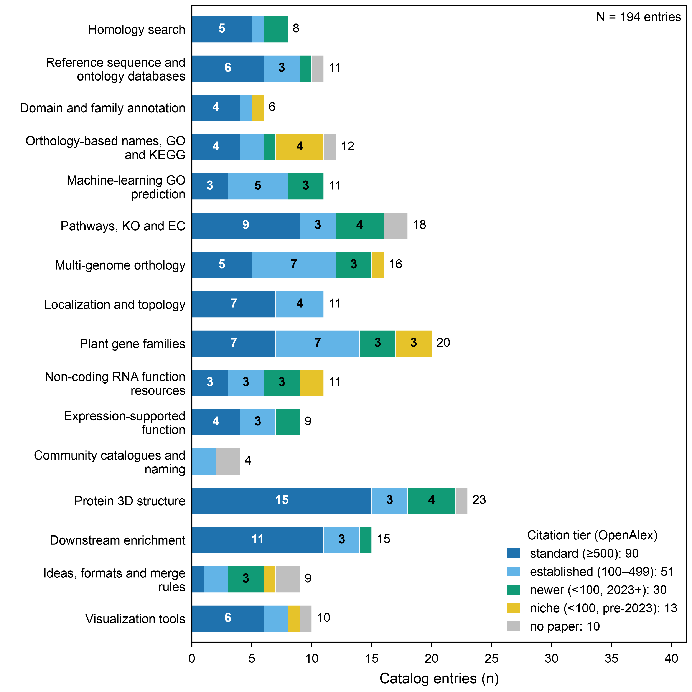
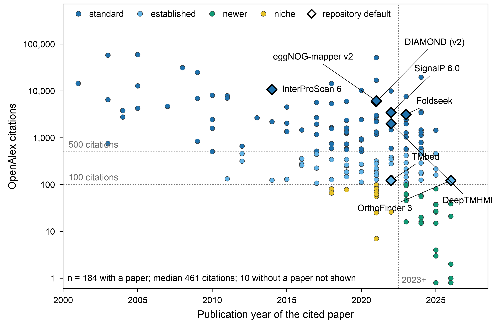
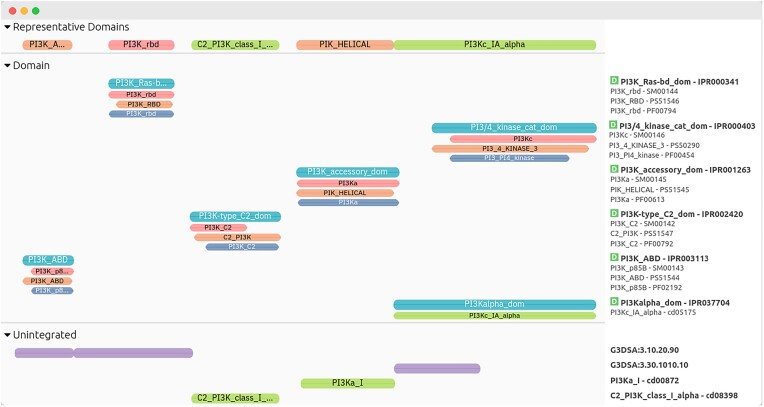
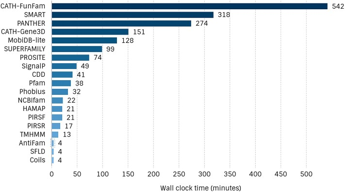
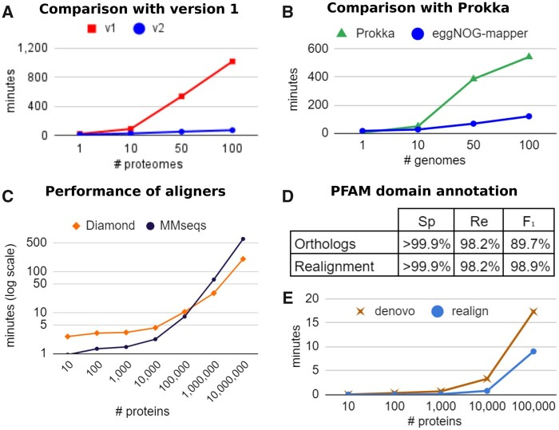
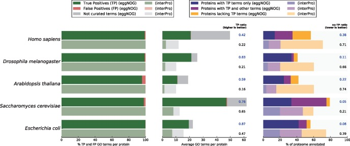
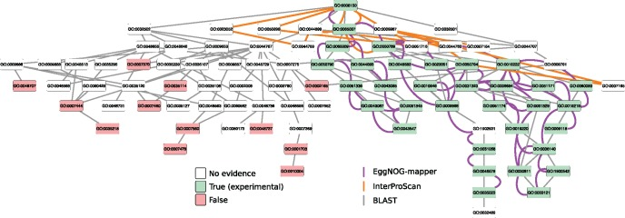
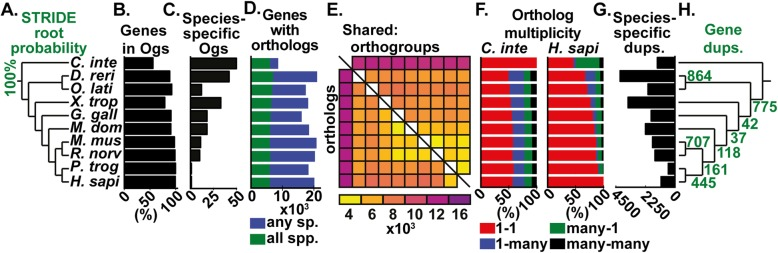
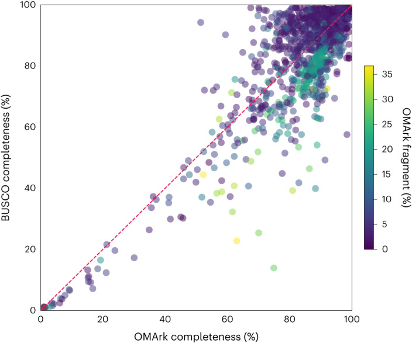

# 方法目录

[English](METHODS_CATALOG.md) · [首页](../README.zh.md) · [按类型索引](README.by-type.zh.md) · [条目数](COUNTS.md)

> 本页存放完整目录，首页链接到这里。条目数的重新统计见 [`COUNTS.md`](COUNTS.md)。下文中的 vitis-te 是 [TE-Lib](https://github.com/Xuzhen-Li/TE-Lib) 仓库的旧名。

## 方法目录

本页按类型列出 194 条方法、工具、数据库与思路，来自第一次调研和后来的一次更新（类型目录 61 条，`catalog/` 最初的卡片 68 条；合并旧版本条目 3 条，新增 41 条）。默认框架仍为 F1（DIAMOND + eggNOG + InterProScan），本目录不作改动。框架与步骤顺序仍见 `docs/ROADMAP.md` 和 `catalog/`。完整表格与勘误见 `docs/CATALOG_BY_TYPE_2026-11.md` 和 `docs/CATALOG_NEW_TOOLS_2026-11.md`。

每节开头有 **分组：** 列表，把本节条目分为可替代（选一个）、互补（一起用）或按顺序（依次运行），并说明什么情况下选哪个。列表中的「A 或 B」表示二选一，「A → B」表示一条固定路线。同一软件的不同版本合并为一条，以最新版本命名；旧版本只在该条的说明里提及。带框架选择和判断节点的流程图见 [`docs/ROADMAP.md`](../docs/ROADMAP.md#workflow-2026-11-14)。

每个类型小节的条目以一张表呈现：工具链接、角色（按本页写明的默认、分支工具或备选）、用途与何时用、原始论文、实验室、权威度与 OpenAlex 被引次数，以及一句引自论文摘要、评测论文或 GitHub 仓库的评价。新增 27 条，来自三类检索（一份候选清单、OpenAlex 关键词检索、公开工具清单与评测论文）。每条新增条目的 DOI 都能解析到题名一致的论文，链接都实际打开核对过。目录现有 194 条，含可视化一节；下面目录中的数字为当前数字。逐条数据见 `catalog/SOFTWARE_AUTHORITY.tsv`，同样的表格（不含各节说明）见 [`docs/software/README.zh.md`](../docs/software/README.zh.md)。书籍形式的学习笔记见 [`book/`](../book/README.zh.md)。

## 目录

- [默认路线](#default-route)
- [权威度规则](#tier-rule)
- [整套流程覆盖哪些步骤](#pipelines) (13)
- [1. 同源搜索](#section-1) (8)
- [2. 参考序列与本体数据库](#section-2) (11)
- [3. 结构域与家族注释](#section-3) (6)
- [4. 基于直系同源的名称、GO 与 KEGG](#section-4) (12)
- [5. 机器学习 GO 预测](#section-5) (11)
- [6. 通路、KO 与 EC](#section-6) (18)
- [7. 多基因组直系同源](#section-7) (16)
- [8. 定位与拓扑](#section-8) (11)
- [9. 植物基因家族](#section-9) (20)
- [10. 非编码 RNA 功能资源](#section-10) (11)
- [11. 表达支持的功能](#section-11) (9)
- [12. 社区目录与命名](#section-12) (4)
- [13. 蛋白三维结构](#section-13) (23)
- [14. 下游富集](#section-14) (15)
- [15. 想法、格式与合并规则](#section-15) (9)
- [可视化工具](#visualization) (新增 10 条，另有交叉列出的条目)
  - [结构域与基序图](#viz-1) (2)
  - [GO 与富集图](#viz-2) (6)
  - [通路图](#viz-3) (4)
  - [网络图](#viz-4) (2)
  - [三维结构查看器](#viz-5) (2)
- [蛋白序列之外还需要的数据](#data-needs)
- [图注与许可](#figure-credits)

各节与本库框架的对应关系：输入质控（F0）归在数据需求一节，不单列类型小节 → 默认框架 F1（同源、结构域、直系同源/GO）→ 可选附加项（通路、多基因组、定位、植物家族）→ 合并生成 `merged_function_table.tsv` → 发布。框架编号仍见 `docs/ROADMAP.md` 和 `catalog/`。

### 默认路线

默认框架是 F1：对结构发布的 `proteins.faa` 运行 DIAMOND (v2)、eggNOG-mapper v2 和 InterProScan 6。附加步骤：AHRD 给可读名称（F4），OrthoFinder 3 做直系同源组（F7），SignalP 6.0 加 DeepTMHMM 或 TMbed 做拓扑，Foldseek 对 AFDB 做结构搜索。这一框架以本页“使用方法”、各节“分组”以及 `docs/ROADMAP.md` 为准；下表把这些工具标为默认，其余条目标为备选或资源。

### 权威度规则

> **权威度规则（只在此处说明一次）：** 权威度取 OpenAlex 的论文被引次数（2026-11-25 取数）。标准：500 次及以上；成熟：100–499 次；较新：少于 100 次且论文发表于 2023 年或之后；小众：少于 100 次且发表于 2023 年之前；无论文：没有题名匹配的论文。通用工具的引用数来自所有学科。实验室取论文元数据中的通讯作者及其第一机构（多个通讯作者时写第一位并以 +N 表示其余人数；没有标注时写末位作者）。评价引自论文摘要（“作者摘要原句”表示工具作者自己的说法）、带 DOI 的评测论文，或 GitHub 仓库（简介与最后提交日期）。本目录共 194 条：标准 90、成熟 51、较新 30、小众 13、无论文 10。

*图：各类型小节的目录条目数，按权威度着色（规则见上）。数字由 `docs/figures/guide/src/make_catalog_charts.py` 从 `catalog/SOFTWARE_AUTHORITY.tsv` 计算（194 条；OpenAlex 被引数于 2026-11-25 取得）。*

*图：184 条有论文的目录条目的发表年份与 OpenAlex 被引数；菱形为本仓库默认工具。数据库和通用工具会从各个领域获得引用；被引数不代表在你的蛋白组上的准确度。数据：`catalog/SOFTWARE_AUTHORITY.tsv`；脚本 `docs/figures/guide/src/make_catalog_charts.py`。*

### 整套流程覆盖哪些步骤

“有”表示论文摘要或目录说明写明了该步骤；“—”只表示其中没有写明。“依据”列给出来源。

| 流程 | 同源搜索 | 结构域 | 直系同源/GO | KEGG/EC/通路 | 可读名称 | 定位 | 权威度 | 依据 |
|---|---|---|---|---|---|---|---|---|
| [eggNOG-mapper v2](https://github.com/eggnogdb/eggnog-mapper) · 默认（F1） | 有（内置） | 有 | 有 | 有 | 有 | — | 标准 · 6146 次 | doi:10.1093/molbev/msab293 （摘要） 与 目录说明 |
| [InterProScan 6](https://github.com/ebi-pf-team/interproscan6) · 默认（F1） | — | 有 | — | — | — | — | 标准 · 10656 次 | 目录说明 |
| [DIAMOND (v2)](https://github.com/bbuchfink/diamond) · 默认（F1） | 有 | — | — | — | — | — | 标准 · 5873 次 | 目录说明 |
| [AHRD](https://github.com/groupschoof/AHRD) · 默认（F4） | 使用 BLAST 结果 | — | — | — | 有 | — | 无论文 | 目录说明 |
| [PANNZER2](http://ekhidna2.biocenter.helsinki.fi/sanspanz/) | 有（SANSparallel） | — | 有 | — | 有 | — | 标准 · 595 次 | doi:10.1093/nar/gky350 （摘要） |
| [Blast2GO](https://www.biobam.com/omicsbox/) | 有 | — | 有 | — | — | — | 标准 · 12842 次 | doi:10.1093/bioinformatics/bti610 （摘要） |
| [EnTAP](https://github.com/harta55/EnTAP) | 有 | 有 | 有 | — | — | — | 成熟 · 250 次 | doi:10.1111/1755-0998.13106 （摘要） |
| [FA-nf](https://github.com/guigolab/FA-nf) | 有（BLAST+、DIAMOND） | 有（InterProScan） | 有 | 有 | — | 信号肽 | 小众 · 7 次 | 摘要与 目录说明 |
| [Sma3s v2](https://github.com/UPOBioinfo/sma3s) | 有（UniProt） | — | 有 | 有 | — | — | 成熟 · 107 次 | 目录说明 |
| [GOMAP](https://github.com/Dill-PICL/GOMAP) | 有 | 有 | 有 | — | — | — | 小众 · 56 次 | 目录说明 |
| [TRAPID 2.0](https://bioinformatics.psb.ugent.be/trapid_02/) | 有（PLAZA） | — | 有 | — | — | — | 小众 · 79 次 | 目录说明 |
| [Trinotate](https://github.com/Trinotate/Trinotate) · F5 路线 | 有 | 有（Pfam） | 有 | — | — | SignalP | 标准 · 1176 次 | 目录说明 |
| [FANTASIA](https://github.com/CBBIO/FANTASIA) | 用嵌入，不用比对 | — | 有 | — | — | — | 较新 · 38 次 | doi:10.1038/s42003-025-08651-2 （摘要） |

## 1. 同源搜索

框架 F1 同源搜索步骤所用的序列相似性比对工具。

**需要：** 本地 DIAMOND（或 BLAST）数据库，一般选用 Swiss-Prot 或有书面说明的同等级库，并将版本号记入 METHODS。[按场景列出的数据需求](#data-needs)

**分组：**
- *快速两两搜索*（可替代）：DIAMOND (v2)、MMseqs2、BLAST+。F1 默认用 DIAMOND；聚类和超大数据集用 MMseqs2（CPU 或 GPU）；小规模参考核对用 BLAST+。
- *谱搜索*（互补）：HMMER 3、HH-suite3。Pfam 式 HMM 搜索用 HMMER；疑难蛋白用 HH-suite3 做谱对谱比对。
- *语言模型远缘同源*（可替代）：PLMSearch、pLM-BLAST、Dense Homolog Retriever (DHR)。仅用于经 DIAMOND 和 HMMER 检索后仍无命中的蛋白；结果作为独立证据类别报告。

各条目的单句简介译自英文目录，英文原句见英文版 README。

| 工具 | 角色 | 用途 / 何时用 | 原始论文 | 实验室（通讯作者，机构） | 权威度（档位 · 被引） | 评价（出处） |
|---|---|---|---|---|---|---|
| [BLAST+](https://blast.ncbi.nlm.nih.gov/) | 备选 | NCBI BLAST 命令行工具集（含 blastp、makeblastdb）。 | [BMC Bioinformatics 2009](https://doi.org/10.1186/1471-2105-10-421) | Thomas Madden (National Institutes of Health) | 标准 · 25016 次 | 无摘要或仓库说明可引；见原文 |
| [DIAMOND (v2)](https://github.com/bbuchfink/diamond) | 默认（F1） | 高速蛋白序列比对工具，支持类 BLAST 的高灵敏度模式（`--ultra-sensitive`）。 | [Nature Methods 2021](https://doi.org/10.1038/s41592-021-01101-x) | Hajk‐Georg Drost (Max Planck Institute for Developmental Biology) | 标准 · 5873 次 | 作者摘要原句：“Here, we introduce an improved version of DIAMOND that greatly exceeds previous search performances and harnesses supercomputing to perform tree-of-life scale protein alignments in hours, while matching the sensitivity of the gold standard BLASTP.”；GitHub 最后提交 2026-11 |
| [MMseqs2](https://github.com/soedinglab/MMseqs2) | 备选 | 快速、高灵敏度的蛋白序列搜索与聚类工具。GPU 加速版（MMseqs2-GPU，doi:10.1038/s41592-025-02819-8）基于同一套代码，并能加速 ColabFold 的多序列比对。 | [Nature Biotechnology 2017](https://doi.org/10.1038/nbt.3988) | Johannes Söding (Max Planck Institute for Biophysical Chemistry) | 标准 · 5716 次 | GitHub 最后提交 2026-11 |
| [HMMER 3](https://github.com/EddyRivasLab/hmmer) | 备选 | 基于 profile HMM 的同源搜索工具（含 hmmscan、hmmsearch、jackhmmer）。 | [PLoS Computational Biology 2011](https://doi.org/10.1371/journal.pcbi.1002195) | Sean R. Eddy (Howard Hughes Medical Institute) | 标准 · 7895 次 | 作者摘要原句：“HMMER3 is substantially more sensitive and 100- to 1000-fold faster than HMMER2.”；GitHub 最后提交 2026-10 |
| [HH-suite3](https://github.com/soedinglab/hh-suite) | 备选 | 用于远缘同源检测的 HMM-HMM 比对工具（含 HHblits、HHsearch）。 | [BMC Bioinformatics 2019](https://doi.org/10.1186/s12859-019-3019-7) | Johannes Söding (Max Planck Institute for Biophysical Chemistry) | 标准 · 1253 次 | GitHub 最后提交 2026-10 |
| [PLMSearch](https://github.com/maovshao/PLMSearch) | 备选 | 通过比对蛋白语言模型嵌入检测远缘同源蛋白；能检出低序列一致性下被 BLAST 和 DIAMOND 遗漏的命中。 | [Nature Communications 2024](https://doi.org/10.1038/s41467-024-46808-5) | Jianyi Yang (Shandong University) +1 | 成熟 · 125 次 | 作者摘要原句：“Extensive experimental results show that PLMSearch can search millions of query-target protein pairs in seconds like MMseqs2 while increasing the sensitivity by more than threefold, and is comparable to state-of-the-art structure search methods.”；GitHub 最后提交 2025-09 |
| [pLM-BLAST](https://github.com/labstructbioinf/pLM-BLAST) | 备选 | 对逐残基语言模型嵌入执行局部比对，用于检测远缘同源关系并定位匹配区域。 | [Bioinformatics 2023](https://doi.org/10.1093/bioinformatics/btad579) | Stanisław Dunin-Horkawicz (Max Planck Institute for Biology) | 较新 · 96 次 | 作者摘要原句：“Our benchmarks reveal that pLM-BLAST maintains a level of accuracy on par with HHsearch for both highly similar sequences (with >50% identity) and markedly divergent sequences (with <30% identity), while being significantly faster.”；GitHub 最后提交 2026-10 |
| [Dense Homolog Retriever (DHR)](https://github.com/ml4bio/Dense-Homolog-Retrieval) | 备选 | 基于稠密检索的远缘同源搜索工具，兼顾速度与灵敏度；同时可为结构预测构建多序列比对。 | [Nature Biotechnology 2024](https://doi.org/10.1038/s41587-024-02353-6) | Siqi Sun (Fudan University) +2 | 较新 · 58 次 | 作者摘要原句：“Here, we offer an ultrafast, highly sensitive method, dense homolog retriever (DHR), for detecting homologs on the basis of a protein language model and dense retrieval techniques.”；GitHub 最后提交 2026-06 |

## 2. 参考序列与本体数据库

序列搜索和基因命名步骤所需的参考序列与本体数据库。

**需要：** 数据库文件本体（UniProt、GO、eggNOG、InterPro 成员库等）及对应版本号。这些内容无法仅凭待测蛋白序列推算出来。[按场景列出的数据需求](#data-needs)

**分组：**
- *序列检索库*（互补）：UniRef、UniProt 2025、TAIR、Ensembl Plants、Carbon Annotation Database (CADB)。F1 的 DIAMOND 比对 Swiss-Prot；需要更广覆盖时用 UniRef；人工审校的名称取自 TAIR 和 Swiss-Prot。
- *特征与家族*（互补）：Pfam (2025)、InterPro 2025、eggNOG 6。Pfam 和 InterPro 支撑 InterProScan；eggNOG 6 支撑 eggNOG-mapper。
- *本体、反应与网络*（互补）：Gene Ontology knowledgebase (2026)、Rhea、STRING (2025)。锁定 GO 版本；精确生化反应用 Rhea；互作网络背景用 STRING。

| 工具 | 角色 | 用途 / 何时用 | 原始论文 | 实验室（通讯作者，机构） | 权威度（档位 · 被引） | 评价（出处） |
|---|---|---|---|---|---|---|
| [UniRef](https://www.uniprot.org/help/uniref) | 资源 | 按序列相似性聚类的 UniProt 数据集（UniRef100/90/50）。 | [Bioinformatics 2014](https://doi.org/10.1093/bioinformatics/btu739) | Hongzhan Huang (European Bioinformatics Institute) | 标准 · 2209 次 | 作者摘要原句：“Non-redundancy and intra-cluster homogeneity in UniRef were recently improved by adding a sequence length overlap threshold.” |
| [Pfam (2025)](https://www.ebi.ac.uk/interpro/entry/pfam/) | 资源 | 蛋白家族 HMM 库，现已并入 InterPro；2025 年论文介绍了 AI 辅助的家族构建。早期论文：Pfam 2021（doi:10.1093/nar/gkaa913）。 | [Nucleic Acids Research 2024](https://doi.org/10.1093/nar/gkae997) | Typhaine Paysan‐Lafosse (European Bioinformatics Institute) | 标准 · 537 次 | 无摘要或仓库说明可引；见原文 |
| [TAIR](https://www.arabidopsis.org/) | 资源 | 拟南芥信息资源库（TAIR）：人工审定的拟南芥基因功能与命名数据库。 | [genesis 2015](https://doi.org/10.1002/dvg.22877) | Tanya Berardini (Phoenix Bioinformatics) | 标准 · 1358 次 | 无摘要或仓库说明可引；见原文 |
| [eggNOG 6](http://eggnog6.embl.de/) | 资源 | 支撑 eggNOG-mapper 的层级直系同源数据库。 | [Nucleic Acids Research 2022](https://doi.org/10.1093/nar/gkac1022) | Peer Bork (Yonsei University) +2 | 成熟 · 383 次 | 论文摘要：“Here, we present a major update of the database and website (version 6.0), which increases the number of covered organisms to 12 535 reference species, expands functional annotations, and implements new functionality.” |
| [UniProt 2025](https://www.uniprot.org) | 资源 | Swiss-Prot/TrEMBL 参考数据库；撰写 METHODS 时请引用最新的 NAR 年度更新论文。 | [Nucleic Acids Research 2024](https://doi.org/10.1093/nar/gkae1010) | Jian Zhang | 标准 · 3617 次 | 论文摘要：“In this publication, we describe ongoing changes to our production pipeline to limit the sequences available in UniProtKB to high-quality, non-redundant reference proteomes.” |
| [Carbon Annotation Database (CADB)](https://huggingface.co/blog/HuggingFaceBio/carbon-annotator-genbank-genome-annotation) | 资源 | 使用 Carbon-A 预测的约 48k 个 GenBank 真核组装的蛋白编码位点与蛋白序列库。 | [bioRxiv (Cold Spring Harbor Laboratory) 2026](https://doi.org/10.64898/2026.10.20.760448) | Qiuyi Li (Beijing Academy of Artificial Intelligence) | 较新 · 0 次 | 作者摘要原句：“Across 42 benchmark genomes, Carbon-A achieves the highest overall nucleotide-, exon-, and gene-level F1 scores among the evaluated models.” |
| [Gene Ontology knowledgebase (2026)](https://geneontology.org) | 资源 | 当前 GO 知识库发布论文（发表于 2026 年 NAR；附有一篇更正声明，doi 10.1093/nar/gkag678）。 | [Nucleic Acids Research 2025](https://doi.org/10.1093/nar/gkaf1292) | Monte Westerfield | 成熟 · 461 次 | 作者摘要原句：“The GO knowledgebase is regularly updated and improved.” |
| [Ensembl Plants](https://plants.ensembl.org) | 资源 | 收录植物基因组、基因树与投射注释的综合数据库。 | 无文章 | — | 无论文 | 无摘要或仓库说明可引；见原文 |
| [InterPro 2025](https://www.ebi.ac.uk/interpro/) | 资源 | 支撑 InterProScan 的综合特征数据库；2025 版新增了 AI 辅助整理的 Pfam 家族与基于三维结构的视图。 | [Nucleic Acids Research 2024](https://doi.org/10.1093/nar/gkae1082) | Matthias Blum (European Bioinformatics Institute) | 标准 · 1464 次 | 论文摘要：“In this publication, we report on the status of InterPro (version 101.0), detailing new developments in the database, associated web interface and software.” |
| [Rhea](https://www.rhea-db.org/) | 资源 | 经专家审校的生化反应数据库，供 UniProt 开展酶功能注释；将 EC 编号关联至具体化学反应。 | [Nucleic Acids Research 2021](https://doi.org/10.1093/nar/gkab1016) | Parit Bansal (SIB Swiss Institute of Bioinformatics) +2 | 成熟 · 319 次 | 论文摘要：“In this paper, we describe a number of key developments in Rhea since our last report in the database issue of Nucleic Acids Research in 2019.” |
| [STRING (2025)](https://string-db.org/) | 资源 | 覆盖数千个基因组（含葡萄属）的蛋白关联网络库；支持基于网络的功能推断与富集分析。 | [Nucleic Acids Research 2024](https://doi.org/10.1093/nar/gkae1113) | Peer Bork (Max Delbrück Center) +2 | 标准 · 1138 次 | 作者摘要原句：“The resource now also offers improved annotations of clustered networks and provides users with downloadable network embeddings, which facilitate the use of STRING networks in machine learning and allow cross-species transfer of protein information.” |

## 3. 结构域与家族注释

框架 F1 结构域步骤中的蛋白结构域与家族注释（InterProScan 及配套数据）。

**需要：** 正常可用的 InterProScan 程序及配套数据库；这一步耗时较长，虽属默认框架 F1，但 F-L1 并不要求当天跑完 IPS。[按场景列出的数据需求](#data-needs)

**分组：**
- *HMM 特征*（互补）：InterProScan 6、SMART (2021 update)、CDD / CD-Search (2023)。F1 默认用 InterProScan；信号域与结构域架构核对用 SMART 和 CDD。
- *家族树定位*（按顺序）：PANTHER、TreeGrafter。TreeGrafter 将蛋白放置到 PANTHER 进化树上，完成基于系统发育的 GO 注释。

*InterPro 对 PIK3CA 蛋白的结构域注释展示（图 4）。 Blum、Andreeva、Florentino 等 2025，《Nucleic Acids Research》图 4，doi:10.1093/nar/gkae1082，PMC11701551，CC BY。*

*InterProScan 在人类蛋白组上的运行耗时表现（图 6）。 Blum、Andreeva、Florentino 等 2025，《Nucleic Acids Research》图 6，doi:10.1093/nar/gkae1082，PMC11701551，CC BY。*

| 工具 | 角色 | 用途 / 何时用 | 原始论文 | 实验室（通讯作者，机构） | 权威度（档位 · 被引） | 评价（出处） |
|---|---|---|---|---|---|---|
| [InterProScan 6](https://github.com/ebi-pf-team/interproscan6) | 默认（F1） | 调用 InterPro 各成员库（Pfam、PANTHER、SMART、CDD、Gene3D 等）并完成 InterPro2GO 映射。当前版本为 6（2025–2026 年基于 Nextflow 发布），引用论文仍沿用 InterProScan 5。本仓库 F1 的运行脚本针对 v5 编写 [待确认：切换前先测试 v6 的输出列]。 | [Bioinformatics 2014](https://doi.org/10.1093/bioinformatics/btu031) | Alex Mitchell (European Bioinformatics Institute) +1 | 标准 · 10656 次 | 论文摘要：“Here, we describe a new Java-based architecture for the widely used protein function prediction software package InterProScan.”；GitHub 最后提交 2026-11 |
| [SMART (2021 update)](https://smart.embl.de) | 资源 | 信号转导与胞外结构域资源库（InterPro 成员数据库）。 | [Nucleic Acids Research 2020](https://doi.org/10.1093/nar/gkaa937) | Peer Bork (Max Delbrück Center) | 标准 · 2441 次 | 无摘要或仓库说明可引；见原文 |
| [CDD / CD-Search (2023)](https://www.ncbi.nlm.nih.gov/Structure/cdd/cdd.shtml) | 资源 | NCBI 保守结构域模型与 SPARCLE 结构域架构数据库。 | [Nucleic Acids Research 2022](https://doi.org/10.1093/nar/gkac1096) | Aron Marchler‐Bauer (National Institutes of Health) | 标准 · 1479 次 | 无摘要或仓库说明可引；见原文 |
| [PANTHER](https://www.pantherdb.org/) | 资源 | 附带进化树推断 GO 注释的系统发育蛋白家族与亚家族数据库；InterProScan 可直接报告 PANTHER 命中。 | [Protein Science 2021](https://doi.org/10.1002/pro.4218) | Paul D. Thomas (University of Southern California) | 标准 · 2293 次 | 论文摘要：“Here, we describe in detail the current contents of PANTHER, how those contents are generated, and how they can be used in a variety of applications.” |
| [TreeGrafter](https://github.com/pantherdb/TreeGrafter) | 备选 | 将查询蛋白嫁接至 PANTHER 家族进化树，并从最近的已注释祖先节点转移 GO 条目。 | [Bioinformatics 2018](https://doi.org/10.1093/bioinformatics/bty625) | Paul D. Thomas (University of Southern California) | 小众 · 81 次 | 作者摘要原句：“We show that TreeGrafter outperforms subfamily HMM scoring for correctly assigning subfamily membership, and that it produces highly specific annotations of GO terms based on annotated reference phylogenetic trees.”；GitHub 最后提交 2026-04 |
| [ProteInfer](https://github.com/google-research/proteinfer) | 备选 | 直接从氨基酸序列预测 Pfam、EC 和 GO 标签的深度神经网络；适合快速核查无 HMM 命中的蛋白。 | [eLife 2023](https://doi.org/10.7554/eLife.80942) | Theo Sanderson (The Francis Crick Institute) | 成熟 · 216 次 | 论文摘要：“Here we introduce ProteInfer, which instead employs deep convolutional neural networks to directly predict a variety of protein functions - Enzyme Commission (EC) numbers and Gene Ontology (GO) terms - directly from an unaligned amino acid sequence.”；GitHub 最后提交 2026-03 |

## 4. 基于直系同源的名称、GO 与 KEGG

基于直系同源或序列相似性的基因名称、GO 与 KEGG 注释，亦涵盖完整注释框架（F1 直系同源步骤、快速框架 F2、EnTAP 框架 F3、F4 可读名称）。

**需要：** eggNOG-mapper 数据库（若需生成可读名称，再补充可选的 AHRD / PANNZER 输入）。机器自动分配的 GO 仍归为电子注释证据（IEA）。[按场景列出的数据需求](#data-needs)

**分组：**
- *可读名称*（可替代）：AHRD、PANNZER2、Sma3s v2。F4 默认用 AHRD；PANNZER2 同时输出带评分的 GO 预测。
- *一体化套件*（可替代）：EnTAP、Trinotate、Blast2GO、FA-nf、GOMAP、TRAPID 2.0。均为 F1 的替代方案而非附加步骤：含 EnTAP（F3）和 Trinotate（F5）；GOMAP 面向植物；Blast2GO 为商业软件。
- *直系同源转移与定位*（互补）：eggNOG-mapper v2、OMAmer、FANTASIA。eggNOG-mapper v2 是 F1 中 GO、KEGG 和 EC 的默认来源；OMAmer 用于快速定位家族；FANTASIA 只用于没有同源命中的蛋白。

*eggNOG-mapper v2 与其他功能注释工具的运行耗时对比（图 2）。 Cantalapiedra 等 2021，《Molecular Biology and Evolution》图 2，doi:10.1093/molbev/msab293，PMC8662613，CC BY。*

*eggNOG-mapper 与 InterProScan 的注释结果对比（图 3）。 Huerta-Cepas 等 2017，《Molecular Biology and Evolution》图 3，doi:10.1093/molbev/msx148，PMC5850834，CC BY。*

*eggNOG-mapper 在具体实例上的 GO 分配过程（图 4）。 Huerta-Cepas 等 2017，《Molecular Biology and Evolution》图 4，doi:10.1093/molbev/msx148，PMC5850834，CC BY。*

| 工具 | 角色 | 用途 / 何时用 | 原始论文 | 实验室（通讯作者，机构） | 权威度（档位 · 被引） | 评价（出处） |
|---|---|---|---|---|---|---|
| [eggNOG-mapper v2](https://github.com/eggnogdb/eggnog-mapper) | 默认（F1） | 基于直系同源的功能注释工具：分配基因名称、GO、KEGG、EC 与 COG。 | [Molecular Biology and Evolution 2021](https://doi.org/10.1093/molbev/msab293) | Peer Bork (Yonsei University) +1 | 标准 · 6146 次 | 论文摘要：“Here, we describe a major upgrade to eggNOG-mapper, a tool for functional annotation based on precomputed orthology assignments, now optimized for vast (meta)genomic data sets.”；GitHub 最后提交 2026-08 |
| [PANNZER2](http://ekhidna2.biocenter.helsinki.fi/sanspanz/) | 备选 | 快速的网页端及本地端 GO 与自由文本功能描述预测工具。 | [Nucleic Acids Research 2018](https://doi.org/10.1093/nar/gky350) | Petri Törönen (University of Helsinki) +1 | 标准 · 595 次 | 论文摘要：“Here, we introduce PANNZER2 (Protein ANNotation with Z-scoRE), a fast functional annotation web server that provides both Gene Ontology (GO) annotations and free text description predictions.” |
| [Blast2GO](https://www.biobam.com/omicsbox/) | 备选 | 基于 BLAST 的 GO 注释与可视化工具（现已并入商业软件 OmicsBox）。 | [Bioinformatics 2005](https://doi.org/10.1093/bioinformatics/bti610) | Ana Conesa (Alfred-Wegener-Institut Helmholtz-Zentrum für Polar- und Meeresforschung) | 标准 · 12842 次 | 论文摘要：“We present here Blast2GO (B2G), a research tool designed with the main purpose of enabling Gene Ontology (GO) based data mining on sequence data for which no GO annotation is yet available.” |
| [EnTAP](https://github.com/harta55/EnTAP) | 备选 | 非模式真核生物注释流程：整合序列过滤、相似性搜索、污染标记、eggNOG 与 InterPro。 | [Molecular Ecology Resources 2019](https://doi.org/10.1111/1755-0998.13106) | Jill Wegrzyn (University of Connecticut) | 成熟 · 250 次 | 作者摘要原句：“EnTAP (Eukaryotic Non-Model Transcriptome Annotation Pipeline) was designed to improve the accuracy, speed, and flexibility of functional gene annotation for de novo assembled transcriptomes in non-model eukaryotes.”；GitHub 已归档（最后提交 2025-01） |
| [FA-nf](https://github.com/guigolab/FA-nf) | 备选 | 面向非模式生物蛋白的 Nextflow 功能注释流程（串联 BLAST、InterProScan、KEGG 与信号肽预测）。 | [Genes 2021](https://doi.org/10.3390/genes12101645) | Antonio Hermoso (Barcelona Institute of Science and Technology) | 小众 · 7 次 | 作者摘要原句：“It is also useful for proofreading and improving gene structural annotation.”；GitHub 最后提交 2022-02 |
| [Sma3s v2](https://github.com/UPOBioinfo/sma3s) | 备选 | 比对 UniProt 为蛋白组或转录组分配 GO、关键词与代谢通路的功能注释工具。 | [PROTEOMICS 2017](https://doi.org/10.1002/pmic.201700071) | Antonio J. Pérez‐Pulido (Consejo Superior de Investigaciones Científicas) | 成熟 · 107 次 | 作者摘要原句：“Sma3s is an accurate computational tool for annotating proteins in an unattended way.”；GitHub 最后提交 2026-09 |
| [AHRD](https://github.com/groupschoof/AHRD) | 默认（F4） | 根据 BLAST 比对结果自动分配可读基因功能描述（Human Readable Descriptions）的工具。 | 无文章 | — | 无论文 | 仓库简介：“High throughput protein function annotation with Human Readable Description (HRDs) and Gene Ontology (GO) Terms.”；GitHub 最后提交 2023-08 |
| [GOMAP](https://github.com/Dill-PICL/GOMAP) | 备选 | 面向植物的 GO 元注释工具（GOMAP）：整合序列相似性、结构域与混合方法预测结果以生成植物 GO 集。 | [Plant Methods 2021](https://doi.org/10.1186/s13007-021-00754-1) | Kokulapalan Wimalanathan (Iowa State University) +1 | 小众 · 56 次 | 作者摘要原句：“Assessment shows that GOMAP expands and improves the number of genes annotated and annotations assigned per gene as well as the quality (based on [Formula: see text]) of GO assignments in maize.”；GitHub 最后提交 2023-05 |
| [TRAPID 2.0](https://bioinformatics.psb.ugent.be/trapid_02/) | 备选 | 基于 PLAZA 参考库对从头组装的植物转录组做分类学与功能分析的网页工具。 | [Nucleic Acids Research 2021](https://doi.org/10.1093/nar/gkab565) | Klaas Vandepoele (Ghent University) | 小众 · 79 次 | 论文摘要：“To alleviate some of these challenges, we developed TRAPID 2.0, a web application for the fast and efficient processing of assembled transcriptome data.” |
| [OMAmer](https://github.com/DessimozLab/omamer) | 备选 | 将蛋白免比对归入 OMA 层级直系同源群；运行速度快且能区分亚家族（OMArk 底层亦调用该工具）。 | [Bioinformatics 2021](https://doi.org/10.1093/bioinformatics/btab219) | Marc Robinson‐Rechavi (SIB Swiss Institute of Bioinformatics) +1 | 小众 · 25 次 | 作者摘要原句：“Whilst able to reject non-homologous family-level assignments, we show that OMAmer provides better and quicker subfamily-level assignments than approaches relying on the closest sequence, whether inferred exactly by Smith-Waterman or by the fast heuristic …”；GitHub 最后提交 2026-11 |
| [FANTASIA](https://github.com/CBBIO/FANTASIA) | 备选 | 基于嵌入相似度在全蛋白组范围转移 GO 条目；专用于缺乏同源注释的"暗"蛋白。 | [Communications Biology 2025](https://doi.org/10.1038/s42003-025-08651-2) | Gemma I. Martínez‐Redondo (Institut de Biologia Evolutiva) +2 | 较新 · 38 次 | 作者摘要原句：“FANTASIA holds particular promise for functional discovery in non-model taxa, offering advantages over homology-based tools in sensitivity and generalizability.”；GitHub 最后提交 2026-09 |
| [Trinotate](https://github.com/Trinotate/Trinotate) | F5 路线 | 面向从头组装转录组预测肽段的注释套件（将 BLAST、Pfam、SignalP 和 GO 结果汇总至 SQLite）；对应 F5 路线。此处列出的是作者指定引用的文献。 | [Cell Reports 2017](https://doi.org/10.1016/j.celrep.2016.12.063) | Brian J. Haas (Broad Institute) +1 | 标准 · 1176 次 | GitHub 最后提交 2026-11 |

## 5. 机器学习 GO 预测

基于机器学习的 GO 预测。属于框架 F1 之后的可选附加项，不能替代 F1。

**需要：** 通常只需输入蛋白序列，配合工具自带的模型。这些工具是框架 F1 之后的可选附加项，不能替代 F1。[按场景列出的数据需求](#data-needs)

**分组：**
- *序列与语言模型预测器*（可替代）：DeepGO-SE、GoPredSim、SPROF-GO、TALE、NetGO 3.0、ProtGO、AltereGO、DeepGOPlus。填补 F1 注释空白时优先选用 DeepGO-SE 或 GoPredSim；DeepGOPlus 主要用于复现旧表。机器学习预测的 GO 须单独存为一列证据。
- *利用结构的预测器*（可替代）：DeepFRI、DPFunc。依赖预测的三维结构（第 13 节）；适用于序列分化较大的蛋白家族。

| 工具 | 角色 | 用途 / 何时用 | 原始论文 | 实验室（通讯作者，机构） | 权威度（档位 · 被引） | 评价（出处） |
|---|---|---|---|---|---|---|
| [DeepGOPlus](https://github.com/bio-ontology-research-group/deepgoplus) | 备选 | 结合 CNN 与 DIAMOND 从序列预测 GO 的工具。 | [Bioinformatics 2019](https://doi.org/10.1093/bioinformatics/btz595) | Robert Hoehndorf (King Abdullah University of Science and Technology) | 标准 · 562 次 | 作者摘要原句：“DeepGOPlus can annotate around 40 protein sequences per second on common hardware, thereby making fast and accurate function predictions available for a wide range of proteins.”；GitHub 最后提交 2026-10 |
| NetGO 3.0 | 备选 | 基于蛋白语言模型的 GO 预测在线服务（CAFA 评测名列前茅）。 | [Genomics Proteomics & Bioinformatics 2023](https://doi.org/10.1016/j.gpb.2023.04.001) | Shanfeng Zhu (Fudan University) | 成熟 · 108 次 | 作者摘要原句：“As one of the state-of-the-art automated function prediction (AFP) methods, NetGO 2.0 integrates multi-source information to improve the performance.” |
| [DeepFRI](https://github.com/flatironinstitute/DeepFRI) | 备选 | 结合三维结构与蛋白序列预测功能的图卷积网络工具。规模化流程 metagenomic-DeepFRI（2026 预印本，doi:10.64898/2026.04.27.720983）将该算法扩展至大规模蛋白集。 | [Nature Communications 2021](https://doi.org/10.1038/s41467-021-23303-9) | Vladimir Gligorijević (Flatiron Institute) +1 | 标准 · 1186 次 | 作者摘要原句：“It outperforms current leading methods and sequence-based Convolutional Neural Networks and scales to the size of current sequence repositories.”；GitHub 最后提交 2023-03 |
| [GoPredSim](https://github.com/Rostlab/goPredSim) | 备选 | 基于序列嵌入向量（SeqVec/ProtT5）相似性转移 GO 标签的工具。 | [Scientific Reports 2021](https://doi.org/10.1038/s41598-020-80786-0) | Maria Littmann (Technical University of Munich) | 成熟 · 216 次 | GitHub 最后提交 2024-12 |
| [DeepGO-SE](https://github.com/bio-ontology-research-group/deepgo2) | 备选 | 基于 ESM2 嵌入向量与 GO 公理、通过近似语义蕴涵预测 GO 的工具。 | [Nature Machine Intelligence 2024](https://doi.org/10.1038/s42256-024-00795-w) | Maxat Kulmanov (King Abdullah University of Science and Technology) +1 | 成熟 · 173 次 | 作者摘要原句：“We show, using several benchmarks, that the approach effectively exploits background knowledge in the GO and improves protein function prediction compared to state-of-the-art methods.”；GitHub 最后提交 2026-10 |
| [ProtGO](https://github.com/sunyatawang/ProtGO) | 备选 | 多模态 GO 预测工具（整合蛋白语言模型、文本、分类学信息与 GO 图结构）。 | [Bioinformatics 2025](https://doi.org/10.1093/bioinformatics/btaf390) | Jie Tang (Tsinghua University) +1 | 较新 · 15 次 | 作者摘要原句：“Extensive experiments demonstrate that ProtGO significantly advances the abilities of state-of-the-art PLMs to predict protein functions: approximately 8% to 27% increase in the maximum F1 measure (Fmax) compared to base models.”；GitHub 最后提交 2024-07 |
| AltereGO | 备选 | 在打分层面融合 ESM2、ProtT5、Ankh 与 ProstT5-3Di 预测器以预测 GO 分子功能的工具（2026 预印本）。 | [bioRxiv (Cold Spring Harbor Laboratory) 2026](https://doi.org/10.64898/2026.10.23.761425) | J. Andrew Amburn (University of Tennessee at Knoxville) | 较新 · 0 次 | 作者摘要原句：“In matched comparisons with eight released prediction methods, AltereGO achieved significantly improved ranking capabilities AUPRC in every comparison and significantly better F max and S min in six.” |
| [DPFunc](https://github.com/CSUBioGroup/DPFunc) | 备选 | 结合结构域与三维结构信息的深度学习 GO 预测工具。 | [Nature Communications 2025](https://doi.org/10.1038/s41467-024-54816-8) | Min Li (Central South University) | 较新 · 81 次 | 作者摘要原句：“In this study, we propose a deep learning-based solution, named DPFunc, for accurate protein function prediction with domain-guided structure information.”；GitHub 最后提交 2026-03 |
| [SPROF-GO](https://github.com/biomed-AI/SPROF-GO) | 备选 | 结合蛋白语言模型特征与基于同源的标签扩散算法预测 GO 条目。 | [Briefings in Bioinformatics 2023](https://doi.org/10.1093/bib/bbad117) | Huiying Zhao (Sun Yat-sen University) +1 | 成熟 · 107 次 | 作者摘要原句：“Due to the explosive growth of proteins in sequence databases and the diversity of their functions, it remains challenging to fast and accurately predict protein functions from sequences alone.”；GitHub 最后提交 2024-07 |
| [TALE](https://github.com/Shen-Lab/TALE) | 备选 | 用 Transformer 把序列和 GO 标签联合嵌入，因此能为很少被注释的条目排序。 | [Bioinformatics 2021](https://doi.org/10.1093/bioinformatics/btab198) | Yang Shen (Texas A&M University) | 成熟 · 178 次 | 作者摘要原句：“Combining TALE and a sequence similarity-based method, TALE+ outperformed competing methods when only sequence input is available.”；GitHub 最后提交 2024-12 |
| [CAFA3 assessment](https://biofunctionprediction.org/cafa/) | 参考 | 蛋白功能预测方法的社区评测。 | [Genome biology 2019](https://doi.org/10.1186/s13059-019-1835-8) | Iddo Friedberg (Iowa State University) | 标准 · 561 次 | 作者摘要原句：“We conclude that while predictions of the molecular function and biological process annotations have slightly improved over time, those of the cellular component have not.” |

> 评测要点： CAFA3：分子功能和生物过程的预测比早期略有提升，细胞组分没有提升，最好的方法仍有很大改进空间（doi:10.1186/s13059-019-1835-8）。机器学习得到的 GO 只能当候选。

## 6. 通路、KO 与 EC

代谢通路、KO 与 EC 注释（F1+ Kofam、框架 F6 MapMan 及相关附加项）。

**需要：** 跑 Kofam / KO 需准备 HMM 模型库及打分阈值；跑 MapMan（F6）需准备 Mercator4 结果（网页版或本地版，见 `docs/MERCATOR_WHEN.md`）。KEGG 的再分发规定目前标为 `[待确认]`，此处不作预设。[按场景列出的数据需求](#data-needs)

**分组：**
- *KO 分配*（可替代）：KofamKOALA / KofamScan、BlastKOALA / GhostKOALA、KAAS。KofamScan 支持本地运行（F1+ 可选）；BlastKOALA 和 KAAS 为网页端替代方案。
- *植物通路框架与酶参考*（互补）：MapMan4 / Mercator4、Plant Reactome (2024)、Plant Metabolic Network / E2P2、Pathway Tools、MetaCyc、KEGG (2025 NAR)、BRENDA。植物 BIN 用 Mercator4（F6）；先用 E2P2 预测酶，再用 Pathway Tools 构建葡萄通路数据库；核对 EC 结果时以 BRENDA 为酶参考。
- *EC 预测*（可替代）：DeepEC、CLEAN、EZpred、ProteEC-CLA。没有 KO 的酶先用 CLEAN；结果对照 BRENDA 核对。
- *完整度与基因簇*（互补）：KEGG Mapper、kegg-pathways-completeness、plantiSMASH 2.0。基于 KO 集合评估通路完整度；生物合成基因簇识别用 plantiSMASH。

| 工具 | 角色 | 用途 / 何时用 | 原始论文 | 实验室（通讯作者，机构） | 权威度（档位 · 被引） | 评价（出处） |
|---|---|---|---|---|---|---|
| [MapMan4 / Mercator4](https://www.plabipd.de/mercator_main.html) | 备选 | 由 Mercator4 分配的植物专用功能分类体系（MapMan4）。 | [Molecular Plant 2019](https://doi.org/10.1016/j.molp.2019.01.003) | Marie Bolger (Forschungszentrum Jülich) | 标准 · 585 次 | 论文摘要：“Here we present a redesigned and significantly enhanced MapMan4 framework, together with a revised version of the associated online Mercator annotation tool.” |
| [KofamKOALA / KofamScan](https://www.genome.jp/tools/kofamkoala/) | 备选 | 利用自适应阈值 profile HMM 分配 KEGG Orthology（KO）的工具。 | [Bioinformatics 2019](https://doi.org/10.1093/bioinformatics/btz859) | Hiroyuki Ogata (Kyoto University) | 标准 · 2358 次 | 作者摘要原句：“KofamKOALA is faster than existing KO assignment tools with its accuracy being comparable to the best performing tools.” |
| [BlastKOALA / GhostKOALA](https://www.kegg.jp/blastkoala/) | 备选 | 基于序列相似性分配 KO 编号的 KEGG 在线服务。 | [Journal of Molecular Biology 2015](https://doi.org/10.1016/j.jmb.2015.11.006) | Minoru I. Kanehisa (Kyoto University) | 标准 · 4552 次 | 无摘要或仓库说明可引；见原文 |
| [KEGG Mapper](https://www.kegg.jp/kegg/mapper/) | 备选 | 将 KO 列表映射至 KEGG 代谢通路、BRITE 层级与功能模块的工具。 | [Protein Science 2019](https://doi.org/10.1002/pro.3711) | Minoru I. Kanehisa (Kyoto University Institute for Chemical Research) | 标准 · 1339 次 | 论文摘要：“Here we report a new version of KEGG Mapper, a suite of KEGG mapping tools available at the KEGG website (https://www.kegg.jp/ or https://www.genome.jp/kegg/), together with the KOALA family tools for automatic assignment of KO (KEGG Orthology) identifiers …” |
| [kegg-pathways-completeness](https://github.com/EBI-Metagenomics/kegg-pathways-completeness-tool) | 备选 | 根据 KO 列表计算 KEGG 功能模块完整度的工具。 | 无文章 | — | 无论文 | 仓库简介：“This tool estimates the completeness of KEGG pathway modules from the presence or absence of KEGG orthologues (KOs)”；GitHub 最后提交 2026-10 |
| [MetaCyc](https://metacyc.org/) | 资源 | 跨物种的人工审定代谢通路与酶数据库。 | [Nucleic Acids Research 2019](https://doi.org/10.1093/nar/gkz862) | Ron Caspi (SRI International) +1 | 标准 · 1617 次 | 无摘要或仓库说明可引；见原文 |
| [BRENDA](https://www.brenda-enzymes.org/) | 资源 | 综合性的酶功能与 EC 编号数据库。 | [Nucleic Acids Research 2020](https://doi.org/10.1093/nar/gkaa1025) | Dietmar Schomburg (Technische Universität Braunschweig) | 标准 · 899 次 | 无摘要或仓库说明可引；见原文 |
| DeepEC | 备选 | 基于深度学习预测 EC 编号的工具。 | [Proceedings of the National Academy of Sciences 2019](https://doi.org/10.1073/pnas.1821905116) | Sang Yup Lee (Korea Advanced Institute of Science and Technology) | 成熟 · 346 次 | 作者摘要原句：“Here, we report DeepEC, a deep learning-based computational framework that predicts EC numbers for protein sequences with high precision and in a high-throughput manner.” |
| [KEGG (2025 NAR)](https://www.kegg.jp) | 资源 | 用于 KO 与代谢通路映射的当前 KEGG 引用文献（2025 NAR）。 | [Nucleic Acids Research 2024](https://doi.org/10.1093/nar/gkae909) | Minoru I. Kanehisa (Kyoto University) | 标准 · 3418 次 | 无摘要或仓库说明可引；见原文 |
| [Plant Reactome (2024)](https://plantreactome.gramene.org) | 资源 | 人工审定的植物代谢通路数据库（以水稻为参考并投射至其他植物）。 | [Nucleic Acids Research 2023](https://doi.org/10.1093/nar/gkad1052) | Pankaj Jaiswal (Oregon State University) +1 | 较新 · 16 次 | 作者摘要原句：“It provides curated reference pathways from rice (Oryza sativa) and gene-orthology-based pathway projections to 129 additional species, spanning single-cell photoautotrophs, non-vascular plants, and higher plants, thus encompassing a wide-ranging taxonomic …” |
| [Plant Metabolic Network / E2P2](https://plantcyc.org) | 备选 | 利用 E2P2 酶预测工具构建的 PlantCyc 及各物种代谢通路数据库。 | 无文章 | — | 无论文 | 无摘要或仓库说明可引；见原文 |
| [CLEAN](https://github.com/tttianhao/CLEAN) | 备选 | 基于对比学习预测 EC 编号的工具。 | [Science 2023](https://doi.org/10.1126/science.adf2465) | Tianhao Yu (University of Illinois Urbana-Champaign) +2 | 标准 · 566 次 | 作者摘要原句：“We present a machine learning algorithm named CLEAN (contrastive learning-enabled enzyme annotation) to assign EC numbers to enzymes with better accuracy, reliability, and sensitivity compared with the state-of-the-art tool BLASTp.”；GitHub 最后提交 2025-04 |
| EZpred | 备选 | 利用无标签同源序列预测 EC 编号的工具（发表于 Advanced Science 2026）。 | [Advanced Science 2026](https://doi.org/10.1002/advs.78703) | Quancheng Liu (University of Michigan) +1 | 较新 · 1 次 | 作者摘要原句：“For test enzymes with < 30% sequence identity to any training proteins, the F1‐score of EZpred EC number prediction is at least 34% higher than state‐of‐the‐art EC number prediction models.” |
| ProteEC-CLA | 备选 | 在 ESM2 基础上结合对比学习与代理注意力机制（agent attention）预测 EC 编号的工具。 | [Proteins Structure Function and Bioinformatics 2025](https://doi.org/10.1002/prot.26822) | Yue Zhao (Beijing Forestry University) | 较新 · 3 次 | 作者摘要原句：“ProteEC-CLA utilizes contrastive learning to construct positive and negative sample pairs, which not only enhances sequence feature extraction but also improves the utilization of unlabeled data.” |
| [plantiSMASH 2.0](https://github.com/plantismash/plantismash) | 备选 | 植物生物合成基因簇（BGC）检测工具，支持部分酶家族底物预测与启动子 TF 结合位点分析；内置覆盖 430 个基因组约 30k 个 BGC 的数据库。 | [Journal of Molecular Biology 2026](https://doi.org/10.1016/j.jmb.2026.169798) | Elena Del Pup (Wageningen University & Research) +3 | 较新 · 21 次 | 作者摘要原句：“Together, these improvements make plantiSMASH 2.0 a powerful and comprehensive platform for the detection and characterization of plant biosynthetic pathways, supporting and accelerating research in plant specialized metabolism and plant natural product …”；GitHub 最后提交 2026-02 |
| [KAAS](https://www.genome.jp/kegg/kaas/) | 备选 | KEGG 在线注释服务，通过双向最佳命中分配 KO 编号并重建通路图。 | [Nucleic Acids Research 2007](https://doi.org/10.1093/nar/gkm321) | Minoru I. Kanehisa (Kyoto University Institute for Chemical Research) | 标准 · 4594 次 | 论文摘要：“Here, we have developed a web-based server called KAAS (KEGG Automatic Annotation Server: http://www.genome.jp/kegg/kaas/) i.e. an implementation of a rapid method to automatically assign K numbers to genes in the genome, enabling reconstruction of KEGG …” |
| [Pathway Tools](https://bioinformatics.ai.sri.com/ptools/) | 备选 | 构建物种专属的通路/基因组数据库；在 PMN 流程中，先由 E2P2 预测酶，再用 Pathway Tools 建库（PlantCyc 即如此构建）。 | [Briefings in Bioinformatics 2019](https://doi.org/10.1093/bib/bbz104) | Peter E Midford (SRI International) | 成熟 · 260 次 | 作者摘要原句：“It can now support metabolic-model execution through the Web, it provides a more accurate gap filler for metabolic models; it supports development of models for organism communities distributed across a spatial grid; and model results may be visualized …” |
| [DeepECtransformer](https://github.com/kaistsystemsbiology/DeepProZyme) | 备选 | 基于 Transformer 从序列预测 EC 号。 | [Nature Communications 2023](https://doi.org/10.1038/s41467-023-43216-z) | Sang Yup Lee (Korea Advanced Institute of Science and Technology) | 成熟 · 144 次 | 论文摘要：“Here we present a deep learning model, DeepECtransformer, which utilizes transformer layers as a neural network architecture to predict EC numbers.”；GitHub 最后提交 2023-10 |

## 7. 多基因组直系同源

跨基因组的直系同源基因群划分。框架 F7 仅对直系同源群的代表序列做功能注释，而非逐个基因注释。

**需要：** 数据集中各个基因组的蛋白 FASTA。框架 F7 仅注释直系同源群的代表序列，而非每个基因。[按场景列出的数据需求](#data-needs)

**分组：**
- *直系同源群推断*（可替代）：OrthoFinder 3、SonicParanoid2、Broccoli、Proteinortho6、FastOMA。F7 默认用 OrthoFinder 3；物种面板很大时选用 FastOMA 或 SonicParanoid2。
- *参考目录*（互补）：PLAZA 5.0、OrthoDB v12、OMA browser 2024、PhylomeDB V5、OrthoVenn3。利用植物库和基于进化树的参考库交叉核对直系同源群。
- *家族演化*（按顺序）：OrthoFinder 3 或 SonicParanoid2 或 Broccoli 或 Proteinortho6 或 FastOMA、CAFE 5。先确定直系同源群，再用 CAFE 5 估计扩张和收缩。

*OrthoFinder 在脊索动物数据集上的分析结果概览（图 3）。 Emms 与 Kelly 2019，《Genome Biology》图 3，doi:10.1186/s13059-019-1832-y，PMC6857279，CC BY。*

| 工具 | 角色 | 用途 / 何时用 | 原始论文 | 实验室（通讯作者，机构） | 权威度（档位 · 被引） | 评价（出处） |
|---|---|---|---|---|---|---|
| [Broccoli](https://github.com/rderelle/Broccoli) | 备选 | 结合系统发育树与网络标签传播推断直系同源关系的工具。 | [Molecular Biology and Evolution 2020](https://doi.org/10.1093/molbev/msaa159) | Romain Derelle (University of Birmingham) | 成熟 · 113 次 | 作者摘要原句：“In this article, we introduce Broccoli, a user-friendly pipeline designed to infer, with high precision, orthologous groups, and pairs of proteins using a phylogeny-based approach.”；GitHub 最后提交 2026-10 |
| [Proteinortho6](https://gitlab.com/paulklemm_PHD/proteinortho) | 备选 | 面向大规模数据的图算法（共）直系同源检测工具。 | [Frontiers in Bioinformatics 2023](https://doi.org/10.3389/fbinf.2023.1322477) | Marcus Lechner (Philipps University of Marburg) | 较新 · 46 次 | 作者摘要原句：“In this contribution, we evaluate and implement major algorithmic improvements that significantly enhance the speed of the analysis without reducing precision.” |
| [CAFE 5](https://github.com/hahnlab/CAFE5) | 备选 | 在演化速率变异模型下分析基因家族扩张与收缩的工具。 | [Bioinformatics 2020](https://doi.org/10.1093/bioinformatics/btaa1022) | Dan Vanderpool (Indiana University Bloomington) | 标准 · 949 次 | 作者摘要原句：“These include improved support for multithreading, the explicit modeling of rate variation among families using gamma-distributed rate categories, and command-line arguments that preclude the use of accessory scripts.”；GitHub 最后提交 2026-10 |
| [PLAZA 5.0](https://bioinformatics.psb.ugent.be/plaza/) | 资源 | 植物比较基因组学平台：涵盖基因家族、直系同源与 GO/InterPro 注释投射。 | [Nucleic Acids Research 2021](https://doi.org/10.1093/nar/gkab1024) | Klaas Vandepoele (Ghent University) | 成熟 · 281 次 | 作者摘要原句：“This latest release also comes with a set of new and updated features: a new BED import functionality for the workbench, improved interactive visualizations for functional enrichments and genome-wide mapping of gene sets, and a fully redesigned and extended …” |
| [OrthoFinder 3](https://github.com/OrthoFinder/OrthoFinder) | 默认（F7） | 可扩展的系统发育直系同源推断工具（v3.x 版本采用 FAMSA 比对）。 | [Nature Methods 2026](https://doi.org/10.1101/2025.07.15.664860) | Steven L. Kelly (University of Oxford) | 成熟 · 122 次 | 作者摘要原句：“This extends OrthoFinder's high-accuracy comparative genomic framework to provide substantially enhanced scalability and accuracy.”；GitHub 最后提交 2026-11 |
| [FastOMA](https://github.com/DessimozLab/FastOMA) | 备选 | 呈线性扩展的快速直系同源推断工具（基于 OMAmer 归置）。 | [Nature Methods 2025](https://doi.org/10.1038/s41592-024-02552-8) | Christophe Dessimoz (SIB Swiss Institute of Bioinformatics) | 较新 · 37 次 | 作者摘要原句：“Here, addressing this, 'FastOMA' provides linear scalability for orthology inference, enabling the processing of thousands of eukaryotic genomes within a day.”；GitHub 最后提交 2026-11 |
| [SonicParanoid2](https://gitlab.com/salvo981/sonicparanoid2) | 备选 | 结合机器学习与语言模型的快速直系同源推断工具。 | [Genome biology 2024](https://doi.org/10.1186/s13059-024-03298-4) | Wataru Iwasaki (Institute for Quantitative Biosciences, The University of Tokyo) | 较新 · 56 次 | 作者摘要原句：“SonicParanoid is one of the fastest tools for orthology inference; however, its scalability and accuracy have been hampered by time-consuming all-versus-all alignments and the existence of proteins with complex domain architectures.” |
| [OrthoDB v12](https://www.orthodb.org) | 资源 | 附带功能描述的层级直系同源数据库（见 OrthoDB 与 BUSCO 联合更新论文）。 | [Nucleic Acids Research 2024](https://doi.org/10.1093/nar/gkae987) | Evgeny M. Zdobnov (University of Geneva) +1 | 标准 · 592 次 | 无摘要或仓库说明可引；见原文 |
| [OMA browser 2024](https://omabrowser.org) | 资源 | OMA 直系同源数据库 2024 更新版。 | [Nucleic Acids Research 2023](https://doi.org/10.1093/nar/gkad1020) | Natasha Glover (SIB Swiss Institute of Bioinformatics) | 成熟 · 112 次 | 论文摘要：“In this update paper, we present the latest developments in the OMA browser knowledgebase, which aims to provide high-quality orthology inferences and facilitate the study of gene families, genomes and their evolution.” |
| [OrthoVenn3](https://orthovenn3.bioinfotoolkits.net/) | 备选 | 在线比较基因组平台，支持跨多个基因组聚类并对比直系同源群，提供韦恩图与系统发育视图。 | [Nucleic Acids Research 2023](https://doi.org/10.1093/nar/gkad313) | Ling Xu (China Agricultural University) +1 | 标准 · 582 次 | 作者摘要原句：“Furthermore, OrthoVenn3 now provides gene family contraction and expansion analysis to support researchers better understanding the evolutionary history of gene families, as well as collinearity analysis to detect conserved and variable genomic structures.” |
| PhylomeDB V5 | 资源 | 全基因组基因树目录及基于进化树的直系同源预测库；可用于核对基于图聚类的直系同源群。[待确认: 2026-11-14 访问 phylomedb.org 返回 503] | [Nucleic Acids Research 2021](https://doi.org/10.1093/nar/gkab966) | Toni Gabaldón (Institució Catalana de Recerca i Estudis Avançats) | 小众 · 99 次 | 论文摘要：“Here, we describe the latest evolution of PhylomeDB (version 5).” |
| [OrthoMCL](https://orthomcl.org/) | 备选 | 经典图聚类直系同源分组；仍被引用，新项目多改用 OrthoFinder。 | [Genome Research 2003](https://doi.org/10.1101/gr.1224503) | David S. Roos (University of Pennsylvania) | 标准 · 6548 次 | 作者摘要原句：“OrthoMCL provides a scalable method for constructing orthologous groups across multiple eukaryotic taxa, using a Markov Cluster algorithm to group (putative) orthologs and paralogs.” |
| [Quest for Orthologs benchmark](https://orthology.benchmarkservice.org/) | 参考 | 直系同源推断方法的标准基准评测服务。 | [Nature Methods 2016](https://doi.org/10.1038/nmeth.3830) | Christophe Dessimoz (SIB Swiss Institute of Bioinformatics) | 成熟 · 259 次 | 作者摘要原句：“Achieving high accuracy in orthology inference is essential for many comparative, evolutionary and functional genomic analyses, yet the true evolutionary history of genes is generally unknown and orthologs are used for very different applications across …” |
| [OMA standalone](https://omabrowser.org/standalone/) | 备选 | 在自有基因组和转录组上运行 OMA 直系同源算法，可并入 OMA 公共基因组。 | [Genome Research 2019](https://doi.org/10.1101/gr.243212.118) | Christophe Dessimoz (SIB Swiss Institute of Bioinformatics) | 成熟 · 187 次 | 论文摘要：“Here, we describe the OMA pipeline available as a standalone program for Linux and Mac.” |
| [Count](https://www.iro.umontreal.ca/~csuros/gene_content/count.html) | 备选 | 在系统树上用简约法或似然法分析基因家族获得/丢失与大小演化。 | [Bioinformatics 2010](https://doi.org/10.1093/bioinformatics/btq315) | Miklós Csűös (Université de Montréal) | 标准 · 506 次 | 无摘要或仓库说明可引；见原文 |
| [BadiRate](https://github.com/fgvieira/badirate) | 备选 | 按分支估计基因家族出生、死亡与创新速率的似然方法。 | [Bioinformatics 2011](https://doi.org/10.1093/bioinformatics/btr623) | Julio Rozas (Institut de Recerca de la Biodiversitat de la Universitat de Barcelona) | 成熟 · 133 次 | 作者摘要原句：“We have assessed the accuracy of BadiRate by computer simulations, and have also illustrated its functionality by analyzing a representative empirical dataset.”；GitHub 最后提交 2020-08 |

> 评测要点： Quest for Orthologs 基准服务在 20 个基准上比较直系同源方法，各有不同的精度与召回取舍；按与自己用途最接近的基准选方法（doi:10.1038/nmeth.3830）。

## 8. 定位与拓扑

信号肽、跨膜拓扑结构与亚细胞定位预测（F1+ 附加项）。

**需要：** 通常只需蛋白序列（用于 SignalP、TargetP 等工具）。结果应作为 F1+ 的附加列并入总表，不要另建第二张主表。[按场景列出的数据需求](#data-needs)

**分组：**
- *信号肽与拓扑*（互补）：SignalP 6.0、DeepTMHMM 或 TMbed 或 TMHMM 2.0 或 Phobius。信号肽用 SignalP 6.0，再加一个跨膜拓扑工具：默认用 DeepTMHMM 或 TMbed，TMHMM 2.0 只用于复现旧表。Phobius 和 TMbed 也能判定信号肽。
- *细胞器定位*（可替代）：TargetP 2.0、LOCALIZER、DeepLoc 2.1、WoLF PSORT。质体与线粒体定位用 TargetP 2.0；多亚细胞区室判定用 DeepLoc 2.1。
- *植物分泌组*（按顺序）：SignalP 6.0、ApoplastP。在 SignalP 之后用 ApoplastP 区分质外体蛋白。

| 工具 | 角色 | 用途 / 何时用 | 原始论文 | 实验室（通讯作者，机构） | 权威度（档位 · 被引） | 评价（出处） |
|---|---|---|---|---|---|---|
| [SignalP 6.0](https://services.healthtech.dtu.dk/services/SignalP-6.0/) | 默认（信号肽） | 基于蛋白语言模型预测全部五类信号肽的工具。 | [Nature Biotechnology 2022](https://doi.org/10.1038/s41587-021-01156-3) | Henrik Nielsen (Technical University of Denmark) | 标准 · 3441 次 | 论文摘要：“We introduce SignalP 6.0, a machine learning model that detects all five SP types and is applicable to metagenomic data.” |
| [TMHMM 2.0](https://services.healthtech.dtu.dk/services/TMHMM-2.0/) | 备选 | 基于 HMM 预测跨膜螺旋的工具。 | [Journal of Molecular Biology 2001](https://doi.org/10.1006/jmbi.2000.4315) | Anders Krogh (Technical University of Denmark) | 标准 · 14533 次 | 无摘要或仓库说明可引；见原文 |
| [Phobius](https://phobius.sbc.su.se/) | 备选 | 联合预测跨膜拓扑结构与信号肽的工具。 | [Journal of Molecular Biology 2004](https://doi.org/10.1016/j.jmb.2004.03.016) | Erik L. L. Sonnhammer (Karolinska Institutet) | 标准 · 2783 次 | 无摘要或仓库说明可引；见原文 |
| [WoLF PSORT](https://wolfpsort.hgc.jp/) | 备选 | 内置植物模型的亚细胞定位预测工具。 | [Nucleic Acids Research 2007](https://doi.org/10.1093/nar/gkm259) | Kenta Nakai (Korea Center for Disease Control and Prevention) | 标准 · 4718 次 | 无摘要或仓库说明可引；见原文 |
| [LOCALIZER](https://localizer.csiro.au/) | 备选 | 预测植物蛋白与病原效应蛋白在叶绿体、线粒体及细胞核定位的工具。 | [Scientific Reports 2017](https://doi.org/10.1038/srep44598) | Jana Sperschneider (Commonwealth Scientific and Industrial Research Organisation) | 标准 · 521 次 | 作者摘要原句：“LOCALIZER shows greater prediction accuracy for chloroplast and mitochondrial targeting compared to other methods for 652 plant proteins.” |
| [DeepLoc 2.1](https://services.healthtech.dtu.dk/services/DeepLoc-2.1/) | 备选 | 基于蛋白语言模型预测亚细胞定位与膜蛋白类型的工具。 | [Nucleic Acids Research 2024](https://doi.org/10.1093/nar/gkae237) | Henrik Nielsen (Technical University of Denmark) | 成熟 · 290 次 | 作者摘要原句：“Notably, DeepLoc 2.1 outperforms existing models, with the larger ProtT5 model exhibiting a marginal advantage over the ESM-1B model.” |
| [TargetP 2.0](https://services.healthtech.dtu.dk/services/TargetP-2.0/) | 备选 | 预测 N 端靶向肽（信号肽、线粒体、叶绿体与类囊体转运肽）的工具。 | [Life Science Alliance 2019](https://doi.org/10.26508/lsa.201900429) | Arne Elofsson (Stockholm University) +1 | 标准 · 1263 次 | 论文摘要：“Here, we demonstrate this by presenting TargetP 2.0, a novel state-of-the-art method to identify N-terminal sorting signals, which direct proteins to the secretory pathway, mitochondria, and chloroplasts or other plastids.” |
| [DeepTMHMM](https://dtu.biolib.com/DeepTMHMM) | 默认拓扑（DeepTMHMM 或 TMbed） | 跨膜拓扑结构预测工具（预印本）。 | [bioRxiv (Cold Spring Harbor Laboratory) 2022](https://doi.org/10.1101/2022.04.08.487609) | Ole Winther (University of Copenhagen) | 标准 · 1984 次 | 作者摘要原句：“We introduce DeepTMHMM, a deep learning protein language model-based algorithm that can detect and predict the topology of both alpha helical and beta barrels proteins with unprecedented accuracy.” |
| [TMbed](https://github.com/BernhoferM/TMbed) | 默认拓扑（DeepTMHMM 或 TMbed） | 基于 ProtT5 嵌入预测跨膜螺旋、β-桶和信号肽；在全蛋白组规模下运行很快。 | [BMC Bioinformatics 2022](https://doi.org/10.1186/s12859-022-04873-x) | Michael Bernhofer (Technical University of Munich) | 成熟 · 122 次 | 作者摘要原句：“TMbed completes predictions for entire proteomes within hours on a single consumer-grade desktop machine at performance levels similar or better than methods, which are using evolutionary information from multiple sequence alignments (MSAs) of protein …”；GitHub 最后提交 2026-02 |
| [ApoplastP](https://apoplastp.csiro.au/) | 备选 | 预测植物蛋白或效应蛋白是否定位于质外体；构建分泌组时可与 SignalP 互补。 | [New Phytologist 2017](https://doi.org/10.1111/nph.14946) | Jana Sperschneider (Commonwealth Scientific and Industrial Research Organisation) | 成熟 · 225 次 | 作者摘要原句：“ApoplastP predicts apoplastic localization in effectors with a sensitivity of 75% and a false positive rate of 5%, improving the accuracy of cysteine-rich classifiers by > 13%.” |
| [SUBA3](https://suba.live/) | 备选 | 整合实验与预测的拟南芥亚细胞定位数据库；用于核对植物定位预测。 | [Nucleic Acids Research 2012](https://doi.org/10.1093/nar/gks1151) | A. Harvey Millar (The University of Western Australia) | 成熟 · 318 次 | 无摘要或仓库说明可引；见原文 |

## 9. 植物基因家族

植物特定基因家族分类工具（框架 F8 NLR、框架 F9 TF/激酶）。

**需要：** NLR（F8）需输入 InterProScan 结果，并可附上可选的 HRP 窗口列表；TF / 激酶（F9）需使用 iTAK（或有书面说明的同等级工具）。若课题不涉及抗病或 NLR 分析，可直接跳过 F8。[按场景列出的数据需求](#data-needs)

**分组：**
- *转录因子与激酶*（互补）：iTAK、TAPscan v4、PlantTFDB / PlantRegMap、PlantPAN (latest)、JASPAR 2026。家族分类用 iTAK 或 TAPscan；结合基序分析用 PlantTFDB、PlantPAN 和 JASPAR。
- *蛋白组上的 NLR 识别*（可替代）：NLRtracker + RefPlantNLR、Resistify、NLRexpress、RGAugury。F8：NLRtracker 基于 InterProScan 的输出；Resistify 直接读蛋白序列；两者对比使用。抗病基因的参考数据库是 PRGdb 4.0。
- *基因组上的 NLR 位点*（可替代）：NLR-Annotator、NLRSeek。二选一；两者都与蛋白侧的识别互补，因为很多 NLR 在基因注释中被漏掉。NLR-Annotator 单独使用时不依赖基因模型、直接在基因组上找 NLR 位点（结构层）；NLRSeek 已包含 NLR-Annotator，并加上定点重注释和 NLRtracker。
- *酶与转运蛋白分类*（互补）：dbCAN3、CAZy、MEROPS、TCDB (2021)。dbCAN3 用于分配 CAZy 家族；蛋白酶用 MEROPS；转运蛋白用 TCDB。

| 工具 | 角色 | 用途 / 何时用 | 原始论文 | 实验室（通讯作者，机构） | 权威度（档位 · 被引） | 评价（出处） |
|---|---|---|---|---|---|---|
| [iTAK](https://github.com/kentnf/iTAK) | 备选 | 植物转录因子与蛋白激酶识别及分类工具。 | [Molecular Plant 2016](https://doi.org/10.1016/j.molp.2016.09.014) | Zhangjun Fei (Robert W. Holley Center for Agriculture & Health) | 标准 · 1466 次 | GitHub 最后提交 2026-04 |
| [TAPscan v4](https://tapscan.plantcode.cup.uni-freiburg.de/) | 备选 | 基于家族规则检测转录相关蛋白的工具，配套链型植物（streptophyte）范围的数据库。 | [The Plant Journal 2024](https://doi.org/10.1111/tpj.17184) | Stefan Andreas Rensing (University of Freiburg) | 较新 · 20 次 | 论文摘要：“Here, we present TAPscan v4, including an updated web interface (https://tapscan.plantcode.cup.uni-freiburg.de/), which enables an in-depth representation of the distribution of 138 TAP families across 678 species from diverse groups of organisms, with a …” |
| [PRGdb 4.0](http://prgdb.org/) | 备选 | 附带 DRAGO 注释流程的植物抗病基因数据库。 | [Nucleic Acids Research 2021](https://doi.org/10.1093/nar/gkab1087) | Walter Sanseverino +1 | 小众 · 97 次 | 作者摘要原句：“DRAGO3, the tool for automatic annotation and prediction of plant resistance genes behind PRGdb, has been improved in both accuracy and sensitivity, leading to more reliable predictions.” |
| [RGAugury](https://bitbucket.org/yaanlpc/rgaugury) | 备选 | 识别抗病基因类似物（NBS、RLK、RLP）的分析流程。 | [BMC Genomics 2016](https://doi.org/10.1186/s12864-016-3197-x) | Frank M. You (Agriculture and Agri-Food Canada) | 成熟 · 280 次 | 无摘要或仓库说明可引；见原文 |
| [Resistify](https://github.com/SwiftSeal/resistify) | 备选 | 利用 NLRexpress 基序从蛋白序列中快速识别并分类 NLR 的工具。 | [Bioinformatics and Biology Insights 2025](https://doi.org/10.1177/11779322241308944) | Moray Smith (James Hutton Institute) | 较新 · 26 次 | 作者摘要原句：“Accurately identifying NLRs from these genomes is a prerequisite for improving our understanding of NLRs and identifying novel sources of disease resistance.”；GitHub 最后提交 2026-07 |
| [NLRtracker + RefPlantNLR](https://github.com/slt666666/NLRtracker) | 备选 | 利用 RefPlantNLR 特征从蛋白组或转录本中提取并分类 NLR 的工具与参考集。 | [PLoS Biology 2021](https://doi.org/10.1371/journal.pbio.3001124) | Sophien Kamoun (University of East Anglia) | 成熟 · 223 次 | 论文摘要：“Here, we describe a comprehensive reference dataset of experimentally validated plant nucleotide-binding leucine-rich repeat (NLR) immune receptors.”；GitHub 最后提交 2024-03 |
| [NLR-Annotator](https://github.com/steuernb/NLR-Annotator) | 备选 | 不依赖已有基因注释、直接在基因组序列上定位 NLR 位点的工具。 | [PLANT PHYSIOLOGY 2020](https://doi.org/10.1104/pp.19.01273) | Brande B. H. Wulff (John Innes Centre) | 成熟 · 273 次 | 论文摘要：“Here, we developed NLR-Annotator, a software tool for in silico NLR identification independent of transcript support.”；GitHub 最后提交 2023-07 |
| [NLRexpress](https://github.com/eliza-m/NLRexpress) | 备选 | 基于机器学习预测 CC/TIR/NB-ARC/LRR 基序的工具。 | [Frontiers in Plant Science 2022](https://doi.org/10.3389/fpls.2022.975888) | Andrei‐José Petrescu (Institute of Biochemistry) | 小众 · 26 次 | GitHub 最后提交 2022-08 |
| [NLRSeek](https://github.com/Wang-Mengda/NLRSeek) | 备选 | 结合 NLR-Annotator 位点、靶向重注释与 NLRtracker 以找回蛋白组中遗漏 NLR 的流程。 | [aBIOTECH 2025](https://doi.org/10.1016/j.abiote.2025.100001) | Jinding Liu (Nanjing Agricultural University) +1 | 较新 · 0 次 | 论文摘要：“To address this problem, we developed NLRSeek ( https://github.com/Wang-Mengda/NLRSeek ), a genome reannotation–based pipeline for NLR identification.”；GitHub 最后提交 2026-02 |
| [PlantTFDB / PlantRegMap](http://planttfdb.gao-lab.org) | 资源 | 植物转录因子家族、结合基序与调控网络数据库。 | [Nucleic Acids Research 2019](https://doi.org/10.1093/nar/gkz1020) | Jinpu Jin (Peking University) +1 | 标准 · 1310 次 | 无摘要或仓库说明可引；见原文 |
| [PlantPAN (latest)](https://plantpan.itps.ncku.edu.tw) | 资源 | 植物启动子与转录因子结合位点分析平台。 | [Nucleic Acids Research 2023](https://doi.org/10.1093/nar/gkad945) | Wen-Chi Chang (Academia Sinica) | 成熟 · 183 次 | 作者摘要原句：“These improvements included easy-to-read experimental condition clusters, searchable gene-centered interfaces for the identification of promoter regions' binding preferences by considering experimental condition clusters and peak visualization for all …” |
| [dbCAN3](https://github.com/linnabrown/run_dbcan) | 备选 | 碳水化合物活性酶（CAZyme）及其底物注释工具。 | [Nucleic Acids Research 2023](https://doi.org/10.1093/nar/gkad328) | Yanbin Yin (University of Nebraska–Lincoln) | 标准 · 1282 次 | 作者摘要原句：“We have updated the meta server to dbCAN3 with the following new functions and components: (i) dbCAN-sub as a profile Hidden Markov Model database (HMMdb) for substrate prediction at the CAZyme subfamily level; (ii) searching against experimentally …”；GitHub 最后提交 2025-04 |
| [CAZy](http://www.cazy.org/) | 资源 | 碳水化合物活性酶家族的参考分类体系，也是 dbCAN3 注释所依据的分类标准。 | [Nucleic Acids Research 2021](https://doi.org/10.1093/nar/gkab1045) | Nicolas Terrapon (Centre National de la Recherche Scientifique) | 标准 · 2795 次 | 论文摘要：“Here we briefly summarize the increase in novel families and the annotations conducted during the last 8 years.” |
| [MEROPS](https://www.ebi.ac.uk/merops/) | 资源 | 肽酶与蛋白酶抑制剂家族数据库，附带经审校的底物信息；用于整理蛋白酶基因家族表。 | [Nucleic Acids Research 2017](https://doi.org/10.1093/nar/gkx1134) | Neil David Rawlings (European Bioinformatics Institute) | 标准 · 1961 次 | 作者摘要原句：“Cross-references have been established between MEROPS and the PANTHER database at both the family and protein-species level, which will help to improve curation and coverage between the resources.” |
| [TCDB (2021)](https://www.tcdb.org/) | 资源 | 转运蛋白分类数据库；为膜转运蛋白（如浆果中的糖和离子转运蛋白）分配 TC 家族。 | [Nucleic Acids Research 2020](https://doi.org/10.1093/nar/gkaa1004) | Milton H. Saier (University of California San Diego) +1 | 标准 · 511 次 | 无摘要或仓库说明可引；见原文 |
| [JASPAR 2026](https://jaspar.elixir.no/) | 资源 | 开放的经审校转录因子结合谱数据库（含植物转录因子）；可用于查看 PlantTFDB/PlantPAN 预测结果背后的基序。 | [Nucleic Acids Research 2025](https://doi.org/10.1093/nar/gkaf1209) | Boris Lenhard (Hammersmith Hospital) +5 | 成熟 · 216 次 | 无摘要或仓库说明可引；见原文 |
| [NLR-Parser](https://github.com/steuernb/NLR-Parser) | 备选 | 基于 MEME 基序的植物 NLR 基因筛查；NLR-Annotator 或 NLRtracker 之前的快速初筛。 | [Bioinformatics 2015](https://doi.org/10.1093/bioinformatics/btv005) | Burkhard Steuernagel (John Innes Centre) +1 | 成熟 · 130 次 | GitHub 最后提交 2018-12 |
| [CUPP](https://cupp.info/) | 备选 | 基于保守肽段模式的 CAZyme 家族与功能注释；dbCAN HMM 的替代。 | [Biotechnology for Biofuels 2019](https://doi.org/10.1186/s13068-019-1436-5) | Kristian Barrett (Technical University of Denmark) | 小众 · 78 次 | 作者摘要原句：“The CUPP runtime, F-score, sensitivity, and precisions of family and subfamily annotations match or represent an improvement compared to state-of-the-art tools.” |
| [TransportDB 2.0](http://www.membranetransport.org/transportDB2/index.html) | 备选 | 已测序基因组的转运蛋白注释，附 TransAAP 注释流程。 | [Nucleic Acids Research 2016](https://doi.org/10.1093/nar/gkw1068) | Liam D. H. Elbourne (Macquarie University) | 成熟 · 358 次 | 作者摘要原句：“This pipeline is now fully automated enabling it to better keep pace with the accelerating rate of genome sequencing.” |
| ARAMEMNON | 备选 | 拟南芥膜蛋白数据库，提供共识拓扑与定位预测。 | [PLANT PHYSIOLOGY 2003](https://doi.org/10.1104/pp.011577) | Reinhard Kunze (University of Cologne) | 标准 · 751 次 | 无摘要或仓库说明可引；见原文 |

## 10. 非编码 RNA 功能资源

非编码 RNA 功能注释资源。通常需要转录组或已知的 ncRNA 位点，不能单靠蛋白表。

**需要：** 转录组数据或已知的 ncRNA 位点——不能只靠蛋白表。基因结构预测与 TE 库构建仍分别归属结构注释库和 TE-Lib。[按场景列出的数据需求](#data-needs)

**分组：**
- *miRNA 参考*（互补）：miRBase、PmiREN 2.0、sRNAanno。对照 miRBase 和 PmiREN 为 miRNA 命名；phasiRNA 位点注释用 sRNAanno。
- *靶标*（按顺序）：psRNATarget (2017 release) 或 psRobot、TarDB。先用 psRNATarget 或 psRobot 预测，再到 TarDB 查降解组支持。
- *lncRNA 与 circRNA 目录*（互补）：PLncDB V2.0、GreeNC 2.0、CANTATAdb 3.0、PlantCircRNA、ncPlantDB。仅用于查询，本身不直接赋予功能注释。

| 工具 | 角色 | 用途 / 何时用 | 原始论文 | 实验室（通讯作者，机构） | 权威度（档位 · 被引） | 评价（出处） |
|---|---|---|---|---|---|---|
| [miRBase](https://www.mirbase.org/) | 资源 | microRNA 参考序列与命名数据库。 | [Nucleic Acids Research 2018](https://doi.org/10.1093/nar/gky1141) | Sam Griffiths‐Jones (University of Manchester) | 标准 · 5364 次 | 作者摘要原句：“We describe improvements to the database and website to provide more information about the quality of microRNA gene annotations, and the cellular functions of their products.” |
| [psRobot](http://omicslab.genetics.ac.cn/psRobot/) | 备选 | 植物小 RNA 荟萃分析与靶基因预测工具。 | [Nucleic Acids Research 2012](https://doi.org/10.1093/nar/gks554) | Meng Wang (Chinese Academy of Sciences) +1 | 标准 · 660 次 | 无摘要或仓库说明可引；见原文 |
| [ncPlantDB](https://bis.zju.edu.cn/ncPlantDB) | 资源 | 涵盖 43 个物种的植物 ncRNA 数据库，包含潜在 ncRNA 编码小肽与细胞类型互作信息。 | [Nucleic Acids Research 2024](https://doi.org/10.1093/nar/gkae1017) | Ming Chen (Zhejiang University) | 较新 · 16 次 | 论文摘要：“To address this gap, we present ncPlantDB (https://bis.zju.edu.cn/ncPlantDB), a comprehensive database integrating ncRNA and ncPEP data across 43 plant species. ncPlantDB encompasses 353 140 ncRNAs, 3799 ncPEPs and 4 647 071 interactions, sourced from …” |
| [PLncDB V2.0](https://www.tobaccodb.org/plncdb/) | 资源 | 植物 lncRNA 百科数据库。 | [Nucleic Acids Research 2020](https://doi.org/10.1093/nar/gkaa910) | Peijian Cao (China Tobacco) | 成熟 · 188 次 | 无摘要或仓库说明可引；见原文 |
| [GreeNC 2.0](http://greenc.sequentiabiotech.com) | 资源 | 植物 lncRNA 目录数据库。 | [Nucleic Acids Research 2021](https://doi.org/10.1093/nar/gkab1014) | Riccardo Aiese Cigliano | 小众 · 82 次 | 论文摘要：“Here we present our most recent update where 16 species have been updated, while 78 species have been added, resulting in the annotation of more than 495 000 lncRNAs.” |
| [CANTATAdb 3.0](http://cantata.amu.edu.pl) | 资源 | 更新版植物 lncRNA 数据库。 | [Plant and Cell Physiology 2024](https://doi.org/10.1093/pcp/pcae081) | Michał Wojciech Szcześniak (Adam Mickiewicz University in Poznań) | 较新 · 20 次 | 无摘要或仓库说明可引；见原文 |
| [PlantCircRNA](https://plant.deepbiology.cn/PlantCircRNA/) | 资源 | 植物环状 RNA（circRNA）数据库。 | [Nucleic Acids Research 2024](https://doi.org/10.1093/nar/gkae709) | Xiaoyong Sun (Shandong Agricultural University) | 较新 · 15 次 | 论文摘要：“We developed PlantCircRNA (https://plant.deepbiology.cn/PlantCircRNA/) to fill this gap.” |
| [psRNATarget (2017 release)](https://www.zhaolab.org/psRNATarget/) | 备选 | 植物小 RNA 靶基因预测在线服务。 | [Nucleic Acids Research 2018](https://doi.org/10.1093/nar/gky316) | Patrick Xuechun Zhao (Noble Research Institute) | 标准 · 1644 次 | 作者摘要原句：“This update enhances its analytical performance by developing a new scoring schema that is capable of discovering miRNA-mRNA interactions at higher 'recall rates' without significantly increasing total prediction output.” |
| [PmiREN 2.0](https://pmiren.com) | 资源 | 植物 miRNA 百科数据库。 | [Nucleic Acids Research 2021](https://doi.org/10.1093/nar/gkab811) | Lei Li (Peking University) +1 | 成熟 · 129 次 | 论文摘要：“Here we report the update of PmiREN2.0 (https://pmiren.com/) with an addition of 19 363 miRNA entries from 91 plants, doubling the amount of data in the original version.” |
| [sRNAanno](http://www.plantsrnas.org/) | 资源 | 跨多个植物物种（含葡萄）统一注释的小 RNA 位点资源库（涵盖 miRNA、phasiRNA 和 hc-siRNA）。 | [Horticulture Research 2021](https://doi.org/10.1038/s41438-021-00480-8) | Rui Xia (South China Agricultural University) | 成熟 · 159 次 | 无摘要或仓库说明可引；见原文 |
| [TarDB](http://www.biosequencing.cn/TarDB/) | 资源 | 具降解组数据支持的植物 miRNA 靶标及 miRNA 触发的 phasiRNA 数据库；可用于核验 psRNATarget 的预测结果。 | [BMC Genomics 2021](https://doi.org/10.1186/s12864-021-07680-5) | Xuan Ma (Tianjin Normal University) | 小众 · 69 次 | 论文摘要：“Here, we report TarDB, an online database that collects three categories of relatively high-confidence plant miRNA targets: (i) cross-species conserved miRNA targets; (ii) degradome/PARE (Parallel Analysis of RNA Ends) sequencing supported miRNA targets; …” |

## 11. 表达支持的功能

利用基因表达或共表达数据佐证功能假说，但不作为实验级 GO 证据。

**需要：** 若要用表达数据佐证基因功能，需准备 RNA-seq 数据（最好来自同一基因型）。[按场景列出的数据需求](#data-needs)

**分组：**
- *表达图谱*（互补）：Grapevine Expression Atlas、Expression Atlas (2024)、scPlantDB。查询葡萄基因的时空表达模式。
- *网络构建*（可替代）：WGCNA、hdWGCNA、GENIE3。bulk 转录组用 WGCNA，单细胞数据用 hdWGCNA，推断转录因子-靶基因调控关系用 GENIE3。
- *共表达门户*（互补）：ATTED-II v11、CoNekT。无需自行建网即可快速完成“关联推断功能”核查。

| 工具 | 角色 | 用途 / 何时用 | 原始论文 | 实验室（通讯作者，机构） | 权威度（档位 · 被引） | 评价（出处） |
|---|---|---|---|---|---|---|
| Grapevine Expression Atlas | 资源 | 欧亚葡萄（V. vinifera Corvina）多器官与发育时期表达图谱。 | [The Plant Cell 2012](https://doi.org/10.1105/tpc.112.100230) | Mario Pezzotti (University of Verona) | 成熟 · 461 次 | 论文摘要：“We developed a genome-wide transcriptomic atlas of grapevine (Vitis vinifera) based on 54 samples representing green and woody tissues and organs at different developmental stages as well as specialized tissues such as pollen and senescent leaves.” |
| [ATTED-II v11](https://atted.jp/) | 资源 | 植物基因共表达数据库。 | [Plant and Cell Physiology 2022](https://doi.org/10.1093/pcp/pcac041) | Takeshi Obayashi (Tohoku University) | 成熟 · 141 次 | 作者摘要原句：“We believe that with these improvements, ATTED-II is more valuable and powerful for supporting interspecies comparative studies and integrated analyses using heterogeneous data.” |
| [scPlantDB](https://biobigdata.nju.edu.cn/scplantdb/) | 资源 | 植物单细胞图谱数据库：收录细胞类型与标记基因。 | [Nucleic Acids Research 2023](https://doi.org/10.1093/nar/gkad706) | Dijun Chen (State Key Laboratory of Pharmaceutical Biotechnology) | 较新 · 99 次 | 论文摘要：“In this study, we present a systematic approach to construct a plant single-cell database, scPlantDB, which is publicly available at https://biobigdata.nju.edu.cn/scplantdb.” |
| [hdWGCNA](https://github.com/smorabit/hdWGCNA) | 备选 | 面向单细胞与空间转录组数据的共表达网络分析工具。 | [Cell Reports Methods 2023](https://doi.org/10.1016/j.crmeth.2023.100498) | Vivek Swarup (University of California, Irvine) | 标准 · 1047 次 | 作者摘要原句：“We showcase hdWGCNA using data from autism spectrum disorder and Alzheimer's disease brain samples, identifying disease-relevant co-expression network modules. hdWGCNA is directly compatible with Seurat, a widely used R package for single-cell and spatial …”；GitHub 最后提交 2026-06 |
| [CoNekT](https://conekt.sbs.ntu.edu.sg) | 备选 | 面向植物的共表达网络分析工具包与平台。 | [Nucleic Acids Research 2018](https://doi.org/10.1101/255075) | Sebastian Proost (Max Planck Institute of Molecular Plant Physiology) +1 | 成熟 · 128 次 | 论文摘要：“Here, we present CoNekT (Co-expression Network Toolkit), an open source web server, that contains user-friendly tools and interactive visualizations for comparative analyses of gene expression data and co-expression networks.” |
| [WGCNA](https://cran.r-project.org/package=WGCNA) | 备选 | 基于 bulk RNA-seq 构建加权基因共表达模块；与单细胞工具 hdWGCNA 对应，用于通过共表达关联推断基因功能。 | [BMC Bioinformatics 2008](https://doi.org/10.1186/1471-2105-9-559) | Steve Horvath (University of California, Los Angeles) | 标准 · 31417 次 | 无摘要或仓库说明可引；见原文 |
| [GENIE3](https://github.com/aertslab/GENIE3) | 备选 | 利用树集成算法从表达矩阵推断转录因子与靶基因的调控关系；可搭配 iTAK/PlantTFDB 的转录因子列表使用。 | [PLoS ONE 2010](https://doi.org/10.1371/journal.pone.0012776) | Vân Anh Huynh‐Thu (University of Liège) | 标准 · 2449 次 | 作者摘要原句：“It doesn't make any assumption about the nature of gene regulation, can deal with combinatorial and non-linear interactions, produces directed GRNs, and is fast and scalable.”；GitHub 最后提交 2022-04 |
| [Expression Atlas (2024)](https://www.ebi.ac.uk/gxa/) | 资源 | EMBL-EBI 旗下的基线与差异表达数据库，涵盖 bulk 和单细胞数据集（含植物实验）。 | [Nucleic Acids Research 2023](https://doi.org/10.1093/nar/gkad1021) | Irene Papatheodorou (European Bioinformatics Institute) | 较新 · 60 次 | 无摘要或仓库说明可引；见原文 |
| [GRNBoost2 / Arboreto](https://github.com/aertslab/arboreto) | 备选 | 可扩展的 GENIE3 式基因调控网络推断。 | [Bioinformatics 2018](https://doi.org/10.1093/bioinformatics/bty916) | Stein Aerts (VIB-KU Leuven Center for Brain & Disease Research) | 标准 · 745 次 | 作者摘要原句：“Arboreto includes both GRNBoost2 and an improved implementation of GENIE3, as a user-friendly open source Python package.”；GitHub 最后提交 2024-04 |

## 12. 社区目录与命名

经整理的社区目录与命名参考源。

**需要：** 能够访问指定的社区目录（并记录其版本号或访问日期）。[按场景列出的数据需求](#data-needs)

**分组：**
- *葡萄命名*（按顺序）：The grapevine gene nomenclature system、Grapedia Grapevine Reference Gene Catalogue、PN40024 reference annotation (PN_T2T / v5)。先将基因 ID 映射至当前 PN_T2T 版本，再按命名规范从 Grapedia 目录提取基因符号。

| 工具 | 角色 | 用途 / 何时用 | 原始论文 | 实验室（通讯作者，机构） | 权威度（档位 · 被引） | 评价（出处） |
|---|---|---|---|---|---|---|
| The grapevine gene nomenclature system | 思路 | 葡萄基因命名规则建议。 | [BMC Genomics 2014](https://doi.org/10.1186/1471-2164-15-1077) | Jérôme Grimplet (Consejo Superior de Investigaciones Científicas) | 成熟 · 124 次 | 作者摘要原句：“To better exploit the results obtained by the international community, we think that a coordinated nomenclature for gene naming in species with sequenced genomes is essential.” |
| [Grapedia Grapevine Reference Gene Catalogue](https://grapedia.org/genes/) | 资源 | 经人工审校的欧亚葡萄（V. vinifera）基因 ID 与符号对照目录，附带功能描述、文献及置信度；v3.1 版（2025 年 11 月）已对齐至 T2T v5.1 注释。最早以 Grape Gene Reference Catalogue 为名发表（doi:10.3389/fpls.2021.803977）。 | 无文章 | — | 无论文 | 无摘要或仓库说明可引；见原文 |
| [ProtNLM (UniProt names)](https://www.uniprot.org/help/ProtNLM) | 思路 | UniProt 采用 Google 蛋白命名模型为未审定条目提供推荐名称，并附带自动注释证据标签。 | 无文章 | — | 无论文 | 无摘要或仓库说明可引；见原文 |
| [PN40024 reference annotation (PN_T2T / v5)](https://grapedia.org/) | 资源 | PN_T2T（v5）参考基因 ID，并含早期 v4（doi:10.1093/g3journal/jkad067）及 12X.v2 上的 VCost.v3（doi:10.1016/j.gdata.2017.09.002）；发布前须将基因名称与 ID 映射至当前版本。 | [Horticulture Research 2023](https://doi.org/10.1093/hr/uhad061) | Camille Rustenholz (Institut National de Recherche pour l'Agriculture, l'Alimentation et l'Environnement) +3 | 成熟 · 294 次 | 作者摘要原句：“Even though PN40024 derives from nine generations of selfing, we still found nine genomic hotspots of heterozygous sites associated with biological processes, such as the oxidation-reduction process and protein phosphorylation.” |

## 13. 蛋白三维结构

蛋白三维结构预测、搜索与结构域划分。此处的 structure 指蛋白三维空间结构，而非基因模型。

**需要：** 蛋白序列；部分工具还需搭配 AlphaFold / PDB 类结构库。此处的 “structure” 指蛋白三维结构，不是基因模型。[按场景列出的数据需求](#data-needs)

**分组：**
- *整组蛋白单体预测*（可替代）：ColabFold、ESMFold / ESM-2、AlphaFold2。整个蛋白组用 ColabFold（带快速多序列比对的 AlphaFold2）或 ESMFold；AlphaFold2 本身的代码和权重都是开放的。
- *复合物预测*（可替代）：AlphaFold 3、RoseTTAFold All-Atom、Boltz-1。只用于蛋白与蛋白、核酸或配体的复合物；AlphaFold 3 的权重仅限非商业用途，需申请获取。
- *结构检索后确认*（按顺序）：Foldseek 或 TM-Vec 2s 或 AlphaFind v2 或 DALI、TM-align 或 US-align。先检索（默认用 Foldseek 搜 AFDB），再用 TM-align 逐对确认命中；复合物用 US-align。
- *结构检索目标库*（互补）：AlphaFold Protein Structure Database (2024)、AFDB clusters (Foldseek)。它们是检索的目标库，不是工具：先用 AFDB clusters 快速初筛，再用完整的 AFDB 看细节。
- *基于结构的结构域*（互补）：TED (The Encyclopedia of Domains)、CATH (2021)、Merizo。Merizo 用于切分自建结构模型；TED 和 CATH 提供参考结构域定义。
- *嵌入*（互补）：ProtTrans (ProtT5)、ESM3、ProstT5。为第 1、5、8 节中的语言模型工具提供特征输入。
- *位点与口袋*（互补）：PARSE、WASP。从三维结构推断功能位点；仅用于后续深入分析。

| 工具 | 角色 | 用途 / 何时用 | 原始论文 | 实验室（通讯作者，机构） | 权威度（档位 · 被引） | 评价（出处） |
|---|---|---|---|---|---|---|
| [AlphaFold2](https://github.com/google-deepmind/alphafold) | 备选 | 蛋白三维结构预测工具。 | [Nature 2021](https://doi.org/10.1038/s41586-021-03819-2) | John Jumper (Google DeepMind (United Kingdom)) +1 | 标准 · 51454 次 | GitHub 最后提交 2026-04 |
| [ColabFold](https://github.com/sokrypton/ColabFold) | 备选 | 采用 MMseqs2 生成多序列比对的快速 AlphaFold2 流程。 | [Nature Methods 2022](https://doi.org/10.1038/s41592-022-01488-1) | Milot Mirdita (Max Planck Institute for Multidisciplinary Sciences) +2 | 标准 · 9964 次 | 作者摘要原句：“ColabFold's 40-60-fold faster search and optimized model utilization enables prediction of close to 1,000 structures per day on a server with one graphics processing unit.”；GitHub 最后提交 2026-11 |
| [ESMFold / ESM-2](https://github.com/facebookresearch/esm) | 备选 | 基于蛋白语言模型的单序列三维结构预测工具。 | [Science 2023](https://doi.org/10.1126/science.ade2574) | Alexander W. Rives (New York University) | 标准 · 7612 次 | GitHub 已归档（最后提交 2024-02） |
| [AlphaFold 3](https://github.com/google-deepmind/alphafold3) | 备选 | 联合预测蛋白与核酸、配体及离子复合物三维结构的工具。 模型权重只按申请提供，且仅限非商业用途；批量预测单体时，开放的 AlphaFold2（另列一条）仍是可用选择。 | [Nature 2024](https://doi.org/10.1038/s41586-024-07487-w) | Max Jaderberg +2 | 标准 · 19677 次 | 作者摘要原句：“The new AlphaFold model demonstrates substantially improved accuracy over many previous specialized tools: far greater accuracy for protein–ligand interactions compared with state-of-the-art docking tools, much higher accuracy for protein–nucleic acid …”；GitHub 最后提交 2026-11 |
| [TED (The Encyclopedia of Domains)](https://ted.cathdb.info/) | 资源 | 对 AlphaFold DB 做基于三维结构的结构域切分数据库（TED）。 | [Science 2024](https://doi.org/10.1126/science.adq4946) | Christine Anne Orengo (Institute of Structural and Molecular Biology) +1 | 成熟 · 181 次 | 无摘要或仓库说明可引；见原文 |
| [CATH (2021)](https://www.cathdb.info/) | 资源 | 蛋白三维结构域层级分类数据库。 | [Nucleic Acids Research 2020](https://doi.org/10.1093/nar/gkaa1079) | Ian Sillitoe (Institute of Structural and Molecular Biology) | 标准 · 578 次 | 作者摘要原句：“Finally, we have improved links to and from CATH including SCOP, InterPro, Aquaria and 2DProt.” |
| [TM-align](https://zhanggroup.org/TM-align/) | 备选 | 基于 TM-score 的蛋白三维结构比对工具。 | [Nucleic Acids Research 2005](https://doi.org/10.1093/nar/gki524) | Yang Zhang (University at Buffalo, State University of New York) | 标准 · 4278 次 | 作者摘要原句：“On average, the resulting structure alignments have higher accuracy and coverage than those provided by these most often-used methods.” |
| [US-align](https://github.com/pylelab/USalign) | 备选 | 通用于蛋白与核酸的三维结构比对工具。 | [Nature Methods 2022](https://doi.org/10.1038/s41592-022-01585-1) | Yang Zhang (University of Michigan) | 标准 · 595 次 | 作者摘要原句：“Detailed analyses showed that the main advantage of US-align lies in the extensive optimization of the unified objective function powered by efficient heuristic search iterations, which substantially improve the accuracy and speed of the structural alignment …”；GitHub 最后提交 2026-10 |
| [DALI](http://ekhidna2.biocenter.helsinki.fi/dali/) | 备选 | 比对 PDB 或 AlphaFold DB 的三维结构比较在线服务。 | [Protein Science 2019](https://doi.org/10.1002/pro.3749) | Liisa Holm (University of Helsinki) | 标准 · 737 次 | 作者摘要原句：“Meta-analysis of independent reference-based evaluations of alignment accuracy and fold discrimination shows DALI at top rank in six out of 12 studies.” |
| [Foldseek](https://github.com/steineggerlab/foldseek) | 默认（结构搜索） | 基于 3Di 字母表的蛋白三维结构搜索工具，可检出序列搜索遗漏的远缘同源蛋白。 | [Nature Biotechnology 2023](https://doi.org/10.1038/s41587-023-01773-0) | Johannes Söding (Max Planck Institute for Multidisciplinary Sciences) +1 | 标准 · 3169 次 | 作者摘要原句：“Foldseek decreases computation times by four to five orders of magnitude with 86%, 88% and 133% of the sensitivities of Dali, TM-align and CE, respectively.”；GitHub 最后提交 2026-11 |
| [ProstT5](https://github.com/mheinzinger/ProstT5) | 备选 | 将氨基酸序列直接翻译为 3Di 符号的蛋白语言模型，使 Foldseek 无需预先预测三维结构即可运行。 | [NAR Genomics and Bioinformatics 2024](https://doi.org/10.1093/nargab/lqae150) | Michael Heinzinger (Technical University of Munich) | 成熟 · 454 次 | 作者摘要原句：“As a proof-of-concept for our novel approach, dubbed Protein ‘structure-sequence’ T5 (ProstT5), we showed improved performance for subsequent, structure-related prediction tasks, leading to three orders of magnitude speedup for deriving 3Di.”；GitHub 最后提交 2026-03 |
| TM-Vec 2s | 备选 | 基于嵌入向量做远缘同源检测与 TM-score 预测的工具（2026 预印本）。 | [bioRxiv (Cold Spring Harbor Laboratory) 2026](https://doi.org/10.64898/2026.02.05.704073) | Qiyun Zhu (Arizona State University) | 较新 · 2 次 | 作者摘要原句：“Benchmarks on the CATH and SCOPe domains for large-scale database queries showed that TM-Vec 2s is 185× faster than the original TM-Vec, while achieving higher TM-score prediction accuracy.” |
| [AlphaFold Protein Structure Database (2024)](https://alphafold.ebi.ac.uk) | 资源 | 覆盖 UniProt 的预测蛋白三维结构数据库；常作为 Foldseek 的搜索目标库。 | [Nucleic Acids Research 2023](https://doi.org/10.1093/nar/gkad1011) | Demis Hassabis (Google DeepMind (United Kingdom)) +1 | 标准 · 2431 次 | 作者摘要原句：“We also discuss the improvements and services added since its initial release, including enhancements to the Predicted Aligned Error viewer, customisation options for the 3D viewer, and improvements in the search engine of AlphaFold DB.” |
| [AlphaFind v2](https://alphafind.fi.muni.cz) | 备选 | 在 AlphaFold DB 与 TED 结构域上做三维结构相似性搜索的工具。 | [Nucleic Acids Research 2026](https://doi.org/10.1093/nar/gkag372) | Matej Antol (Masaryk University) | 较新 · 2 次 | 论文摘要：“In this paper, we present AlphaFind v2, an application for finding structurally similar proteins in the AlphaFold Database (https://alphafold.ebi.ac.uk/) of predicted structures.” |
| [WASP](https://github.com/gioodm/wasp-proteins-annotation) | 备选 | 通过 Foldseek 比对 AlphaFold DB 完成全蛋白组注释（涵盖 GO、Pfam、PANTHER、CATH、Rhea、EC）的工具。 | 无文章 | — | 无论文 | 仓库简介：“Python command-line software for whole-proteomes annotation based on structural homology.”；GitHub 最后提交 2026-10 |
| PARSE | 备选 | 利用局部三维结构嵌入向量注释蛋白功能位点的工具。 | [Proceedings of the National Academy of Sciences 2025](https://doi.org/10.1073/pnas.2513219122) | Russ Biagio Altman (Stanford Medicine) | 较新 · 27 次 | 作者摘要原句：“For the task of predicting the catalytic function of enzymes, PARSE achieves comparable or superior global performance to state-of-the-art machine learning methods (F1 score [Formula: see text] 85%) while simultaneously annotating the specific residues …” |
| [Merizo](https://github.com/psipred/Merizo) | 备选 | 对预测的蛋白三维结构做结构域切分的工具。 | [Nature Communications 2023](https://doi.org/10.1038/s41467-023-43934-4) | David T. Jones (University College London) | 较新 · 63 次 | 论文摘要：“Here, we describe a deep learning method for domain segmentation called Merizo, which learns to cluster residues into domains in a bottom-up manner.”；GitHub 最后提交 2025-05 |
| [RoseTTAFold All-Atom](https://github.com/baker-laboratory/RoseTTAFold-All-Atom) | 备选 | 联合预测蛋白与配体、核酸及修饰的三维结构；是复合物建模的开源替代方案。 | [Science 2024](https://doi.org/10.1126/science.adl2528) | Rohith Krishna (University of Washington) +6 | 标准 · 1298 次 | 论文摘要：“We describe RoseTTAFold All-Atom (RFAA), which combines a residue-based representation of amino acids and DNA bases with an atomic representation of all other groups to model assemblies that contain proteins, nucleic acids, small molecules, metals, and …”；GitHub 最后提交 2026-05 |
| [Boltz-1](https://github.com/jwohlwend/boltz) | 备选 | 开源生物分子复合物结构预测工具（MIT 许可），准确度接近 AlphaFold 3，且不受 AF3 权重条款限制。 [preprint] | [bioRxiv (Cold Spring Harbor Laboratory) 2024](https://doi.org/10.1101/2024.11.19.624167) | Jeremy Wohlwend (MIT Computer Science and Artificial Intelligence Laboratory) | 标准 · 795 次 | 作者摘要原句：“In this paper, we introduce Boltz-1, an open-source deep learning model incorporating innovations in model architecture, speed optimization, and data processing achieving Alphafold3-level accuracy in predicting the 3D structures of biomolecular complexes.”；GitHub 最后提交 2026-05 |
| [ESM3](https://github.com/evolutionaryscale/esm) | 备选 | 融合序列、结构与功能的多模态蛋白语言模型；提供开源轻量模型用于特征嵌入提取与蛋白设计。 | [Science 2025](https://doi.org/10.1126/science.ads0018) | Alexander W. Rives | 标准 · 1442 次 | 作者摘要原句：“ESM3 can follow complex prompts combining its modalities and is highly responsive to alignment to improve its fidelity.”；GitHub 最后提交 2026-11 |
| [ProtTrans (ProtT5)](https://github.com/agemagician/ProtTrans) | 备选 | 预训练蛋白语言模型；其生成的 ProtT5 嵌入是本目录中 goPredSim、TMbed、ProstT5 等多款工具的输入特征。 | [IEEE Transactions on Pattern Analysis and Machine Intelligence 2021](https://doi.org/10.1109/TPAMI.2021.3095381) | Burkhard Rost (Technical University of Munich) | 标准 · 3008 次 | 作者摘要原句：“We validated the advantage of using the embeddings as exclusive input for several subsequent tasks: (1) a per-residue (per-token) prediction of protein secondary structure (3-state accuracy Q3=81%-87%); (2) per-protein (pooling) predictions of protein …”；GitHub 最后提交 2025-05 |
| [AFDB clusters (Foldseek)](https://cluster.foldseek.com/) | 资源 | 基于三维结构的 AlphaFold 数据库聚类资源；可揭示哪些缺乏注释的"暗"蛋白家族与已知家族共享折叠构象。 | [Nature 2023](https://doi.org/10.1038/s41586-023-06510-w) | Pedro Beltrão (SIB Swiss Institute of Bioinformatics) +1 | 成熟 · 421 次 | 论文摘要：“Here, we developed a structural-alignment-based clustering algorithm—Foldseek cluster—that can cluster hundreds of millions of structures.” |
| [SWISS-MODEL](https://swissmodel.expasy.org/) | 备选 | 基于模板的同源建模服务。 | [Nucleic Acids Research 2018](https://doi.org/10.1093/nar/gky427) | Torsten F. Schwede (SIB Swiss Institute of Bioinformatics) | 标准 · 14323 次 | 论文摘要：“Here, we present an update to the SWISS-MODEL server, which pioneered the field of automated modelling 25 years ago and been continuously further developed.” |

## 14. 下游富集

下游 GO/KEGG 富集分析。直接读取已生成的注释总表，本身不产出新的功能标签。

**需要：** 已完成的功能注释表，外加界定清晰的背景基因集（通常取当次发布的全部基因）。这属于合并总表之后的下游分析，并非功能标签的来源。[按场景列出的数据需求](#data-needs)

**分组：**
- *过表示分析*（可替代）：topGO、GOATOOLS、clusterProfiler 4.0、GOseq、g:Profiler (2023)、ShinyGO、DAVID (2025 update)、agriGO v2.0。以葡萄背景集运行 topGO 或 clusterProfiler；存在基因长度检出偏倚时选用 GOseq。
- *排序列表*（可替代）：GSEA、clusterProfiler 4.0。信号是一个排序而不是基因名单时：用 GSEA，或 clusterProfiler 的 GSEA 模式。
- *条目精简*（可替代）：Revigo、simplifyEnrichment。报告前先去掉冗余条目；GOSemSim 计算这类聚类所依据的语义相似度，做自定义比较时直接用它。

| 工具 | 角色 | 用途 / 何时用 | 原始论文 | 实验室（通讯作者，机构） | 权威度（档位 · 被引） | 评价（出处） |
|---|---|---|---|---|---|---|
| [topGO](https://bioconductor.org/packages/topGO/) | 备选 | 兼顾 GO 图拓扑结构的 GO 富集分析工具。 | [NCI BioConductor 2017](https://doi.org/10.18129/B9.bioc.topGO) | Adrian Alexa, Jorg Rahnenfuhrer | 成熟 · 445 次 | 无摘要或仓库说明可引；见原文 |
| [GOATOOLS](https://github.com/tanghaibao/goatools) | 备选 | Python GO 分析库：支持有向无环图（DAG）向上传播、GO slim 提取与富集分析。 | [Scientific Reports 2018](https://doi.org/10.1038/s41598-018-28948-z) | Haibao Tang (Fujian Agriculture and Forestry University) | 标准 · 1572 次 | GitHub 最后提交 2026-11 |
| [GOseq](https://bioconductor.org/packages/goseq/) | 备选 | 校正 RNA-seq 基因长度偏好性的 GO 富集分析工具。 | [Genome biology 2010](https://doi.org/10.1186/gb-2010-11-2-r14) | Alicia Oshlack (Walter and Eliza Hall Institute of Medical Research) | 标准 · 8066 次 | 论文摘要：“We present GOseq, an application for performing Gene Ontology (GO) analysis on RNA-seq data.” |
| [ShinyGO](http://bioinformatics.sdstate.edu/go/) | 备选 | 收录 Ensembl/STRING 植物物种的在线富集分析工具。 | [Bioinformatics 2019](https://doi.org/10.1093/bioinformatics/btz931) | Xijin Ge (South Dakota State University) | 标准 · 6004 次 | 论文摘要：“To complement existing tools, we developed ShinyGO based on a large annotation database derived from Ensembl and STRING-db for 59 plant, 256 animal, 115 archeal and 1678 bacterial species.” |
| [DAVID (2025 update)](https://davidbioinformatics.nih.gov) | 备选 | 在线富集分析服务；2025 更新版新增用于跨物种分析的 DAVID Ortholog。 | [Nucleic Acids Research 2026](https://doi.org/10.1093/nar/gkag470) | Weizhong Chang (Frederick National Laboratory for Cancer Research) | 较新 · 39 次 | 作者摘要原句：“Since its initial release in 2003, DAVID developments have been published in 12 papers and cited >80 000 times.” |
| [g:Profiler (2023)](https://biit.cs.ut.ee/gprofiler) | 备选 | 功能富集分析与基因 ID 转换工具。 | [Nucleic Acids Research 2023](https://doi.org/10.1093/nar/gkad347) | Hedi Peterson (University of Tartu) | 标准 · 1981 次 | 论文摘要：“In this update article, we introduce a novel filtering method highlighting Gene Ontology driver terms, accompanied by new graph visualizations providing a broader context for significant Gene Ontology terms.” |
| [agriGO v2.0](http://systemsbiology.cau.edu.cn/agriGOv2/) | 备选 | 面向农业物种的 GO 富集分析平台。 | [Nucleic Acids Research 2017](https://doi.org/10.1093/nar/gkx382) | Tian Tian (State Key Laboratory of Plant Physiology and Biochemistry) +4 | 标准 · 2700 次 | 论文摘要：“Here, we present our updated agriGO that has a largely expanded number of supporting species (394) and datatypes (865).” |
| [clusterProfiler 4.0](https://github.com/YuLab-SMU/clusterProfiler) | 备选 | R 语言富集分析包，支持直接读取 `merged_function_table.tsv` 构建自定义 TERM2GENE。 | [The Innovation 2021](https://doi.org/10.1016/j.xinn.2021.100141) | Xiaochen Bo (Beijing Radiation Center) +1 | 标准 · 17017 次 | 论文摘要：“To meet these requirements, we present here an updated version of our popular Bioconductor package, clusterProfiler 4.0.”；GitHub 最后提交 2026-11 |
| [Revigo](http://revigo.irb.hr/) | 备选 | 按语义相似度将冗长的富集 GO 条目列表归并为精简的分组。 | [PLoS ONE 2011](https://doi.org/10.1371/journal.pone.0021800) | Fran Supek (Universitat Pompeu Fabra) | 标准 · 7068 次 | 作者摘要原句：“Furthermore, REVIGO visualizes this non-redundant GO term set in multiple ways to assist in interpretation: multidimensional scaling and graph-based visualizations accurately render the subdivisions and the semantic relationships in the data, while treemaps …” |
| [simplifyEnrichment](https://github.com/jokergoo/simplifyEnrichment) | 备选 | 按语义相似度对富集 GO 条目进行聚类，并为每个聚类生成词云摘要。 | [Genomics Proteomics & Bioinformatics 2022](https://doi.org/10.1016/j.gpb.2022.04.008) | Zuguang Gu (National Center for Tumor Diseases) +1 | 成熟 · 348 次 | GitHub 最后提交 2026-01 |
| [GOSemSim](https://github.com/YuLab-SMU/GOSemSim) | 备选 | 计算 GO 条目间及基因间的语义相似度；是冗余条目精简步骤的底层工具。 | [Bioinformatics 2010](https://doi.org/10.1093/bioinformatics/btq064) | Xiaochen Bo (Anhui Medical University) +1 | 标准 · 1599 次 | GitHub 最后提交 2026-11 |
| GSEA | 备选 | 对不设阈值的排序基因列表开展基因集富集分析；适用于差异表达呈连续梯度而非一份基因列表的场景。 | [Proceedings of the National Academy of Sciences 2005](https://doi.org/10.1073/pnas.0506580102) | Jill P. Mesirov (Broad Institute) | 标准 · 59736 次 | 论文摘要：“Here, we describe a powerful analytical method called Gene Set Enrichment Analysis (GSEA) for interpreting gene expression data.” |
| [KOBAS-i](https://github.com/xmao/kobas) | 备选 | 网页和命令行的 GO/KEGG 富集，带探索性图；支持多物种。 | [Nucleic Acids Research 2021](https://doi.org/10.1093/nar/gkab447) | Yi Chen Zhao (Chinese Academy of Sciences) +1 | 标准 · 2208 次 | 论文摘要：“Here we presented version 3.0 of KOBAS, which is named KOBAS-i (short for KOBAS intelligent version).”；GitHub 最后提交 2026-05 |
| [WebGestalt 2024](https://www.webgestalt.org/) | 备选 | 网页基因集分析（ORA、GSEA、网络）并出图。 | [Nucleic Acids Research 2024](https://doi.org/10.1093/nar/gkae456) | Bing Zhang (Baylor College of Medicine) | 成熟 · 499 次 | 作者摘要原句：“Notably, the adoption of a Rust backend reduced gene set enrichment analysis time by 95% from 270.64 to 12.41 s and network topology-based analysis by 89% from 159.59 to 17.31 s in our evaluation.” |
| [ClueGO](https://apps.cytoscape.org/apps/cluego) | 备选 | Cytoscape 插件，把富集的 GO 术语和通路分组成网络。 | [Bioinformatics 2009](https://doi.org/10.1093/bioinformatics/btp101) | Jérôme Galon (Inserm) | 标准 · 6926 次 | 作者摘要原句：“We have developed ClueGO, an easy to use Cytoscape plug-in that strongly improves biological interpretation of large lists of genes.” |

## 15. 想法、格式与合并规则

相关思路、文件格式与总表合并规则。最终合并产物仍为 `merged_function_table.tsv`。在完成实测前，不改变框架 F1。

**需要：** 视具体思路而定；合并产物仍为 `merged_function_table.tsv`。在完成实测前，不改变框架 F1。[按场景列出的数据需求](#data-needs)

**分组：**
- *格式与证据*（互补）：Evidence & Conclusion Ontology (ECO, 2022)、GO Annotation File (GAF 2.2) format、GO-CAM。每条 GO 注释均须附带 ECO 证据代码；发布用 GAF 格式，经审校的通路用 GO-CAM。
- *错误与特异性*（互补）：GO specificity balance (Genome Res 2026)、CAFA lessons (idea)、Misannotation in enzyme superfamilies。阐明转移标签出错的原因，以及如何把握 GO 条目的特异性层级。
- *大语言模型代理*（可替代）：GeneAgent、LLM-assisted Reactome annotation、Agentic AI for gene function across genomes。目前仅处方案阶段；使用时必须保留人工审核。

| 工具 | 角色 | 用途 / 何时用 | 原始论文 | 实验室（通讯作者，机构） | 权威度（档位 · 被引） | 评价（出处） |
|---|---|---|---|---|---|---|
| [Evidence & Conclusion Ontology (ECO, 2022)](https://evidenceontology.org/) | 思路 | 描述注释背后证据类型的标准本体（可映射至 GO 证据代码）。 | [Nucleic Acids Research 2021](https://doi.org/10.1093/nar/gkab1025) | Michelle Gwinn Giglio (University of Maryland, Baltimore) | 小众 · 62 次 | 论文摘要：“Here we report on recent updates to the ECO ontology itself as well as associated resources that are available through this project.” |
| [GO Annotation File (GAF 2.2) format](https://geneontology.org/docs/go-annotation-file-gaf-format-2.2/) | 思路 | 记录基因与 GO 关联及证据代码的标准制表符分隔格式（GAF 2.2）。 | 无文章 | — | 无论文 | 无摘要或仓库说明可引；见原文 |
| GO specificity balance (Genome Res 2026) | 思路 | 探讨如何在序列语言模型预测中平衡 GO 条目特异度的论文（Genome Res 2026）。 | [Genome Research 2026](https://doi.org/10.1101/gr.280816.125) | Bin Liu (Beijing Institute of Technology) | 较新 · 1 次 | 作者摘要原句：“Our model consistently outperforms state-of-the-art methods by 5%-15% across all specificity levels and on both a benchmark data set and an independent test set, demonstrating robust generalization.” |
| [CAFA lessons (idea)](https://biofunctionprediction.org/cafa/) | 思路 | 社区评测（CAFA）持续表明，对背景知识有限的蛋白做 GO 预测依然困难；机器学习给出的 GO 仅可作为电子注释证据（IEA）发布。 | 无文章 | — | 无论文 | 无摘要或仓库说明可引；见原文 |
| GeneAgent | 思路 | 结合领域数据库做基因集分析并支持自我核验的大语言模型智能体（LLM agent）。 | [Nature Methods 2025](https://doi.org/10.1038/s41592-025-02748-6) | Zhiyong Lu (National Institutes of Health) | 成熟 · 160 次 | 作者摘要原句：“Here we present GeneAgent, an LLM-based AI agent for gene-set analysis that reduces hallucinations by autonomously interacting with biological databases to verify its own output.” |
| LLM-assisted Reactome annotation | 思路 | 利用 LLM/RAG 生成代谢通路注释草稿供审定员复核的方法（预印本）。 | [bioRxiv (Cold Spring Harbor Laboratory) 2025](https://doi.org/10.64898/2025.12.20.695723) | Guanming Wu (Oregon Health & Science University) | 较新 · 4 次 | 论文摘要：“We developed an LLM workflow that can assist curators in adding new genes to existing pathways and refining the functional annotations of existing ones.” |
| Agentic AI for gene function across genomes | 思路 | GO 审定团队采用受控模式（schema）与校验器构建的跨基因组基因功能智能体工作流（Zenodo 记录）。 | [Zenodo (CERN European Organization for Nuclear Research) 2026](https://doi.org/10.5281/zenodo.18904049) | Chris Mungall (Lawrence Berkeley National Laboratory) | 较新 · 0 次 | 无摘要或仓库说明可引；见原文 |
| Misannotation in enzyme superfamilies | 思路 | 量化了酶超家族中转移分子功能标签的错误率；论证了保留证据代码并优先采用人工审校资源的必要性。 | [PLoS Computational Biology 2009](https://doi.org/10.1371/journal.pcbi.1000605) | Patricia Clement Babbitt (QB3) | 标准 · 842 次 | 无摘要或仓库说明可引；见原文 |
| [GO-CAM](https://geneontology.org/docs/gocam-overview/) | 思路 | 将 GO 注释连接为结构化的因果活性模型；对于经人工整理的葡萄通路，是超越扁平 GAF 表格的目标格式。 | [Nature Genetics 2019](https://doi.org/10.1038/s41588-019-0500-1) | Paul D. Thomas (University of Southern California) | 成熟 · 148 次 | 无摘要或仓库说明可引；见原文 |

## 可视化工具

用于查看基因模型和作图的工具。标为“通用工具”的不专属于注释。已在前面类型小节出现的条目在这里再次列出并注明所在小节，不重复计数。

### 结构域与基序图

| 工具 | 角色 | 用途 / 何时用 | 原始论文 | 实验室（通讯作者，机构） | 权威度（档位 · 被引） | 评价（出处） |
|---|---|---|---|---|---|---|
| [IBS 2.0](https://ibs.renlab.org/) | 备选，通用工具 | 绘制蛋白结构域和基序示意图。 | [Nucleic Acids Research 2022](https://doi.org/10.1093/nar/gkac373) | Jian Min Ren (Sun Yat-sen University) | 成熟 · 279 次 | 论文摘要：“Here, we present a professional tool called IBS 2.0 for illustrating the organization of both protein and nucleotide sequences.” |
| [drawProteins](https://bioconductor.org/packages/drawProteins/) | 备选 | R/Bioconductor 包，按 UniProt 特征画结构域架构图。 | [F1000Research 2018](https://doi.org/10.12688/f1000research.14541.1) | Paul Brennan (Cardiff University) | 小众 · 66 次 | 无摘要或仓库说明可引；见原文 |

### GO 与富集图

| 工具 | 角色 | 用途 / 何时用 | 原始论文 | 实验室（通讯作者，机构） | 权威度（档位 · 被引） | 评价（出处） |
|---|---|---|---|---|---|---|
| [enrichplot](https://github.com/YuLab-SMU/enrichplot) | 备选 | clusterProfiler 结果的点图、柱图、cnet 和 emap 图（无单独论文）。 | 无文章 | — | 无论文 | 仓库简介：“Visualization of Functional Enrichment Result”；GitHub 最后提交 2026-11 |
| [GOplot](https://github.com/wencke/wencke.github.io) | 备选 | R 包，把富集结果与表达量结合作图（弦图、圈图）。 | [Bioinformatics 2015](https://doi.org/10.1093/bioinformatics/btv300) | Fátima Sánchez‐Cabo (Spanish National Centre for Cardiovascular Research) +1 | 标准 · 2053 次 | 论文摘要：“Here we present an R package called GOplot, based on ggplot2, for enhanced graphical representation.”；GitHub 最后提交 2016-12 |
| [Revigo](http://revigo.irb.hr/) | 备选 | 按语义相似度将冗长的富集 GO 条目列表归并为精简的分组。（见第 14 节） | [PLoS ONE 2011](https://doi.org/10.1371/journal.pone.0021800) | Fran Supek (Universitat Pompeu Fabra) | 标准 · 7068 次 | 作者摘要原句：“Furthermore, REVIGO visualizes this non-redundant GO term set in multiple ways to assist in interpretation: multidimensional scaling and graph-based visualizations accurately render the subdivisions and the semantic relationships in the data, while treemaps …” |
| [simplifyEnrichment](https://github.com/jokergoo/simplifyEnrichment) | 备选 | 按语义相似度对富集 GO 条目进行聚类，并为每个聚类生成词云摘要。（见第 14 节） | [Genomics Proteomics & Bioinformatics 2022](https://doi.org/10.1016/j.gpb.2022.04.008) | Zuguang Gu (National Center for Tumor Diseases) +1 | 成熟 · 348 次 | GitHub 最后提交 2026-01 |
| [clusterProfiler 4.0](https://github.com/YuLab-SMU/clusterProfiler) | 备选 | R 语言富集分析包，支持直接读取 `merged_function_table.tsv` 构建自定义 TERM2GENE。（见第 14 节） | [The Innovation 2021](https://doi.org/10.1016/j.xinn.2021.100141) | Xiaochen Bo (Beijing Radiation Center) +1 | 标准 · 17017 次 | 论文摘要：“To meet these requirements, we present here an updated version of our popular Bioconductor package, clusterProfiler 4.0.”；GitHub 最后提交 2026-11 |
| [ClueGO](https://apps.cytoscape.org/apps/cluego) | 备选 | Cytoscape 插件，把富集的 GO 术语和通路分组成网络。（见第 14 节） | [Bioinformatics 2009](https://doi.org/10.1093/bioinformatics/btp101) | Jérôme Galon (Inserm) | 标准 · 6926 次 | 作者摘要原句：“We have developed ClueGO, an easy to use Cytoscape plug-in that strongly improves biological interpretation of large lists of genes.” |

### 通路图

| 工具 | 角色 | 用途 / 何时用 | 原始论文 | 实验室（通讯作者，机构） | 权威度（档位 · 被引） | 评价（出处） |
|---|---|---|---|---|---|---|
| [Pathview](https://bioconductor.org/packages/pathview/) | 备选 | 把基因或化合物数据画到 KEGG 通路图上。 | [Bioinformatics 2013](https://doi.org/10.1093/bioinformatics/btt285) | Weijun Luo (University of North Carolina at Charlotte) | 标准 · 2671 次 | 无摘要或仓库说明可引；见原文 |
| [iPath3.0](https://pathways.embl.de/) | 备选 | 代谢总览交互图，可为 KO/EC 集合着色。 | [Nucleic Acids Research 2018](https://doi.org/10.1093/nar/gky299) | Peer Bork (Max Delbrück Center) +1 | 成熟 · 343 次 | 无摘要或仓库说明可引；见原文 |
| [MapMan (viewer)](https://mapman.gabipd.org/) | 备选 | 把植物组学数据画到 MapMan 通路图上；与 Mercator4 分箱配合。 | [The Plant Journal 2004](https://doi.org/10.1111/j.1365-313X.2004.02016.x) | Mark Stitt (Max Planck Society) | 标准 · 3804 次 | 无摘要或仓库说明可引；见原文 |
| [KEGG Mapper](https://www.kegg.jp/kegg/mapper/) | 备选 | 将 KO 列表映射至 KEGG 代谢通路、BRITE 层级与功能模块的工具。（见第 6 节） | [Protein Science 2019](https://doi.org/10.1002/pro.3711) | Minoru I. Kanehisa (Kyoto University Institute for Chemical Research) | 标准 · 1339 次 | 论文摘要：“Here we report a new version of KEGG Mapper, a suite of KEGG mapping tools available at the KEGG website (https://www.kegg.jp/ or https://www.genome.jp/kegg/), together with the KOALA family tools for automatic assignment of KO (KEGG Orthology) identifiers …” |

### 网络图

| 工具 | 角色 | 用途 / 何时用 | 原始论文 | 实验室（通讯作者，机构） | 权威度（档位 · 被引） | 评价（出处） |
|---|---|---|---|---|---|---|
| [Cytoscape](https://cytoscape.org/) | 备选，通用工具 | 网络可视化平台，用于共表达、蛋白互作和富集网络。 | [Genome Research 2003](https://doi.org/10.1101/gr.1239303) | Trey Ideker (University of California San Diego) | 标准 · 57947 次 | 无摘要或仓库说明可引；见原文 |
| [ClueGO](https://apps.cytoscape.org/apps/cluego) | 备选 | Cytoscape 插件，把富集的 GO 术语和通路分组成网络。（见第 14 节） | [Bioinformatics 2009](https://doi.org/10.1093/bioinformatics/btp101) | Jérôme Galon (Inserm) | 标准 · 6926 次 | 作者摘要原句：“We have developed ClueGO, an easy to use Cytoscape plug-in that strongly improves biological interpretation of large lists of genes.” |

### 三维结构查看器

| 工具 | 角色 | 用途 / 何时用 | 原始论文 | 实验室（通讯作者，机构） | 权威度（档位 · 被引） | 评价（出处） |
|---|---|---|---|---|---|---|
| [UCSF ChimeraX](https://www.cgl.ucsf.edu/chimerax/) | 备选，通用工具 | 桌面三维结构查看器，可显示预测模型（pLDDT 着色、叠合）。 | [Protein Science 2020](https://doi.org/10.1002/pro.3943) | Thomas E. Ferrin (University of California, San Francisco) | 标准 · 10274 次 | 作者摘要原句：“ChimeraX brings (a) significant performance and graphics enhancements; (b) new implementations of Chimera's most highly used tools, many with further improvements; (c) several entirely new analysis features; (d) support for new areas such as virtual reality, …” |
| [Mol* Viewer](https://molstar.org/) | 备选，通用工具 | 网页三维结构查看器，RCSB PDB 和 AlphaFold DB 使用它。 | [Nucleic Acids Research 2021](https://doi.org/10.1093/nar/gkab314) | Alexander Rose (San Diego Supercomputer Center) | 标准 · 1333 次 | 无摘要或仓库说明可引；见原文 |

## 蛋白序列之外还需要的数据

主要输入是结构注释库发布的 `proteins.faa`（每个基因保留一条代表序列）。下文说明各个步骤通常还需补充哪些数据。在改动经过实测验证前，默认框架 F1 保持不变。

| 场景 | 最低要求 | 建议再加 | 本库常用工具 | 常见陷阱 |
|---|---|---|---|---|
| 输入质控（F0） | `PROTEINS_FA` + 蛋白模式的 BUSCO lineage | 补充 OMArk 做一致性检查 | BUSCO 蛋白模式、OMArk（可选） | 把 F0 当作功能标签的来源；试图在这一步“修补”质量欠佳的蛋白组，而不是退回结构注释库处理 |
| 默认框架 F1 | 本地 DIAMOND 库、eggNOG-mapper 数据、InterProScan 数据（版本号记入 METHODS） | DIAMOND 选用 Swiss-Prot（或有书面说明的同等级库） | `F1_diamond.sh`、`F2_eggnog.sh`、`F3_interproscan.sh` | 把步骤脚本 `F2_eggnog.sh` 与备选框架 F2 混为一谈 |
| 快速框架 F2 | 仅需 eggNOG-mapper 数据 | 后续将 Kofam 结果并入合并总表 | eggNOG-mapper ± Kofam | 将仅跑完 F2 的结果当作已跑过 IPS 的完整版发布 |
| 名称（F4，可选） | AHRD 所需的 Blast/DIAMOND 格式比对结果 | 有书面说明的命名参考源 | AHRD，可选 PANNZER（2026-11 目录中其网站状态标为 `[待确认]`） | 以为加上可读名称就能直接提升 F-L 质量等级 |
| MapMan（F6，可选） | Mercator4 运行结果（网页版或本地版） | 参照 `docs/MERCATOR_WHEN.md` 执行 | `F6_ingest_mercator.py` | 仅因研究对象是植物就去跑 Mercator，手头却并无绘制 MapMan 图的计划 |
| 多基因组（F7） | 数据集中各个基因组的蛋白序列 | 先注释直系同源群的代表序列，随后合并 | OrthoFinder，再对代表序列跑 F1 | 在说明中写得像每个基因都单独跑过全套 F1 |
| NLR（F8，可选） | InterProScan 输出；可附上结构注释叠加层提供的 HRP 窗口 | 仅在课题涉及抗病 / NLR 分析时启用 | `F8_run.sh` | 将 IPS+HRP 初步筛查结果直接称作已审定的 NLR 集 |
| TF / 激酶（F9，可选） | iTAK（或有书面说明的同等级工具） | 仅在需要分析该基因家族时启用 | `F9_itak.sh` | 把 F9 当作植物基因组注释的必跑清单项 |
| 富集（下游） | `merged_function_table.tsv` + 界定清晰的背景集 | 以当次发布的全部基因作为背景集 | 目录已收录 clusterProfiler 等工具；部分工具含 NC/ND 许可限制，不用于配图 | 图省事拿局部子集当背景，却未在文中如实说明 |
| 通路 / KO | Kofam HMM 库与阈值文件，或直接用 eggNOG 的 KO 字段 | 记录所用数据库版本 | KofamScan、eggNOG | 默认 KEGG 数据可以再分发（`[待确认]`） |

### 跨切陷阱

- 本库不负责基因结构预测、soft-mask、构建 TE 库或编辑 GFF。这些任务归属结构注释库或 TE-Lib。
- 在撰写 METHODS 时，务必区分四套编号：注释框架（F1/F2/F3/F5）、执行脚本（如 `F2_eggnog.sh` 只是框架 F1 中的一步）、工具卡片（F1a/F1b/F1c）与质控门控（Gate-F1…F7）。
- 最终合并产物是 `merged_function_table.tsv`。由机器预测出的 GO/EC 仍带 IEA 证据代码。
- 框架 F7 仅对直系同源群的代表序列做注释，并非逐一注释每个基因。
- Foldseek、DeepFRI 与 AlphaFold DB 中提到的 “structure” 均指蛋白三维结构。
- InterProScan 属于默认框架 F1 的一环，但耗时较长；F-L1 是交付验收标准，并不意味着今晚就得跑完 IPS。
- F4/F6/F8/F9 等面向植物的可选附加步骤，本身并不会提高注释产物的质量等级。

目录中仍标有 `[待确认]` 的条目（HMMER 3、eggNOG 6、PANNZER2、MetaCyc、PRGdb 4.0、psRobot、DALI、ShinyGO — 2026-11-13 网站核查）保留原标记，直至有人实际打开对应网页核实。本文未重新核查这些网站。

更详细的说明（含英文表格）见 [`docs/SCENARIOS_FUNCTIONAL.md#data-needs-zh`](../docs/SCENARIOS_FUNCTIONAL.md#data-needs-zh)。

*OMArk 与 BUSCO 在 1,805 个真核生物 UniProt 参考蛋白组上的完整性评估对比（图 5）。因 F0 输入质控未单列为类型小节，故置于此处。 Nevers 等 2025，《Nature Biotechnology》43(1):124-133，图 5，doi:10.1038/s41587-024-02147-w（线上发表于 2024-02-21），PMC11738984，CC BY。*

## 图注与许可

`docs/figures/` 中的自绘概览图归本仓库所有。下方的目录配图均为取自 CC BY 论文的原始未修改 JPEG（Europe PMC 许可字段为 `cc by`，于 2026-11-13 核实），未包含任何 NC/ND 限制素材。

| 文件 | 图注与出处 |
|---|---|
| [`docs/figures/catalog/01_eggnogmapper_v2_runtime.jpg`](../docs/figures/catalog/01_eggnogmapper_v2_runtime.jpg) | eggNOG-mapper v2 与其他功能注释工具的运行耗时对比（图 2）。 Cantalapiedra 等 2021，《Molecular Biology and Evolution》图 2，doi:10.1093/molbev/msab293，PMC8662613，CC BY。 |
| [`docs/figures/catalog/02_eggnogmapper_vs_interproscan.jpg`](../docs/figures/catalog/02_eggnogmapper_vs_interproscan.jpg) | eggNOG-mapper 与 InterProScan 的注释结果对比（图 3）。 Huerta-Cepas 等 2017，《Molecular Biology and Evolution》图 3，doi:10.1093/molbev/msx148，PMC5850834，CC BY。 |
| [`docs/figures/catalog/03_eggnogmapper_rhogap1_go.jpg`](../docs/figures/catalog/03_eggnogmapper_rhogap1_go.jpg) | eggNOG-mapper 在具体实例上的 GO 分配过程（图 4）。 Huerta-Cepas 等 2017，《Molecular Biology and Evolution》图 4，doi:10.1093/molbev/msx148，PMC5850834，CC BY。 |
| [`docs/figures/catalog/04_interpro_pik3ca_domains.jpg`](../docs/figures/catalog/04_interpro_pik3ca_domains.jpg) | InterPro 对 PIK3CA 蛋白的结构域注释展示（图 4）。 Blum、Andreeva、Florentino 等 2025，《Nucleic Acids Research》图 4，doi:10.1093/nar/gkae1082，PMC11701551，CC BY。 |
| [`docs/figures/catalog/05_interproscan_human_runtime.jpg`](../docs/figures/catalog/05_interproscan_human_runtime.jpg) | InterProScan 在人类蛋白组上的运行耗时表现（图 6）。 Blum、Andreeva、Florentino 等 2025，《Nucleic Acids Research》图 6，doi:10.1093/nar/gkae1082，PMC11701551，CC BY。 |
| [`docs/figures/catalog/06_orthofinder_chordata_summary.jpg`](../docs/figures/catalog/06_orthofinder_chordata_summary.jpg) | OrthoFinder 在脊索动物数据集上的分析结果概览（图 3）。 Emms 与 Kelly 2019，《Genome Biology》图 3，doi:10.1186/s13059-019-1832-y，PMC6857279，CC BY。 |
| [`docs/figures/catalog/07_omark_vs_busco_proteomes.jpg`](../docs/figures/catalog/07_omark_vs_busco_proteomes.jpg) | OMArk 与 BUSCO 在 1,805 个真核生物 UniProt 参考蛋白组上的完整性评估对比（图 5）。因 F0 输入质控未单列为类型小节，故置于此处。 Nevers 等 2025，《Nature Biotechnology》43(1):124-133，图 5，doi:10.1038/s41587-024-02147-w（线上发表于 2024-02-21），PMC11738984，CC BY。 |

> 需要做基因家族功能注释的葡萄项目见 [vitis-open-directions](https://github.com/Xuzhen-Li/vitis-open-directions)。
