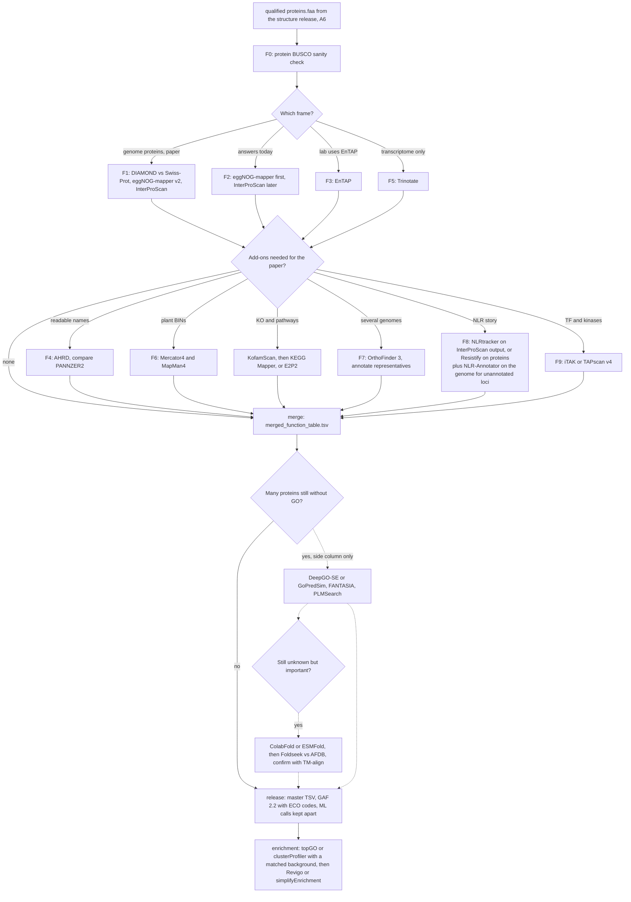

# Branch roadmap — gene function

One page: **mandatory trunk**, **alternate frames**, **optional plant add-ons**.  
Process map: [`steps/FUNCTIONAL_MAIN.md`](steps/FUNCTIONAL_MAIN.md) · recipes: [`SCENARIOS_FUNCTIONAL.md`](SCENARIOS_FUNCTIONAL.md).

Upstream structure roadmap: [gene-structure-annotation `ROADMAP`](https://github.com/Xuzhen-Li/gene-structure-annotation/blob/main/docs/ROADMAP.md).

---

## Big picture (second layer only)

```text
qualified proteins.faa  (+ optional curated GFF)
        │
        ▼
┌───────────────────────────────┐
│  gene-function-annotation     │  ← this repo
│  F0 → F1 (default)            │
│  → optional add-ons           │
│  → merged_function_table.tsv      │
│  → release/<TAG>/             │
└───────────────────────────────┘
```

No genome assembly, BRAKER, or EVM here. If you still need gene models, finish [gene-structure-annotation](https://github.com/Xuzhen-Li/gene-structure-annotation) first.

---

## Trunk (default paper path)

```text
PROTEINS_FA
  │
F0    protein BUSCO (sanity; fix structure upstream if catastrophic)
  │
F1    DIAMOND Swiss-Prot  +  eggNOG-mapper  +  InterProScan
  │         (runners: F1_diamond.sh · F2_eggnog.sh · F3_interproscan.sh)
  │
      optional add-ons (F4 / F6 / F7 / F8 / F9) — see below
  │
merge F_merge_tables.py  →  function/merge/merged_function_table.tsv
  │
pack  F_release.sh       →  function/release/<TAG>/
```

**Always:** F0 → F1 → merge → release.  
**Default if unsure:** F1 only (skip plant add-ons).

---

## A. Alternate frames — pick **instead of** full F1 (or as a slim path)

These change *how* the main homology/domain tables are produced. Still rejoin at merge/release.

| ID | When | Core | Notes |
|----|------|------|-------|
| **F1** | Default / paper | DIAMOND + eggNOG + InterProScan | Preferred METHODS spine |
| **F2** | Fast / lightweight | eggNOG (± optional Kofam **F1+**) | Skip or defer InterProScan |
| **F3** | EnTAP-centric lab | EnTAP → copy TSVs into merge | Docs-driven; not a full runner rewrite |
| **F5** | Transcriptome CDS (no genome GFF) | Trinotate (± still run F1 on peptides) | Not a plant-genome default |

```text
Chooser:
  Normal genome proteins, publication  → F1
  Need answers today, IPS too slow     → F2 now, IPS later into merge
  Lab standardized on EnTAP            → F3
  Trinity/transcriptome only           → F5
```

---

## B. Optional add-ons — **after** F1 (or after an alternate frame)

Never replace F1 as the gene-centric master without a documented reason.

| ID | When | Product | Runner |
|----|------|---------|--------|
| **F4** | Readable gene names | AHRD names joined | `F4_run_ahrd.md` · `F4_join_ahrd.py` (± PANNZER `F4b`) |
| **F6** | Plant MapMan BINs | Mercator4 ingest | `F6_ingest_mercator.py` — when to use the **web**: [`MERCATOR_WHEN.md`](MERCATOR_WHEN.md) |
| **F7** | Multi-genome orthologs first | OrthoFinder reps → then F1 | `F7_orthofinder.sh` |
| **F8** | Plant NLR candidates / screen | IPS filter ± HRP | `F8_run.sh` |
| **F9** | Plant TF / kinase | iTAK | `F9_itak.sh` |

```text
Default (any clade):   F0 → frame F1 → merge → release
Plant paper (pick):    F1 required; then F4 / F6 / F8 / F9 only if that figure or species needs them
  — F8 = NLR candidates/screen, not a curated NLR set; skip if no disease/NLR story
  — F4/F6/F9 likewise optional — not a higher F-L grade by themselves
Multi-genome panel:    F7 → F1 on representatives → merge
```

Do **not** treat AHRD+Mercator+NLR+iTAK as a plant-genome checklist. `cases/` and grape examples are illustrations, not the only L2/F-L1 template.

---

## C. What is **not** an F-branch

| Need | Where |
|------|--------|
| Soft-mask / BRAKER / liftover / GSAman | [gene-structure-annotation](https://github.com/Xuzhen-Li/gene-structure-annotation) |
| TE curatedlib | structure `TE_LIBRARY` · [vitis-te](https://github.com/Xuzhen-Li/vitis-te) |
| Writing GO into GFF column 9 | Not claimed yet — master TSV is source of truth |

---

## ID cheat sheet

| Kind | IDs |
|------|-----|
| Trunk | F0, F1, merge, release |
| Alternate frame | F2, F3, F5 |
| Optional add-on | F4, F6, F7, F8, F9 |

Naming quirk (historical): script `F2_eggnog.sh` is the **eggNOG step inside F1**, and also the core of the **F2** fast frame. Same binary, two roles — see [`FUNCTIONAL_GUIDE.md`](FUNCTIONAL_GUIDE.md).

---

## Quick links

| Doc | Use |
|-----|-----|
| [`QUICKSTART.md`](QUICKSTART.md) | Run F1 once |
| [`STAGE_IO.md`](STAGE_IO.md) | Inputs → products |
| [`EVALUATION.md`](EVALUATION.md) | **Final** F-L0/F-L1 criteria |
| [`PLAYBOOK.md`](PLAYBOOK.md) | Short FA checklist |
| [`SCENARIOS_FUNCTIONAL.md`](SCENARIOS_FUNCTIONAL.md) | Situation recipes |
| [`INSTALL_FUNCTIONAL.md`](INSTALL_FUNCTIONAL.md) | DBs / tools |
| [`DB_INSTALL_CHECKLIST.md`](DB_INSTALL_CHECKLIST.md) | F1 DB tick list + disk / METHODS fields |
| [`POST_STRUCTURE.md`](POST_STRUCTURE.md) | One-page proteins → DB → F1 → release |
| [`SELF_AUDIT.md`](SELF_AUDIT.md) | 2026-09-14 lit/peer gap table |
| [`RECENT_HIGH_QUALITY.md`](RECENT_HIGH_QUALITY.md) | Allowlisted FA standards |
| [`MERCATOR_WHEN.md`](MERCATOR_WHEN.md) | When to use Mercator4 web (F6) |
| [`CATALOG_BY_TYPE_2026-11.md`](CATALOG_BY_TYPE_2026-11.md) | 2026-11 type catalog (combined inventory 129) |
| [`CATALOG_NEW_TOOLS_2026-11.md`](CATALOG_NEW_TOOLS_2026-11.md) | 2026-11 first-pass list (68 cards in `catalog/`) |
| [`../catalog/README.md`](../catalog/README.md) | Stage-folder cards, in framework / step order |
| [`../README.md`](../README.md) | Homepage catalog by type, Needs lines, data-needs summary |
| [`SCENARIOS_FUNCTIONAL.md#data-needs-details`](SCENARIOS_FUNCTIONAL.md#data-needs-details) | Data needed alongside the proteins (appended 2026-11-13) |

## Status 2026-11-13 / 已完成 · 仍待做

Documentation status as of 2026-11-13 (Asia/Shanghai). The trunk (F0 → F1 → merge → `merged_function_table.tsv` → release), the meaning of frames F2/F3/F5, and the script-versus-frame warning for `F2_eggnog.sh` are unchanged.

### 已完成 / Done (in open PR #9, not merged yet)

- A 2026-11 methods catalog, in two passes: 68 entries filed by framework / step in `catalog/` and `docs/CATALOG_NEW_TOOLS_2026-11.md`, then 61 further entries in `docs/CATALOG_BY_TYPE_2026-11.md`. Combined inventory: 129. Reading list only; default frame F1 in `docs/TOOLS.md` is unchanged.
- The repository homepage (`README.md` / `README.zh.md`) is now the catalog by type (15 sections, jump links, counts, a **Needs:** line, a data-needs summary, and credited figures). Long data-needs text is appended to the existing `SCENARIOS_FUNCTIONAL.md`.
- Two errata files travelled with that PR. The GSAman DOI erratum concerns the structure repo's boundary; it is kept here but does not add GSAman to this pipeline.
- The GSAman tool paper is Chen, Wu et al. 2026 (doi:10.1016/j.xinn.2026.101471); the last-mile opinion article is Chen, Chen and Xia 2026 (doi:10.1016/j.xinn.2026.101537).

### 仍待做 / Still to do

- Review the homepage and data-needs text; merge PR #9 only when the owner asks.
- Some first-pass folders are still thin or empty (`catalog/F0_protein_qc`, `frame_F2`, `frame_F3`, `Fmerge_aggregate`). The type catalog already lists related tools. Fill those existing cards rather than adding new markdown files.
- Re-check catalog rows still marked `[待确认]` (HMMER 3, eggNOG 6, PANNZER2, MetaCyc, PRGdb 4.0, psRobot, DALI, ShinyGO) by opening the sites, not by guessing.
- Optional add-ons (F4 / F6 / F8 / F9) remain optional. New ML-GO or protein-3D tools stay off the default F1 path until tested.
- Figure licence rule is the same as the structure repo (CC BY or OSI; no NC/ND).

<a id="workflow-2026-11-14"></a>
## Workflow chart (2026-11-14) / 流程图

The same trunk, frames and add-ons as above, drawn as a single chart showing the choice at each decision point. Solid arrows mark the default path; dotted arrows mark optional side steps whose outputs stay in separate columns. Every tool named in the chart appears in the homepage catalog ([`../README.md`](../README.md)); the chart introduces no new defaults.

将上文的主干、框架与附加项绘成一张流程图，并标出各判断节点的选择。实线表示默认路径；虚线表示可选的旁支步骤，其输出结果单独成列。图中列出的工具均已收录于主页目录（[`../README.md`](../README.md)），本图不新增默认工具。



**Decision notes / 判断说明**

- Frame: Use F1 for genome proteins and publications; F2 when results are needed today (merge InterProScan later); F3 if the lab already standardises on EnTAP; F5 for transcriptome peptides only. / 框架：基因组蛋白注释与发表论文用 F1；当天急需结果用 F2（后续再将 InterProScan 结果并入合并表）；实验室已统一使用 EnTAP 时选 F3；仅有转录组肽段时用 F5。
- Run add-ons only when required for a specific figure or species; do not treat them as a checklist. / 附加项仅在特定图表或所研究物种确有需求时运行，并非必做清单。
- NLR (F8): protein-side calls (NLRtracker on InterProScan output, or Resistify on proteins) miss NLRs that were never annotated as genes, so add NLR-Annotator on the genome. / NLR（F8）：蛋白侧的识别（NLRtracker 基于 InterProScan 输出，或 Resistify 直接读蛋白）会漏掉没被注释成基因的 NLR，所以要在基因组上补跑 NLR-Annotator。
- Machine-learning GO and structure search fill gaps for proteins still lacking GO after F1. Keep their predictions in a separate column with their own evidence codes; do not merge them into the F1 GO set. / 机器学习 GO 预测与结构检索仅用于补齐 F1 之后仍无 GO 注释的蛋白。结果须单独成列并标注各自的证据代码，切勿混入 F1 的 GO 集合。
- Enrichment needs a background matched to the annotated gene set (the same F1 run), then Revigo or simplifyEnrichment to reduce redundant terms. / 富集分析的背景基因集要与注释基因集匹配（同一次 F1 结果），之后再用 Revigo 或 simplifyEnrichment 去掉冗余条目。

## Status 2026-11-14 / 已完成 · 仍待做

Documentation status as of 2026-11-14 (Asia/Shanghai). The trunk (F0 → F1 → merge → release), frames F2/F3/F5 and optional add-ons remain unchanged.

### 已完成 / Done (prepared 2026-11-14, not committed yet)

- Homepage catalog: 41 new entries, each with a checked DOI or project link and a one-line English and Chinese intro. Total entries 129 → 167.
- Version merges and renames (one entry per program, named for the latest version; older versions only in the entry note): InterProScan 5 → InterProScan 6, MMseqs2-GPU → MMseqs2, Pfam (2021) → Pfam (2025), metagenomic-DeepFRI → DeepFRI, Grape Gene Reference Catalogue (paper) → Grapedia Grapevine Reference Gene Catalogue.
- Moved entries to better-fitting sections: Merizo (section 3 → 13), DPFunc (section 3 → 5), dbCAN3 (section 6 → 9), ProtNLM (UniProt names) (section 15 → 12). Section anchors are unchanged.
- Added a **Clusters:** list (alternatives / complementary / in order) at the start of each of the 15 sections, with notes on when to use each tool.
- Added the workflow chart above.

### 仍待做 / Still to do

- Verify that the mermaid chart renders properly on GitHub (only a static syntax check has been run).
- The homepage entry now points to InterProScan 6, whereas the F1 runner was written for InterProScan 5; test the v6 output columns before updating the runner.
- New entries still marked [待确认]:
- PhylomeDB V5
