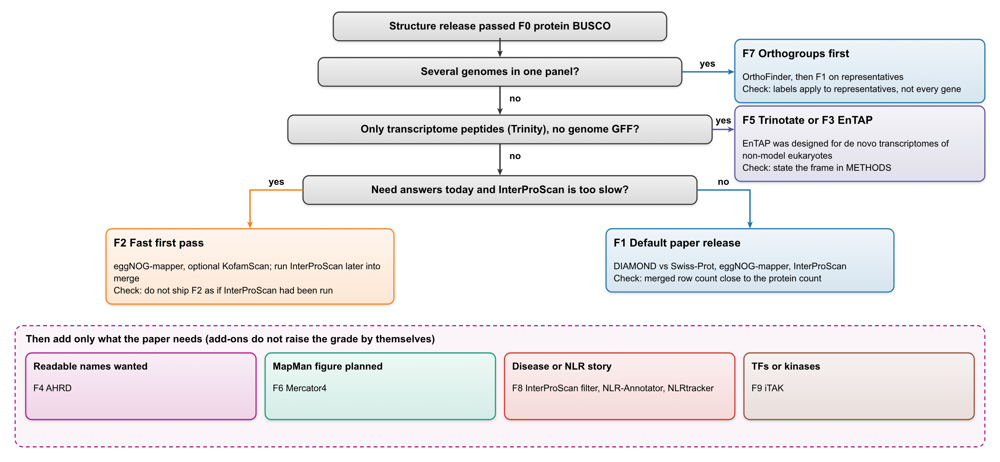
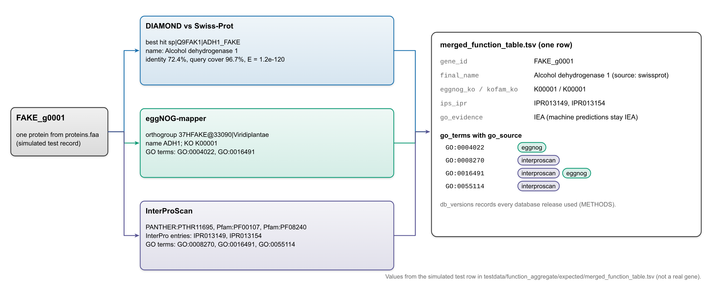
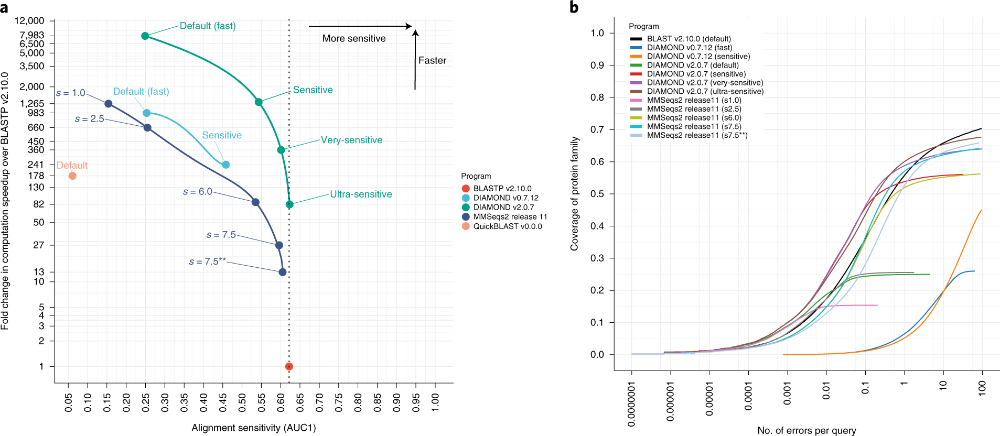
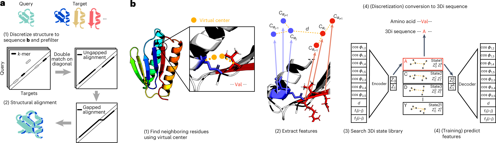
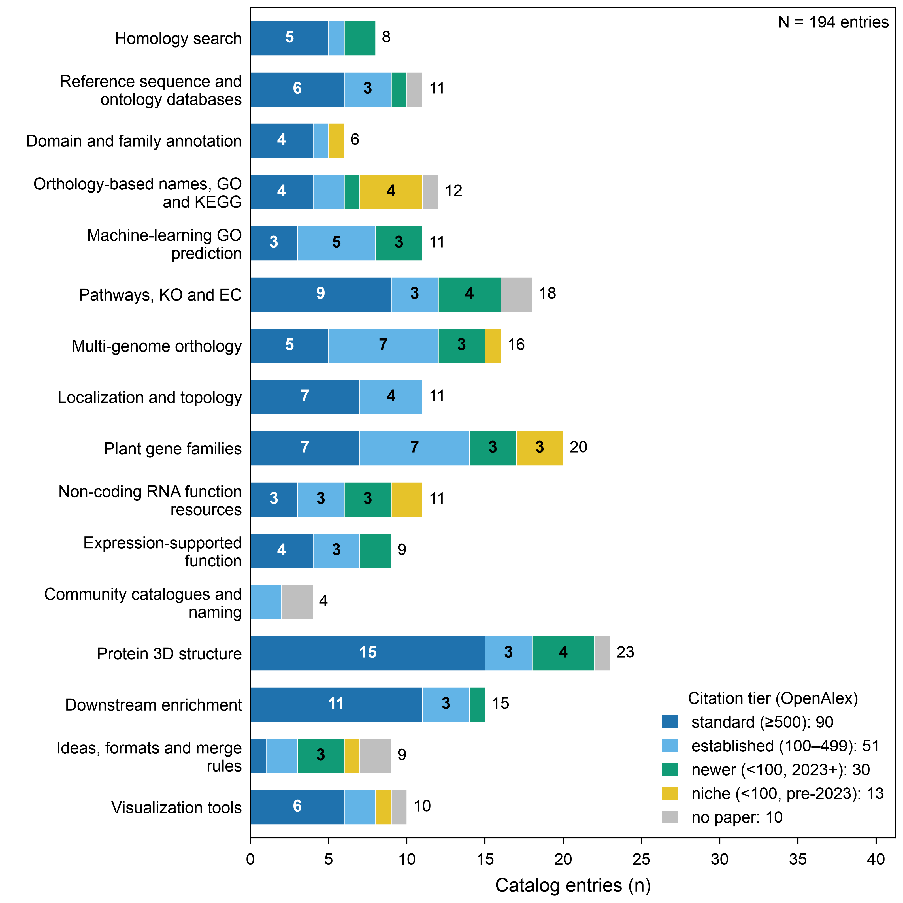
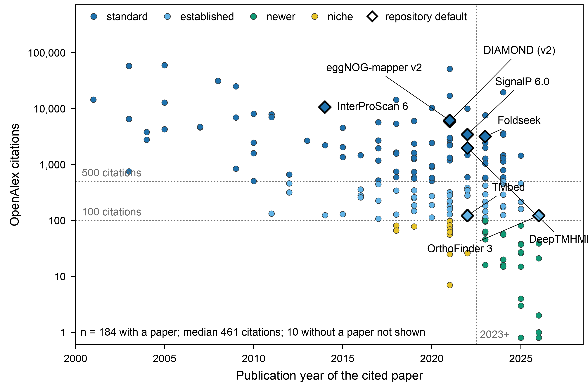

# Figures for the guide

Figures linked from the README files and the book chapters. Three kinds:

1. Published figures under CC BY 4.0, reproduced without changes, with full credit (folder `published/`, or files already in `book/illustrated_v3_p2d/figures/`). Figures from papers that are not openly licensed are not copied.
2. Schematics drawn for this repository (editable SVG with live text, plus a PNG at 2x).
3. Charts computed from `catalog/SOFTWARE_AUTHORITY.tsv` (SVG with live text, plus a PNG at 600 dpi).

## Regenerate

From the repository root (Python 3 with matplotlib; Google Chrome or Chromium for the PNG of each schematic). Existing outputs are never overwritten, so write into an empty folder:

```bash
mkdir new_figs
python3 docs/figures/guide/src/make_function_schematics.py new_figs .
python3 docs/figures/guide/src/make_catalog_charts.py function catalog/SOFTWARE_AUTHORITY.tsv new_figs function
bash docs/figures/guide/src/render_svg.sh new_figs/NAME.svg new_figs/NAME.png WIDTH HEIGHT
```

## Figures and credits

### Functional annotation route


File: `function_route_map_v2.png`

Figure. The functional annotation route of this repository: F0 protein QC, frame F1 (DIAMOND against Swiss-Prot, eggNOG-mapper, InterProScan), merge into `merged_function_table.tsv`, function QC and release. Optional add-ons (F4, F6, F8, F9) join at merge; the other frames (F2, F3, F5) and the F7 panel entry also rejoin at merge. Schematic drawn for this repository from `docs/ROADMAP.md` and README; editable SVG: `function_route_map_v2.svg`.

### Which frame to use



File: `function_frame_decision_v2.png`

Figure. Choosing a frame from the data and the deadline, then adding only the add-ons the paper needs (the same choice as the table in book chapter 18 and `docs/ROADMAP.md`). Schematic drawn for this repository; editable SVG: `function_frame_decision_v2.svg`.

### Three F1 evidence lines merged into one row



File: `function_evidence_merge_v2.png`

Figure. How the three F1 evidence lines for one protein become one row of `merged_function_table.tsv`: each GO term keeps the source that gave it, and machine predictions stay IEA. Values are the simulated test row FAKE_g0001 in `testdata/function_aggregate/expected/merged_function_table.tsv`, not a real gene; schematic drawn for this repository.

### DIAMOND speed and sensitivity



File: `published/diamond_2021_fig1.png`

Figure. Speed-up over BLASTP against alignment sensitivity for DIAMOND, MMseqs2 and other search modes (a), and coverage of protein families against errors per query (b). Reproduced without changes from Buchfink B, Reuter K and Drost H-G (2021), Sensitive protein alignments at tree-of-life scale using DIAMOND, Nature Methods 18:366-368, Fig. 1, doi:10.1038/s41592-021-01101-x, PMC8026399, licensed CC BY 4.0 (https://creativecommons.org/licenses/by/4.0/).

### Foldseek workflow



File: `published/foldseek_2024_fig1.png`

Figure. Foldseek: query and target structures are turned into 3Di sequences, prefiltered by double k-mer matches on a diagonal, then aligned without and with gaps (a); the 3Di state of each residue is learned from features of that residue and its nearest neighbour in space (b). Reproduced without changes from van Kempen M, Kim SS, Tumescheit C, Mirdita M, Lee J, Gilchrist CLM, Söding J and Steinegger M (2024), Fast and accurate protein structure search with Foldseek, Nature Biotechnology 42:243-246, Fig. 1, doi:10.1038/s41587-023-01773-0, PMC10869269, licensed CC BY 4.0 (https://creativecommons.org/licenses/by/4.0/).

### Catalog entries per section by tier



File: `function_catalog_by_step_v2.png`

Figure. Catalog entries per type section, coloured by citation tier (tier rule above). Counts computed from `catalog/SOFTWARE_AUTHORITY.tsv` (194 entries; OpenAlex counts retrieved 2026-11-25) by `docs/figures/guide/src/make_catalog_charts.py`.

### Publication year against citations



File: `function_catalog_year_citations_v2.png`

Figure. Publication year against OpenAlex citations for the 184 catalog entries with a paper; diamonds mark repository defaults. Databases and general tools collect citations from every field; a count is not a measure of accuracy on your proteome. Source: `catalog/SOFTWARE_AUTHORITY.tsv`; script `docs/figures/guide/src/make_catalog_charts.py`.
